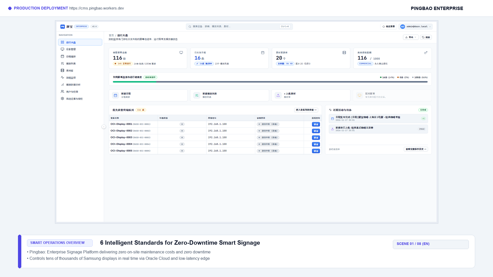
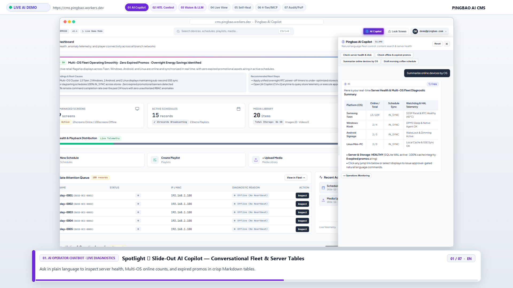

<div align="center">

# 📺 Pingbao (屏宝 / 핑바오)
### Enterprise Smart Management Platform for Samsung Smart Signage (Samsung CMS)

**Pingbao (屏宝 / 핑바오)** is an enterprise-grade cloud digital signage management platform exclusively tailored for the **Samsung Smart Signage** ecosystem.  
With native deep optimization for Samsung Tizen 6.5+ SSSP (Samsung Smart Signage Platform), Pingbao enables centralized IoT remote control for tens of thousands of Samsung commercial screens, 24-hour visual timeline dayparting, fully automated multi-screen synchronization (SyncPlay), and 100% autonomous offline playback. Furthermore, it provides comprehensive enterprise REST API and AI Agent MCP (Model Context Protocol) support.

[](#)
[](https://cms.pingbao.workers.dev)
[](https://github.com/pingbaosignage/pingbao-community/releases)
[](https://github.com/pingbaosignage/pingbao-community/issues)
[](#)

<br/>

**[ English (EN) ]** | **[ 简体中文 (ZH) ](README.md)** | **[ 한국어 (KO) ](README.ko.md)**

<br/>

<!-- ============================================================================== -->
<!-- 🚀 HIGH-VISIBILITY LIVE DEMO BANNER -->
<!-- ============================================================================== -->
<table width="100%" style="margin: 20px 0;">
  <tr>
    <td align="center" style="background: linear-gradient(135deg, #0f172a 0%, #1e293b 100%); padding: 28px 20px; border-radius: 14px; border: 2px solid #3b82f6; box-shadow: 0 10px 25px rgba(59, 130, 246, 0.2);">
      <h2 style="margin: 0 0 12px 0; color: #60a5fa; font-size: 24px; letter-spacing: -0.5px;">
        🚀 Pingbao Enterprise Cloud Interactive Live Demo
      </h2>
      <p style="font-size: 16px; margin: 0 0 20px 0; color: #f1f5f9; line-height: 1.6;">
        <b>No installation, no login required.</b> Experience all enterprise workspaces directly in your web browser.<br/>
        <span style="color: #94a3b8; font-size: 14px;">(Pre-seeded with 116 Samsung Signage displays, 24-hr schedule matrix, PoP analytics, and hardware IoT remote control)</span>
      </p>
      <a href="https://cms.pingbao.workers.dev" target="_blank" rel="noopener noreferrer">
        
      </a>
      <div style="margin-top: 14px;">
        <span style="color: #38bdf8; font-size: 14px; font-weight: 600;">🔗 Official Demo Endpoint: </span>
        <a href="https://cms.pingbao.workers.dev" target="_blank" style="color: #ffffff; text-decoration: underline; font-weight: bold; font-size: 14px;">https://cms.pingbao.workers.dev</a>
      </div>
    </td>
  </tr>
</table>

<br/>

<!-- ============================================================================== -->
<!-- 🎬 OFFICIAL 2-MIN PRODUCT VIDEO & 6 SMART HIGHLIGHTS -->
<!-- ============================================================================== -->
<div align="center">

### 🎬 Pingbao 2-Minute Product Demo Video & 6 Smart Operational Highlights

> 📺 **Watch Online in Browser**: [▶ Watch 2-Minute Demo Video (GitHub Video Player)](https://github.com/pingbaosignage/pingbao-community/blob/main/docs/assets/videos/pingbao_smart_operations_demo_en.mp4)  
> 🌐 **Switch Voiceover Language**: [한국어 음성 영상 (KO)](https://github.com/pingbaosignage/pingbao-community/blob/main/docs/assets/videos/pingbao_smart_operations_demo_ko.mp4) | [中文解说视频 (ZH)](https://github.com/pingbaosignage/pingbao-community/blob/main/docs/assets/videos/pingbao_smart_operations_demo_zh.mp4)

<a href="https://github.com/pingbaosignage/pingbao-community/blob/main/docs/assets/videos/pingbao_smart_operations_demo_en.mp4" target="_blank">
  
</a>
<br/>
<sub><b>▲ Click to stream the video instantly in your browser without downloading. (1080P Full HD with English voiceover and integrated subtitle cards)</b></sub>

<br/><br/>

#### ⚡ 6 Killer Operational Breakthroughs (Why Pingbao?)

| 01. Auto Error Detection & Self-Healing | 02. Precision Uptime & Store Analytics | 03. Zero-Visit 1080P/4K Live Screen Capture |
| :---: | :---: | :---: |
|  |  |  |
| **One-Click Batch Self-Healing**<br/>Detects network latency & desired-state gaps instantly | **Uptime-Driven Executive Decision Making**<br/>Monitors display operating hours & anomaly leaks | **Direct Framebuffer Capture**<br/>Inspects true rendered screens without site visits |
| **04. Comprehensive User Audit Trails** | **05. Conversational AI Native (MCP)** | **06. Sub-Second Proof-of-Play (PoP)** |
|  |  |  |
| **Complete Audit Trails**<br/>Tracks who, when, and what schedule was modified | **Built-in Model Context Protocol (MCP)**<br/>Natural language health queries & auto scheduling | **Indisputable Billing Audit Reports**<br/>Logs true rendered frames, computes completion % |

</div>

<br/>


<sub><b>▲ Pingbao Operations Dashboard: Samsung Signage Fleet Availability, Schedule Deployment Progress, Storage Consumption, and Fleet Health (Live Oracle Cloud Cluster Metrics)</b></sub>

</div>

---

## 🌟 Core Value Propositions

1. **Dedicated to Samsung Smart Signage & Deep IoT Control**
   * Exclusively engineered for **Samsung Smart Signage (Tizen 6.5+ / SSSP 10+)** standalone displays.
   * Remote LCD backlight panel On/Off, volume control, scheduled reboot, operating temperature tracking, and 1-second live screen capture retrieval.
2. **Autonomous Offline Playback (No Duration Limits)**
   * Powered by local edge pre-caching and an embedded SQLite state engine on Samsung displays, screens seamlessly continue scheduled 24/7/365 broadcasting even during prolonged network outages without black screens or crashes.
3. **4-Tier Priority Timeline Scheduling Engine**
   * Hierarchical preemption architecture: `EMERGENCY` (instant disaster/VIP takeover) > `EVENT` (dayparted peak promotions) > `REGULAR` (daily schedule) > `DEFAULT` (24/7 fallback base playlist).
   * Dayparting (Breakfast / Lunch / Tea / Dinner / Night) auto-transitions smoothly without screen blinks or glitches.
4. **Fully Automated Multi-Screen Synchronization (SyncPlay)**
   * **100% Automatic**: When multiple Samsung signage displays share the **same device group, same assigned schedule, and same local network (LAN)**, SyncPlay automatically activates millisecond-accurate frame synchronization and simultaneous transitions without specialized hardware matrix switchers or manual pairing.
5. **Standard REST API & AI Agent MCP (Model Context Protocol) Support**
   * 60+ OpenAPI 3.0 RESTful endpoints with API Key scoped permissions and usage telemetry.
   * Built-in standardized **MCP server (`pingbao`)** empowering modern AI agents (Claude, Cursor, Antigravity, LLM-based autonomous operations) to manage devices, distribute schedules, and diagnose fleet health via natural language.
6. **Auditable Proof-of-Play (PoP) & Business Settlement Reports**
   * Exact second-level playback audit logs, Completion Rate (%) computation, tamper-evident signatures, and one-click Excel/CSV export.
7. **Self-Healing Operations & Automated Community Error Telemetry**
   * Automatically captures backend exceptions, sanitizes sensitive data (PII/secrets), deduplicates by SHA-256 fingerprint, and dispatches error reports directly to GitHub Community Issues.

---

## 📸 Comprehensive Workspace Overview & Live Screens (All 9 Workspaces)

### 1. Operations Dashboard (Dashboard)

Consolidated fleet metrics: Samsung display online/offline percentages, schedule synchronization rate, object storage usage, and active alert ribbons.

---

### 2. Samsung Signage Fleet Management (Device Management)

Control thousands of Samsung screens across hierarchical organizations (HQ, Retail Center, Flagship Stores) with backlight control, volume adjustment, remote reboot, and live screenshot feedback.

---

### 3. Timeline Scheduling Engine (Schedules) —— [Core Specialization]

Master-detail view combining organization schedule plans with an interactive 24-hour multi-track timeline, visual priority indicators, and one-click atomic publishing.

#### Detailed Slot Orchestration & Priority Matrix (Schedule Detail & Slots)

Drag-and-drop priority slot ordering (Priority 10 to 100), visual Effective Broadcast Windows calculation, and automatic preemption overlay.

---

### 4. Playlist Authoring (Playlists)

Combine video (MP4/WebM) and images (PNG/JPG), configure individual image exposure duration (e.g. 8s, 15s), apply GPU-accelerated crossfades, and calculate full loop cycle durations.

---

### 5. Media Asset Management (Media Assets)

Chunked streaming uploads for 4K 60fps video, binary magic bytes validation, automatic metadata extraction, and delete-protection locks for in-use assets.

---

### 6. Operations Monitoring & Diagnostics (Operations Monitoring)

Real-time long-polling latency (Ping RTT), command queue inspection, 1-Click Batch Retry for network timeouts, and exportable Markdown technical diagnostic reports.

---

### 7. Proof-of-Play & Settlement Reports (Proof-of-Play & Analytics)

1-second precision device playback audit logs, Completion Rate (%) metrics distinguishing Full vs. Partial plays, and multi-tenant Excel/CSV export.

---

### 8. Multi-Tenant Organizations & RBAC (Users & RBAC)

Hierarchical multi-tenant organization trees, granular CRUDX permission matrix, and RFC 6238 TOTP two-factor authentication with backup codes.

---

### 9. Commercial License & Error Telemetry (License & Telemetry)

| Commercial License (Ed25519) | Error Telemetry & Community Portal |
| :---: | :---: |
|  |  |

* **Ed25519 Asymmetric Digital Signature**: Secure license activation verifying fleet quotas in air-gapped enterprise environments.
* **Automated Error Telemetry & Community Issue Reporting**:
  * Strict Opt-in consent required from SuperAdmin before telemetry activation.
  * Deep sanitization of passwords, API tokens, Authorization headers, internal IPs, and phone numbers.
  * SHA-256 fingerprint deduplication with automatic dispatch to [pingbaosignage/pingbao-community](https://github.com/pingbaosignage/pingbao-community/issues).
  * In-console manual feedback form for submitting bug reports and feature requests directly to GitHub.

---

## 🎯 Deep Dive: Scheduling Engine Architecture

### 1. 4-Tier Hierarchical Preemption
```
┌─────────────────────────────────────────────────────────────┐
│  Tier 1: EMERGENCY (P: 100 ~ 200)                           │
│  Disaster alarms / Fire evacuation / VIP instant takeover   │
├─────────────────────────────────────────────────────────────┤
│  Tier 2: EVENT (P: 50 ~ 99)                                 │
│  Lunch rush flash deals / Evening cocktail promotions       │
├─────────────────────────────────────────────────────────────┤
│  Tier 3: REGULAR (P: 10 ~ 49)                               │
│  Standard dayparted loops (Breakfast / Afternoon Tea)       │
├─────────────────────────────────────────────────────────────┤
│  Tier 4: DEFAULT (P: 0)                                     │
│  24/7 background fallback playlist (Zero blackout guarantee)│
└─────────────────────────────────────────────────────────────┘
```

### 2. Standard Dayparting Matrix
* **Breakfast Window (07:30 ~ 10:30)**: Morning combos & fresh coffee (`EVENT`, P:60)
* **Mid-Morning (10:30 ~ 11:30)**: Brand image & member rewards (`REGULAR`, P:20)
* **Lunch Rush (11:30 ~ 14:00)**: Best-sellers & queuing guides (`EVENT`, P:80)
* **Afternoon Tea (14:00 ~ 17:30)**: Bakery treats & drink promos (`REGULAR`, P:30)
* **Dinner & Party (17:30 ~ 21:30)**: Family dining sets & craft beer specials (`EVENT`, P:85)
* **Night / Closing (21:30 ~ 24:00)**: Closing notice & low-power posters (`DEFAULT`, P:0)

### 3. SyncPlay: Automatic Multi-Screen Synchronization
* **Automatic Activation**: Whenever multiple Samsung smart signage displays share the **same device group, the same assigned schedule, and the same local network (LAN)**, SyncPlay automatically activates without manual pairing or hardware switchers.
* **Frame-Accurate Simultaneous Transitions**: Displays transition at the exact same millisecond, and ultra-wide (5760x1080) video is rendered seamlessly across concatenated screens.

### 4. Autonomous Offline Loop
* All media assets are pre-cached locally on Samsung display storage prior to broadcast. An embedded SQLite dispatcher executes schedules based on local hardware RTC clocks, ensuring continuous playback even during prolonged network isolation.

---

## 🤖 REST API & AI Agent MCP Support

Pingbao natively integrates a standardized **Model Context Protocol (MCP)** server (`pingbao` toolset), empowering modern AI agents such as Claude Desktop, Cursor, Antigravity, and autonomous LLM workflows to interact directly with digital signage infrastructure.

### 🌟 Key Capability: LLM-Generated Content Direct Upload & Scheduling
> **💡 Can an AI agent upload newly generated visuals and schedule them directly?**  
> **Yes, 100% supported!** Through the `pingbao_upload_media` tool, an AI agent can upload LLM-generated SVG banners, HTML dynamic widgets, Base64-encoded images, or remote asset URLs straight into Pingbao's media repository. The agent can then call `pingbao_create_playlist`, `pingbao_create_schedule`, and `pingbao_assign_schedule` to execute an autonomous loop from creative generation to on-screen playback without manual steps.

### 💬 5 Real-World Autonomous Scenarios & AI Prompts

| # | Operational Scenario | MCP Tools Used | Example AI Agent Prompt |
| :---: | :--- | :--- | :--- |
| **01** | **Natural Language Device Diagnostics**<br/>(Device Status & Health) | `pingbao_list_devices`<br/>`pingbao_get_device_detail` | *"Check the operational status of all Samsung signage displays in the Shanghai Flagship and Gangnam branches. Report any screens that have been offline for over 10 minutes or experiencing playback errors."* |
| **02** | **LLM Content Generation & Scheduling**<br/>(Content Upload & Scheduling) | `pingbao_upload_media`<br/>`pingbao_create_playlist`<br/>`pingbao_create_schedule`<br/>`pingbao_assign_schedule` | *"I just generated a vertical 1080x1920 promotional SVG banner for a weekend rainy-day special. Upload this asset to the media library as 'Rainy Day Special', create a playlist, and schedule it on the Gangnam Kiosk group for Fri-Sun lunch hours (11:30~14:00) with EVENT priority (50)."* |
| **03** | **Emergency Screen Takeover & Alert**<br/>(Emergency Broadcast Takeover) | `pingbao_upload_media`<br/>`pingbao_create_schedule`<br/>`pingbao_control_device` | *"A severe typhoon warning has been issued. Immediately broadcast an urgent notification banner 'Early Store Closure at 20:00 Due to Severe Weather' across all counter displays with EMERGENCY (Priority 100) priority, overriding regular programming right now."* |
| **04** | **Eco-Mode & Remote Hardware Timers**<br/>(Eco-Mode & Power Timers) | `pingbao_control_device`<br/>`pingbao_configure_power_timers` | *"Store closing time (22:00) has passed. Set volume to 0 (mute) on all active displays, and configure weekday hardware power timers (Panel On at 08:30, Panel Off at 22:30 Monday-Friday) across all headquarters screens starting tomorrow."* |
| **05** | **Proof-of-Play (PoP) & Anomaly Triage**<br/>(Proof-of-Play Audit) | `pingbao_verify_playback`<br/>`pingbao_get_device_detail` | *"Audit playback logs for the 'New Burger Launch Campaign' video over the last 24 hours. Summarize completion rate (%) by store, and highlight any screens below 95% completion or reporting network latency frame drops."* |

---

## 📋 Full Feature Matrix

| Functional Module | Key Capabilities & Descriptions | Architecture & Standards |
| :--- | :--- | :--- |
| **1. Dashboard** | Fleet overview, schedule sync rate, anomaly ribbons, storage telemetry | Multi-tenant scope isolation, MinIO/S3 metrics |
| **2. Samsung Signage Control** | Exclusively Samsung SSSP (Tizen 6.5+), remote panel On/Off, volume, reboot | Samsung Tizen b2bapis drivers, Redis command queue |
| **3. Scheduling Engine** | 4-tier preemption, Dayparting timeline tracks, Effective Windows analysis | SQLite local autonomous engine, atomic rollback |
| **4. Automatic SyncPlay** | Same group, same schedule, same network -> 100% automatic frame sync | Lightweight LAN broadcast, zero external hardware |
| **5. REST API & MCP** | 60+ API endpoints & native MCP server for AI agent autonomous operations | OpenAPI 3.0, deep Claude/Cursor/Antigravity integration |
| **6. Playlist Authoring** | Video/image mixing, per-item duration, GPU crossfade transitions, loop timing | WebGL/CSS GPU acceleration, playlist schema integrity |
| **7. Media Assets** | 4K streaming upload, binary magic bytes validation, auto metadata, delete locks | MinIO/S3 object storage, SHA-256 checksums |
| **8. Monitoring & Operations** | Long-polling latency, command queue tracking, 1-Click Batch Retry, Markdown reports | Single-device fault tracing, automated self-healing |
| **9. Proof-of-Play (PoP)** | 1-second precision play audit logs, Completion Rate (%) metrics, Excel/CSV export | Edge transaction logging, audit compliance |
| **10. Security & RBAC** | Organization hierarchy, CRUDX role matrix, RFC 6238 TOTP two-factor authentication | Argon2id password hashing, enterprise security baseline |
| **11. License & Telemetry** | Ed25519 digital signature licensing, PII-sanitized error telemetry, GitHub sync | Opt-in consent required, SHA-256 error deduplication |

---

## 🚀 Multi-Cloud & AI Agent Automated Deployment Guide

Pingbao provides turnkey deployment across on-premises environments, enterprise data centers, and major cloud providers (Oracle Cloud, AWS, GCP, Azure, Alibaba/Tencent Cloud), featuring **1-Prompt Automated Deployment via AI Coding Agents** such as **Claude Code, Cursor, Antigravity, and Gemini**.

### 1. Supported Server Environments
* **☁️ Oracle Cloud (OCI)**: High-performance Always Free A1.Flex/E2.1 instances + Cloudflare Edge Proxy (free SSL & DDoS mitigation)
* **☁️ AWS (Amazon Web Services)**: EC2 Ubuntu 22.04 LTS + Elastic IP static address binding
* **☁️ GCP (Google Cloud)**: Compute Engine E2 VM + VPC firewall rule automation
* **☁️ Microsoft Azure**: Virtual Machines B2s + NSG inbound ports (80, 443)
* **☁️ Alibaba & Tencent Cloud**: ECS/CVM with mainland China ICP compliance or instant Hong Kong/Singapore regions
* **🏢 On-Premises & Synology NAS**: Air-gapped private network bare-metal Linux servers and Synology DSM 7+ Container Manager

### 2. 🤖 AI Agent 1-Click Installation (Golden Prompt)
Launch your preferred AI CLI (`claude`, `cursor`, `agy`, etc.) in the server terminal and deliver the following prompt. The AI autonomously installs Docker, configures environment keys, boots containers, and verifies server health:

```markdown
You are an expert DevOps engineer for the enterprise digital signage platform "Pingbao".
Please deploy the latest Pingbao operating environment on this Linux host and perform end-to-end health verification:
1. Inspect the host OS and unattended-install Docker Engine & Docker Compose v2 from upstream repos if missing.
2. Verify ports 80 and 443 and allow inbound traffic in host firewalls (ufw, firewalld, iptables).
3. In the pingbaosignage/pingbao-community release directory, copy `.env.example` to `.env` with strong 64-char random keys.
4. Launch the container stack with `docker compose -f docker-compose.onprem.yml up -d`.
5. Query `curl -s http://localhost/api/v1/health` to verify normal operation (`status: ok`) and output the web console URL.
```

👉 **Detailed Platform Configurations & Troubleshooting**: [📖 Full Admin & Multi-Cloud/AI Deployment Guide (docs/en/admin-guide.md)](docs/en/admin-guide.md)

---

## 📖 Documentation

* 📘 [User Guide](docs/en/user-guide.md) - Device pairing, media curation, schedule authoring, and monitoring workflows
* 🛠️ [Admin Guide](docs/en/admin-guide.md) - Docker deployment, environment configuration, and maintenance
* ❓ [FAQ](docs/en/faq.md) - Offline playback mechanisms, firewall requirements, and troubleshooting
* 📜 [Changelog](CHANGELOG.md) - Release history and version updates

---

<div align="center">
<sub>Pingbao (屏宝 / 핑바오) © 2026. All rights reserved.</sub>
</div>
