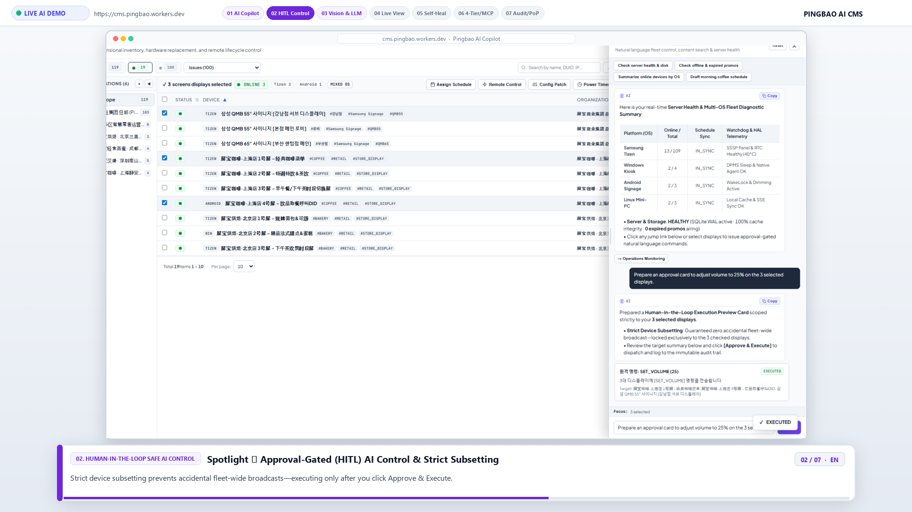
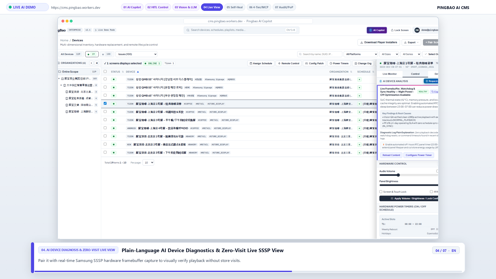
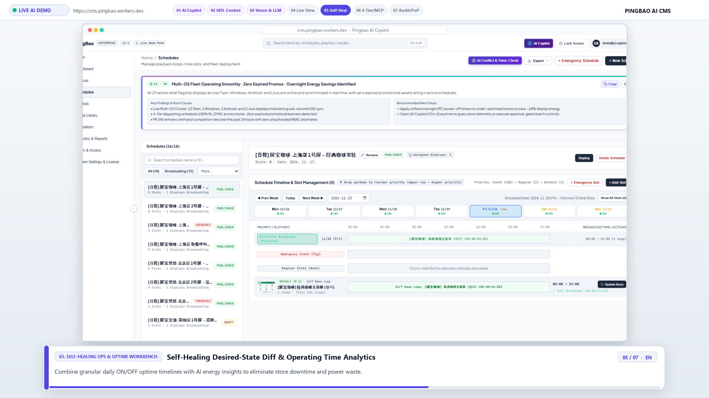
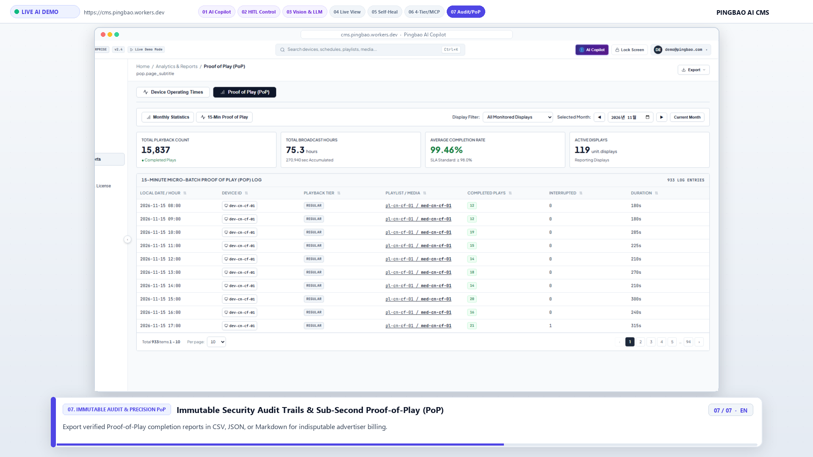
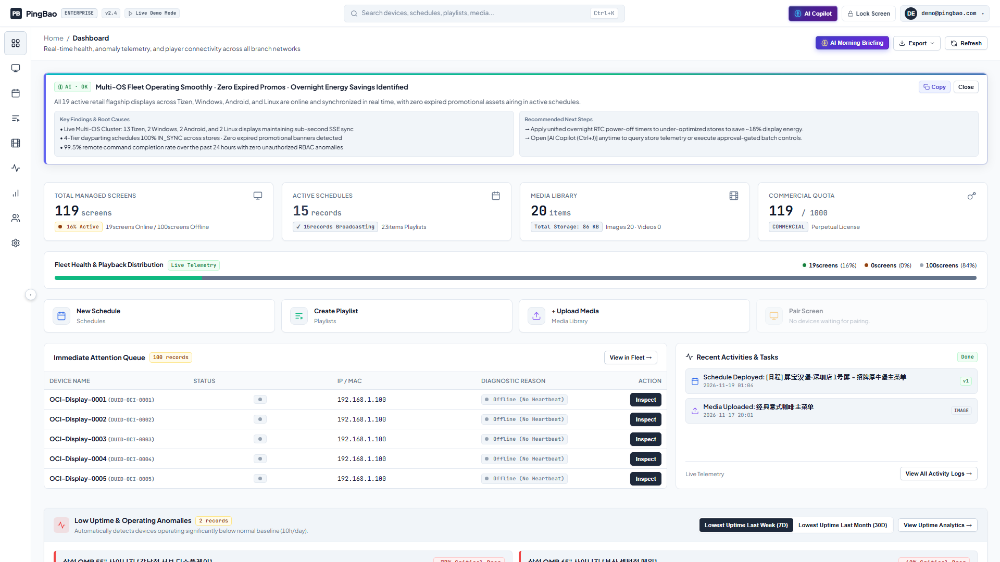
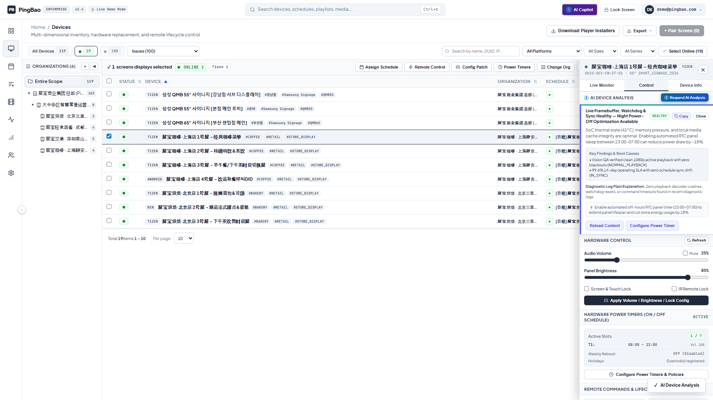
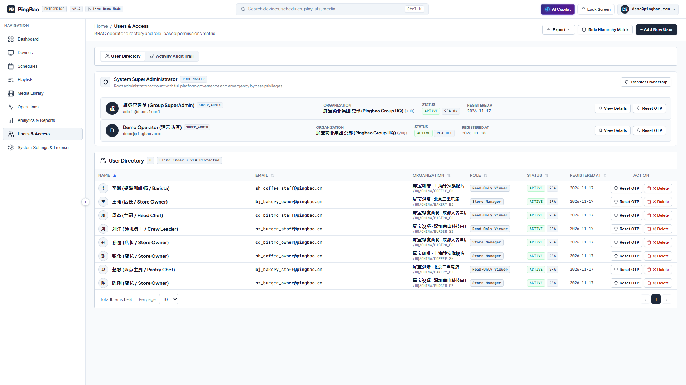

# 📺 Pingbao (屏宝 / 핑바오)
### AI-Native Enterprise Samsung Smart Signage & Multi-OS Fleet Operations Platform

**Pingbao (屏宝 / 핑바오)** is a next-generation Enterprise Digital Signage CMS supercharged with a **Built-In AI Operator Copilot Chatbot (`Ctrl+J`) and 5 Autonomous Intelligences**, purpose-built around deep native hardware control for **Samsung Smart Signage (Tizen 6.5+ / SSSP 6–10+)** while unifying **Windows, Android, Linux, and Web** players in one console.  
Diagnose nationwide fleets in crisp Markdown tables, execute **zero-accident Human-in-the-Loop (HITL) natural language controls**, block expired promotional banners via Multimodal Vision QA, connect 10 cloud or **100% free air-gapped local Ollama/vLLM models**, and automate 4-tier dayparting, SyncPlay, and 1-second Proof-of-Play (PoP) billing.

 

**[ English (EN) ]** | **[ 简体中文 (ZH) ](README.md)** | **[ 한국어 (KO) ](README.ko.md)**

 

<!-- ============================================================================== -->
<!-- 🚀 HIGH-VISIBILITY LIVE DEMO BANNER -->
<!-- ============================================================================== -->
<table width="100%" style="margin: 20px 0;">
  <tr>
    <td align="center" style="background: linear-gradient(135deg, #0f172a 0%, #1e293b 100%); padding: 28px 20px; border-radius: 14px; border: 2px solid #3b82f6; box-shadow: 0 10px 25px rgba(59, 130, 246, 0.2);">
      <h2 style="margin: 0 0 12px 0; color: #60a5fa; font-size: 24px; letter-spacing: -0.5px;">
        🚀 Pingbao Enterprise AI Interactive Live Demo
      </h2>
      

        <b>No installation, no signup required.</b> Experience all enterprise workspaces and the AI Automation Hub live in your browser. 
        (119 Multi-OS displays, Built-In AI Intelligence Hub, 24-hr 4-Tier schedule matrix, PoP billing, and IoT remote control)
      

      
      

        🔗 Official Demo Endpoint: 
        <a href="https://cms.pingbao.workers.dev" target="_blank" style="color: #ffffff; text-decoration: underline; font-weight: bold; font-size: 14px;">https://cms.pingbao.workers.dev</a>
      

    </td>
  </tr>
</table>

 

<!-- ============================================================================== -->
<!-- 🎬 OFFICIAL AI SPOTLIGHT VIDEO & HIGHLIGHTS -->
<!-- ============================================================================== -->

### 🎬 Pingbao Official AI Spotlight Demo Video

* 🇺🇸 **English Voiceover Video**: [▶ Watch Video (pingbao_smart_operations_demo_en.mp4)](docs/assets/videos/pingbao_smart_operations_demo_en.mp4)
* 🇰🇷 **한국어 음성 데모 영상**: [▶ 영상 보기 (pingbao_smart_operations_demo_ko.mp4)](docs/assets/videos/pingbao_smart_operations_demo_ko.mp4)
* 🇨🇳 **中文普通话解说视频**: [▶ 观看视频 (pingbao_smart_operations_demo_zh.mp4)](docs/assets/videos/pingbao_smart_operations_demo_zh.mp4)

 

  

#### ⚡ 6 Game-Changing AI & Enterprise Breakthroughs (Why Pingbao?)

| 01. ★ Slide-Out AI Copilot & Table Reports | 02. ★ Zero-Accident HITL AI Control | 03. ★ Vision AI Promo Guard & Free Local LLMs |
| :---: | :---: | :---: |
|  |  |  |
| **Built-In AI Operator Copilot (`Ctrl+J`)** Live server & Multi-OS Markdown diagnostic tables | **Approval-Gated & Strict Subsetting** Locks strictly to selected screens until approved | **Multimodal Vision & Air-Gapped Ollama** Blocks expired promos · Zero API cost local AI |
| **04. AI Device Diagnosis & Live SSSP View** | **05. Self-Healing Op Diff & Uptime SLA** | **06. Immutable Audit & Sub-Second PoP** |
|  |  |  |
| **Plain-Language Root Cause + Live Capture** Instant log explanation & remote framebuffer proof | **Desired-State Diff & Session Timelines** Auto-retries transient drops & cuts night power waste | **AI Security Summary & Frame-Accurate PoP** Full IP audit ledger & CSV/JSON/MD billing exports |

---

## 🧠 Flagship Spotlight: Built-In ‘Pingbao AI Operator Copilot’ & 5 Autonomous Intelligences

Without installing any external client, click the top-right **`[AI Copilot]` button (`Ctrl+J`)** from any workspace to diagnose, govern, and control hundreds of commercial screens through natural conversation.

<b>▲ Resizable Slide-Out ‘Pingbao AI Copilot’: Drag left border to resize, run 1-click quick prompts, view live Multi-OS Markdown tables, and jump directly to target screens</b>

  

| ① Approval-Gated (HITL) Control & Strict Subsetting | ② 3-Second `[AI Morning Briefing]` Knowledge Box |
| :---: | :---: |
|  |  |
| **100% Protection Against Accidental Fleet Broadcasts** Strictly locks commands to checked displays (`3 selected`) and dispatches only when you click **`[Approve & Execute]`** | **All-Workspace 1-Click AI Insights + Chat Convergence** Morning briefings, device diagnostics, schedule conflict audits, and security summaries automatically converge into chat |
| **③ Multimodal Vision Auto-Tagging & Promo Expiry Guard** | **④ 10 Global/China Cloud & 100% Free On-Prem Ollama** |
|  |  |
| **Stop Expired Promotional Banners Before They Air** Automatically extracts menu items, OCR prices, dayparting windows, and **campaign end dates (`2026-12-31`)** | **Zero API Cost · Zero Data Egress Air-Gapped AI** Supports OpenAI, Gemini, Claude, Qwen, DeepSeek, GLM, Doubao, Kimi, and **free self-hosted Ollama/vLLM** |

---

## 🌟 Core Value Propositions

1. **Built-In AI Operator Copilot (`Ctrl+J`) & Multimodal Vision Automation**
   * Active UI Focus awareness, Rolling Memory compaction, HITL approval cards with Strict Device Subsetting, Vision promo-expiry guard, instant 3-language emergency copywriting, and 10 Cloud/China/Free Local Ollama presets.
2. **Samsung Smart Signage Specialization & 5-Platform Multi-OS Fleet Control**
   * Native `b2bapis` control for **Samsung Tizen 6.5+ / SSSP 6–10+** plus unified management for **Windows (`.exe`), Android (`.apk`), Linux (`.deb`/`.sh`), and Web (`/player`)** with URL-stamped installers and **7-command Bulk Remote Control**.
3. **Autonomous Offline Playback & 4-Tier Smart Scheduling**
   * Local pre-caching guarantees zero blackouts offline; `EMERGENCY > EVENT > REGULAR > DEFAULT` priority preemption with `[AI Schedule & Timer Audit]`.
4. **Zero-Config Multi-Screen Synchronization (SyncPlay)**
   * Displays sharing the **same group, same schedule, and same LAN** automatically achieve millisecond frame sync via SSE `sync-stream`.
5. **Uptime Workbench, Precision PoP, 6-Month Auto-Purge & Built-In MCP**
   * Daily power session timelines, 1s hardware-verified PoP exports, 180-day log auto-purge, and 60+ REST APIs + native `pingbao` MCP server.

---

## 📸 Comprehensive Workspace Overview & Native English UI

### 1. Operations Dashboard & AI Morning Briefing (Dashboard)

---

### 2. Multi-OS Fleet · AI Device Diagnosis · URL-Stamped Installers (Devices)

| Multi-OS Fleet & Live Remote Screen Capture | Right Inspector (`Control` Tab) — AI Device Diagnosis |
| :---: | :---: |
|  |  |
| **Multi-OS Player Installer Modal (`Auto-Stamped URL`)** | **7-Command Dedicated Bulk Remote Control Modal** |
|  |  |

---

### 3. 4-Tier Timeline Scheduling & AI Conflict Audit (Schedules)

---

### 4. Playlist Authoring (Playlists)

---

### 5. Media Assets Library & Multimodal Vision QA (Media Library)

| Media Assets Library (`4K Streaming & Magic-Byte Guard`) | AI Vision Metadata & Promo Expiry Detection |
| :---: | :---: |
|  |  |

---

### 6. Operations Monitoring & Desired-State Diff (Operations)

---

### 7. Analytics & Reports: Operating Times & Proof-of-Play (Uptime & PoP)

| Device Operating Times Workbench (`Uptime + AI Power Tip`) | Proof-of-Play Settlement Reports (`PoP`) |
| :---: | :---: |
|  |  |

---

### 8. Multi-Tenant Organizations, RBAC & Immutable Audit Logs

| Users & Organization Directory (`Users & Access`) | Immutable User Audit Ledger (`[AI Security Summary]`) |
| :---: | :---: |
|  |  |

---

### 9. System Settings · AI/LLM Automation · 6-Month Retention · MCP

| `AI / LLM Automation` (10 Cloud, China & Ollama Presets) | Preferences & 6-Month Log Auto-Purge |
| :---: | :---: |
|  |  |
| **Commercial License (`Ed25519`)** | **Open REST API & External AI Agent (`MCP`)** |
|  |  |

---

## 📋 Full Feature Matrix

| Functional Module | Key Capabilities | Architecture & Differentiators |
| :--- | :--- | :--- |
| **1. Built-In AI Copilot** | Slide-out chat (`Ctrl+J`), Markdown tables, HITL approval cards, jump links | Active UI focus awareness, Strict Subsetting broadcast guard |
| **2. Vision & Domain AI** | Morning briefing, device log interpreter, Vision auto-tagging & promo expiry guard | 10 Cloud/China/Free Ollama presets, AES-256 key encryption |
| **3. Multi-OS Fleet Control** | Samsung Tizen SSSP native + Windows / Android / Linux / Web + 7-cmd bulk modal | OS-tailored HAL routing, URL-stamped installers |
| **4. 4-Tier Scheduling & Sync** | Emergency/Event/Regular/Default preemption, AI conflict audit, auto SyncPlay | SSE `sync-stream` + EMA clock offset calibration |
| **5. Self-Healing & Uptime/PoP** | `BEFORE/AFTER` Op Diff, daily power sessions, 1s frame-verified PoP exports | CSV/JSON/MD billing exports, 180-day auto-purge |
| **6. Security, Audit & MCP** | TOTP 2FA, RBAC, immutable audit ledger, 60+ REST APIs & built-in MCP server | Argon2id, Ed25519 air-gap license, Claude/Cursor ready |

---

## 📖 Documentation

* 📘 [User Operations Guide](docs/en/user-guide.md) - AI Operator Copilot workflows, Multi-OS pairing, Vision QA, and 4-Tier scheduling
* 🛠️ [Admin & AI/LLM Deployment Guide](docs/en/admin-guide.md) - Docker setup, Cloud/Ollama LLM configuration, backup, and upgrades
* ❓ [FAQ](docs/en/faq.md) - HITL AI safety guard, air-gapped free LLMs, offline playback, and SyncPlay
* 📜 [Changelog](CHANGELOG.md) - Release history and version updates

---

Pingbao (屏宝 / 핑바오) © 2026. All rights reserved.

