

# 📺 Pingbao (屏宝 / 핑바오)
### AI-Native Enterprise Signage Platform with Copilot, Smart Recipes & Conversational External Sync Studio

**Pingbao (屏宝 / 핑바오)** is a next-generation Enterprise Digital Signage CMS supercharged with a **Built-In AI Operator Copilot (`Ctrl+J`) & AI Smart Recipes** plus a zero-code **Conversational External Sync Studio & Live HTML5 Content Studio**, purpose-built around deep native hardware control for **Samsung Smart Signage (Tizen 6.5+ / SSSP 6–10+)** while unifying **Windows, Android, Linux, and Web** players (`v2.2.0`) in one console.  
Diagnose nationwide fleets in crisp Markdown tables, execute **zero-accident Human-in-the-Loop (HITL) controls**, and connect live weather, FX, stock market, or internal ERP APIs purely through conversation into **bespoke 16:9 interactive HTML5 signage widgets**.

 

**[ English (EN) ]** | **[ 简体中文 (ZH) ](README.md)** | **[ 한국어 (KO) ](README.ko.md)**

 

<!-- ============================================================================== -->
<!-- 🚀 HIGH-VISIBILITY LIVE DEMO BANNER -->
<!-- ============================================================================== -->
<table width="100%" style="margin: 20px 0;">
  <tr>
    <td align="center" style="background: linear-gradient(135deg, #0f172a 0%, #1e293b 100%); padding: 28px 20px; border-radius: 14px; border: 2px solid #3b82f6; box-shadow: 0 10px 25px rgba(59, 130, 246, 0.2);">
      <h2 style="margin: 0 0 12px 0; color: #60a5fa; font-size: 24px; letter-spacing: -0.5px;">
        🚀 Pingbao Enterprise AI Interactive Live Demo
      </h2>
      

        <b>No installation, no signup required.</b> Experience all 10 enterprise workspaces, AI Copilot, and External Sync Studio live in your browser. 
        (119 Multi-OS v2.2 displays, AI Copilot & Smart Recipes, Conversational External Sync Studio, NL Content Studio, 4-Tier schedules & PoP billing)
      

      
      

        🔗 Official Demo Endpoint: 
        <a href="https://cms.pingbao.workers.dev" target="_blank" style="color: #ffffff; text-decoration: underline; font-weight: bold; font-size: 14px;">https://cms.pingbao.workers.dev</a>
      

    </td>
  </tr>
</table>

 

<!-- ============================================================================== -->
<!-- 🎬 OFFICIAL AI & SYNC STUDIO DEMO VIDEO & HIGHLIGHTS -->
<!-- ============================================================================== -->

### 🎬 Pingbao Official AI & External Sync Studio Demo Video

* 🇺🇸 **English Voiceover Video**: [▶ Watch Video (pingbao_smart_operations_demo_en.mp4)](docs/assets/videos/pingbao_smart_operations_demo_en.mp4)
* 🇰🇷 **한국어 음성 데모 영상**: [▶ 영상 보기 (pingbao_smart_operations_demo_ko.mp4)](docs/assets/videos/pingbao_smart_operations_demo_ko.mp4)
* 🇨🇳 **中文普通话解说视频**: [▶ 观看视频 (pingbao_smart_operations_demo_zh.mp4)](docs/assets/videos/pingbao_smart_operations_demo_zh.mp4)

 

<a href="docs/assets/videos/pingbao_smart_operations_demo_en.mp4">
  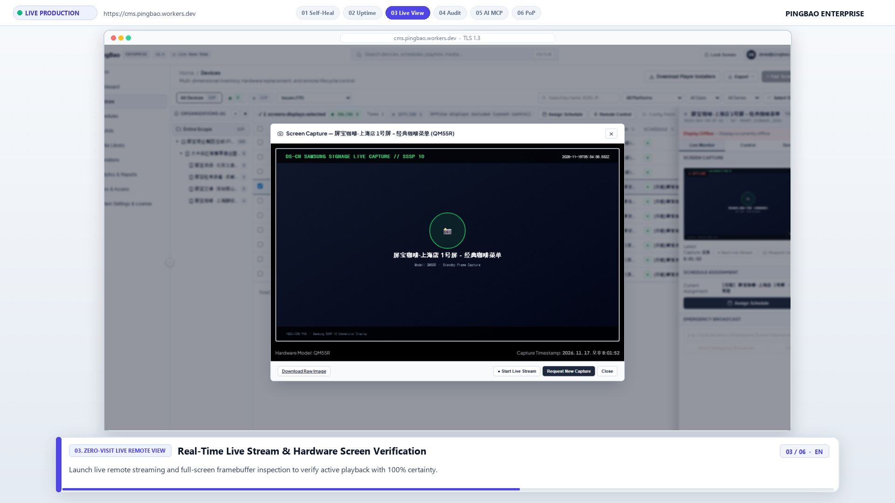
</a>

  

#### ⚡ 6 Game-Changing AI & Live Data Integration Breakthroughs (Why Pingbao?)

| 01. ★ AI Copilot & ‘Smart Recipes’ | 02. ★ Zero-Accident HITL AI Control | 03. ★ Conversational External Sync Concierge (NEW) |
| :---: | :---: | :---: |
|  |  |  |
| **Slide-Out AI Copilot (`Ctrl+J`)** 1-click task-memory runbooks & Multi-OS tables | **Approval-Gated & Strict Subsetting** Locks strictly to selected screens until approved | **Zero-Code Weather, FX, Stock & ERP Sync** Learned API skills + live 16:9 HTML5 widgets |
| **04. ★ Decoupled Data Feeds & NL Studio (NEW)** | **05. HTML5 Kiosk ZIP · Vision QA & Free Ollama** | **06. v2.2 Live HTML5 Capture · MCP · Precision PoP** |
|  |  | 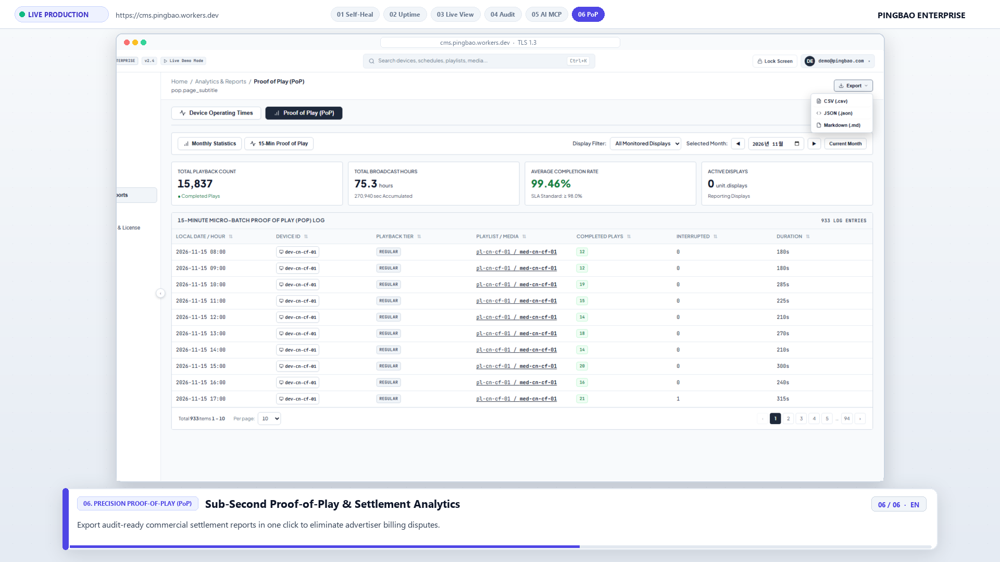 |
| **Shared Cron Snapshots & Split-Screen Studio** Derive multiple custom HTML5 boards via plain text | **Blocks Expired Promos & 11 LLM Presets** Zero API cost, zero data egress local Ollama | **SSSP + Dynamic HTML5 Remote Frame Proof** Native Claude/Cursor MCP & sub-second PoP |

---

## 🌐 Flagship Spotlight ①: Zero-Code ‘External Sync Agents’ & ‘AI NL Content Studio’

Simply ask in chat—*"Connect live USD foreign exchange rates for our hotel lobby"* or *"Build a live city weather board"*—and Pingbao’s **Conversational External Sync Concierge** discovers the right API, maps fields automatically, and renders a **16:9 interactive HTML5 signage widget** in real time.

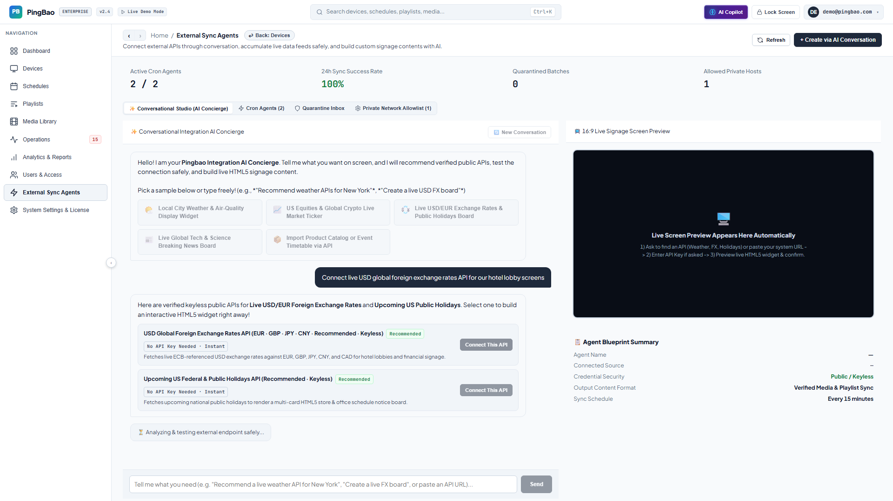
<b>▲ [External Sync Agents > Conversational Studio]: 1-click Learned API Skill reuse cards, regional keyless/commercial catalog, 10 color themes, and real-time 16:9 HTML5 widget preview</b>

  

| ① Cron Sync Agents & Accumulated Data-Feed Store (`AGENTS`) | ② 2-Column ‘AI Content Modification Studio’ (`NL Studio`) |
| :---: | :---: |
| 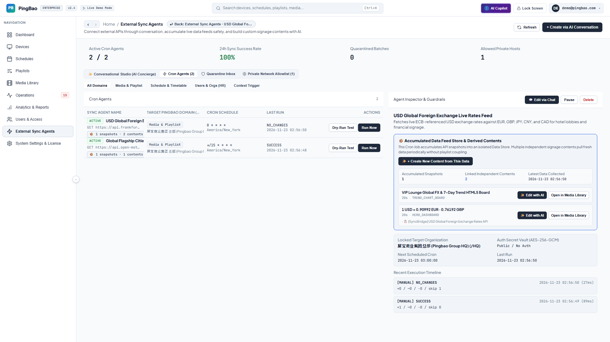 | 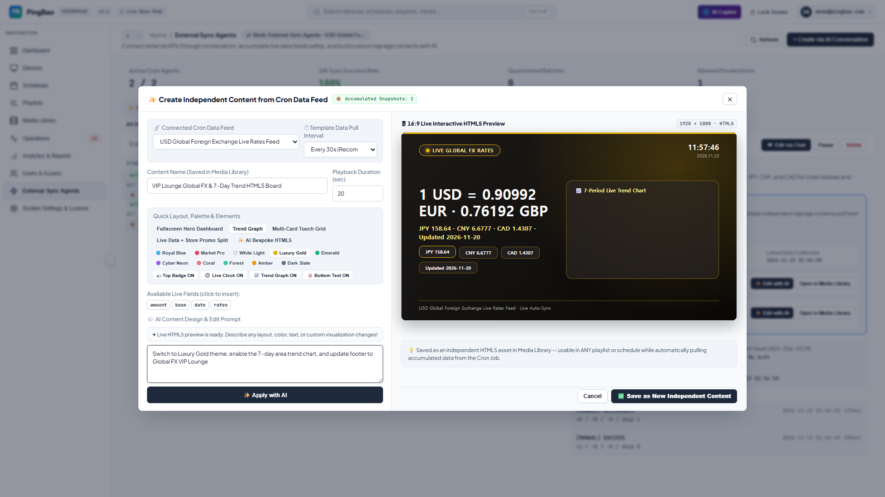 |
| **One Verified Data Feed, Unlimited Independent Displays** Cron agents accumulate rolling snapshots shared safely across multiple independent HTML5 signage assets | **Reshape Layouts, Themes & 7-Day Trend Charts via Plain English** Insert raw API field chips, toggle elements, and save/clone independent HTML5 media with auto schedule refresh |
| **③ Interactive HTML5 Kiosk Bundles (`.zip`) & Live Web URLs** | **④ Data-Feed Badges & 1-Click `[✨ Edit with AI]`** |
| 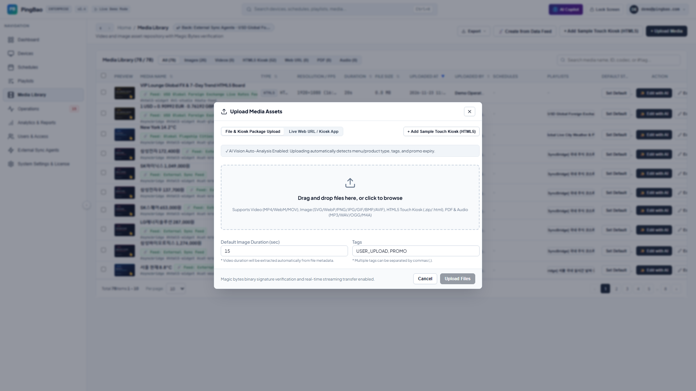 | 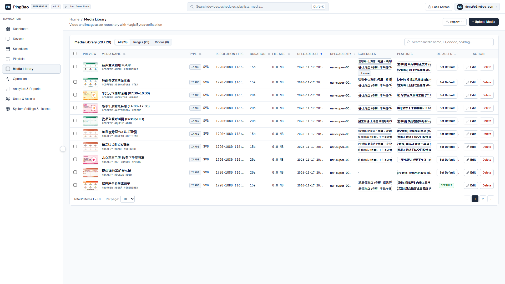 |
| **Hardened Against Zip-Slip, Symlinks & Executables** Upload touch-ready `.zip`/`.html` kiosk bundles, generate 1-click sample apps, or register live web URLs | **Seamless Media Library Integration** Inspect bound feed intervals and refine live HTML5 widgets anytime with `[✨ Edit with AI]` |

### 🛡️ Zero-Shell Enterprise Security Guardrails
* **AES-256-GCM Secret Vault**: Encrypts Bearer tokens, API Keys (Header/Query), Basic credentials, and OAuth2 Client Credentials at rest—never exposed in plaintext logs or API responses.
* **Anti-SSRF Defense & Private Network Allowlist**: Hard-blocks loopback (`127.0.0.1`), cloud metadata (`169.254.169.254`), and internal DB/Redis ports while allowing explicitly approved corporate ERP/HR hosts or CIDRs.
* **Mass-Change Circuit Breaker & Quarantine Inbox**: Automatically halts sync runs exceeding mutation or deactivation caps for human diff review, with hard-blocks against `SUPER_ADMIN` privilege escalation.

---

## 🧠 Flagship Spotlight ②: Built-In ‘Pingbao AI Operator Copilot’ & ‘AI Smart Recipes’ (`Ctrl+J`)

Click the top-right **`[AI Copilot]` button (`Ctrl+J`)** from any workspace to diagnose fleets in Markdown tables and automate recurring daily workflows using **AI Smart Recipes**.

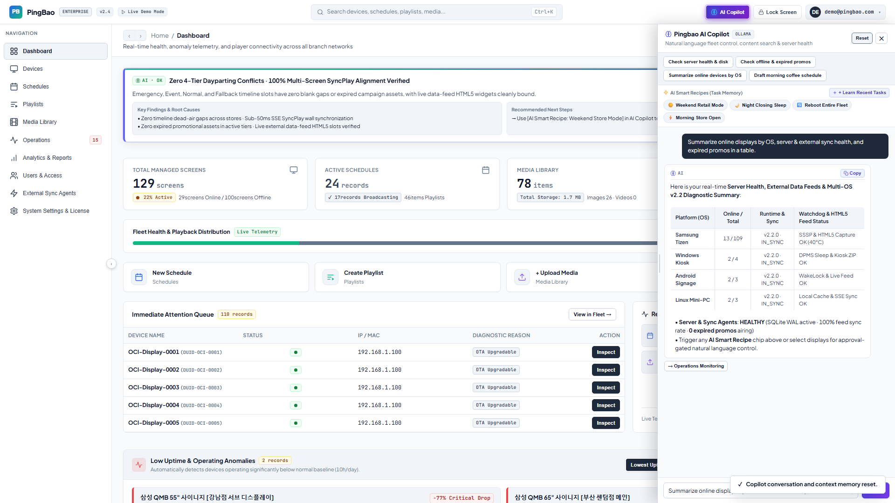
<b>▲ Resizable Slide-Out ‘Pingbao AI Copilot’: Top ‘AI Smart Recipes’ 1-click runbook strip, live Multi-OS v2.2 Markdown diagnostic tables, and instant jump links</b>

  

| ① Approval-Gated (HITL) Control & Strict Subsetting | ② 3-Second `[AI Morning Briefing]` Knowledge Box |
| :---: | :---: |
| 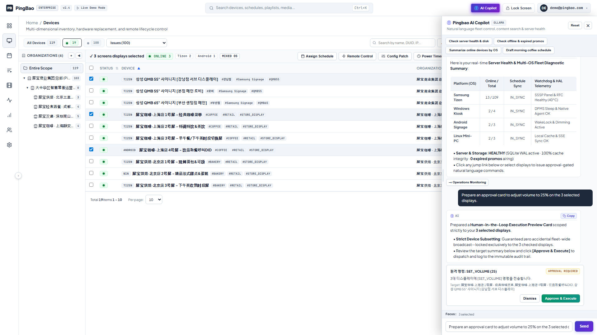 |  |
| **100% Protection Against Accidental Fleet Broadcasts** Strictly locks commands to checked displays (`3 selected`) and dispatches only when you click **`[Approve & Execute]`** | **All-Workspace 1-Click AI Insights + Chat Convergence** Morning briefings, device diagnostics, schedule conflict audits, and security summaries automatically converge into chat |
| **③ Multimodal Vision Auto-Tagging & Promo Expiry Guard** | **④ 11 Global/China/FreeLLMAPI & Free On-Prem Ollama** |
| 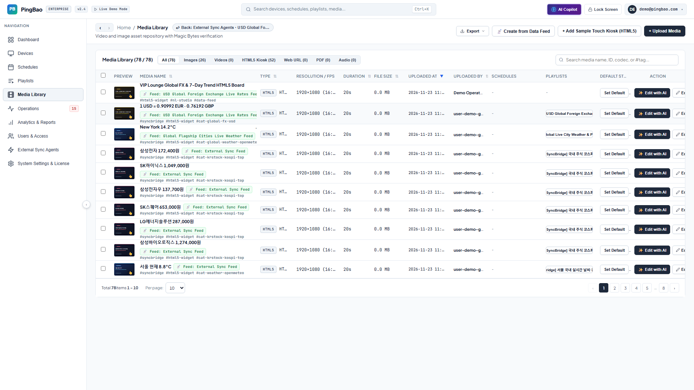 | 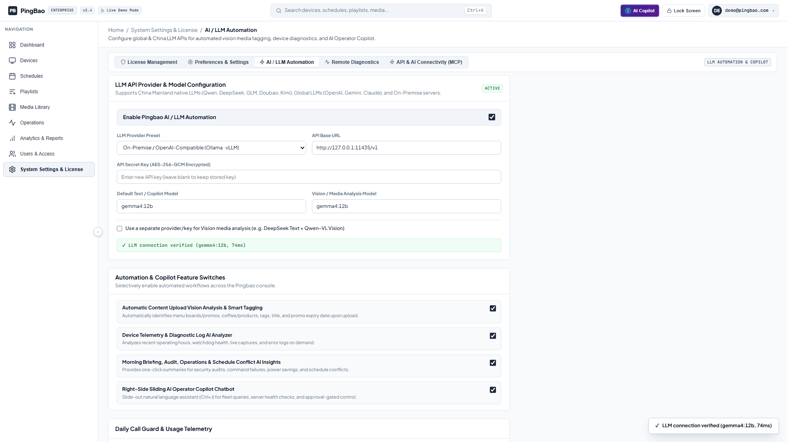 |
| **Stop Expired Promotional Banners Before They Air** Automatically extracts menu items, OCR prices, dayparting windows, and **campaign end dates (`2026-12-31`)** | **Zero API Cost · Zero Data Egress Air-Gapped AI** Supports OpenAI, Gemini, Claude, Qwen, DeepSeek, GLM, Doubao, Kimi, FreeLLMAPI, and **free local Ollama/vLLM** |

---

## 📸 Complete 10-Workspace Overview & Native English UI

### 1. Operations Dashboard & AI Morning Briefing (Dashboard)
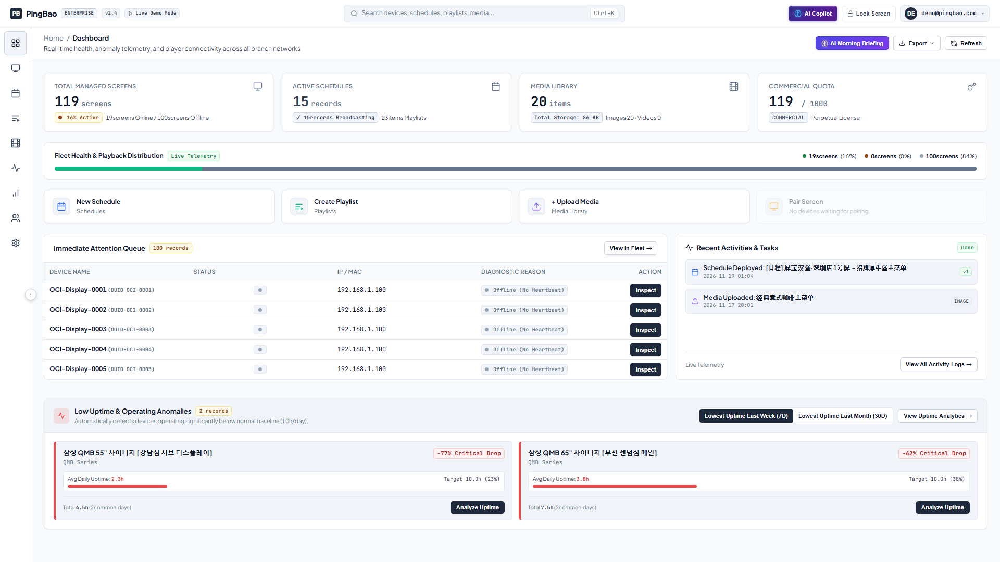

---

### 2. Multi-OS Fleet (v2.2) · AI Device Diagnosis · Live HTML5 Screen Capture (Devices)

| Multi-OS Fleet & Live Remote Screen Capture (`v2.2.0`) | Right Inspector (`Control` Tab) — AI Device Diagnosis |
| :---: | :---: |
| 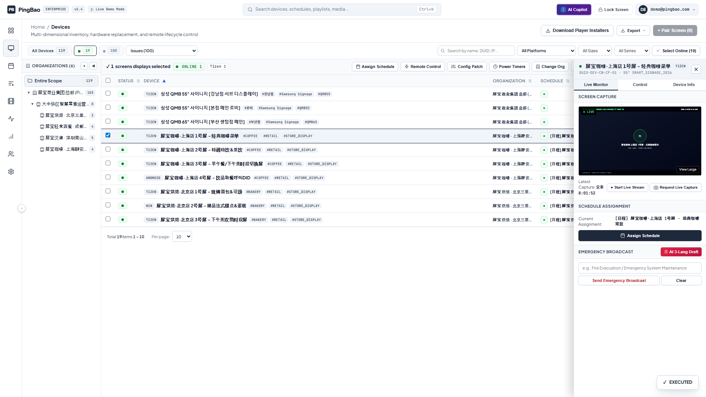 |  |
| **Multi-OS Player Installer Modal (`Auto-Stamped URL`)** | **7-Command Dedicated Bulk Remote Control Modal** |
| 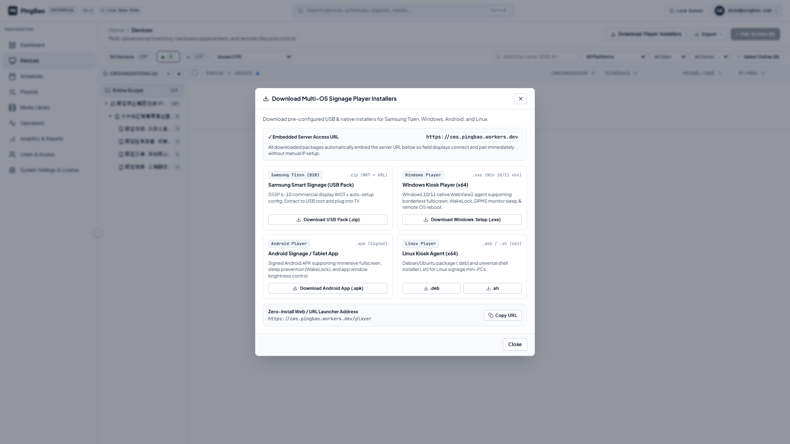 | 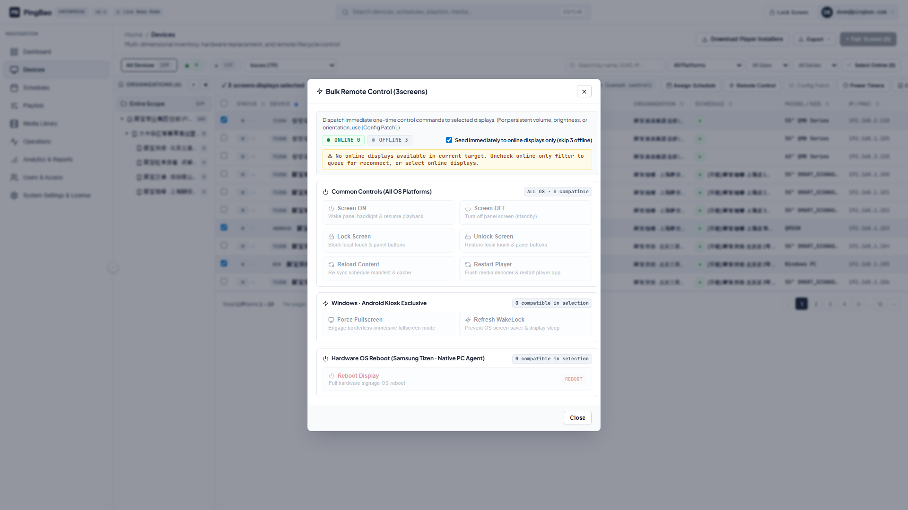 |

---

### 3. 4-Tier Timeline Scheduling & AI Conflict Audit (Schedules)
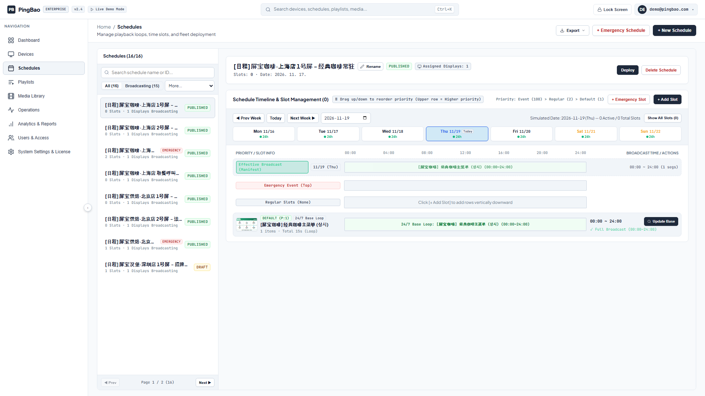

---

### 4. Playlist Authoring (Playlists)
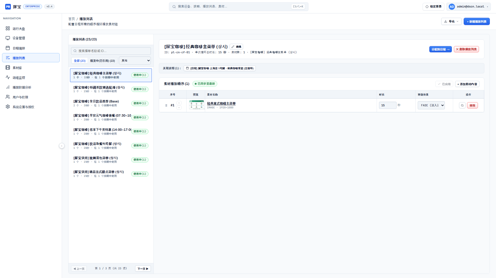

---

### 5. Media Library · HTML5 Kiosk Bundles · Multimodal Vision QA (Media Library)

| Media Library (`Data-Feed HTML5 & Edit with AI`) | Interactive HTML5 Kiosk (`.zip`) & Live Web URL Modal |
| :---: | :---: |
|  |  |

---

### 6. External Sync Agents & AI Content Studio (External Sync Agents · NEW)

| Conversational Sync Studio (`STUDIO`) | Cron Sync Agents & Data-Feed Store (`AGENTS`) |
| :---: | :---: |
|  |  |

---

### 7. Operations Monitoring & Desired-State Diff (Operations)
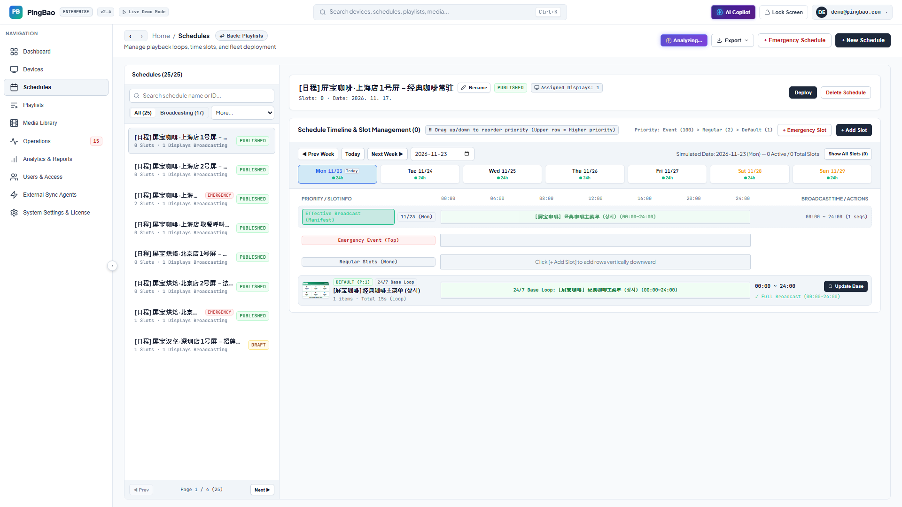

---

### 8. Analytics & Reports: Operating Times & Proof-of-Play (Uptime & PoP)

| Device Operating Times Workbench (`Uptime + AI Power Tip`) | Proof-of-Play Settlement Reports (`PoP`) |
| :---: | :---: |
| 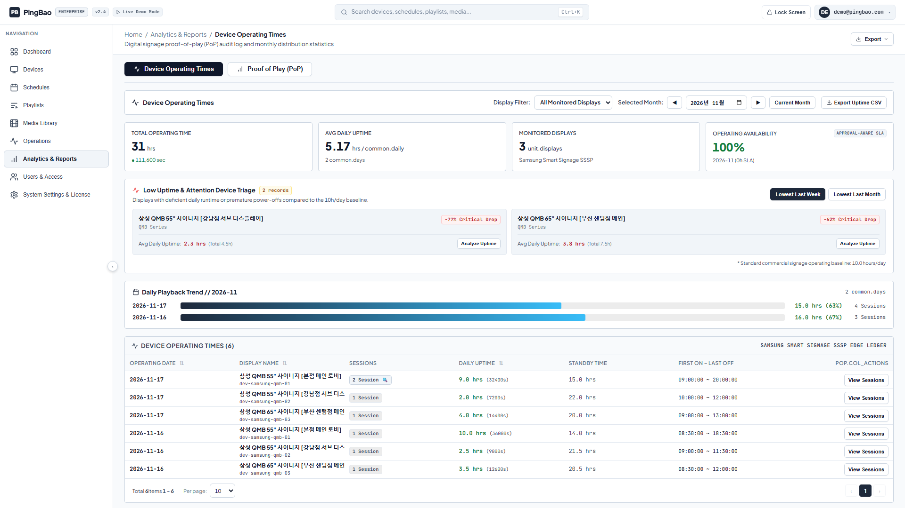 | 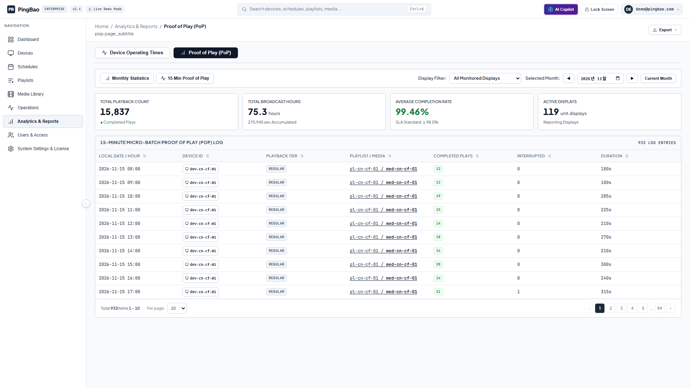 |

---

### 9. Multi-Tenant Organizations, RBAC & Immutable Audit Logs

| Users & Organization Directory (`Users & Access`) | Immutable User Audit Ledger (`[AI Security Summary]`) |
| :---: | :---: |
|  |  |

---

### 10. System Settings · 11 AI/LLM Providers · 6-Month Retention · External Agent MCP

| `AI / LLM Automation` (11 Cloud, China, FreeLLMAPI & Ollama) | Preferences & 6-Month Log Auto-Purge |
| :---: | :---: |
|  | 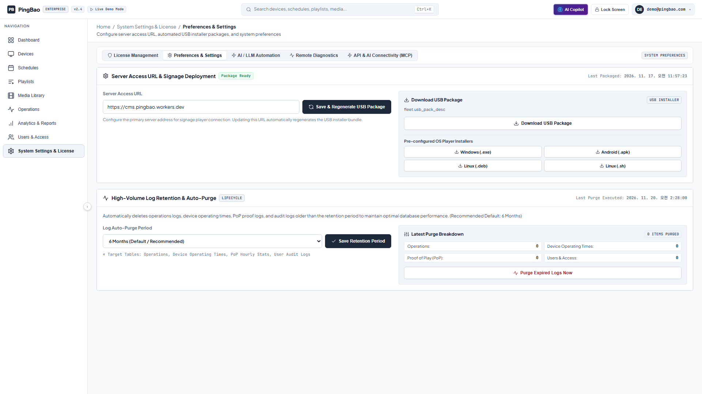 |
| **Commercial License (`Ed25519`)** | **Open REST API & External AI Agent (`MCP`)** |
| 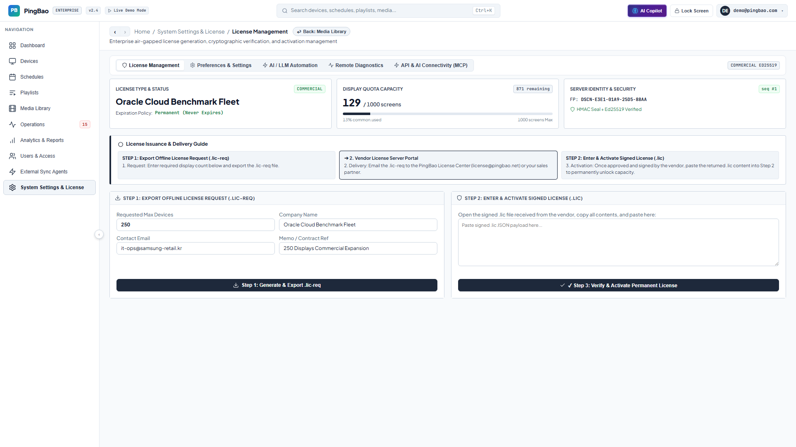 | 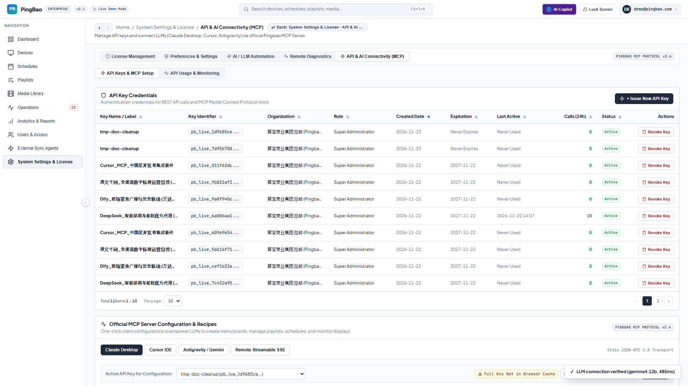 |

---

## 🤖 Open REST API & External AI Agent MCP Hub

Alongside inbound **External Sync Agents**, Pingbao embeds a native **MCP (Model Context Protocol)** server (`pingbao` toolkit) and scoped API keys (`pb_live_...`), enabling **Claude Desktop, Cursor, Antigravity, Dify, and custom LLM agents** to upload banners, author playlists, and publish schedules autonomously.

---

## 📋 Full Feature Matrix

| Functional Module | Key Capabilities | Architecture & Differentiators |
| :--- | :--- | :--- |
| **1. Built-In AI Copilot & Recipes** | Slide-out chat (`Ctrl+J`), **AI Smart Recipes (`+ Learn Recent Tasks`)**, Markdown tables, HITL cards | Active UI focus awareness, Strict Subsetting broadcast guard |
| **2. External Sync Agents** | Conversational API discovery (weather, FX, stocks, ERP), **Learned API Skills**, 16:9 HTML5 generation | AES-256 vault, Anti-SSRF & private Allowlist, Quarantine inbox |
| **3. Data-Feed & NL Studio** | Accumulated Cron Data-Feed Store, **2-column AI NL Content Modification Studio** | 10 color themes, 7-day trend charts, multi-content feed sharing |
| **4. HTML5 Kiosk & Vision AI** | Hardened `.zip`/`.html` kiosk bundles, live Web URLs, Vision auto-tagging & promo expiry guard | Zip-Slip protection, 11 Cloud/China/FreeLLMAPI/Ollama presets |
| **5. Multi-OS Fleet (`v2.2.0`)** | Samsung Tizen SSSP native + Windows / Android / Linux / Web + 7-command bulk modal | SSSP hardware + **dynamic HTML5 live capture**, URL-stamped installers |
| **6. 4-Tier Scheduling & Sync** | Emergency/Event/Regular/Default preemption, AI conflict audit, zero-config SyncPlay | SSE `sync-stream` + EMA clock offset calibration |
| **7. Self-Healing & Uptime/PoP** | `BEFORE/AFTER` Op Diff, daily power sessions, 1s frame-verified PoP exports | CSV/JSON/MD billing exports, 180-day auto-purge |
| **8. Security, Audit & MCP** | TOTP 2FA, RBAC, immutable audit ledger, 60+ REST APIs & built-in MCP server | Argon2id, Ed25519 air-gap license, Claude/Cursor/Antigravity ready |

---

## 📖 Documentation

* 📘 [User Operations Guide](docs/en/user-guide.md) - AI Copilot & Smart Recipes, Conversational External Sync Agents, NL Content Studio, and 4-Tier scheduling
* 🛠️ [Admin & Security/AI Deployment Guide](docs/en/admin-guide.md) - Docker setup, 11 Cloud/Ollama LLM presets, Anti-SSRF & Quarantine governance
* ❓ [FAQ](docs/en/faq.md) - Conversational External Sync, decoupled data-feed HTML5 contents, air-gapped free LLMs, and SyncPlay
* 📜 [Changelog](CHANGELOG.md) - Full `v1.5.0` release notes and version history

---

Pingbao (屏宝 / 핑바오) © 2026. All rights reserved.

