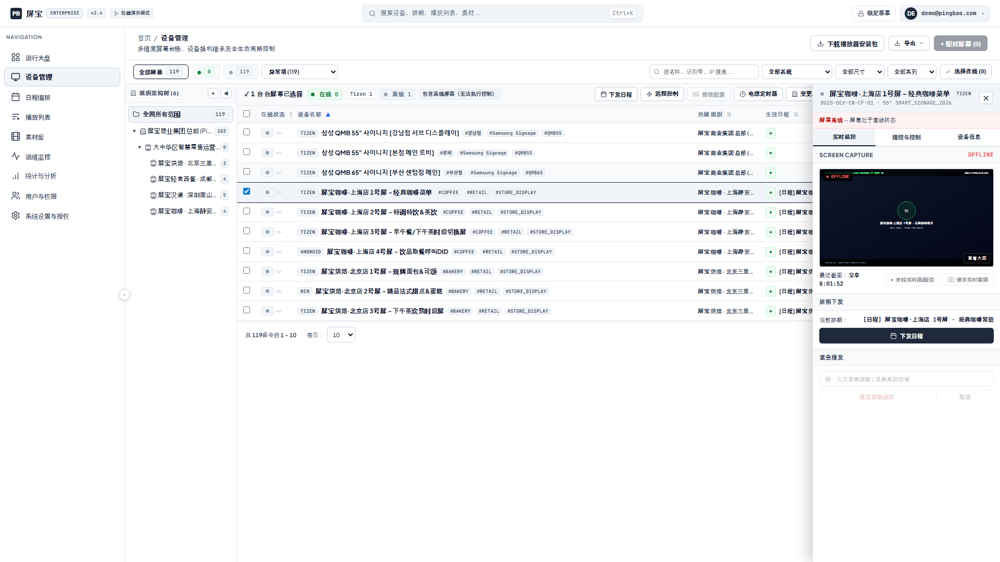
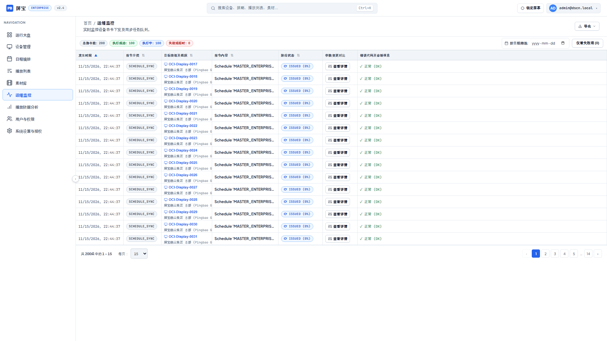

<div align="center">

# 📺 핑바오 (Pingbao / 屏宝)
### 삼성 스마트 사이니지 엔터프라이즈 스마트 통합 관제 플랫폼 (Samsung Smart Signage CMS)

**핑바오(Pingbao)**는 **삼성 스마트 사이니지(Samsung Smart Signage)** 디스플레이 생태계에 최적화된 엔터프라이즈 디지털 사이니지 전역 스마트 통합 관제 플랫폼입니다.  
삼성 Tizen 6.5+ SSSP(Samsung Smart Signage Platform)를 네이티브로 지원하여 수만 대의 삼성 상용 디스플레이를 원격으로 제어하고, 24시간 타임라인 드래그 앤 드롭으로 콘텐츠를 무중단 자율 스케줄링하며, 전 자동 다중 화면 싱크(SyncPlay) 및 오프라인 영구 자율 재생을 완벽하게 보장합니다. 나아가 표준 REST API 및 AI 에이전트를 위한 MCP(Model Context Protocol) 지원을 전면 제공합니다.

[](#)
[](https://cms.pingbao.workers.dev)
[](https://github.com/pingbaosignage/pingbao-community/releases)
[](https://github.com/pingbaosignage/pingbao-community/issues)
[](#)

<br/>

**[ 한국어 (KO) ]** | **[ 简体中文 (ZH) ](README.md)** | **[ English (EN) ](README.en.md)**

<br/>

> 🎮 **온라인 라이브 데모 / 1-Click Live Demo**: 별도 회원가입 없이 클릭 한 번으로 핑바오(Pingbao) 엔터프라이즈 CMS 전 워크스페이스를 실시간으로 직접 체험해보실 수 있습니다:  
> 👉 **[핑바오 온라인 라이브 데모 체험하기 (https://cms.pingbao.workers.dev)](https://cms.pingbao.workers.dev)** (116대 삼성 사이니지 가상 클러스터, 복합 스케줄 편성 매트릭스, 커머셜 영구 라이선스 사전 탑재)

<br/>


<sub><b>▲ 핑바오(Pingbao) 실시간 관제 대시보드: 삼성 사이니지 가동률, 스케줄 배포 진척률, 스토리지 점유율 및 시스템 헬스 관제 (오라클 클라우드 운영 환경 실측 데이터)</b></sub>

</div>

---

## 🌟 핵심 제품 특징 (Core Value Propositions)

1. **삼성 스마트 사이니지 전용·심층 IoT 하드웨어 제어**
   * **삼성 스마트 사이니지 (Samsung Smart Signage / Tizen 6.5+ SSSP 10+)** 네이티브 하드웨어 완벽 지원.
   * 원격 패널 On/Off(백라이트 절전), 볼륨 조절, 단말 재부팅, 동작 온도 모니터링 및 실시간 송출 화면 1초 단위 캡처 회신.
2. **단절 무관·영구 자율 오프라인 재생 (Autonomous Offline Loop)**
   * 단말 로컬 스토리지 사전 프리캐싱과 SQLite 상태 머신을 통해 현장 네트워크가 장기간 단절되어도 스케줄에 맞춰 24/7/365 무중단 무결점 재생 보장.
3. **4계층 우선순위 타임라인 스케줄링 엔진 (4-Tier Smart Scheduling)**
   * `EMERGENCY`(비상 재난/VIP 의전) > `EVENT`(피크 타임 프로모션) > `REGULAR`(일상 타임파팅) > `DEFAULT`(24시간 배경 폴백) 4단계 자동 선점 구조.
   * Dayparting(조식/중식/티타임/석식/야간) 시각 도달 시 자동 무결점 전환 및 선점 종료 후 자연스러운 자동 복귀.
4. **전 자동 멀티스크린 싱크 재생 (SyncPlay)**
   * **조건 충족 시 100% 자동 동작**: 복수의 삼성 사이니지가 **【같은 그룹】, 【같은 스케줄】, 【같은 네트워크(동일 LAN)】** 환경에 있으면, 복잡한 하드웨어 분배기나 수동 설정 없이 **자동으로 밀리초 단위 프레임 동기화 및 동시 화면 전환**이 작동합니다.
5. **표준 REST API 및 AI 에이전트 MCP (Model Context Protocol) 지원**
   * 60개 이상의 RESTful OpenAPI 3.0 엔드포인트 제공.
   * **MCP 서버 (`pingbao`)** 표준 내장으로 Claude, Cursor, Antigravity 등 차세대 LLM 기반 AI 에이전트가 직접 디바이스 조회, 스케줄 변경, 이상 진단 도구를 자율적으로 호출할 수 있습니다.
6. **정밀 재생 증빙 (Proof-of-Play - PoP)**
   * 1초 단위 실제 렌더링 프레임 및 시작/종료 타임스탬프 기록, 완주율(Completion Rate %) 산출 및 엑셀 감사 리포트 내보내기 지원.
7. **장애 자율 치유 및 자동화 커뮤니티 이슈 텔레메트리 (Automated Error Telemetry)**
   * 런타임 오류 자동 수집, PII/비밀키 마스킹, SHA-256 지문 중복 제거 후 GitHub 커뮤니티 이슈로 자동 리포팅하여 신속한 패치 수령 지원.

---

## 📸 9대 전 기능 워크스페이스 소개 및 공식 운영 화면

핑바오 관리 콘솔은 엔터프라이즈 운영에 필수적인 9개 독립 워크스페이스를 제공합니다:

### 1. 통합 대시보드 (Dashboard)

전국 및 글로벌 매장 삼성 사이니지의 가동률, 스케줄 동기화 완료율, 스토리지 사용량 및 이상 징후 알림을 한 화면에서 관제합니다.

---

### 2. 삼성 사이니지 장치 관리 (Device Management)

수만 대의 삼성 스크린을 조직별(본사/지사/매장), 방향(가로/세로), 온라인 상태별로 즉시 필터링하고 백라이트 On/Off, 원격 재부팅, 볼륨 조절 및 실시간 송출 캡처를 수행합니다.

---

### 3. 스케줄 편성 관리 (Schedules) —— [핵심 특화 엔진]

좌측 마스터 스케줄 목록과 우측 24시간 타임라인이 결합된 직관적인 뷰를 통해, 일상 방송과 프로모션 방송을 시각적으로 결합하고 원클릭으로 현장에 즉시 배포합니다.

#### 상세 타임슬롯 편성 및 우선순위 매트릭스 (Schedule Detail & Slots)

드래그 앤 드롭으로 슬롯 우선순위(Priority 10~100)를 재배치하고, 시간대 중복 시 실제 송출되는 유효 방송 윈도우(Effective Windows)를 시각적으로 검증합니다.

---

### 4. 재생목록 저작 (Playlists)

비디오(MP4/WebM)와 이미지(PNG/JPG)를 자유롭게 혼합하고 이미지별 노출 초(예: 8초, 15초)와 부드러운 페이드(Crossfade) 전환 효과를 적용합니다.

---

### 5. 미디어 에셋 라이브러리 (Media Assets)

4K 60fps 대용량 영상의 분할 스트리밍 업로드, 바이너리 매직 바이트 위변조 검증, 자동 썸네일 생성 및 스케줄 사용 중 에셋에 대한 삭제 방지 락을 지원합니다.

---

### 6. 실시간 운영 모니터링 (Operations Monitoring)

장치별 롱폴링 응답 지연(RTT), 명령 대기 큐 및 전송 실패 항목을 실시간 추적하고, 원클릭 일괄 재전송(1-Click Batch Retry)을 통해 네트워크 장애를 신속히 극복합니다.

---

### 7. 정밀 재생 증빙 리포트 (Proof-of-Play & Analytics)

단말 현지 시간 기준 1초 단위 실제 송출 사실 로그를 기반으로 완주율(Completion Rate %)을 집계하여 광고주 정산 및 감사용 엑셀 보고서를 생성합니다.

---

### 8. 사용자 및 다중 테넌트 조직 권한 (Users & RBAC)

그룹 본사-리테일 센터-도시 플래그십-매장으로 이어지는 트리형 조직 구조와 CRUDX 단위 세분화 역할, RFC 6238 TOTP 기업 2단계 인증을 제공합니다.

---

### 9. 상용 라이선스 & 오류 보고 커뮤니티 (License & Error Telemetry)

| 상용 라이선스 (Commercial License) | 오류 보고 & 커뮤니티 (Error Telemetry) |
| :---: | :---: |
|  |  |

* **Ed25519 전자서명 기반 상용 라이선스**: 에어갭(폐쇄망) 환경에서도 단말 활성화 쿼터를 안전하게 검증합니다.
* **오류 보고 & 커뮤니티 포털**:
  * 관리자 명시적 동의(Opt-in) 하에 서버 내부 오류를 자동 수집하고 민감정보(비밀번호, IP, 토큰)를 마스킹합니다.
  * SHA-256 지문으로 동일 오류를 중복 없이 취합하여 GitHub 커뮤니티 이슈로 전송하거나, 관리자가 콘솔 내에서 직접 수동 이슈/개선사항을 등록할 수 있습니다.

---

## 🎯 스케줄링 핵심 엔진 아키텍처 상세 (Deep Dive)

### 1. 4단계 우선순위 선점 계층
```
┌─────────────────────────────────────────────────────────────┐
│  Tier 1: EMERGENCY (P: 100 ~ 200)                           │
│  긴급 재난 방송 / 화재 대피 안내 / VIP 영접 전 화면 즉시 점유  │
├─────────────────────────────────────────────────────────────┤
│  Tier 2: EVENT (P: 50 ~ 99)                                 │
│  런치 피크 타임 타임세일 / 디너 파티 주류 프로모션             │
├─────────────────────────────────────────────────────────────┤
│  Tier 3: REGULAR (P: 10 ~ 49)                               │
│  일상 조식 메뉴판 / 오후 애프터눈 티 세트 롤링                 │
├─────────────────────────────────────────────────────────────┤
│  Tier 4: DEFAULT (P: 0)                                     │
│  24/7 배경 베이스 플레이리스트 (공백 발생 시 무조건 송출)        │
└─────────────────────────────────────────────────────────────┘
```

### 2. 표준 타임파팅 매트릭스 (Dayparting Matrix)
* **조식 (07:30 ~ 10:30)**: 모닝 세트 메뉴 및 모닝커피 프로모션 (`EVENT`, P:60)
* **오전 (10:30 ~ 11:30)**: 브랜드 이미지 및 멤버십 혜택 (`REGULAR`, P:20)
* **중식 피크 (11:30 ~ 14:00)**: 점심 특선 베스트셀러 및 주문 대기 가이드 (`EVENT`, P:80)
* **티타임 (14:00 ~ 17:30)**: 베이커리 & 디저트 음료 1+1 (`REGULAR`, P:30)
* **석식 파티 (17:30 ~ 21:30)**: 디너 패밀리 세트 & 수제 생맥주 행사 (`EVENT`, P:85)
* **야간/마감 (21:30 ~ 24:00)**: 마감 안내 및 저전력 브랜드 포스터 (`DEFAULT`, P:0)

### 3. SyncPlay 멀티스크린 자동 동기화 (전 자동 무설정)
* **자동 트리거 원리**:
  여러 대의 삼성 사이니지가 **【같은 그룹】 + 【같은 스케줄】 + 【같은 네트워크(동일 LAN)】** 에 연결되어 있으면, 사용자가 별도의 싱크 버튼을 누르거나 장비를 묶지 않아도 **시스템이 스스로 감지하여 100% 자동으로 SyncPlay 동기화를 활성화**합니다.
* **프레임 단위 완벽 동시 전환**:
  카운터 상단의 3~5연속 전자메뉴판이 동일한 찰나에 함께 페이드 아웃/인되며, 5760x1080 울트라 와이드 비디오도 분할 싱크로 매끄럽게 연결 재생됩니다.

### 4. 오프라인 영구 자율 루프 (Autonomous Offline Loop)
* 스케줄 배포 시 모든 미디어 파일은 삼성 단말의 로컬 고속 스토리지에 사전 다운로드되며, 내장 RTC 시계를 기준으로 로컬 SQLite 상태 머신이 스스로 판단하여 재생하므로 365일 통신이 두절되어도 완벽히 작동합니다.

---

## 🤖 개방형 REST API 및 AI 에이전트 MCP 지원

핑바오는 현대적인 개발자 및 인공지능 생태계를 위해 표준 **MCP (Model Context Protocol)** 서버(`pingbao` 툴킷)를 기본 내장하고 있습니다. Claude Desktop, Cursor, Antigravity 및 독자적인 LLM 기반 자율 관제 에이전트와 완벽하게 연동됩니다.

### 🌟 핵심 기능: LLM 생성 콘텐츠 자동 업로드 및 스케줄링 완벽 지원
> **💡 LLM이 제작한 비주얼 콘텐츠를 직접 업로드하고 편성할 수 있나요?**  
> **네, 100% 완벽하게 지원됩니다!** AI 에이전트는 `pingbao_upload_media` 도구를 호출하여 생성형 AI가 만든 SVG 벡터 배너, HTML 위젯, Base64 인코딩 이미지, 또는 원격 미디어 URL을 핑바오 미디어 라이브러리에 즉시 업로드할 수 있습니다. 이어서 `pingbao_create_playlist`와 `pingbao_create_schedule`을 순차 실행하여 특정 매장 스크린에 편성 배포하는 전 과정을 자율적으로 완수합니다.

### 💬 5대 핵심 실전 시나리오 및 AI 에이전트 프롬프트 (Prompts) 예시

| 번호 | 운영 시나리오 | 연동 MCP 도구 | 추천 AI 에이전트 자연어 프롬프트 (Prompt) 예시 |
| :---: | :--- | :--- | :--- |
| **01** | **자연어 장치 상태 및 이상 진단**<br/>(Device Status & Health) | `pingbao_list_devices`<br/>`pingbao_get_device_detail` | *"현재 상하이 플래그십 매장과 강남점의 모든 삼성 사이니지 전원 상태와 네트워크 연결 상태를 확인해줘. 10분 이상 오프라인 상태이거나 스케줄 재생 오류가 발생한 스크린이 있으면 목록과 원인을 보고해줘."* |
| **02** | **LLM 생성 콘텐츠 업로드 & 스케줄링**<br/>(Content Upload & Scheduling) | `pingbao_upload_media`<br/>`pingbao_create_playlist`<br/>`pingbao_create_schedule`<br/>`pingbao_assign_schedule` | *"이번 주말 비 오는 날 특별 할인 프로모션을 위한 세로형(1080x1920) SVG 배너를 방금 생성했어. 이 배너를 미디어 라이브러리에 '우천 스페셜 할인'으로 업로드하고, 이번 주 금/토/일 점심 피크(11:30~14:00) EVENT 우선순위(50) 스케줄로 강남점 키오스크 그룹에 편성해줘."* |
| **03** | **긴급 비상 방송/재난 공지 즉각 송출**<br/>(Emergency Broadcast Takeover) | `pingbao_upload_media`<br/>`pingbao_create_schedule`<br/>`pingbao_control_device` | *"현재 태풍 경보가 발령되었어. 전 매장의 카운터 사이니지에 '기상 악화에 따른 조기 마감(20:00) 안내' 긴급 공지 배너를 EMERGENCY(최고 우선순위 100)로 기존 방송을 즉시 중단하고 지금 즉시 띄워줘."* |
| **04** | **에너지 절감 및 전원/볼륨 하드웨어 제어**<br/>(Eco-Mode & Power Timers) | `pingbao_control_device`<br/>`pingbao_configure_power_timers` | *"영업 종료 시간인 밤 10시가 지났어. 영업 중인 디스플레이 중 음향 볼륨이 켜져 있는 기기는 0(음소거)으로 바꾸고, 내일부터 적용할 평일 자동 전원 타이머(매일 08:30 패널 켜짐, 22:30 패널 꺼짐)를 본사 매장 전체에 일괄 등록해줘."* |
| **05** | **재생 증빙(PoP) 감사 및 방영 이상 감지**<br/>(Proof-of-Play Audit) | `pingbao_verify_playback`<br/>`pingbao_get_device_detail` | *"지난 24시간 동안 송출된 '신제품 버거 런칭 캠페인' 광고 영상의 매장별 방영 횟수와 완주율(Completion Rate %)을 분석해줘. 완주율이 95% 미만이거나 네트워크 지연으로 프레임 드랍이 발생한 디바이스가 있다면 그 원인과 로그를 정리해줘."* |

---

## 📋 전체 기능 리스트 (Full Feature Matrix)

| 모듈 영역 | 핵심 기능 및 상세 명세 | 기술 규격 및 차별점 |
| :--- | :--- | :--- |
| **1. 통합 대시보드** | 조직별 관제 요약, 스케줄 동기화율(%), 이상 징후 알림 리본, 스토리지 모니터링 | 멀티 테넌트 스코프 자동 분리, MinIO/S3 연동 |
| **2. 삼성 사이니지 관제** | 삼성 전용 Standalone (Tizen 6.5+ SSSP 10+), 전원 On/Off 타이머, 원격 제어 | 삼성 Tizen b2bapis 드라이버, Redis 영속 큐 |
| **3. 타임라인 스케줄링** | 4계층 우선순위 선점, Dayparting 다중 트랙, 유효 방송 구간 분석, 원클릭 배포 | SQLite 로컬 자율 상태 머신, 무결점 폴백 복구 |
| **4. 전 자동 SyncPlay** | 같은 그룹, 같은 스케줄, 같은 네트워크 시 100% 자동 프레임 동기화 및 동시 전환 | 로컬 경량 브로드캐스트 기반, 고가 분배기 불필요 |
| **5. REST API & MCP** | 60+ API 엔드포인트 및 AI Agent용 표준 MCP 서버 내장, API Key 권한 관리 | OpenAPI 3.0 규격, Claude/Cursor/Antigravity 연동 |
| **6. 플레이리스트 저작** | 직관적 D&D 저작, 이미지 노출 초 제어, 전환 효과(Fade/Cut), 총 재생시간 집계 | WebGL/CSS 하드웨어 가속 트랜지션, 가상 시뮬레이터 |
| **7. 미디어 라이브러리** | MP4/WebM/PNG 대용량 스트리밍 업로드, 매직 바이트 검증, 자동 메타 추출, 삭제 보호 | 멀티 청크 분할 스트리밍, SHA-256 서명 무결성 |
| **8. 운영 모니터링 & 진단** | 실시간 단말 상태·명령 큐 싱글 뷰, 원클릭 실패 필터, 일괄 재시도, 다포맷 리포트 | 1-Click Batch Retry, LLM 보고서용 Markdown 지원 |
| **9. 정밀 재생 증빙 (PoP)** | 1초 단위 실제 송출 증빙, 완주 vs 중도 중단 분석, 단말 현지 시간대 분석, 엑셀 Export | 15분 주기 암호화 배치 보고, 광고 정산용 완주율(%) |
| **10. 엔터프라이즈 보안** | 본사-지사-매장 조직 트리, CRUDX 매트릭스, 2FA(TOTP), 5-Strike 방어 | RFC 6238 TOTP, Argon2id, Ed25519 전자서명 라이선스 |
| **11. 라이선스 & 오류 텔레메트리** | Ed25519 비대칭 서명 활성화, 비정상 오류 PII 마스킹, SHA-256 중복제거 커뮤니티 전송 | 관리자 Opt-in 동의 기반, GitHub 커뮤니티 이슈 직동 |

---

## 📖 문서 및 매뉴얼 (Documentation)

* 📘 [사용자 매뉴얼 (User Guide)](docs/ko/user-guide.md) - 디스플레이 등록, 미디어 업로드, 플레이리스트 편성, 스케줄링 방법
* 🛠️ [관리자 및 설치 가이드 (Admin Guide)](docs/ko/admin-guide.md) - Docker 환경 구성, 환경변수 설정, 업그레이드 및 롤백
* ❓ [자주 묻는 질문 (FAQ)](docs/ko/faq.md) - 오프라인 재생, 지원 규격 및 트러블슈팅
* 📜 [변경 이력 (Changelog)](CHANGELOG.md) - 버전별 변경 사항 및 개선 내역

---

<div align="center">
<sub>Pingbao (핑바오 / 屏宝) © 2026. All rights reserved.</sub>
</div>
