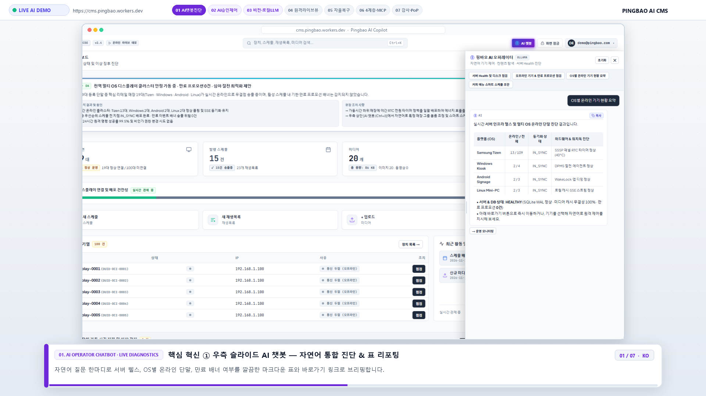
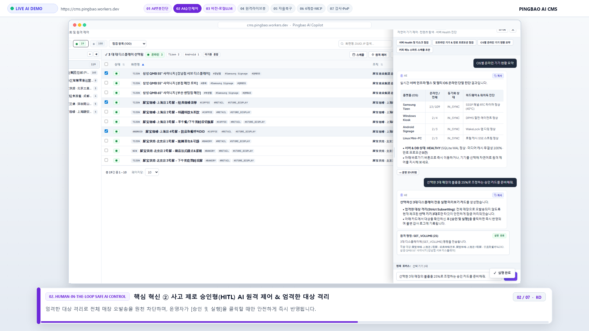
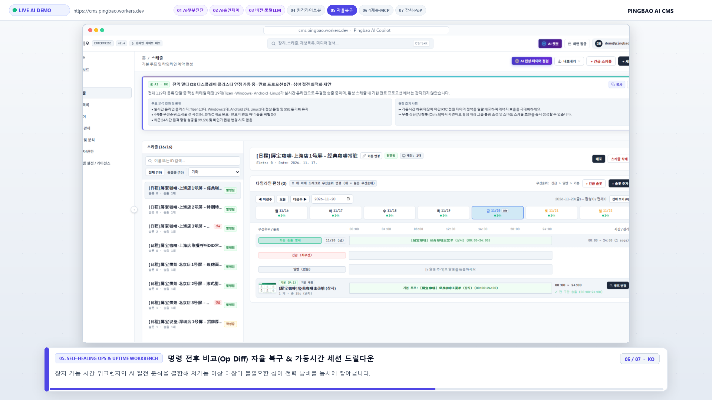
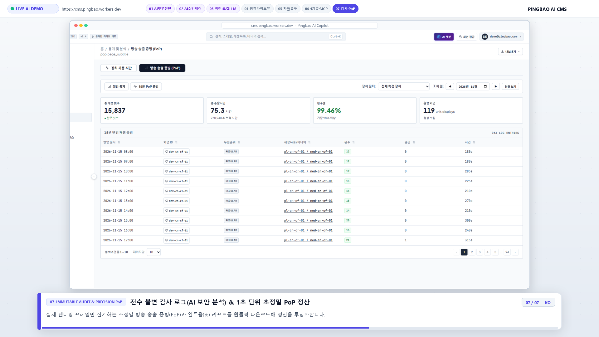
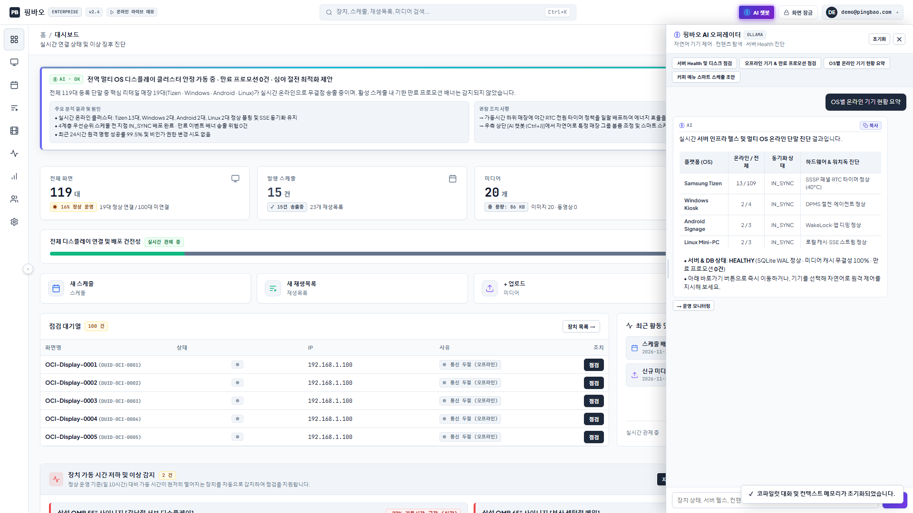
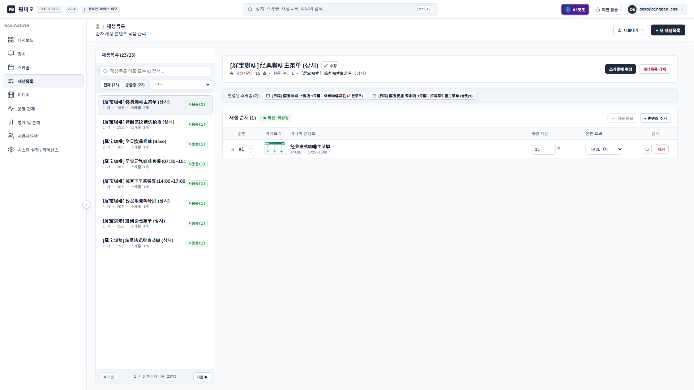
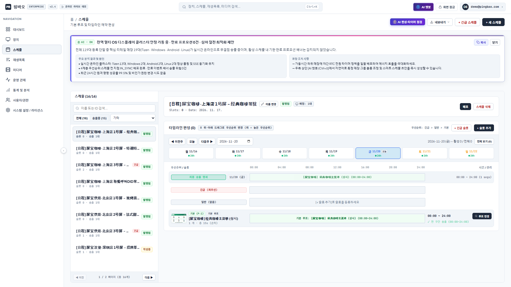

# 📺 핑바오 (Pingbao / 屏宝)
### 빌트인 AI 오퍼레이터 챗봇 탑재 · 삼성 스마트 사이니지 & 멀티 OS 엔터프라이즈 통합 관제 플랫폼

**핑바오(Pingbao)**는 **빌트인 AI 오퍼레이터 챗봇(`Ctrl+J`)과 5대 자율 관제 지능**을 기본 탑재하고, **삼성 스마트 사이니지(Samsung Smart Signage · Tizen 6.5+ / SSSP 6~10+)** 심층 하드웨어 제어를 주력으로 **Windows, Android, Linux, Web** 플레이어까지 단일 콘솔에서 통합 제어하는 차세대 엔터프라이즈 디지털 사이니지 플랫폼입니다.  
자연어 대화 한마디로 전국 매장의 상태를 표(Table)로 진단하고 **사고 제로 승인형(HITL) 원격 제어**를 수행하며, 멀티모달 비전(Vision) 만료 배너 차단, 100% 무료 폐쇄망 로컬 LLM(Ollama/vLLM) 연동, 전 자동 SyncPlay, 4계층 타임파팅 스케줄링 및 초정밀 재생 증빙(PoP)을 전면 제공합니다.

 

**[ 한국어 (KO) ]** | **[ 简体中文 (ZH) ](README.md)** | **[ English (EN) ](README.en.md)**

 

<!-- ============================================================================== -->
<!-- 🚀 HIGH-VISIBILITY LIVE DEMO BANNER -->
<!-- ============================================================================== -->
<table width="100%" style="margin: 20px 0;">
  <tr>
    <td align="center" style="background: linear-gradient(135deg, #0f172a 0%, #1e293b 100%); padding: 28px 20px; border-radius: 14px; border: 2px solid #3b82f6; box-shadow: 0 10px 25px rgba(59, 130, 246, 0.2);">
      <h2 style="margin: 0 0 12px 0; color: #60a5fa; font-size: 24px; letter-spacing: -0.5px;">
        🚀 핑바오 온라인 라이브 데모 (Live Interactive Demo)
      </h2>
      

        <b>별도 설치나 회원가입 없이</b> 브라우저에서 핑바오 AI 엔터프라이즈 CMS의 전 기능을 즉시 체험해보실 수 있습니다. 
        (119대 멀티 OS 사이니지 클러스터, 빌트인 AI 관제 허브, 24시간 스케줄 매트릭스, PoP 정산, 하드웨어 IoT 제어 완비)
      

      
      

        🔗 공식 체험 도메인: 
        <a href="https://cms.pingbao.workers.dev" target="_blank" style="color: #ffffff; text-decoration: underline; font-weight: bold; font-size: 14px;">https://cms.pingbao.workers.dev</a>
      

    </td>
  </tr>
</table>

 

<!-- ============================================================================== -->
<!-- 🎬 OFFICIAL PRODUCT VIDEO & AI SPOTLIGHT HIGHLIGHTS -->
<!-- ============================================================================== -->

### 🎬 핑바오 AI 스마트 관제 공식 데모 영상 (Official AI Spotlight Video)

* 🇰🇷 **한국어 음성 데모 영상**: [▶ 영상 보기 (pingbao_smart_operations_demo_ko.mp4)](docs/assets/videos/pingbao_smart_operations_demo_ko.mp4)
* 🇨🇳 **中文普通话解说视频**: [▶ 观看视频 (pingbao_smart_operations_demo_zh.mp4)](docs/assets/videos/pingbao_smart_operations_demo_zh.mp4)
* 🇺🇸 **English Voiceover Video**: [▶ Watch Video (pingbao_smart_operations_demo_en.mp4)](docs/assets/videos/pingbao_smart_operations_demo_en.mp4)

 

  

#### ⚡ 핑바오만의 핵심 AI & 엔터프라이즈 운영 기술 (Why Pingbao?)

| 01. ★ 빌트인 AI 챗봇 자연어 표 진단 | 02. ★ 사고 제로 승인형(HITL) AI 원격 제어 | 03. ★ 비전 AI 만료 차단 & 무료 로컬 LLM |
| :---: | :---: | :---: |
|  |  |  |
| **우측 슬라이드 AI 오퍼레이터 (`Ctrl+J`)** 말 한마디로 서버 헬스·멀티 OS 현황 표 브리핑 | **Human-in-the-Loop & 대상 격리 가드** 선택 기기만 안전 격리 후 `[승인 및 실행]` 시 반영 | **멀티모달 비전 & 10대 클라우드/사내 Ollama** 행사 종료일 자동 감지 및 API 비용 0원 폐쇄망 AI |
| **04. AI 장치 정밀 해설 & 무방문 라이브 뷰** | **05. 자율 복구(Op Diff) & 가동시간 분석** | **06. 4계층 스케줄·AI 점검 & 초정밀 PoP** |
|  |  |  |
| **자연어 단말 로그 해석 + SSSP 실시간 화면** 비개발자도 즉시 이해하는 원인 분석 및 현장 검증 | **명령 전후 상태 비교 & 저가동 매장 포착** 통신 장애 자동 복구 및 심야 전력 낭비 차단 | **전수 불변 감사 로그 & 완주율(%) 정산** AI 승인 내역 감사 기록 및 1초 단위 렌더링 증빙 |

---

## 🧠 핵심 특집: 빌트인 ‘핑바오 AI 오퍼레이터 챗봇’ & 5대 자율 관제 지능

핑바오는 별도의 외부 에이전트 설정 없이도 **웹 콘솔 우측 상단 `[AI 챗봇]` 버튼(`Ctrl+J`)** 하나로 수백 개 매장의 사이니지를 자연어 대화로 진단·제어·편성할 수 있는 압도적인 **빌트인 AI 코파일럿**을 제공합니다.

<b>▲ 우측 슬라이드 ‘핑바오 AI 오퍼레이터 챗봇’: 좌측 드래그 폭 조절, 원클릭 퀵 프롬프트, 멀티 OS 가동 현황 마크다운 표(Table) 렌더링 및 즉시 이동 점프 링크</b>

  

| ① 승인형(HITL) 안전 원격 제어 & Strict Subsetting | ② 출근 3초 요약 `[AI 모닝 브리핑]` Knowledge Box |
| :---: | :---: |
|  |  |
| **전체 매장 오발송 100% 원천 차단** 체크박스로 선택한 기기(`선택 기기 3대`)로만 타깃을 잠그고 운영자가 **`[승인 및 실행]`**을 클릭할 때만 실제 반영 | **전 워크스페이스 원클릭 AI 도메인 인사이트** 모닝 브리핑, 장치 정밀 진단, 편성·타이머 충돌 점검, 장애/감사 분석 결과가 챗봇 히스토리에 자동 수렴 |
| **③ 멀티모달 비전(Vision) 자동 태깅 & 만료 배너 차단** | **④ 10대 글로벌·중국 직결 & 100% 무료 사내 Ollama** |
|  |  |
| **기한 지난 프로모션 오송출 방송 사고 예방** 업로드 즉시 품목·가격표(OCR)·권장 시간대 및 **행사 종료일(`2026-12-31`)** 자동 추출 및 만료 경보 | **API 비용 0원 · 데이터 유출 0건 온프레미스 AI** Qwen, DeepSeek, GLM, Doubao, Kimi, OpenAI, Gemini, Claude 및 **무료 로컬 Ollama/vLLM** 직결 |

### ✨ 왜 핑바오 AI 챗봇이 압도적인가요?
1. **현재 화면 문맥을 읽는 지능형 대화 (`Active UI Focus` + `요약 메모리`)**: 현재 보고 있는 탭, 인스펙터에 열린 단말, 체크한 기기 목록을 실시간 인식하여 *"이 기기 에러 로그 쉽게 설명해줘"*, *"선택한 3대 매장 볼륨 25%로 줄여줘"*를 즉시 처리하며 긴 대화도 자동 요약 압축합니다.
2. **사고 제로 Human-in-the-Loop + 엄격한 대상 격리 (`Strict Device Subsetting`)**: AI가 임의로 매장을 조작하지 않습니다. 반드시 **실행 미리보기 카드(`승인 대기`)**를 먼저 띄우고 운영자가 **`[승인 및 실행]`**을 누를 때만 실행되며, 선택 기기 외 전체 매장 브로드캐스트 사고를 원천 차단합니다.
3. **3개 국어 비상 방송 3초 카피라이팅 (`[AI 다국어 문안 생성]`)**: 화재·지진·점검 등 긴급 상황 시 한국어·영어·중국어 표준 비상 안내 문구를 3초 만에 자동 생성하여 즉시 송출합니다.
4. **외부 API 비용·보안 걱정 없는 100% 무료 로컬 LLM (`Ollama / vLLM`)**: 사내 미니 PC나 GPU 서버의 `Ollama`(`gemma4`, `qwen2.5`, `deepseek-r1`)와 연결하면 **외부 인터넷 없이 100% 무료**로 전 기능을 무제한 사용할 수 있습니다.

---

## 🌟 핵심 제품 특징 (Core Value Propositions)

1. **빌트인 AI 오퍼레이터 챗봇(`Ctrl+J`) & 멀티모달 비전 자율 관제**
   * 자연어 마크다운 표 진단, HITL 승인형 원격 제어, 비전 자동 태깅·행사 만료일 차단, 10대 클라우드/중국/무료 로컬 Ollama 모델 완벽 지원.
2. **삼성 스마트 사이니지 심층 특화 & 5대 멀티 OS 통합 관제**
   * **삼성 스마트 사이니지 (Tizen 6.5+ / SSSP 6~10+)** 네이티브 하드웨어 제어(패널 백라이트, 전원, 리모컨/패널 잠금, 외부 입력 전환, 하드웨어 RTC 타이머) 완벽 지원.
   * **Windows(`.exe`) · Android(`.apk`) · Linux(`.deb`/`.sh`) · Web(`/player`)** 통합 관제, 서버 URL 자동 스탬핑 설치 패키지 모달 및 **7대 명령 전용 일괄 원격 제어** 지원.
3. **단절 무관·영구 자율 오프라인 재생 (Autonomous Offline Loop)**
   * 로컬 스토리지 사전 프리캐싱과 내장 상태 머신으로 네트워크가 장기간 단절되어도 24/7/365 무중단 재생 보장.
4. **4계층 우선순위 타임라인 스케줄링 & AI 편성 충돌 점검**
   * `EMERGENCY`(긴급) > `EVENT`(피크 프로모션) > `REGULAR`(일상 타임파팅) > `DEFAULT`(24시간 폴백) 자동 선점 및 `[AI 편성·타이머 점검]` 지원.
5. **전 자동 멀티스크린 싱크 재생 (SyncPlay)**
   * **【같은 그룹】 + 【같은 스케줄】 + 【같은 LAN】** 충족 시 실시간 SSE `sync-stream`과 시계 오프셋 보정으로 **100% 무설정 밀리초 단위 동시 화면 전환**.
6. **장치 가동 시간(Uptime) 워크벤치 & 초정밀 재생 증빙 (Proof-of-Play)**
   * 저가동 이상 매장 조기 포착, `POWER_TIMER`/`MANUAL` 세션 드릴다운, `[AI 가동시간·절전 추천]` 및 1초 단위 렌더링 완주율(%) 정산 리포트 내보내기.
7. **무방문 자가 복구, 6개월 로그 자동 보존 & 표준 REST API / 외부 MCP 연동**
   * `BEFORE/AFTER` 상태 비교(`Op Diff`), **6개월(180일) 로그 자동 정리 주기**, 60+ OpenAPI 3.0 및 Claude/Cursor/Antigravity용 내장 `pingbao` MCP 서버 제공.

---

## 📸 9대 전 기능 워크스페이스 소개 및 공식 운영 화면 (한국어 네이티브 UI)

### 1. 통합 대시보드 & AI 모닝 브리핑 (Dashboard)

전국 매장의 실시간 온라인 가동률, 스케줄 배포 현황, `[AI 모닝 브리핑]`, 7일/30일 저가동 이상 징후 장치를 한 화면에서 관제합니다.

---

### 2. 멀티 OS 장치 관리 · AI 장치 정밀 진단 · 원클릭 설치팩 (Device Management)

| 멀티 OS 장치 관리 & 실시간 라이브 화면 캡처 | 우측 인스펙터 `관제/제어` — AI 장치 정밀 원인 분석 |
| :---: | :---: |
|  |  |
| **멀티 OS 플레이어 설치 패키지 모달 (`URL 자동 스탬핑`)** | **7대 명령 전용 일괄 원격 제어 모달 (`Bulk Control`)** |
|  |  |

삼성 Tizen SSSP 및 Windows·Android·Linux 단말을 조직·OS·상태별로 관제하고, AI 단말 로그 원인 해설과 7대 명령 일괄 제어, 무방문 실시간 화면 검증을 수행합니다.

---

### 3. 스케줄 편성 관리 & AI 편성·타이머 점검 (Schedules)

좌측 마스터 스케줄 목록과 우측 24시간 멀티 티어 타임라인, 상단 `[AI 편성·타이머 점검]`을 결합해 무결점 방송 편성을 원클릭 배포합니다.

---

### 4. 재생목록 저작 (Playlists)

---

### 5. 미디어 에셋 라이브러리 & AI 비전 검수 (Media Assets)

| 미디어 에셋 라이브러리 (`4K 스트리밍 & 매직 바이트 검증`) | AI 비전 분석 메타데이터 & 행사 종료일 만료 차단 |
| :---: | :---: |
|  |  |

---

### 6. 실시간 운영 관제 & AI 장애 패턴 요약 (Operations Monitoring)

---

### 7. 통계 및 분석: 장치 가동 시간 & 방송 송출 증빙 (Uptime & PoP)

| 장치 가동 시간 워크벤치 (`[AI 가동시간·절전 추천]`) | 방송 송출 증빙 리포트 (`1초 단위 완주율 PoP`) |
| :---: | :---: |
|  |  |

---

### 8. 사용자 권한(RBAC) & 불변 감사 로그 (Users & Audit Logs)

| 다중 테넌트 조직 및 권한 (`Users & RBAC`) | 전수 불변 감사 로그 (`[AI 감사 분석]`) |
| :---: | :---: |
|  |  |

---

### 9. 시스템 설정 · AI/LLM 자동화 · 6개월 로그 보존 · MCP 연동

| `AI / LLM 자동화` (10대 클라우드·중국·로컬 Ollama) | 환경설정 & 6개월 로그 자동 정리 (`Preferences`) |
| :---: | :---: |
|  |  |
| **상용 라이선스 (`Ed25519 License`)** | **개방형 REST API & 외부 AI 에이전트 (`MCP`)** |
|  |  |

---

## 🤖 개방형 REST API 및 외부 AI 에이전트 MCP 지원

빌트인 AI 오퍼레이터 챗봇에 더해, 핑바오는 표준 **MCP (Model Context Protocol)** 서버(`pingbao` 툴킷)를 기본 내장하여 Claude Desktop, Cursor, Antigravity 및 사내 자동화 에이전트가 생성형 배너 업로드(`pingbao_upload_media`)부터 플레이리스트·스케줄 배포까지 전자동으로 수행할 수 있습니다.

---

## 📋 전체 기능 리스트 (Full Feature Matrix)

| 모듈 영역 | 핵심 기능 및 상세 명세 | 기술 규격 및 차별점 |
| :--- | :--- | :--- |
| **1. 빌트인 AI 오퍼레이터 챗봇** | 우측 슬라이드 자연어 대화창(`Ctrl+J`), 마크다운 표 진단, HITL 승인형 제어 | UI 포커스 자동 인식, Strict Subsetting 오발송 원천 차단 |
| **2. 5대 AI 인사이트 & 비전** | 모닝 브리핑, 장치 로그 해설, 비전 자동 태깅·만료 배너 차단, 3개국어 비상문안 | 10대 클라우드/중국/무료 로컬 Ollama 지원, AES-256 키 암호화 |
| **3. 통합 대시보드** | 전역 가동률 요약, 실시간 활동 피드, 7일/30일 저가동 이상 장치 트리아지 | 멀티 테넌트 스코프 자동 분리, 원클릭 드릴다운 |
| **4. 멀티 OS 플릿 관제** | 삼성 Tizen SSSP 특화 + Windows / Android / Linux / Web 통합 관제 및 7대 일괄 제어 | OS별 HAL 자동 라우팅, 서버 URL 스탬핑 설치팩 |
| **5. 타임라인 스케줄링** | 4계층 우선순위 선점, Dayparting 다중 트랙, AI 편성·타이머 충돌 감사 | 로컬 자율 상태 머신, 무결점 폴백 복구 |
| **6. 전 자동 SyncPlay** | 같은 그룹, 같은 스케줄, 같은 네트워크 시 100% 자동 프레임 동기화 및 동시 전환 | 인증 SSE `sync-stream` + 클럭 오프셋 보정 |
| **7. 운영 관제 & 가동/PoP** | `BEFORE/AFTER` 상태 비교(`Op Diff`), 가동 세션 분석, 1초 단위 렌더링 완주율(%) | CSV/JSON/MD 정산 감사 내보내기, 180일 자동 보존 |
| **8. 보안 · 감사 · 외부 MCP** | 조직 트리, CRUDX 매트릭스, 2FA(TOTP), 불변 감사 로그, 60+ REST API & 내장 MCP | RFC 6238 TOTP, Argon2id, Ed25519 전자서명 라이선스 |

---

## 📖 공식 문서 및 매뉴얼 (Documentation)

* 📘 [사용자 통합 운영 매뉴얼 (User Guide)](docs/ko/user-guide.md) - AI 오퍼레이터 챗봇 활용법, 멀티 OS 등록, 비전 검수, 스케줄링 전 과정
* 🛠️ [관리자 설치 및 AI/LLM 설정 가이드 (Admin Guide)](docs/ko/admin-guide.md) - Docker 구축, 클라우드/로컬 Ollama LLM 연동, 백업 및 업그레이드
* ❓ [자주 묻는 질문 (FAQ)](docs/ko/faq.md) - AI 안전 제어 원리, 무료 폐쇄망 LLM, 오프라인 재생 및 SyncPlay
* 📜 [변경 이력 (Changelog)](CHANGELOG.md) - 버전별 신기능 및 아키텍처 업데이트 내역

---

Pingbao (핑바오 / 屏宝) © 2026. All rights reserved.

