

# 📺 핑바오 (Pingbao / 屏宝)
### 빌트인 AI 코파일럿 · 스마트 레시피 · 대화형 외부연동 에이전트 탑재 — 멀티 OS 통합 관제 플랫폼

**핑바오(Pingbao)**는 **빌트인 AI 오퍼레이터 챗봇(`Ctrl+J`) & 스마트 레시피**와 코딩 없이 외부 실시간 데이터를 16:9 HTML5 전광판으로 연결하는 **대화형 외부연동 에이전트 스튜디오**를 기본 탑재하고, **삼성 스마트 사이니지(Samsung Smart Signage · Tizen 6.5+ / SSSP 6~10+)** 심층 하드웨어 제어를 주력으로 **Windows, Android, Linux, Web** 플레이어(`v2.2.0`)까지 단일 콘솔에서 통합 제어하는 차세대 엔터프라이즈 디지털 사이니지 플랫폼입니다.  
자연어 대화 한마디로 전국 매장 진단과 **사고 제로 승인형(HITL) 원격 제어**는 물론, 실시간 날씨·주식·환율·사내 ERP API를 대화만으로 연결해 **맞춤형 인터랙티브 HTML5 사이니지 컨텐츠**를 즉시 제작·편성할 수 있습니다.

 

**[ 한국어 (KO) ]** | **[ 简体中文 (ZH) ](README.md)** | **[ English (EN) ](README.en.md)**

 

<!-- ============================================================================== -->
<!-- 🚀 HIGH-VISIBILITY LIVE DEMO BANNER -->
<!-- ============================================================================== -->
<table width="100%" style="margin: 20px 0;">
  <tr>
    <td align="center" style="background: linear-gradient(135deg, #0f172a 0%, #1e293b 100%); padding: 28px 20px; border-radius: 14px; border: 2px solid #3b82f6; box-shadow: 0 10px 25px rgba(59, 130, 246, 0.2);">
      <h2 style="margin: 0 0 12px 0; color: #60a5fa; font-size: 24px; letter-spacing: -0.5px;">
        🚀 핑바오 온라인 라이브 데모 (Live Interactive Demo)
      </h2>
      

        <b>별도 설치나 회원가입 없이</b> 브라우저에서 핑바오 AI 엔터프라이즈 CMS의 10대 전 워크스페이스를 즉시 체험해보실 수 있습니다. 
        (119대 멀티 OS v2.2 클러스터, AI 챗봇 & 스마트 레시피, 대화형 외부연동 스튜디오, AI 컨텐츠 수정 스튜디오, 4계층 스케줄, PoP 정산 완비)
      

      
      

        🔗 공식 체험 도메인: 
        <a href="https://cms.pingbao.workers.dev" target="_blank" style="color: #ffffff; text-decoration: underline; font-weight: bold; font-size: 14px;">https://cms.pingbao.workers.dev</a>
      

    </td>
  </tr>
</table>

 

<!-- ============================================================================== -->
<!-- 🎬 OFFICIAL PRODUCT VIDEO & AI + SYNC STUDIO SPOTLIGHT HIGHLIGHTS -->
<!-- ============================================================================== -->

### 🎬 핑바오 AI 자율 관제 & 외부연동 스튜디오 공식 데모 영상

* 🇰🇷 **한국어 음성 데모 영상**: [▶ 영상 보기 (pingbao_smart_operations_demo_ko.mp4)](docs/assets/videos/pingbao_smart_operations_demo_ko.mp4)
* 🇨🇳 **中文普通话解说视频**: [▶ 观看视频 (pingbao_smart_operations_demo_zh.mp4)](docs/assets/videos/pingbao_smart_operations_demo_zh.mp4)
* 🇺🇸 **English Voiceover Video**: [▶ Watch Video (pingbao_smart_operations_demo_en.mp4)](docs/assets/videos/pingbao_smart_operations_demo_en.mp4)

 

<a href="docs/assets/videos/pingbao_smart_operations_demo_ko.mp4">
  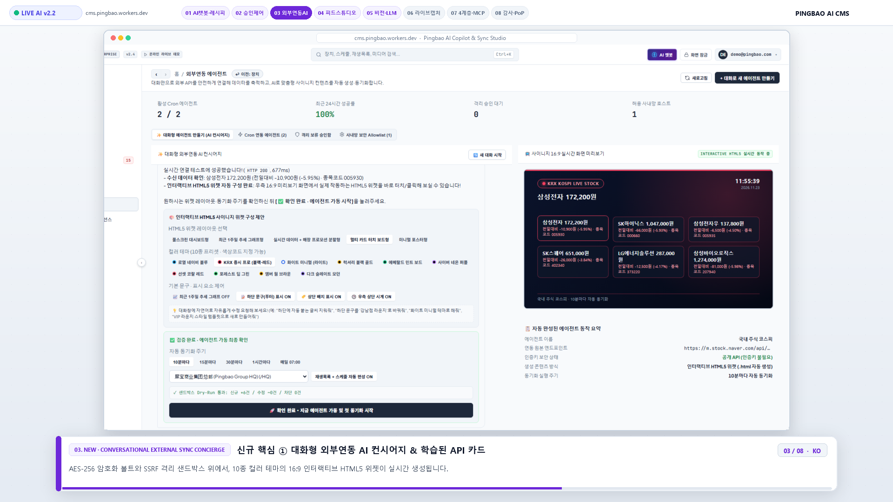
</a>

  

#### ⚡ 핑바오만의 6대 혁신 AI & 외부 데이터 연동 기술 (Why Pingbao?)

| 01. ★ AI 챗봇 & 작업 기억 ‘스마트 레시피’ | 02. ★ 사고 제로 승인형(HITL) AI 원격 제어 | 03. ★ 대화형 외부연동 AI 컨시어지 (NEW) |
| :---: | :---: | :---: |
|  |  |  |
| **우측 슬라이드 코파일럿 (`Ctrl+J`)** 원클릭 런북 실행 및 멀티 OS 마크다운 표 진단 | **Human-in-the-Loop & 대상 격리 가드** 선택 기기만 안전 격리 후 `[승인 및 실행]` 시 반영 | **제로코드 날씨·증시·환율·사내 API 연결** 학습된 API 기억 및 16:9 HTML5 위젯 즉시 생성 |
| **04. ★ 분리형 데이터 스토어 & 컨텐츠 스튜디오 (NEW)** | **05. HTML5 키오스크(.zip) · 비전 검수 & 무료 Ollama** | **06. v2.2 라이브 화면 캡처 · 외부 MCP · 초정밀 PoP** |
| 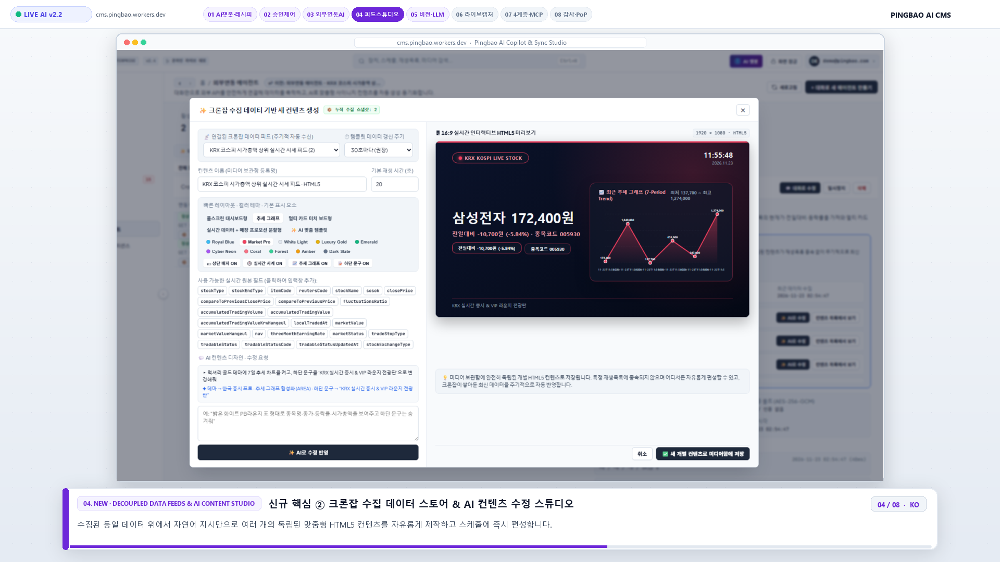 |  | 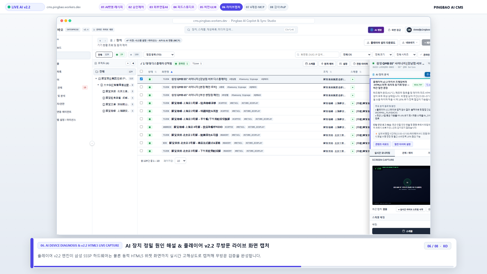 |
| **크론 수집 피드 공유 & 2단 자연어 디자인 편집** 동일 데이터로 다수의 맞춤형 HTML5 보드 파생 | **만료 프로모션 원천 차단 & 11대 LLM 직결** API 비용·유출 걱정 없는 100% 무료 사내 Ollama | **삼성 SSSP + 동적 HTML5 원격 전체화면 검증** Claude/Cursor MCP 자율 편성 및 1초 단위 PoP |

---

## 🌐 신규 특집 ①: 코딩 없이 대화만으로 완성하는 ‘외부연동 에이전트’ & ‘AI 컨텐츠 수정 스튜디오’

개발자 없이도 채팅창에 *"코스피 실시간 시세 전광판 연결해줘"*, *"강남 매장 실시간 날씨 보드 만들어줘"*라고 입력하기만 하면, 핑바오의 **대화형 외부연동 AI 컨시어지**가 최적의 API를 추천하고 **16:9 인터랙티브 HTML5 사이니지 위젯**까지 실시간으로 완성합니다.

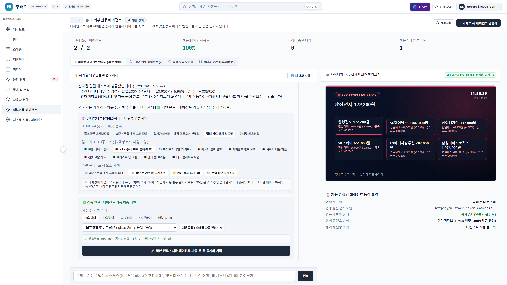
<b>▲ [외부연동 에이전트 > 대화형 스튜디오]: 학습된 API 원클릭 재사용 카드, 한·중·글로벌 엄선 API 추천, 10종 컬러 테마 선택 및 우측 16:9 실시간 HTML5 위젯 미리보기</b>

  

| ① 크론 에이전트 목록 & 축적 데이터 피드 스토어 (`AGENTS`) | ② 2단 분할 ‘AI 컨텐츠 수정 스튜디오’ (`NL Content Studio`) |
| :---: | :---: |
| 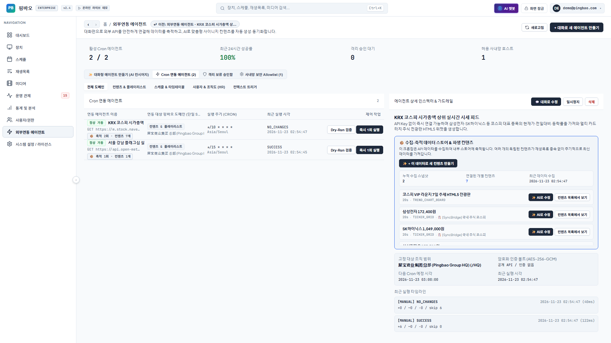 | 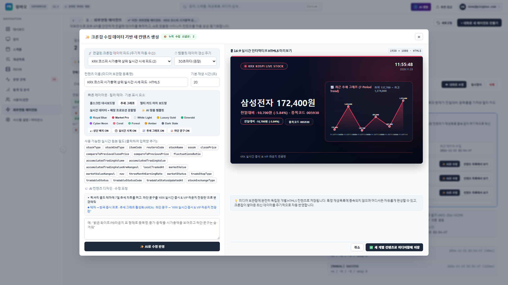 |
| **단일 수집 데이터 위에서 여러 파생 컨텐츠 독립 구독** 크론 에이전트가 주기적으로 축적한 시계열 스냅샷을 여러 매장 컨텐츠가 15초~60초 주기로 안전하게 공유 | **자연어로 레이아웃·컬러·7일 추세 차트 즉시 변형** 원본 API 필드 칩 클릭 삽입, 10종 테마, 추세 그래프 토글 및 멀티턴 자연어 지시로 독립 미디어 저장 |
| **③ 인터랙티브 HTML5 키오스크 패키지(`.zip`) & 웹 URL 등록** | **④ 파생 데이터 피드 뱃지 & 원클릭 `[✨ AI로 수정]`** |
| 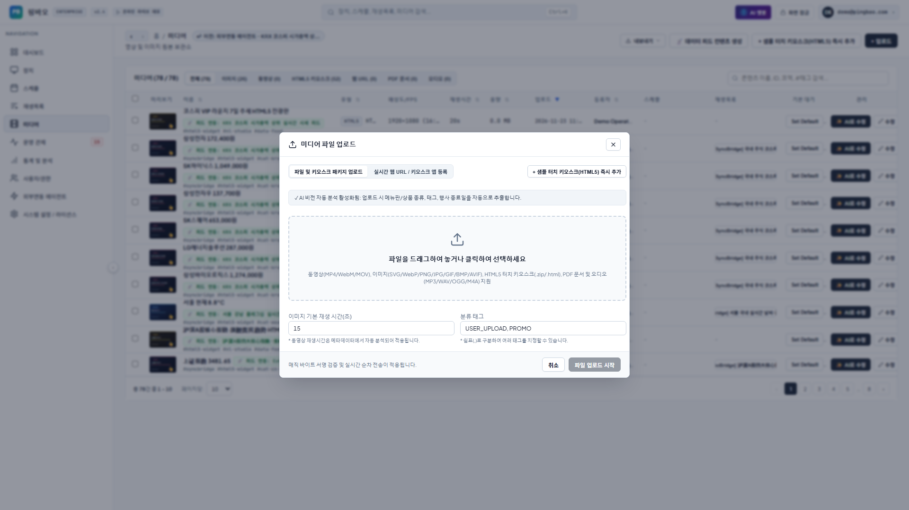 |  |
| **Zip-Slip · 심볼릭 링크 · 악성 실행파일 완벽 차단** 터치 키오스크용 `.zip`/`.html` 업로드, 원클릭 샘플 키오스크 앱 생성 및 실시간 웹 대시보드 URL 등록 | **미디어 라이브러리 완벽 통합 및 활성 스케줄 자동 갱신** 데이터 피드 연동 상태 표시 및 `[✨ AI로 수정]`으로 송출 중인 화면도 무중단 리디자인 |

### 🛡️ 엔터프라이즈 제로-쉘(Zero-Shell) 보안 아키텍처
* **AES-256-GCM 암호화 볼트**: Bearer 토큰, API Key(Header/Query), Basic, OAuth2 Client Credentials 시크릿을 마스터 키로 암호화 보관하며 로그나 응답에 절대 평문 노출하지 않습니다.
* **Anti-SSRF 방어 & 사내망 Allowlist**: 루프백(`127.0.0.1`), 클라우드 메타데이터(`169.254.169.254`), 내부 DB/Redis 포트를 원천 차단하며, 관리자가 명시 승인한 사내 ERP/HR 호스트·CIDR만 안전하게 통신합니다.
* **대량 변경 서킷브레이커 & 격리 승인함 (`Quarantine Inbox`)**: 외부 API 오류로 대량 삭제/변경 임계치를 초과하면 즉시 적용을 보류하고 격리 승인함에서 Diff 검토 후 반영하며, `SUPER_ADMIN` 권한 상승 시도는 하드블록됩니다.

---

## 🧠 핵심 특집 ②: 빌트인 ‘핑바오 AI 오퍼레이터 챗봇’ & ‘AI 스마트 레시피’ (`Ctrl+J`)

웹 콘솔 우측 상단 **`[AI 챗봇]` 버튼(`Ctrl+J`)** 하나로 전국 매장 상태를 표(Table)로 진단하고, 자주 반복하는 운영 루틴을 **AI 스마트 레시피**로 기억해 원클릭으로 실행합니다.

<b>▲ 우측 슬라이드 ‘핑바오 AI 오퍼레이터 챗봇’: 상단 ‘AI 스마트 레시피’ 원클릭 런북 바, 멀티 OS v2.2 마크다운 진단 표 및 즉시 이동 점프 링크</b>

  

| ① 승인형(HITL) 안전 원격 제어 & Strict Subsetting | ② 출근 3초 요약 `[AI 모닝 브리핑]` Knowledge Box |
| :---: | :---: |
| 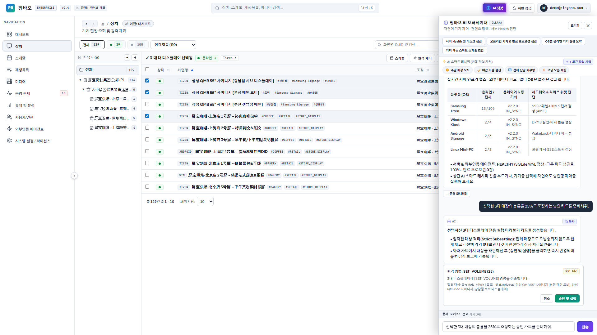 |  |
| **전체 매장 오발송 100% 원천 차단** 선택한 기기(`선택 기기 3대`)로만 타깃을 잠그고 운영자가 **`[승인 및 실행]`**을 클릭할 때만 실제 반영 | **전 워크스페이스 원클릭 AI 도메인 인사이트** 모닝 브리핑, 장치 정밀 진단, 편성·타이머 충돌 점검, 보안 감사 분석 결과가 챗봇 히스토리에 자동 수렴 |
| **③ 멀티모달 비전(Vision) 자동 태깅 & 만료 배너 차단** | **④ 11대 글로벌·중국·FreeLLMAPI & 100% 무료 로컬 Ollama** |
|  | 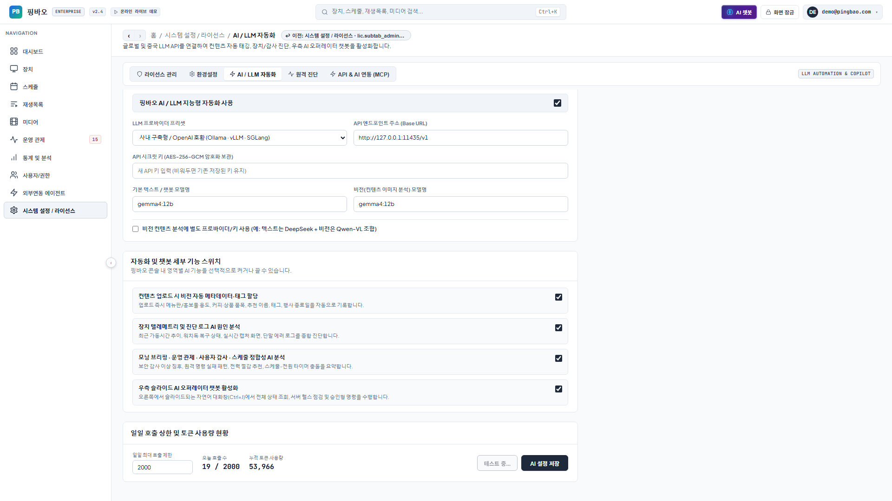 |
| **기한 지난 프로모션 오송출 방송 사고 예방** 업로드 즉시 품목·가격표(OCR)·권장 시간대 및 **행사 종료일(`2026-12-31`)** 자동 추출 및 만료 경보 | **API 비용 0원 · 데이터 유출 0건 온프레미스 AI** Qwen, DeepSeek, GLM, Doubao, Kimi, OpenAI, Gemini, Claude, FreeLLMAPI 및 **무료 로컬 Ollama/vLLM** 직결 |

---

## 📸 10대 전 기능 워크스페이스 소개 및 공식 운영 화면 (한국어 네이티브 UI)

### 1. 통합 대시보드 & AI 모닝 브리핑 (Dashboard)

---

### 2. 멀티 OS 장치 관리(v2.2) · AI 장치 정밀 진단 · 동적 HTML5 라이브 화면 캡처 (Device Management)

| 멀티 OS 장치 관리 & 실시간 라이브 화면 캡처 (`v2.2.0`) | 우측 인스펙터 `관제/제어` — AI 장치 정밀 원인 분석 |
| :---: | :---: |
|  |  |
| **멀티 OS 플레이어 설치 패키지 모달 (`URL 자동 스탬핑`)** | **7대 명령 전용 일괄 원격 제어 모달 (`Bulk Control`)** |
| 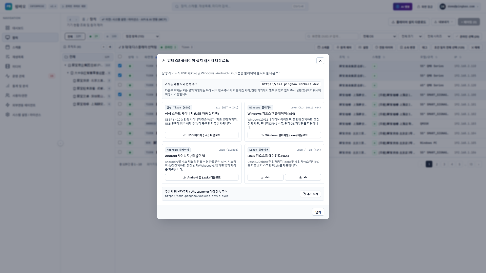 |  |

---

### 3. 스케줄 편성 관리 & AI 편성·타이머 점검 (Schedules)

---

### 4. 재생목록 저작 (Playlists)

---

### 5. 미디어 에셋 라이브러리 · 인터랙티브 HTML5 패키지 · AI 비전 검수 (Media Assets)

| 미디어 라이브러리 (`데이터 피드 HTML5 & AI 수정`) | 인터랙티브 HTML5 키오스크(`.zip`) & 실시간 웹 URL 모달 |
| :---: | :---: |
|  |  |

---

### 6. 외부연동 에이전트 & AI 컨텐츠 수정 스튜디오 (External Sync Agents · NEW)

| 대화형 외부연동 스튜디오 (`STUDIO`) | 크론 에이전트 & 축적 데이터 피드 스토어 (`AGENTS`) |
| :---: | :---: |
|  |  |

---

### 7. 실시간 운영 관제 & 명령 전후 상태 비교 (Operations Monitoring)

---

### 8. 통계 및 분석: 장치 가동 시간 & 방송 송출 증빙 (Uptime & PoP)

| 장치 가동 시간 워크벤치 (`[AI 가동시간·절전 추천]`) | 방송 송출 증빙 리포트 (`1초 단위 완주율 PoP`) |
| :---: | :---: |
| 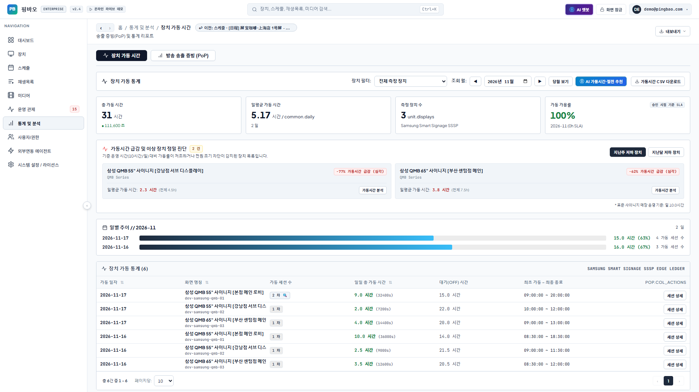 |  |

---

### 9. 사용자 권한(RBAC) & 불변 감사 로그 (Users & Audit Logs)

| 다중 테넌트 조직 및 권한 (`Users & RBAC`) | 전수 불변 감사 로그 (`[AI 감사 분석]`) |
| :---: | :---: |
|  |  |

---

### 10. 시스템 설정 · 11대 AI/LLM 자동화 · 6개월 로그 보존 · 외부 에이전트 MCP 연동

| `AI / LLM 자동화` (11대 클라우드·중국·FreeLLMAPI·Ollama) | 환경설정 & 6개월 로그 자동 정리 (`Preferences`) |
| :---: | :---: |
|  |  |
| **상용 라이선스 (`Ed25519 License`)** | **개방형 REST API & 외부 AI 에이전트 (`MCP`)** |
|  |  |

---

## 🤖 개방형 REST API 및 외부 AI 에이전트 MCP 허브

내장 **대화형 외부연동 에이전트(Inbound Data Sync)**뿐만 아니라, 표준 **MCP (Model Context Protocol)** 서버(`pingbao` 툴킷)와 세분화된 스코프 API 키(`pb_live_...`)를 기본 내장하여 **Claude Desktop, Cursor, Antigravity, Dify, DeepSeek 에이전트** 등 외부 AI 에이전트가 배너 생성·업로드부터 플레이리스트·스케줄 배포까지 자율 수행할 수 있습니다.

---

## 📋 전체 기능 리스트 (Full Feature Matrix)

| 모듈 영역 | 핵심 기능 및 상세 명세 | 기술 규격 및 차별점 |
| :--- | :--- | :--- |
| **1. 빌트인 AI 코파일럿 & 레시피** | 우측 슬라이드 대화창(`Ctrl+J`), **AI 스마트 레시피(`+ 최근 작업 기억`)**, 표 진단, HITL 제어 | UI 포커스 인식, Strict Subsetting 오발송 원천 차단 |
| **2. 대화형 외부연동 에이전트** | 자연어 API 탐색·연결(날씨·주식·환율·공휴일·사내 API), **학습된 API 스킬 카드**, 16:9 HTML5 자동 생성 | AES-256 볼트, Anti-SSRF & 사내망 Allowlist, 격리 승인함 |
| **3. 데이터 스토어 & 컨텐츠 스튜디오** | 크론 시계열 스냅샷 축적 피드 스토어, **2단 분할 자연어 HTML5 컨텐츠 수정 스튜디오** | 10종 컬러 테마, 7일 추세 차트, 단일 피드 다중 컨텐츠 독립 구독 |
| **4. 인터랙티브 HTML5 & 비전 AI** | 키오스크 `.zip`/`.html` 업로드, 실시간 웹 URL, 비전 자동 태깅·행사 종료일 만료 차단 | Zip-Slip 보안 검증, 11대 클라우드/중국/FreeLLMAPI/무료 Ollama |
| **5. 멀티 OS 플릿 관제 (`v2.2.0`)** | 삼성 Tizen SSSP 특화 + Windows / Android / Linux / Web 통합 관제 및 7대 일괄 제어 | SSSP 하드웨어 + **동적 HTML5 실시간 화면 캡처**, URL 스탬핑 설치팩 |
| **6. 4계층 스케줄 & 자동 SyncPlay** | 긴급/이벤트/일반/기본 4계층 선점, AI 편성·타이머 충돌 감사, 무설정 다중 화면 동기화 | 인증 SSE `sync-stream` + EMA 시계 오프셋 밀리초 동기화 |
| **7. 운영 관제 · 가동시간 · PoP** | `BEFORE/AFTER` 상태 비교(`Op Diff`), 가동 세션 분석, 1초 단위 렌더링 완주율(%) 정산 | CSV/JSON/MD 정산 감사 내보내기, 180일 로그 자동 보존 |
| **8. 보안 · 감사 · 외부 MCP** | 다중 테넌트 RBAC, 2FA(TOTP), 불변 감사 로그(AI 요약), 60+ REST API & 내장 MCP 서버 | RFC 6238 TOTP, Argon2id, Ed25519 오프라인 전자서명 라이선스 |

---

## 📖 공식 문서 및 매뉴얼 (Documentation)

* 📘 [사용자 통합 운영 매뉴얼 (User Guide)](docs/ko/user-guide.md) - AI 코파일럿 & 스마트 레시피, 대화형 외부연동 에이전트, AI 컨텐츠 스튜디오, 스케줄링 전 과정
* 🛠️ [관리자 설치 및 보안/AI 가이드 (Admin Guide)](docs/ko/admin-guide.md) - Docker 구축, 11대 LLM & 로컬 Ollama 연동, 외부연동 SSRF/격리 보안 정책
* ❓ [자주 묻는 질문 (FAQ)](docs/ko/faq.md) - 대화형 외부 데이터 연동, 데이터 피드 파생 컨텐츠, 무료 폐쇄망 LLM, SyncPlay
* 📜 [변경 이력 (Changelog)](CHANGELOG.md) - `v1.5.0` 포함 버전별 신기능 및 아키텍처 업데이트 내역

---

Pingbao (핑바오 / 屏宝) © 2026. All rights reserved.

