

# 📺 屏宝 (Pingbao / 핑바오)
### 原生内置 AI 运维助手 · 智能配方 · 对话式外部联动平台 —— 三星商显与多系统云端播控平台

**屏宝 (Pingbao)** 是原生内置 **AI 运维对话助手 (`Ctrl+J`) & AI 智能配方**以及零代码 **对话式外部联动代理与实时 HTML5 内容工作室**的新一代企业级数字标牌全域播控平台 (CMS)。系统以**三星智能商用标牌 (Samsung Smart Signage · Tizen 6.5+ / SSSP 6~10+)** 底层原生硬件智控为核心，同时在单一控制台统一纳管 **Windows、Android、Linux 与 Web** 播放终端（`v2.2.0`）。  
只需一句自然语言对话，即可完成千店大屏表格巡检与**零事故审批制 (HITL) 远程管控**，更可零代码接入沪深A股、实时气象、外汇牌价或企业内网 ERP 接口，秒级生成**定制化 16:9 交互式 HTML5 动态看板**。

 

**[ 简体中文 (ZH) ]** | **[ 한국어 (KO) ](README.ko.md)** | **[ English (EN) ](README.en.md)**

 

<!-- ============================================================================== -->
<!-- 🚀 HIGH-VISIBILITY LIVE DEMO BANNER -->
<!-- ============================================================================== -->
<table width="100%" style="margin: 20px 0;">
  <tr>
    <td align="center" style="background: linear-gradient(135deg, #0f172a 0%, #1e293b 100%); padding: 28px 20px; border-radius: 14px; border: 2px solid #3b82f6; box-shadow: 0 10px 25px rgba(59, 130, 246, 0.2);">
      <h2 style="margin: 0 0 12px 0; color: #60a5fa; font-size: 24px; letter-spacing: -0.5px;">
        🚀 屏宝企业级云端 AI 在线免登录体验 (Live Interactive Demo)
      </h2>
      

        <b>无需安装、免注册登录</b>，直接在浏览器中即刻体验屏宝 AI 企业级云端播控平台十大核心工作台。 
        （预置 119 台多系统 v2.2 标牌集群、AI 助手与智能配方、对话式外部联动工作室、AI 内容修改工作室、四级排程与 PoP 对账）
      

      
      

        🔗 官方在线体验地址: 
        <a href="https://cms.pingbao.workers.dev" target="_blank" style="color: #ffffff; text-decoration: underline; font-weight: bold; font-size: 14px;">https://cms.pingbao.workers.dev</a>
      

    </td>
  </tr>
</table>

 

<!-- ============================================================================== -->
<!-- 🎬 OFFICIAL AI & EXTERNAL SYNC STUDIO VIDEO & HIGHLIGHTS -->
<!-- ============================================================================== -->

### 🎬 屏宝 AI 智能运维与外部联动工作室官方演示视频

* 🇨🇳 **中文普通话解说视频**: [▶ 观看视频 (pingbao_smart_operations_demo_zh.mp4)](docs/assets/videos/pingbao_smart_operations_demo_zh.mp4)
* 🇰🇷 **한국어 음성 데모 영상**: [▶ 영상 보기 (pingbao_smart_operations_demo_ko.mp4)](docs/assets/videos/pingbao_smart_operations_demo_ko.mp4)
* 🇺🇸 **English Voiceover Video**: [▶ Watch Video (pingbao_smart_operations_demo_en.mp4)](docs/assets/videos/pingbao_smart_operations_demo_en.mp4)

 

  

#### ⚡ 屏宝 6 大革命性 AI 与实时外部数据联动核心技术 (Why Pingbao?)

| 01. ★ AI 助手 & 任务记忆「智能配方」 | 02. ★ 零事故审批制(HITL) AI 远程管控 | 03. ★ 对话式外部联动 AI 助手 (NEW) |
| :---: | :---: | :---: |
| 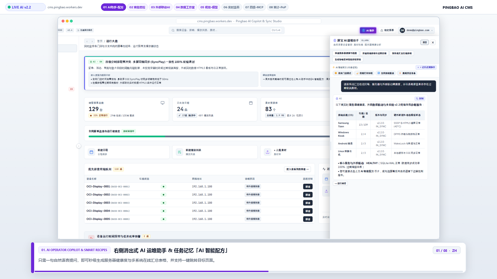 |  |  |
| **右侧滑出式运维助手 (`Ctrl+J`)** 一键执行连环配方并输出多系统表格诊断 | **人工确认防线 + 精准目标隔离** 严格锁定已选设备，点击确认后方才安全下发 | **零代码接入沪深A股·天气·汇率·内网 ERP** 自动记忆学习 API 并实时渲染 16:9 HTML5 看板 |
| **04. ★ 独立数据采集池 & 内容工作室 (NEW)** | **05. HTML5 触控包 · 视觉质检 & 本地 Ollama** | **06. v2.2 动态实时截屏 · MCP · 秒级 PoP** |
|  |  | 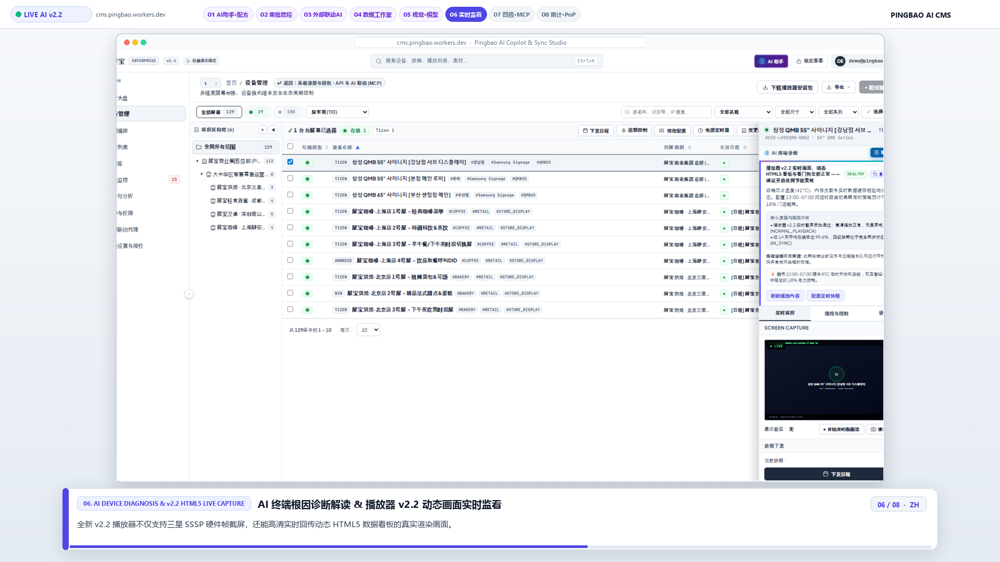 |
| **定时快照共享 & 双栏自然语言定制设计** 同一实时数据源衍生多套独立商显看板 | **源头拦截过期海报 & 11 大模型直连** 支持零 API 费用、数据不出域的内网 Ollama | **三星 SSSP + 动态 HTML5 全屏高清回传** 原生内置 MCP 服务与秒级完播率结算 |

---

## 🌐 重磅新特性 ①：零代码“外部联动代理”与“AI 内容修改工作室”

无需编写一行代码，只需在对话框输入*“帮我接入沪深A股四大核心指数实时行情看板”*或*“接入上海门店实时天气”*，屏宝 **对话式外部联动 AI 助手**即可自动推荐国内外精选接口、完成字段映射，并实时生成 **16:9 交互式 HTML5 动态大屏**。

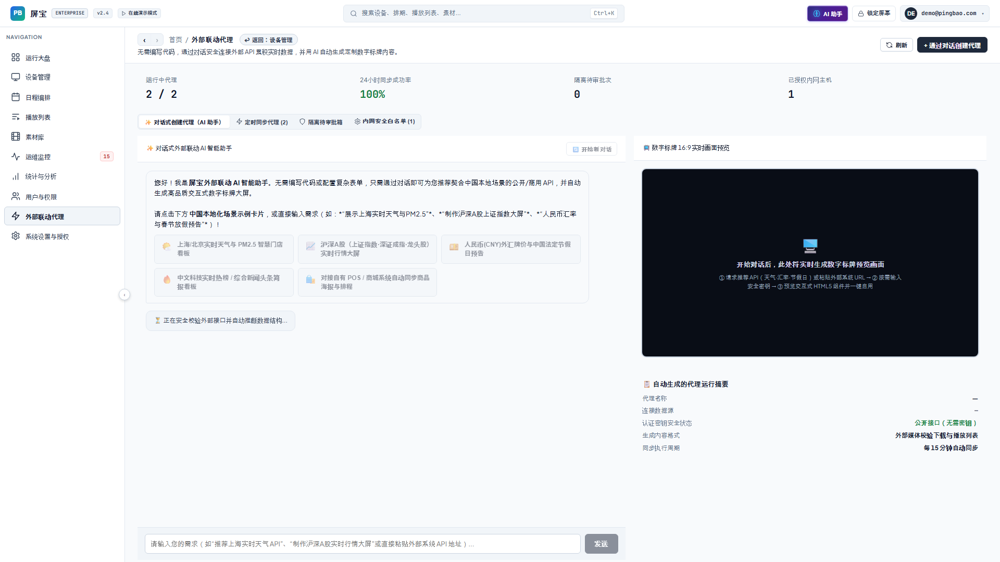
<b>▲ 【外部联动代理 > 对话式创建工作室】：顶部已记忆学习 API 一键复用卡片、中国本地化免密钥/商用接口目录、10 款配色主题及右侧 16:9 实时 HTML5 预览</b>

  

| ① 定时同步代理与累积数据存储池 (`AGENTS`) | ② 双栏「AI 内容修改工作室」 (`NL Content Studio`) |
| :---: | :---: |
| 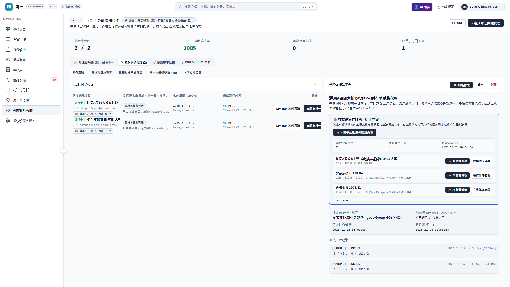 | 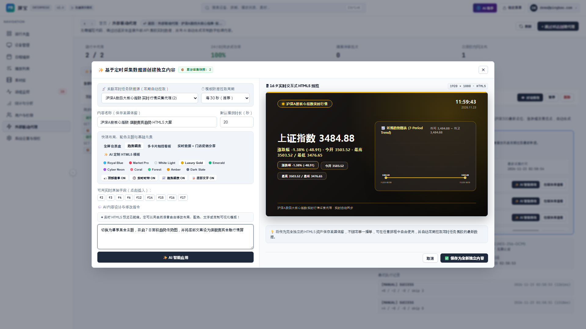 |
| **单一数据源驱动多套独立门店看板** 定时代理持续累积历史数据快照，多套不同版式的 HTML5 媒体内容可按 15~60 秒周期独立订阅 | **自然语言秒级重塑版式·黑金主题·7日走势图** 一键插入原始 API 字段芯片、切换趋势图表，用自然语言自由定制并独立保存至媒体库 |
| **③ 交互式 HTML5 触控包 (`.zip`) 与实时网页 URL** | **④ 数据源订阅标识与一键 `【✨ AI 修改】`** |
| 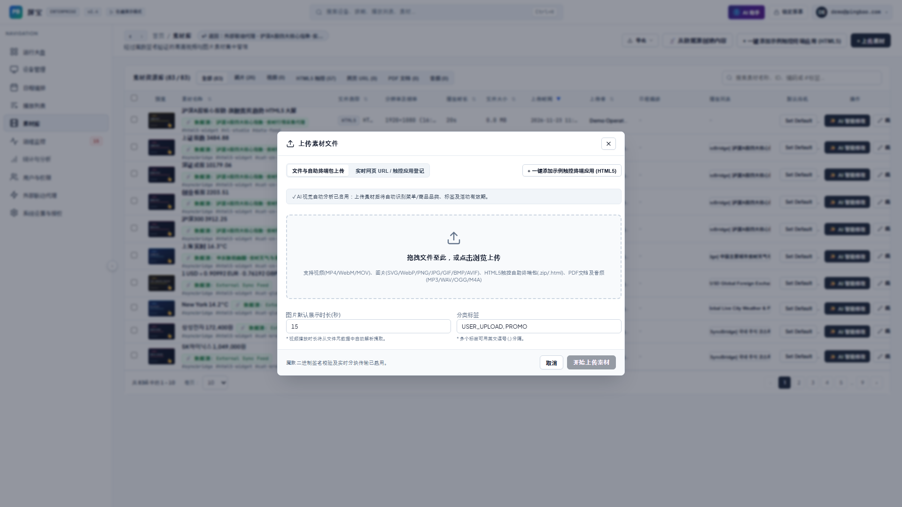 |  |
| **严防 Zip-Slip 路径穿越与恶意可执行文件** 支持上传 `.zip`/`.html` 触控交互应用、一键生成示例应用及注册实时 Web URL | **媒体库深度融合与在播排程自动热更新** 清晰展示关联数据池状态，随时点击 `【✨ AI 修改】` 无缝升级画面 |

### 🛡️ 零 Shell (Zero-Shell) 企业级安全护栏架构
* **AES-256-GCM 密钥保险库**：Bearer 令牌、API Key (Header/Query)、Basic 与 OAuth2 凭据全程主密钥加密存储，绝不在日志或响应中明文暴露。
* **防 SSRF 沙箱与企业内网白名单 (`Allowlist`)**：默认硬性阻断本地回环 (`127.0.0.1`)、云元数据 (`169.254.169.254`) 与数据库端口，仅放行管理员显式授权的内网 ERP/HR 域名或 CIDR 网段。
* **批量变更熔断与隔离审批箱 (`Quarantine Inbox`)**：当外部接口异常触发超限变更或大面积停用时自动熔断挂起，待人工核对差异审批后方才生效，并硬性拦截任何 `SUPER_ADMIN` 提权行为。

---

## 🧠 王牌核心升级 ②：内置“屏宝 AI 运维对话助手”与「AI 智能配方」 (`Ctrl+J`)

点击控制台右上角 **【AI 助手】按钮（快捷键 `Ctrl+J`）**，即可使用顶部可自动记忆连环操作的 **AI 智能配方**，并通过自然语言对话完成千店巡检与安全远控。

<b>▲ 右侧滑出式“屏宝 AI 运维助手”：顶部「AI 智能配方」一键运行栏、实时多系统 v2.2 在线汇总表格及目标页面一键跳转</b>

  

| ① 零事故审批制(HITL)管控与严格子集隔离 | ② 3 秒掌控全局的 `【AI 晨间简报】` 智能卡片 |
| :---: | :---: |
|  |  |
| **100% 杜绝误发全网门店的播出事故** 自动锁定当前勾选屏幕（`已选 3 台设备`），唯有管理员点击 **【确认并执行】** 才会真正下发并写入审计日志 | **全业务模块一键 AI 洞察并自动汇聚至对话窗** 晨间简报、终端诊断、排程冲突校验、安全审计总结一键展开并永久留存对话历史 |
| **③ 多模态视觉自动打标与过期促销拦截** | **④ 11 大中外模型/FreeLLMAPI & 免费内网 Ollama** |
| 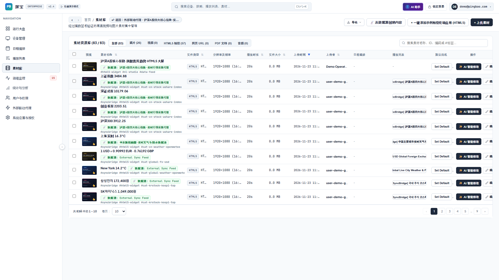 | 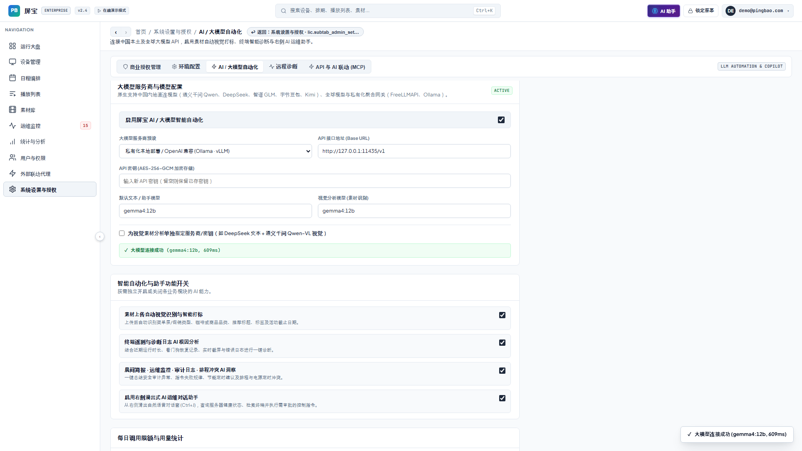 |
| **从源头终结“过期活动海报仍在轮播”事故** 上传即自动提取餐品品类、价目表 OCR、推荐时段及**活动截止日期 (`2026-12-31`)** | **零 API 费用 · 数据零出境企业级隐私保障** 直连通义千问、DeepSeek、智谱、豆包、Kimi、OpenAI、Gemini、FreeLLMAPI 及**免费本地 Ollama/vLLM** |

---

## 📸 十大功能工作台全景介绍与系统界面 (简体中文原生界面)

### 1. 运行仪表盘与 AI 晨间简报 (Dashboard)

---

### 2. 多系统设备管理 (v2.2) · AI 终端根因诊断 · 动态 HTML5 实时截屏 (Device Management)

| 多系统终端列表与实时截屏监看 (`v2.2.0`) | 右侧详情 `管控/控制` —— AI 终端深度根因诊断 |
| :---: | :---: |
|  | 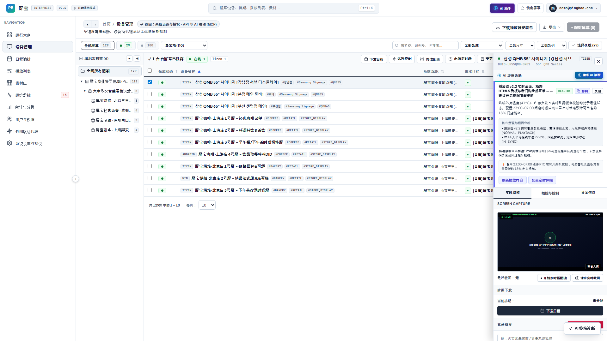 |
| **多系统播放器安装包下载弹窗 (`自动内嵌服务器地址`)** | **7 项指令专属批量远程控制弹窗 (`Bulk Control`)** |
| 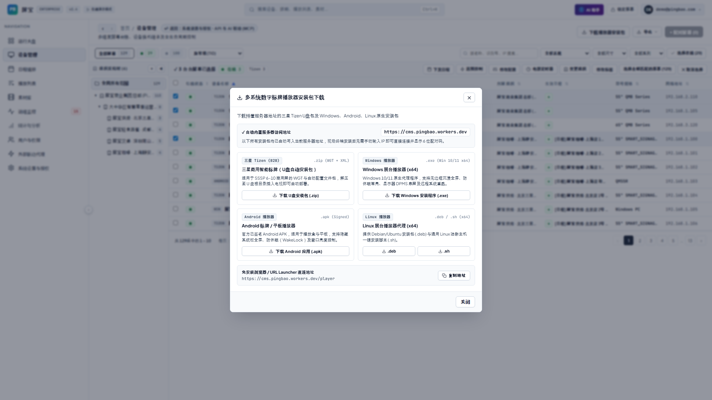 |  |

---

### 3. 四级节目排期核心引擎与 AI 冲突校验 (Schedules)

---

### 4. 播放列表编排 (Playlists)

---

### 5. 媒体素材库 · HTML5 触控包 · 多模态 AI 视觉质检 (Media Assets)

| 媒体资源库 (`实时数据看板与 AI 修改`) | 交互式 HTML5 触控包 (`.zip`) 与实时网页 URL 弹窗 |
| :---: | :---: |
|  |  |

---

### 6. 外部联动代理与 AI 内容修改工作室 (External Sync Agents · NEW)

| 对话式外部联动工作室 (`STUDIO`) | 定时同步代理与数据采集池 (`AGENTS`) |
| :---: | :---: |
|  |  |

---

### 7. 运维监控与状态差异对比 (Operations Monitoring)

---

### 8. 统计与分析：设备运行时长与播发合规证明 (Uptime & PoP)

| 设备运行时长分析台 (`【AI 运行时长与节能建议】`) | 秒级精准播放凭据报表 (`完播率 % 与结算导出`) |
| :---: | :---: |
| 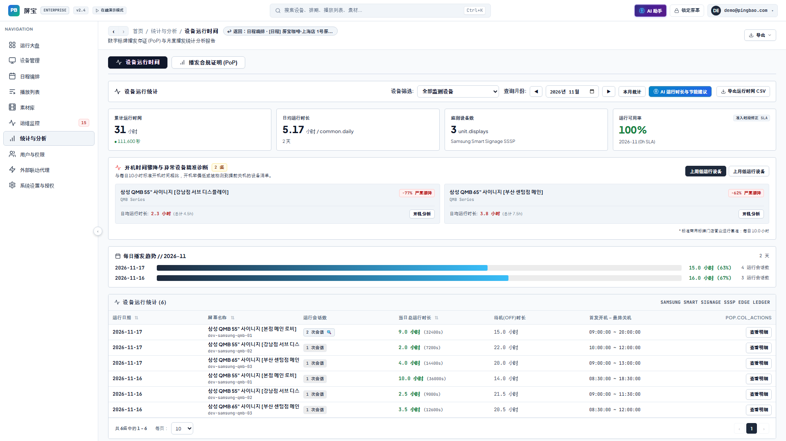 | 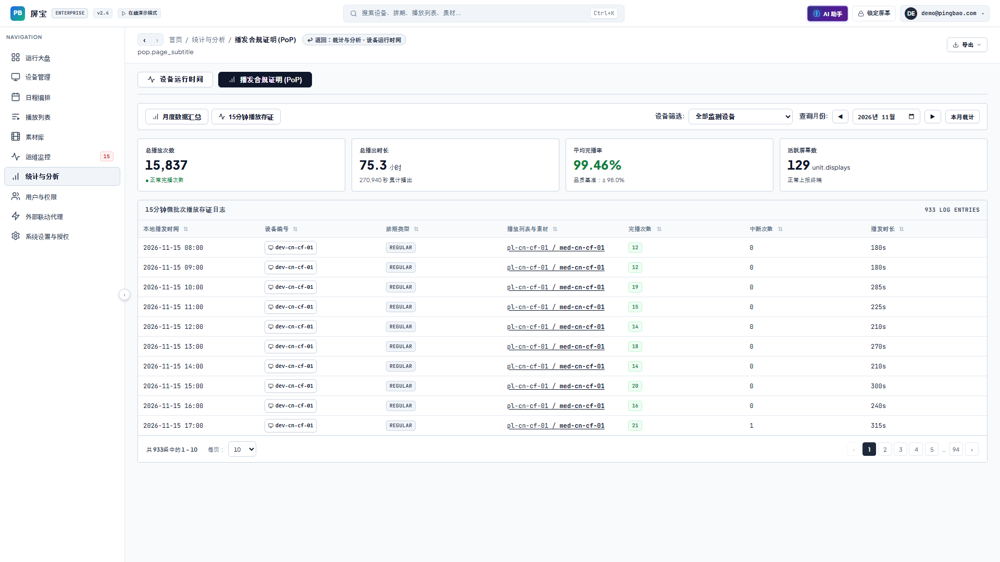 |

---

### 9. 多租户组织权限与不可篡改审计日志 (Users & Audit)

| 多租户组织与 RBAC 权限 (`Users & RBAC`) | 全员操作不可篡改审计账本 (`【AI 安全审计总结】`) |
| :---: | :---: |
|  |  |

---

### 10. 系统设置 · 11 大模型自动化 · 6 个月日志清理 · 外部智能体 MCP 联动

| `AI / 大模型自动化`（11 大中外云/FreeLLMAPI/本地 Ollama） | 环境设置与 6 个月日志自动清理 (`Preferences`) |
| :---: | :---: |
|  | 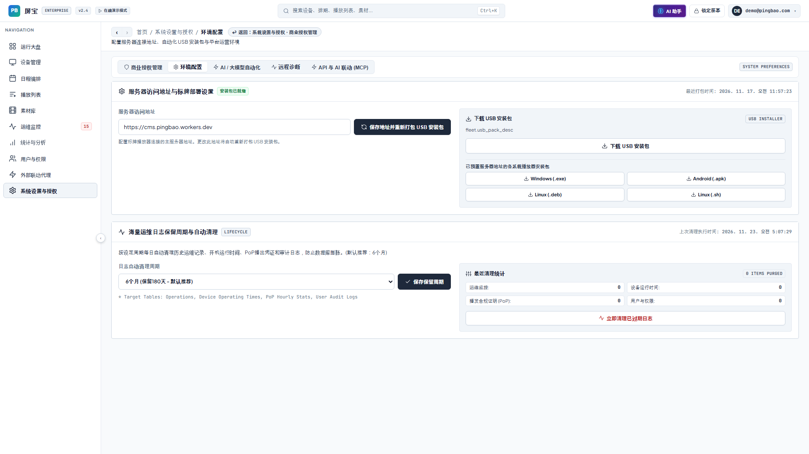 |
| **商业离线数字签名授权 (`Ed25519 License`)** | **开放 REST API 与外部智能体 (`MCP`)** |
| 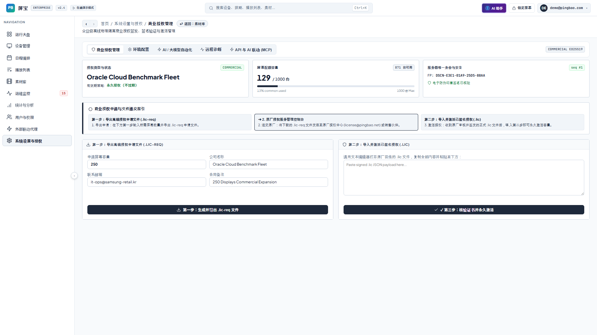 | 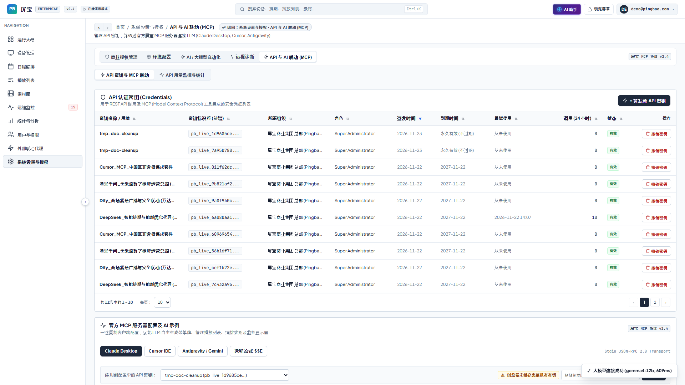 |

---

## 🤖 开放 REST API 与外部智能体 MCP 生态中心

除内置入站**外部联动代理**外，屏宝原生内置标准 **MCP (Model Context Protocol)** 服务（`pingbao` 工具集）与细粒度权限密钥 (`pb_live_...`)，支持 **Claude Desktop、Cursor、Antigravity、Dify 及 DeepSeek 智能体**自主上传海报、编排列表并下发门店排期。

---

## 📋 全功能特性矩阵清单 (Full Feature Matrix)

| 核心模块 | 功能特性明细 | 技术规范与核心优势 |
| :--- | :--- | :--- |
| **1. 内置 AI 助手与智能配方** | 右侧滑出对话窗 (`Ctrl+J`)、**AI 智能配方 (`+ 记忆近期任务`)**、表格诊断、HITL 审批管控 | 自动感知界面焦点、严格子集隔离杜绝全网误发 |
| **2. 对话式外部联动代理** | 自然语言接入天气/沪深A股/汇率/内网 ERP、**已学习 API 记忆卡片**、16:9 HTML5 自动生成 | AES-256 保险库、防 SSRF 与内网白名单、熔断隔离审批箱 |
| **3. 数据采集池与内容工作室** | 定时累积快照存储池、**双栏自然语言 HTML5 内容修改工作室** | 10 款主题配色、7 日走势图、单数据源多看板独立订阅 |
| **4. HTML5 触控包与视觉质检** | 安全校验上传 `.zip`/`.html` 触控包、实时网页 URL、视觉自动打标与过期拦截 | 严防 Zip-Slip、支持 11 大中外模型与免费内网 Ollama |
| **5. 多系统集群管控 (`v2.2.0`)** | 三星 Tizen SSSP 深度控制 + Windows / Android / Linux / Web + 7 项批量管控 | SSSP 硬件 + **动态 HTML5 实时截屏**、安装包自动写入地址 |
| **6. 四级排期与全自动 SyncPlay** | 紧急/活动/常规/垫片四级抢占、AI 排程冲突校验、零配置毫秒级多屏同步 | SSE `sync-stream` + EMA 时钟偏移自动对齐 |
| **7. 自动自愈与开机率/PoP** | `BEFORE/AFTER` 差异比对、开关机会话钻取、秒级真实渲染帧完播率统计 | CSV/JSON/MD 商业对账导出、180 天日志自动清理 |
| **8. 企业安全、审计与 MCP** | TOTP 双因素认证、RBAC、不可篡改审计、60+ REST API 与内置 MCP 服务 | Argon2id、Ed25519 离线授权、直连外部智能体 |

---

## 📖 官方文档指引 (Documentation)

* 📘 [用户运营手册 (User Guide)](docs/zh/user-guide.md) - AI 运维助手与智能配方、对话式外部联动代理、AI 内容修改工作室与四级排期全流程
* 🛠️ [管理员与安全/大模型部署指南 (Admin Guide)](docs/zh/admin-guide.md) - Docker 部署、11 大中外/本地 Ollama 模型配置及外部联动安全规范
* ❓ [常见问题解答 (FAQ)](docs/zh/faq.md) - 对话式外部数据接入、独立数据池衍生看板、免费内网私有化 AI 与 SyncPlay
* 📜 [版本发布日志 (Changelog)](CHANGELOG.md) - `v1.5.0` 最新特性与历史架构演进记录

---

Pingbao (屏宝 / 핑바오) © 2026. All rights reserved. 官方技术社区：<a href="https://github.com/pingbaosignage/pingbao-community">pingbaosignage/pingbao-community</a>

