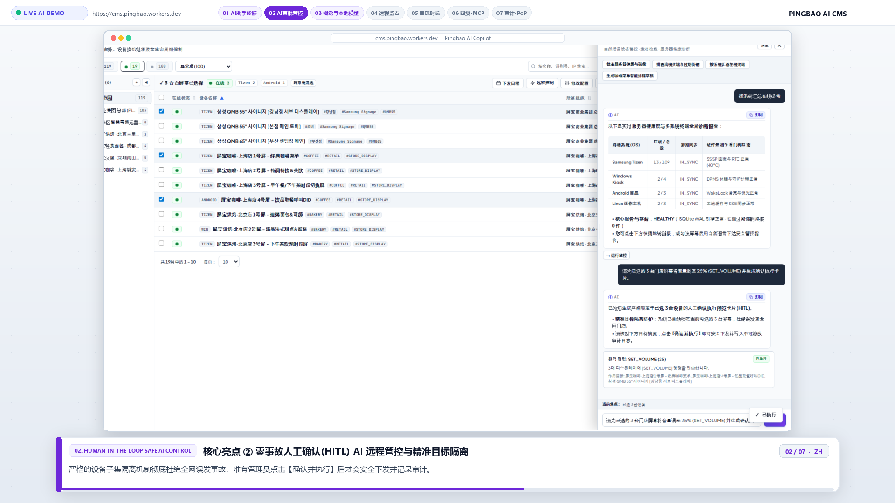
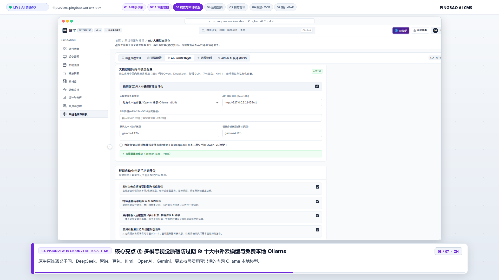
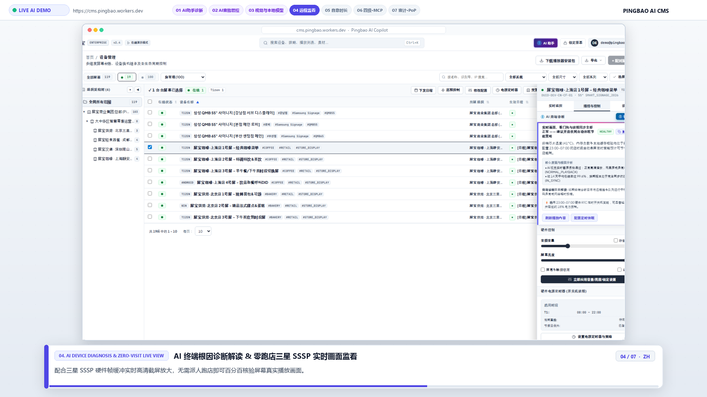
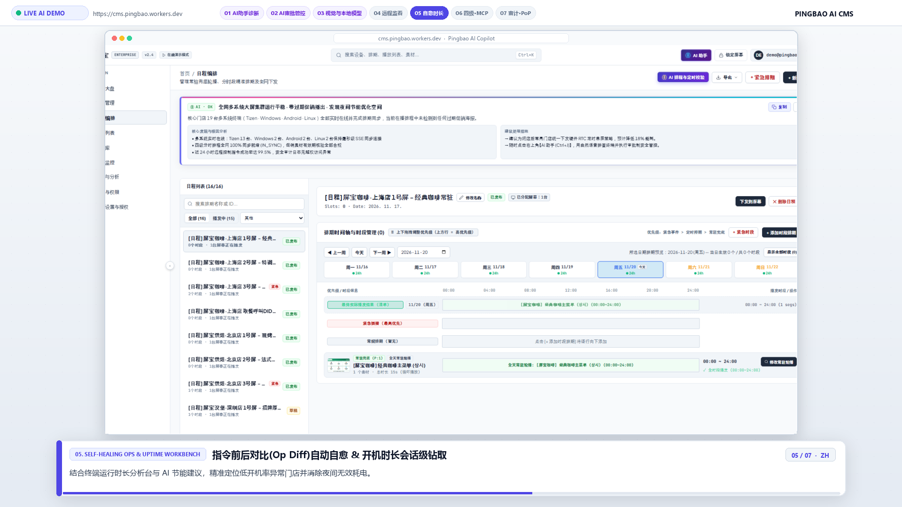
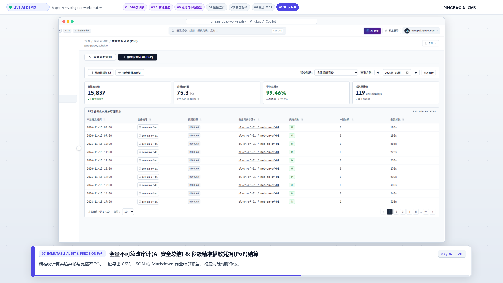
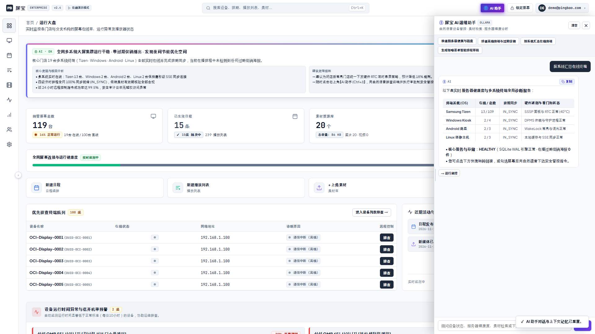
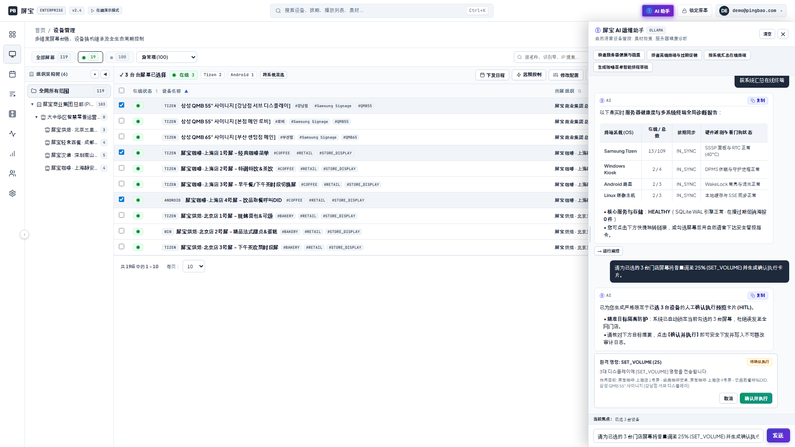
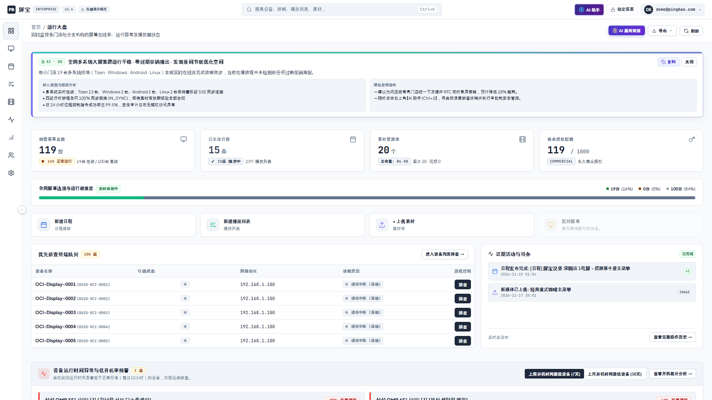
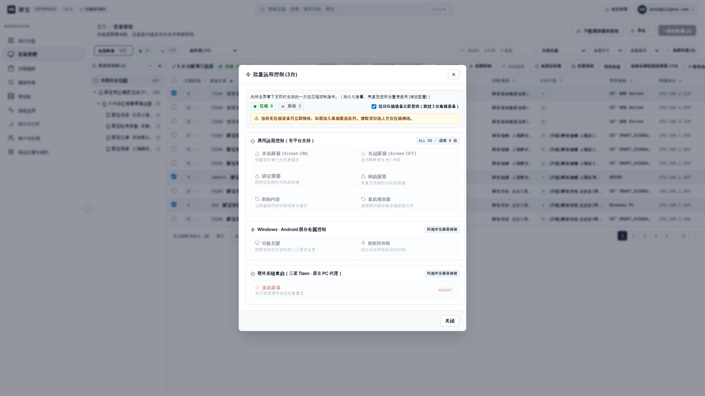
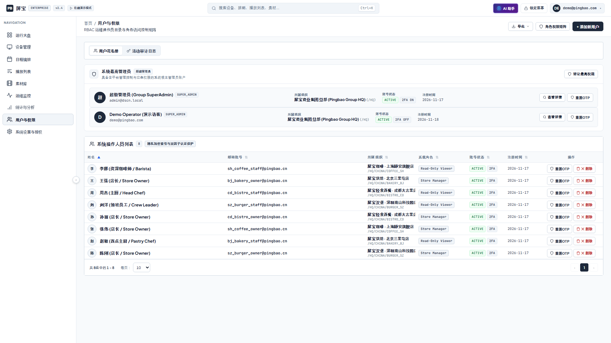

# 📺 屏宝 (Pingbao / 핑바오)
### 原生内置 AI 运维对话助手 · 三星智能商用标牌与多系统企业级云端播控平台

**屏宝 (Pingbao)** 是原生内置 **AI 运维对话助手 (`Ctrl+J`) 与五大核心智能自动化引擎**的新一代企业级数字标牌全域播控平台 (CMS)。系统以**三星智能商用标牌 (Samsung Smart Signage · Tizen 6.5+ / SSSP 6~10+)** 底层原生硬件智控为核心，同时在单一控制台统一纳管 **Windows、Android、Linux 与 Web** 播放终端。  
只需一句自然语言对话，即可输出多系统大屏诊断表格并执行**零事故人工确认制 (HITL) 远程管控**；配合多模态视觉防过期质检、国内五大主流模型直连与 **100% 免费内网本地 Ollama 大模型**、全自动多屏同帧同步 (SyncPlay)、四级分时排程及秒级播放凭据 (PoP)，彻底重塑百城千店智能运维体验。

 

**[ 简体中文 (ZH) ]** | **[ 한국어 (KO) ](README.ko.md)** | **[ English (EN) ](README.en.md)**

 

<!-- ============================================================================== -->
<!-- 🚀 HIGH-VISIBILITY LIVE DEMO BANNER -->
<!-- ============================================================================== -->
<table width="100%" style="margin: 20px 0;">
  <tr>
    <td align="center" style="background: linear-gradient(135deg, #0f172a 0%, #1e293b 100%); padding: 28px 20px; border-radius: 14px; border: 2px solid #3b82f6; box-shadow: 0 10px 25px rgba(59, 130, 246, 0.2);">
      <h2 style="margin: 0 0 12px 0; color: #60a5fa; font-size: 24px; letter-spacing: -0.5px;">
        🚀 屏宝企业级云端 AI 在线免登录体验 (Live Interactive Demo)
      </h2>
      

        <b>无需安装、免注册登录</b>，直接在浏览器中即刻体验屏宝 AI 企业级云端播控平台全部核心能力。 
        （预置 119 台多系统标牌集群、内置 AI 智能自动化中心、24小时四级分时时间轴、PoP 结算与硬件级远控）
      

      
      

        🔗 官方在线体验地址: 
        <a href="https://cms.pingbao.workers.dev" target="_blank" style="color: #ffffff; text-decoration: underline; font-weight: bold; font-size: 14px;">https://cms.pingbao.workers.dev</a>
      

    </td>
  </tr>
</table>

 

<!-- ============================================================================== -->
<!-- 🎬 OFFICIAL AI SPOTLIGHT VIDEO & HIGHLIGHTS -->
<!-- ============================================================================== -->

### 🎬 屏宝 AI 智能运维官方演示视频 (Official AI Spotlight Video)

* 🇨🇳 **中文普通话解说视频**: [▶ 观看视频 (pingbao_smart_operations_demo_zh.mp4)](docs/assets/videos/pingbao_smart_operations_demo_zh.mp4)
* 🇰🇷 **한국어 음성 데모 영상**: [▶ 영상 보기 (pingbao_smart_operations_demo_ko.mp4)](docs/assets/videos/pingbao_smart_operations_demo_ko.mp4)
* 🇺🇸 **English Voiceover Video**: [▶ Watch Video (pingbao_smart_operations_demo_en.mp4)](docs/assets/videos/pingbao_smart_operations_demo_en.mp4)

 

  

#### ⚡ 屏宝 6 大革命性 AI 与企业级运维核心技术 (Why Pingbao?)

| 01. ★ 右侧滑出式 AI 助手表格诊断 | 02. ★ 零事故审批制(HITL) AI 远程管控 | 03. ★ 视觉防过期质检 & 免费内网 Ollama |
| :---: | :---: | :---: |
|  |  |  |
| **原生内置 AI 运维对话助手 (`Ctrl+J`)** 一句话输出服务器健康与多系统大屏表格报告 | **人工确认防线 + 精准目标隔离** 严格锁定已选设备，点击确认后方才安全下发 | **多模态视觉识别 + 十大中外/本地大模型** 自动识别活动截止日，支持零费用本地 Ollama |
| **04. AI 终端根因解读 & 零跑店实时画面** | **05. 指令差异对比自愈 & 开机时长钻取** | **06. 全量不可篡改审计 & 秒级精准 PoP** |
|  |  |  |
| **底层报错通俗解读 + 三星 SSSP 实时截屏** 非技术人员也能秒懂故障原因并足不出户验屏 | **BEFORE/AFTER 对比 & AI 节能建议** 自动重试修复断网，精准消除夜间无效耗电 | **AI 安全审计总结 & 完播率(%)商业对账** 全程留痕记录 IP 并一键导出 CSV/JSON 报表 |

---

## 🧠 王牌核心升级：内置“屏宝 AI 运维对话助手”与五大智能自动化引擎

无需安装任何外部客户端，只需点击控制台右上角 **【AI 助手】按钮（快捷键 `Ctrl+J`）**，即可通过自然语言对话完成千店大屏巡检、安全远控与智能排程。

<b>▲ 右侧滑出式“屏宝 AI 运维助手”：支持拖拽左边缘自由调宽、一键快捷提问芯片、实时生成多系统在线汇总表格及目标页面快捷跳转</b>

  

| ① 零事故审批制(HITL)管控与严格子集隔离 | ② 3 秒掌控全局的 `【AI 晨间简报】` 智能卡片 |
| :---: | :---: |
|  |  |
| **100% 杜绝误发全网门店的播出事故** 自动锁定当前勾选屏幕（`已选 3 台设备`），唯有管理员点击 **【确认并执行】** 才会真正下发并写入审计日志 | **全业务模块一键 AI 洞察并自动汇聚至对话窗** 晨间简报、终端诊断、排程冲突校验、故障规律与安全审计总结一键展开并永久留存对话历史 |
| **③ 多模态视觉自动打标与过期促销拦截** | **④ 国内五大模型直连 & 100% 免费内网 Ollama** |
|  |  |
| **从源头终结“过期活动海报仍在轮播”事故** 上传即自动提取餐品品类、价目表 OCR、推荐时段及**活动截止日期 (`2026-12-31`)** | **零 API 费用 · 数据零出境企业级隐私保障** 免代理直连通义千问、DeepSeek、智谱 GLM、字节豆包、Kimi、OpenAI、Gemini 及**免费本地 Ollama/vLLM** |

---

## 🌟 核心产品优势 (Core Value Propositions)

1. **内置 AI 运维对话助手 (`Ctrl+J`) 与多模态视觉全链路自动化**
   * 自动感知当前界面焦点、长对话摘要记忆压缩、HITL 审批制远程控制、多模态视觉防过期拦截、3 秒生成中英韩三语应急广播文案、10 大国内外云与本地免费 Ollama 模型支持。
2. **专注三星商用标牌深控 · 五大系统统一纳管 (Multi-OS)**
   * 深度适配**三星智能商用标牌 (Tizen 6.5+ / SSSP 6~10+)** 底层硬件控制，同时支持 **Windows (`.exe`) · Android (`.apk`) · Linux (`.deb`/`.sh`) · Web (`/player`)** 自动内嵌服务器地址安装包弹窗及 **7 大指令专属批量远控**。
3. **断网永续自治轮播 & 四级分时智能排程**
   * 本地高速缓存保障断网零黑屏；`EMERGENCY > EVENT > REGULAR > DEFAULT` 四级抢占并配备 `【AI 排程与定时校验】`。
4. **全自动多屏同步播放技术 (SyncPlay)**
   * 满足**【同一分组 + 同一排程 + 同一局域网】**时，基于认证 SSE `sync-stream` 与时钟校准实现 100% 零配置毫秒级同帧翻页。
5. **开机时长分析、秒级精准 PoP、6 个月日志自动清理与标准 MCP 接口**
   * 每日开关机会话钻取、真实硬件渲染帧完播率统计、默认 180 天日志自动清理以及 60+ REST API 与内置 `pingbao` MCP 服务。

---

## 📸 全功能工作台全景介绍与系统界面 (简体中文原生界面)

### 1. 运行仪表盘与 AI 晨间简报 (Dashboard)

---

### 2. 多系统设备管理 · AI 终端根因诊断 · 一键安装包弹窗 (Device Management)

| 多系统终端列表与零跑店实时截屏监看 | 右侧详情 `管控/控制` —— AI 终端深度根因诊断 |
| :---: | :---: |
|  |  |
| **多系统播放器安装包下载弹窗 (`自动内嵌服务器地址`)** | **7 项指令专属批量远程控制弹窗 (`Bulk Control`)** |
|  |  |

---

### 3. 四级节目排期核心引擎与 AI 冲突校验 (Schedules)

---

### 4. 播放列表编排 (Playlists)

---

### 5. 媒体素材库与多模态 AI 视觉质检 (Media Assets)

| 4K 媒体素材资源库 (`流式上传与文件头校验`) | AI 视觉元数据与活动截止日过期拦截 |
| :---: | :---: |
|  |  |

---

### 6. 运维监控与状态差异对比 (Operations Monitoring)

---

### 7. 统计与分析：设备运行时长与播发合规证明 (Uptime & PoP)

| 设备运行时长分析台 (`【AI 运行时长与节能建议】`) | 秒级精准播放凭据报表 (`完播率 % 与结算导出`) |
| :---: | :---: |
|  |  |

---

### 8. 多租户组织权限与不可篡改审计日志 (Users & Audit)

| 多租户组织与 RBAC 权限 (`Users & RBAC`) | 全员操作不可篡改审计账本 (`【AI 安全审计总结】`) |
| :---: | :---: |
|  |  |

---

### 9. 系统设置 · AI 大模型自动化 · 6 个月日志清理 · MCP 联动

| `AI / 大模型自动化`（国内五大直连与免费本地 Ollama） | 环境设置与 6 个月日志自动清理 (`Preferences`) |
| :---: | :---: |
|  |  |
| **商业离线数字签名授权 (`Ed25519 License`)** | **开放 REST API 与外部智能体 (`MCP`)** |
|  |  |

---

## 📋 全功能特性矩阵清单 (Full Feature Matrix)

| 核心模块 | 功能特性明细 | 技术规范与核心优势 |
| :--- | :--- | :--- |
| **1. 内置 AI 运维对话助手** | 右侧滑出对话窗 (`Ctrl+J`)、表格诊断、HITL 审批执行卡片、一键跳转 | 自动感知界面焦点、严格子集隔离杜绝全网误发 |
| **2. 多模态视觉与全域 AI 洞察** | 晨间简报、终端日志解读、视觉自动打标防过期、三语应急文案秒级生成 | 原生支持国内五大模型与免费内网 Ollama、AES-256 加密 |
| **3. 多系统终端集中管控** | 三星 Tizen SSSP 深度控制 + Windows / Android / Linux / Web + 7 项批量管控 | OS 自适应 HAL 路由、安装包自动写入服务器地址 |
| **4. 四级排期与全自动 SyncPlay** | 紧急/活动/常规/垫片四级抢占、AI 排程冲突校验、零配置毫秒级多屏同步 | SSE `sync-stream` + EMA 时钟偏移自动对齐 |
| **5. 自动自愈与开机率/PoP** | `BEFORE/AFTER` 差异比对、开关机会话钻取、秒级真实渲染帧完播率统计 | CSV/JSON/MD 商业对账导出、180 天日志自动清理 |
| **6. 企业安全、审计与 MCP** | TOTP 双因素认证、RBAC、不可篡改审计、60+ REST API 与内置 MCP 服务 | Argon2id、Ed25519 离线授权、无缝直连外部智能体 |

---

## 📖 官方文档指引 (Documentation)

* 📘 [用户运营手册 (User Guide)](docs/zh/user-guide.md) - AI 运维助手实战、多系统注册配对、视觉防过期质检与四级排期全流程
* 🛠️ [管理员与大模型部署指南 (Admin Guide)](docs/zh/admin-guide.md) - Docker 部署、国内/国际/本地 Ollama 大模型配置与升级维护
* ❓ [常见问题解答 (FAQ)](docs/zh/faq.md) - AI 审批制安全防护、免费内网私有化 AI、断网自治播放与 SyncPlay
* 📜 [版本发布日志 (Changelog)](CHANGELOG.md) - 历史版本更新特性与架构演进记录

---

Pingbao (屏宝 / 핑바오) © 2026. All rights reserved. 官方技术社区：<a href="https://github.com/pingbaosignage/pingbao-community">pingbaosignage/pingbao-community</a>

