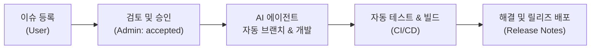

# 📺 핑바오 (Pingbao)
### Enterprise Digital Signage Management Platform

**핑바오(Pingbao)**는 수천 대의 스마트 사이니지 디스플레이를 원격으로 통합 관제하고,  
타임라인 드래그 앤 드롭으로 콘텐츠를 무중단 자율 스케줄링하는 엔터프라이즈 디지털 사이니지 플랫폼(CMS)입니다.

---

## 🌟 주요 특징 (Key Features)

* **하드웨어 표준화 및 심층 원격 제어**
  * 삼성 스마트 사이니지 Standalone(Tizen 6.5 / SSSP 10 이상) 완벽 지원
  * 원격 화면 On/Off, 볼륨 조절, 단말 재부팅 및 실시간 화면 캡처 모니터링
* **기간 제한 없는 자율 반복 스케줄링 (Autonomous Offline Loop)**
  * 네트워크가 장시간 끊어져도 디스플레이 단말이 로컬 캐시를 통해 24시간 365일 무중단 자율 재생
  * 24시간 Base Fallback 루프 및 특정 시간대/요일 우선 이벤트 스케줄 지원
* **고성능 미디어 & 플레이리스트 파이프라인**
  * 대용량 고화질 비디오(MP4, WebM) 및 이미지 실시간 스트리밍 업로드
  * 매직 바이트 바이너리 시그니처 무결성 검증
* **반응형 관제 웹 콘솔 & 다국어 지원**
  * 데스크톱 관제실 대화면부터 모바일 현장 제어 화면까지 완벽 반응형 UI
  * 한국어, English, 中文 3개 국어 실시간 전환 지원
* **검증된 엔터프라이즈 경량 아키텍처**
  * PostgreSQL + Redis + MinIO/S3 기반 고효율 구조
  * 온프레미스(Docker / Synology DSM) 및 클라우드 배포 지원

---

## 📖 문서 및 매뉴얼 (Documentation)

* 📘 [사용자 매뉴얼 (User Guide)](docs/user-guide.md) - 디스플레이 등록, 미디어 업로드, 플레이리스트 편성, 스케줄링 방법
* 🛠️ [관리자 및 설치 가이드 (Admin Guide)](docs/admin-guide.md) - Docker 환경 구성, 환경변수 설정, 업그레이드 및 롤백
* ❓ [자주 묻는 질문 (FAQ)](docs/faq.md) - 오프라인 재생, 지원 규격 및 트러블슈팅
* 📜 [변경 이력 (Changelog)](CHANGELOG.md) - 버전별 변경 사항 및 개선 내역

---

## 💡 이슈 등록 및 제안 (Issue & Feature Request)

핑바오를 사용하시면서 버그를 발견하셨거나 새로운 기능이 필요하신 경우 언제든 이슈를 등록해 주세요!

* [🐛 버그 리포트 등록하기](https://github.com/pingbaosignage/pingbao-community/issues/new?template=bug_report.md)
* [💡 기능 제안 등록하기](https://github.com/pingbaosignage/pingbao-community/issues/new?template=feature_request.md)

### 이슈 처리 워크플로우

1. **이슈 등록**: 사용자가 버그나 개선점을 등록합니다.
2. **관리자 승인 (`accepted`)**: 관리자가 이슈를 검토하고 `accepted` 라벨을 부여합니다.
3. **자동 개발 및 검증**: 개발 에이전트가 승인된 이슈를 감지하여 기능 브랜치를 생성하고 자동 구현 및 테스트/빌드를 수행합니다.
4. **릴리즈 반영**: 검증 완료된 기능은 다음 버전에 패키징되어 릴리즈 노트와 함께 공개됩니다.

---

## 🚀 릴리즈 및 다운로드 (Releases)

최신 릴리즈 패키지 및 릴리즈 노트는 **[Releases](https://github.com/pingbaosignage/pingbao-community/releases)** 탭에서 확인하실 수 있습니다.
