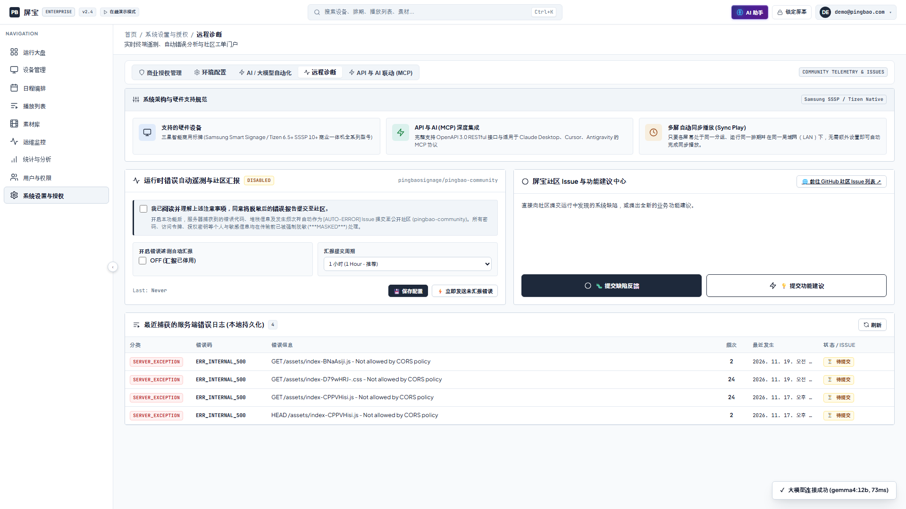

<div align="center">

# 📺 屏宝 (Pingbao / 핑바오)
### 三星智能商用标牌企业级云端播控平台 (Samsung Smart Signage CMS)

**屏宝 (Pingbao)** 是一款专为**三星智能商用标牌 (Samsung Smart Signage)** 量身打造的企业级数字标牌全域智能播控平台。  
原生深度适配三星 Tizen SSSP (Samsung Smart Signage Platform) 硬件生态，支持数万台三星商用大屏的集中智控、24小时可视化时间轴时段编排、全自动多屏同步轮播（SyncPlay）、断网永续自主离线播放，并全面开放企业级 REST API 与 AI 智能体 MCP (Model Context Protocol) 协议支持。

[](#)
[](https://github.com/pingbaosignage/pingbao-community/releases)
[](https://github.com/pingbaosignage/pingbao-community/issues)
[](#)

<br/>

**[ 简体中文 (ZH) ](README.md)** | **[ 한국어 (KO) ](README.ko.md)** | **[ English (EN) ](README.en.md)**

<br/><br/>


<sub><b>▲ 屏宝 (Pingbao) 实时运营仪表盘：全网三星商用屏幕在线率、排期部署进度、存储用量与设备健康状态总览（Oracle 生产集群实测数据）</b></sub>

</div>

---

## 🌟 核心产品优势 (Core Value Propositions)

1. **专注三星商用标牌·底层硬件深度智控**
   * 专属深度适配**三星智能商用标牌 (Samsung Smart Signage / Tizen 6.5+ SSSP 10+)**。
   * 支持三星液晶面板背光远程软硬件开关、音量动态调节、系统定时重启、内部运行温度监测及屏幕实际画面 1 秒级远程截屏回传。
2. **断网无忧·永续自主离线轮播 (Autonomous Offline Loop)**
   * 依托三星标牌本地高速存储预载与 SQLite 离线状态机，网络长期中断时终端依据排期计划 24/7/365 永续无缝轮播，告别黑屏与报错界面。
   * 具备差分增量下载、断点续传与 MD5/SHA-256 双重二进制校验。
3. **四级优先级时间轴智能排期引擎 (4-Tier Smart Scheduling Engine)**
   * 独家支持 `EMERGENCY`（紧急插播）> `EVENT`（分时营销活动）> `REGULAR`（日常分时轮播）> `DEFAULT`（24小时底图兜底）四级抢占体系。
   * 智能分时时段（Dayparting: 早市/午市/下午茶/晚市/夜间）自动无缝切换，高优先时段结束后自动回落，零黑屏零闪烁。
4. **全自动多屏同步播放技术 (SyncPlay)**
   * **全自动零配置**：只需满足**【同一设备分组】、【相同节目排期】、【同一局域网】**三个条件，多台三星标牌无需任何额外拼接硬件或手动配置，即可全自动实现毫秒级帧同步与联屏同时翻页。
5. **企业级 REST API 与 AI 智能体 MCP 支持**
   * 全面开放标准化 OpenAPI 3.0 RESTful 接口与 **MCP (Model Context Protocol)** 协议服务器。
   * 支持 Claude、Cursor、Antigravity 等各类大模型 AI 智能体直接调用工具进行设备巡检、排期下发、状态诊断与自动化运维，并提供精细化 API Key 权限与调用量监控。
6. **企业级合规与精准播放证明 (Proof of Play - Pop)**
   * 精确记录每台屏幕上每个视频与图片的实际开播时间、结束时间与完整播放率（Completion Rate %）。
   * 具备防篡改签名，支持按门店、屏幕、广告主维度一键导出商业审计报表。
7. **故障自愈与自动化社区错误遥测 (Automated Error Telemetry)**
   * 生产环境异常自动捕获、脱敏脱密、指纹去重，经管理员授权后可一键或周期性将错误回传至 GitHub Community Issue，加速版本迭代。

---

## 📸 全功能工作台全景介绍与系统界面 (All 9 Workspaces)

屏宝控制台针对企业复杂运营场景，提供清晰统一的 9 大核心功能工作台：

### 1. 运行仪表盘 (Dashboard)
集团全网运营的一站式指挥中心。实时呈现全网三星商用显示屏在线/离线占比、当日排期同步完成率、存储桶资源消耗、设备地域分布图及系统异常即时告警卡片。


* **核心指标一览**：设备总数、在线率、活跃排期、素材总数与磁盘占用。
* **快捷行动面板**：一键触达设备注册、素材上传、排期下发与系统审计日志。

---

### 2. 设备集中管理 (Device Management)
数万台三星智能商用标牌的生命周期与物联网远程管控中枢。


* **多维快速检索与状态过滤**：支持按所属组织（集团总部、大中华区、城市旗舰店）、在线状态（在线/离线/告警）、屏幕朝向（横屏/竖屏）及 IP/MAC 进行毫秒级筛选。
* **硬件级远程指令**：屏幕背光开关、静音/音量滑块调节、远程重启播放器应用及系统冷重启。
* **画面实时回传 (Live Screenshot)**：无需巡店人员拍照，随时获取三星标牌 1080P/4K 真实当前渲染画面。
* **定时开关机计划**：按门店营业时间（如 09:30~22:00）配置自动关机节能策略，延长显示面板物理寿命。

---

### 3. 节目排期核心引擎 (Schedules) —— [核心特写]
屏宝最强劲的商业播控调度引擎。支持基于 24 小时绝对时间轴与多时段分时编排（Dayparting）。


* **左右主从分栏布局 (Split Master-Detail)**：左侧清晰展示组织内所有排期草稿与已发布计划，右侧展开直观的 24 小时多轨道时间轴。
* **四级优先级抢占机制**：支持将插播时段、营销时段与常态时段进行多层叠加，系统智能计算有效广播窗口（Effective Windows）。
* **原子化草稿发布与回滚**：编辑排期不影响在线屏幕播放，编辑完成后一键点击“发布排期”，秒级差分推送到关联设备集群。

#### 详细时段编排与优先级矩阵 (Schedule Detail & Slots)
点击任意排期条目，即可进入精准到秒的时段编排工作区：


* **拖拽优先级调整 (Drag & Drop Priority)**：时段列表支持自由拖拽排序，系统自动重设权重值（Priority 10~100）。
* **有效播放时段智能分析**：若高优先级时段存在时间覆盖，系统以绿色/橙色/虚线高亮显示实际有效播放区间，完全消除时间重叠冲突困惑。
* **终端一键批量指派**：灵活勾选单台设备、门店分组或整栋楼宇，支持快速解绑与覆写。

---

### 4. 播放列表编排 (Playlists)
多媒体素材的内容组合与视效编排中枢。


* **自由混排与秒级停留控制**：支持视频（MP4/WebM）与图片（PNG/JPG/SVG/WebP）在同一列表中任意混排，支持自定义每张图片的停留秒数（如 8s、15s、30s）。
* **平滑视效转场**：内置无缝切换（Cut）、平滑淡入淡出（Crossfade）等多种硬件加速转场效果。
* **总时长自动计算**：智能累加列表各素材时长，实时反馈单个循环的总耗时（如 04:15），方便精准契合商场广播时段。

---

### 5. 媒体素材智能管家 (Media Assets)
海量高清多媒体资产的统一存储与合规验证空间。


* **超大文件分片流式上传**：支持 4K 60fps 巨幅视频极速上传，支持断点续传。
* **二进制魔数校验 (Magic Bytes Verification)**：严格验证文件真实格式，防止伪装扩展名的恶意文件注入。
* **全景素材预览与元数据提取**：自动读取视频分辨率、编码格式（H.264/H.265/AV1）、时长及生成高清 SVG/WebP 缩略图。
* **引用依赖删除保护**：被任何播放列表或排期引用的素材受智能锁保护，严防误删导致现场出现黑屏。

---

### 6. 运维监控与故障诊断 (Operations Monitoring)
为运维工程师和外包服务商打造的实时监看与自愈工作台。


* **单机通讯与指令队列实时追踪**：直观展示每台屏幕与控制台的长轮询心跳延迟（Ping RTT）、离线告警时间及未执行指令堆积数。
* **一键故障重试 (1-Click Batch Retry)**：针对因网络抖动偶发失败的下发任务，提供一键批量重新分发功能。
* **诊断日志与报告导出**：支持生成标准 Markdown 运维报告与 CSV 格式排障日志，便于提交运维支持分析。

---

### 7. 播放证明与商业对账报表 (Proof-of-Play & Analytics)
数字标牌商业化运营与广告合规审计的权威数据凭证。


* **精确到秒级的事实日志**：终端在本地独立记录真实渲染帧数与起止时间戳，抗断网暂存，联网后通过 HMAC 校验上传。
* **完整播放率与中断深度分析**：区分“全流程播放完成（100%）”与“因插播临时中断（Partial）”，提供合规计费依据。
* **多维统计图表与数据导出**：支持按日期区间、品牌组织、播放列表及单台设备查看趋势图，支持 Excel / CSV 导出。

---

### 8. 用户、多租户组织与 RBAC 权限矩阵 (Users & RBAC)
满足集团多层级分权管理的政企级安全架构。


* **多租户树形组织架构**：集团总部 ➔ 大中华区销售中心 ➔ 城市旗舰店 ➔ 单店部门，数据权限完全隔离。
* **细粒度 RBAC 权限矩阵**：内建超级管理员（SuperAdmin）、运营总监（Operations Manager）、内容编排员（Content Editor）、现场运维（Field Tech）等角色，支持精确到模块 CRUDX（创建、读取、更新、删除、执行/发布）权限控制。
* **企业双因子认证 (2FA / TOTP)**：全员支持基于 RFC 6238 的谷歌验证器 / 微软 Authenticator 动态口令，配备应急一次性备份码。

---

### 9. 商业授权与错误自动遥测社区 (License & Error Telemetry)
透明合规的商业授权凭据与敏捷的开源社区共建通道。

| 商业授权概览 (Commercial License) | 错误自动遥测与社区工单 (Error Telemetry) |
| :---: | :---: |
|  |  |

* **Ed25519 非对称电子签名授权**：支持离线私有化环境授权，防伪造、防窜改，清晰呈现已激活终端配额与有效期。
* **自动化错误遥测与社区直连 (Community Issue Telemetry)**：
  * **隐私合规与主动知情**：默认严格遵循 Opt-in 机制，必须由超级管理员勾选同意方可启动。
  * **敏感数据智能脱敏**：系统在收集服务器崩溃和通信异常时，自动过滤密码、Authorization 头部、公网私网 IP 及手机号等 PII 隐私数据。
  * **SHA-256 指纹去重聚合**：自动聚合相同堆栈错误，防止向社区重复刷单，自动将错误派发到 [pingbaosignage/pingbao-community](https://github.com/pingbaosignage/pingbao-community/issues)。
  * **内置手动社区工单表单**：管理员亦可在控制台内直接填写改善建议与 Bug 描述，一键直通开发团队 GitHub 议题看板。

---

## 🎯 核心调度引擎深度解析 (Deep Dive: Scheduling Architecture)

排期系统是企业数字标牌的核心灵魂。屏宝采用工业级状态机设计，确保在各种复杂的业务场景下内容播放精准无误。

### 1. 四级优先级抢占模型 (4-Tier Priority Hierarchy)

```
┌─────────────────────────────────────────────────────────────┐
│  Tier 1: EMERGENCY (P: 100 ~ 200)                           │
│  紧急广播 / 台风防灾警报 / 消防疏散 / 领导视察全屏抢占      │
├─────────────────────────────────────────────────────────────┤
│  Tier 2: EVENT (P: 50 ~ 99)                                 │
│  限时营销活动 / 午高峰特价推荐 / 晚市音乐派对促销           │
├─────────────────────────────────────────────────────────────┤
│  Tier 3: REGULAR (P: 10 ~ 49)                               │
│  全天常态分时排期 / 早间问候 / 下午茶轮播                   │
├─────────────────────────────────────────────────────────────┤
│  Tier 4: DEFAULT (P: 0)                                     │
│  24/7 底层兜底播放列表 (Base Fallback Playlist)             │
└─────────────────────────────────────────────────────────────┘
```

* **抢占与自愈逻辑**：
  * 当高优先级时段到达时，终端硬件毫秒级切入高优先级内容，当前播放列表优雅淡出。
  * 当高优先级时段结束或被管理员取消时，屏幕自动平滑回落至下一优先级的常态内容，**全程无需人工干预，无蓝屏、无加载图标**。

### 2. 分时时段智能编排 (Dayparting Matrix)

餐饮与零售行业典型的全天分时运营方案：

| 运营时段 | 播放时段 (Time Window) | 推荐内容与业务场景 | 优先级等级 |
| :--- | :--- | :--- | :--- |
| **早餐黄金档** | `07:30 ~ 10:30` | 早餐套餐特惠、晨间醒脑咖啡推介、今日天气预报 | `EVENT` (P:60) |
| **日常上午档** | `10:30 ~ 11:30` | 品牌形象大片、会员积分换购、当季主打商品轮播 | `REGULAR` (P:20) |
| **午市高峰爆流** | `11:30 ~ 14:00` | 午餐爆款单人餐、热卖点单排行榜、翻台引导视频 | `EVENT` (P:80) |
| **下午茶轻享** | `14:00 ~ 17:30` | 现烘烘焙甜点、特饮买一赠一、舒缓背景动效 | `REGULAR` (P:30) |
| **晚市餐饮狂欢** | `17:30 ~ 21:30` | 晚餐多人家庭套餐、精酿生啤促销、晚间特调鸡尾酒 | `EVENT` (P:85) |
| **夜间常态与打烊** | `21:30 ~ 24:00` | 打烊提示、明日预告、低能耗品牌静态海报 | `DEFAULT` (P:0) |

### 3. 全自动多屏同步播放技术 (SyncPlay)
在现代化连锁快餐和零售前台，通常由 3~5 块三星商用横屏拼接构成数字化电子餐牌（Digital Menu Board）。屏宝通过创新的 **SyncPlay 自动同步协议** 实现：
* **全自动触发条件（零繁琐配置）**：
  只要多台三星商用标牌满足以下三项条件，系统开机后即可**全自动触发 SyncPlay 毫秒级帧同步**：
  1. **相同设备分组 (Same Device Group)**：屏幕归属于同一门店或同一区域分组；
  2. **相同节目排期 (Same Assigned Schedule)**：被指派了相同的排期计划；
  3. **相同局域网络 (Same Local Network)**：接入同一个门店局域网（有线或 Wi-Fi）。
* **毫秒级时钟对齐与统一翻页**：基于局域网轻量心跳广播，各屏幕在切歌换图时**同一瞬间统一淡入、统一翻页**，彻底杜绝单台卡顿造成的视觉杂乱。
* **超宽画卷跨屏协同**：支持将一段 5760x1080 超宽巨幅视频，根据各屏幕的物理点位自动裁切并精准同步播放，无需任何昂贵的外部拼接矩阵硬件。

### 4. 离线断网自治循环机制 (Offline Autonomous Loop)
屏宝采用“**配置先行，素材预载，本地自治**”架构：
1. **预下载机制 (Pre-Caching)**：新排期发布后，三星终端播放器在后台以低优先级网络带宽静默下载未来时段所需的所有媒体文件。
2. **原子化生效 (Atomic Activation)**：到达预定时间点瞬间，播放器直接从本地固态存储调入素材并无缝切换，不依赖即时网络连接。
3. **极强容灾韧性**：即使门店因施工导致宽带断开数周，屏幕仍将严格依据设备内部高精度硬件实时时钟（RTC）按计划每日精准切换早市、午市与晚市内容。

---

## 🤖 开放 REST API 与 AI 智能体 MCP 支持

屏宝提供完备的开发者与智能化生态接入能力，原生内置标准 **MCP (Model Context Protocol)** 协议服务器（`pingbao` 工具包），支持与 Claude Desktop、Cursor、Antigravity 以及企业自定义 LLM 自动化 Agent 无缝对接。

### 🌟 核心特性：支持 LLM 生成内容直传与排期编排
> **💡 支持 AI 生成内容自动上传吗？**  
> **完全支持！** 智能体可通过 `pingbao_upload_media` 接口直接上传由大语言模型实时生成的 SVG 矢量海报、HTML 动态组件、Base64 编码图片或媒体 URL，并可自动装配为播放列表（`pingbao_create_playlist`）及下发到指定分组的时间轴排期（`pingbao_create_schedule`）。从“创意生成”到“屏幕播发”全链路无需人工干预。

### 💬 5 大核心实战场景与 AI 提示词 (Prompts) 示例

| 场景序号 | 运维管控场景 | 适用 MCP 工具 | 推荐 AI 智能体提示词 (Prompt) 示例 |
| :---: | :--- | :--- | :--- |
| **01** | **自然语言状态巡检与异常排查**<br/>(Device Status & Health) | `pingbao_list_devices`<br/>`pingbao_get_device_detail` | *"请检查上海旗舰店和首尔江南店所有三星商用标牌的运行状态。列出所有离线超过 10 分钟或当前排期播放失败的屏幕，并分析可能的原因。"* |
| **02** | **LLM 生成内容自动上传与编排**<br/>(Content Upload & Scheduling) | `pingbao_upload_media`<br/>`pingbao_create_playlist`<br/>`pingbao_create_schedule`<br/>`pingbao_assign_schedule` | *"我刚刚为雨天促销生成了一张 1080x1920 竖版促销海报（附 SVG/Base64）。请将其上传至屏宝素材库，命名为'雨天特惠'，新建播放列表，并将其发布为本周五至周日午市高峰期 (11:30~14:00) 的 EVENT 级排期，下发给江南店点餐屏组。"* |
| **03** | **突发事件/紧急广播全网秒级抢播**<br/>(Emergency Broadcast Takeover) | `pingbao_upload_media`<br/>`pingbao_create_schedule`<br/>`pingbao_control_device` | *"发布台风暴雨防汛紧急通知！立即将全门店收银台标牌画面切换为'因恶劣天气提前至 20:00 闭店公告'，设为最高 EMERGENCY 优先级（抢占级别 100），立即生效中断当前常规节目。"* |
| **04** | **绿色节能与硬件定时开关机批处理**<br/>(Eco-Mode & Power Timers) | `pingbao_control_device`<br/>`pingbao_configure_power_timers` | *"营业时间（22:00）已结束。请将全网正在运行的屏幕音量统一静音（Volume 0），并为总部所有展示屏配置工作日硬件定时器（周一至周五每日 08:30 自动开机点亮屏幕，22:30 自动切断面板背光）。"* |
| **05** | **播发存证 (PoP) 审计与广告履约核验**<br/>(Proof-of-Play Audit) | `pingbao_verify_playback`<br/>`pingbao_get_device_detail` | *"请调取过去 24 小时内'新品汉堡上市推广'视频在各门店的播发存证记录。统计各设备的完播率 (Completion Rate %)，并标出完播率低于 95% 或存在卡顿跳帧的异常屏幕名单。"* |

---

## 📋 全功能特性矩阵清单 (Full Feature Matrix)

| 核心模块 | 功能特性明细 | 技术规范与核心优势 |
| :--- | :--- | :--- |
| **1. 运营仪表盘** | 组织级在线/离线占比、排期部署进度条、实时磁盘与流量监控、健康告警卡片 | 毫秒级数据流更新，多租户视界自动隔离 |
| **2. 三星标牌智控** | 专属适配三星商用标牌 (Tizen 6.5+ SSSP 10+)、硬件开/关、音量调节、远程重启 | 原生对接三星 Tizen b2bapis 驱动，Redis 指令持久化队列 |
| **3. 时间轴排期引擎** | 4 级优先级抢占、Dayparting 分时多轨道时间轴、冲突可视化预检、原子草稿发布 | 离线自主播放状态机，无损层叠回落 |
| **4. 全自动 SyncPlay** | 同一分组、同一排期、同一局域网全自动触发，多屏毫秒级帧同步无感翻页 | 局域网轻量广播时钟对齐，无需任何额外硬件矩阵 |
| **5. 开放 API 与 MCP** | 60+ RESTful API 端点、标准 MCP 服务器，支持 AI Agent 自主化运维与调用监控 | OpenAPI 3.0 规范，Claude/Cursor/Antigravity 深度兼容 |
| **6. 播放列表编排** | 视频与图片自由混排、自定义图片停留秒数、硬件加速淡入淡出、总播放时长统计 | WebGL / CSS GPU 加速转场，列表数据完整性约束 |
| **7. 媒体资产库** | 4K 高清视频分段流式上传、二进制魔数校验、元数据自动提取、引用锁定防误删 | 支持 MinIO/S3 兼容对象存储，SHA-256 数字摘要 |
| **8. 实时运维监控** | 长轮询心跳实时测速、下发失败指令清单、一键批量重新下发、Markdown 报告导出 | 故障精准定位至单台设备与具体文件，支持自动化诊断 |
| **9. 播放证明 (PoP)** | 1 秒精度播控事实日志、完整播放率百分比计算、多维趋势图、商业审计报表导出 | 本地安全暂存抗断网，支持 Excel / CSV 审计格式导出 |
| **10. 组织与 RBAC** | 多租户多层级组织架构树、模块级 CRUDX 权限配置、RFC 6238 TOTP 双因子认证 | 基于 Argon2id 密码哈希，企业级安全基线合规 |
| **11. 授权与错误遥测** | Ed25519 非对称电子授权签名、崩溃异常自动脱敏捕获、指纹去重回传 GitHub | 严格遵循用户 Opt-in 授权机制，直通开源社区工单看板 |

---

## 📖 官方文档指引 (Documentation)

* 📘 [用户使用手册 (User Guide)](docs/zh/user-guide.md) - 从设备注册配对、素材管理、排期编排到监控运维全流程操作指引
* 🛠️ [管理员与私有化部署指南 (Admin Guide)](docs/zh/admin-guide.md) - Docker Compose 容器化部署、生产环境配置与运维升级
* ❓ [常见问题解答 (FAQ)](docs/zh/faq.md) - 离线播放原理、网络防火墙端口要求与排障技巧
* 📜 [版本发布日志 (Changelog)](CHANGELOG.md) - 各历史版本更新特性与修复列表

---

## 🤝 社区交流与支持 (Community & Support)

* **官方问题与建议反馈**：[GitHub Issues](https://github.com/pingbaosignage/pingbao-community/issues)
* **商业支持与私有化咨询**：欢迎在控制台 **商业授权与错误汇报社区** 页面提交需求或联系商务支持。

<div align="center">
<sub>Pingbao (屏宝 / 핑바오) © 2026. All rights reserved. 官方技术社区：<a href="https://github.com/pingbaosignage/pingbao-community">pingbaosignage/pingbao-community</a></sub>
</div>
