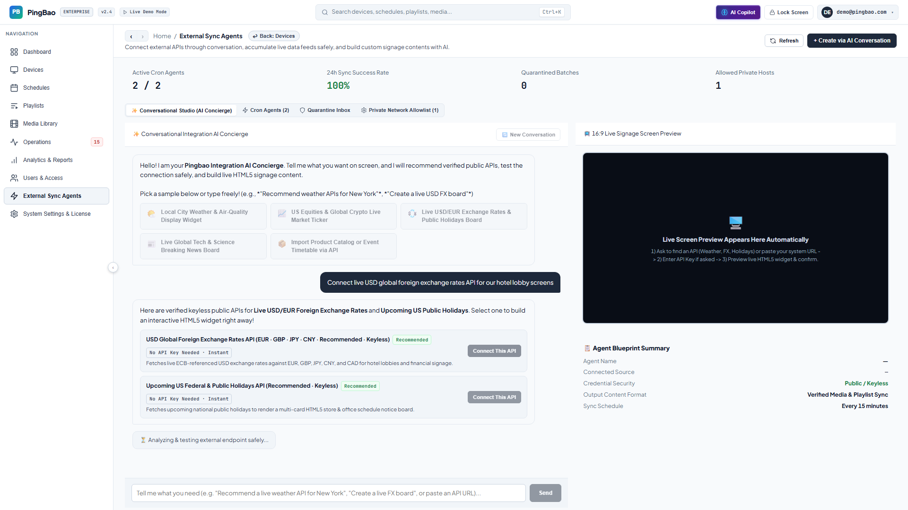
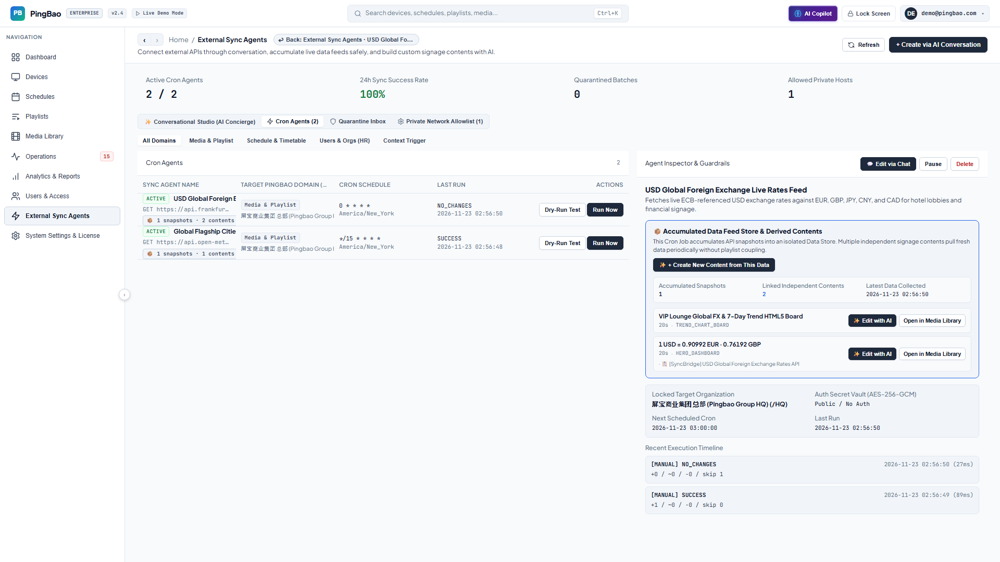
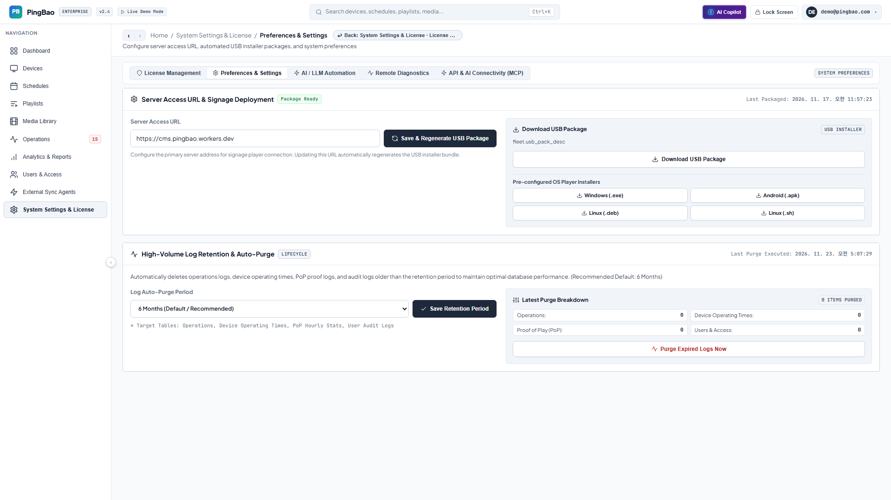
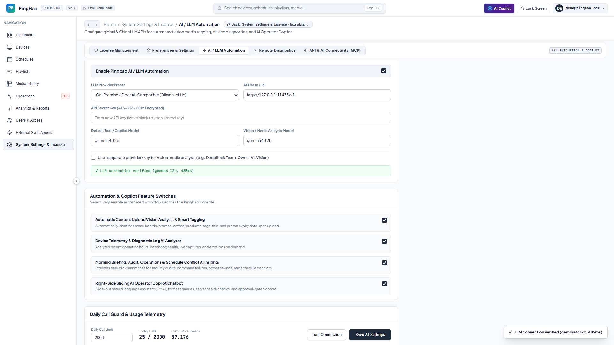

# Pingbao (屏宝 / 핑바오) Admin, Security & AI Deployment Guide

This guide covers deploying **Pingbao** on-premise, on NAS, or in the cloud, configuring the **11-provider AI / LLM Automation Engine**, and governing **External Sync Agents Zero-Shell Security**.

---

## 1. System Requirements & Architecture Modes

* **Server OS**: Linux (Ubuntu 22.04 LTS+, Rocky Linux 9+), Synology DSM 7+, QNAP QTS, Oracle Linux, Windows Server 2019+
* **Supported Commercial Player Runtimes (`v2.2.0`)**:
  * **Samsung Smart Signage**: Tizen 6.5+ / SSSP 6–10+ (`USB Auto-Installer .zip` with SSSP + dynamic HTML5 capture)
  * **Windows Kiosk**: Windows 10 / 11 x64 (`.exe`)
  * **Android Signage**: Commercial Android media players / tablets (`.apk`)
  * **Linux Mini-PC**: Ubuntu / Debian x64 (`.deb` / `.sh`)
  * **Web Launcher**: Zero-install browser runtime (`/player`)
* **Container Runtime**: Docker Engine 24.0+ & Docker Compose v2+ (**Node.js 22.5+** for bare-metal)
* **Database Modes (`DB_MODE`)**:
  * **Lightweight Embedded (`DB_MODE=sqlite`, Default)**: 2+ CPU cores, **2–4 GB RAM**, 20 GB+ SSD (`dscn-server` + `dscn-nginx`)
  * **Enterprise HA Cluster (`DB_MODE=postgres`)**: 4+ CPU cores, **8–16 GB RAM**, 100 GB+ SSD (PostgreSQL 16 + Redis 7 Pub/Sub cluster bus)
  * **(Optional) Self-Hosted Local LLM (`Ollama` / `vLLM`)**: 8–16 GB+ GPU VRAM or Apple Silicon (`gemma4:12b`, `qwen2.5:14b`, `qwen2.5vl:7b` — 100% air-gapped, zero API cost)

---

## 2. Docker Installation, Upgrade & Rollback

```bash
tar -zxvf pingbao-release.tar.gz
cd pingbao-release

# Interactive installer (1: SQLite Lightweight / 2: PostgreSQL + Redis Enterprise)
./install.sh

# Zero-downtime upgrade with automatic pre-backup and healthcheck rollback
./upgrade.sh

# Instant rollback to previous snapshot
./rollback.sh
```

Core `.env` invariants:
* `DATA_DIR`: Isolated database directory (`./data`), strictly separated from static `./storage`.
* `SERVER_MASTER_KEY`: Stored in `.env.secret` (`0600`) for HKDF JWT derivation, LLM API key encryption, and External Sync Vault (`AES-256-GCM`).

---

## 3. External Sync Agents — Zero-Shell Security Architecture

Accessible strictly to `SUPER_ADMIN`, **[External Sync Agents]** enforces five defense-in-depth layers:

<br/>

| Conversational Sync Studio (`STUDIO`) | Cron Sync Agents & Data-Feed Store (`AGENTS`) |
| :---: | :---: |
|  |  |

1. **Zero-Shell Execution Sandbox**: Sync agents execute declarative HTTP(S) JSON fetches and schema mappings only—zero shell access or arbitrary code execution.
2. **AES-256-GCM Secret Vault**: Encrypts Bearer tokens, API Keys (`Header`/`Query`), Basic auth, and OAuth2 Client Credentials at rest; secrets are masked (`••••`) in all API responses and logs.
3. **Anti-SSRF Egress Guard & Private Network Allowlist (`ALLOWLIST` Tab)**:
   * Blocks loopback (`127.0.0.1`), link-local/cloud metadata (`169.254.169.254`), RFC1918 private subnets, and internal DB/Redis ports at DNS resolution time.
   * Explicitly approve internal ERP/POS/HR hosts (`erp-api.corp.internal`) or CIDRs in **`ALLOWLIST`** when integrating private corporate APIs.
4. **Mass-Change Circuit Breaker & Quarantine Inbox (`QUARANTINE` Tab)**:
   * Automatically halts sync runs exceeding `max_mutations_per_run` or `max_deactivate_ratio` for human diff review.
   * Hard-blocks `SUPER_ADMIN` role escalation on `USER_ORG` syncs and never exposes `USER_ORG` PII records on `/api/v1/public/data-feeds/*`.
5. **Hardened HTML5 Kiosk `.zip` Validation**: Rejects path traversal (`../`), symbolic links, >100 MB archives, and executable/server-script extensions.

---

## 4. System Settings Subtabs & 11 AI / LLM Provider Presets

<br/>

| Preferences & 6-Month Auto-Purge (`ADMIN_SETTINGS`) | Built-In AI / LLM Automation (`AI_SETTINGS`) |
| :---: | :---: |
|  |  |

1. **License (`LICENSE`)**: Offline-capable Ed25519 commercial license verification and seat quota management.
2. **Preferences (`ADMIN_SETTINGS`)**: URL-stamped Multi-OS installer repackaging and **180-day default log auto-purge lifecycle**.
3. **★ AI / LLM Automation (`AI_SETTINGS` · 11 Official Presets)**:
   * **Global Cloud & Free Gateway (5)**: `openai`, `gemini`, `claude`, `qwen_intl`, **`freellmapi` (`FreeLLMAPI`)**
   * **China Mainland Direct (5)**: `qwen`, `deepseek`, `zhipu` (GLM), `doubao`, `kimi`
   * **100% Free Air-Gapped On-Premise**: **`ollama`** (`Ollama · vLLM · SGLang` — zero API cost, zero data egress)
   * Supports split text/vision providers, AES-256-GCM key storage, live latency test, and `daily_call_limit` budget caps.
4. **Diagnostics (`DIAGNOSTICS`)**: Device diagnostic log bundles and PII-redacted (`***MASKED***`) opt-in telemetry.
5. **Connectivity (`CONNECTIVITY`)**: Scoped API keys (`pb_live_...`) and ready-to-paste MCP config JSON for Claude Desktop, Cursor, Antigravity, and Dify.
