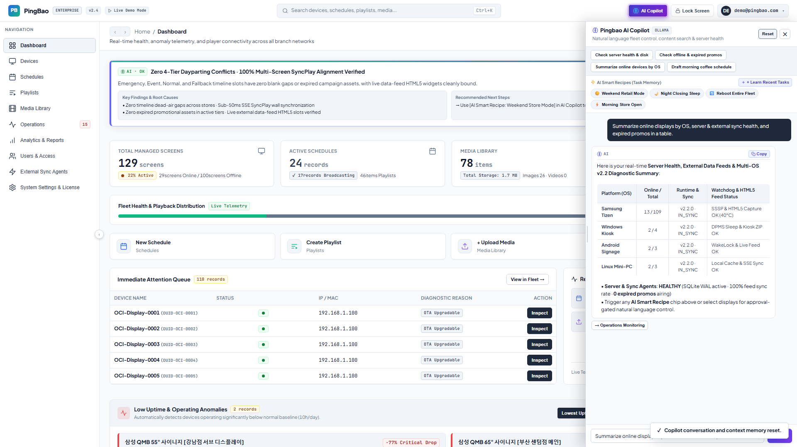
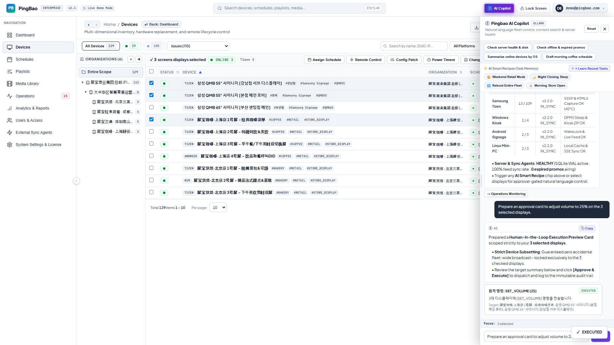
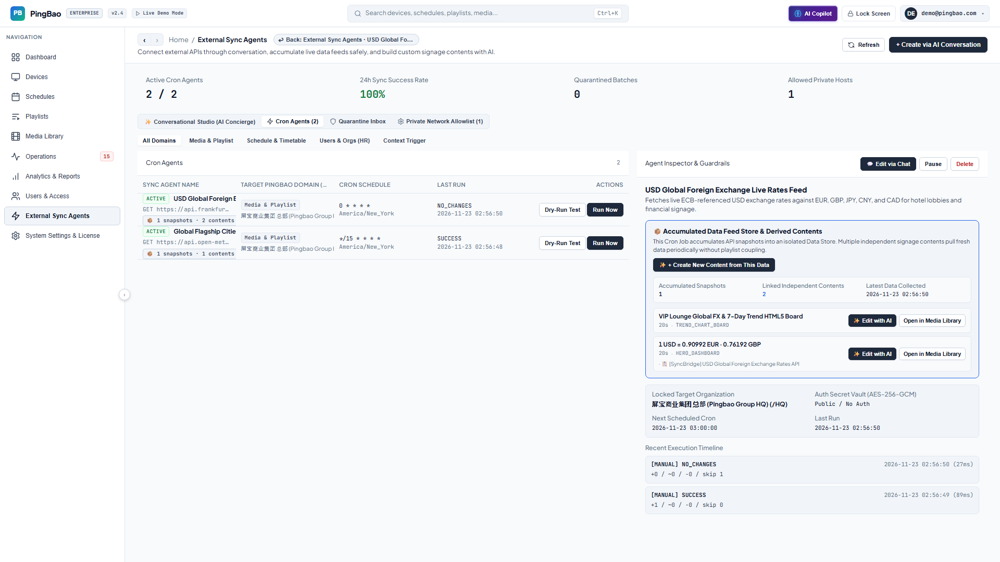
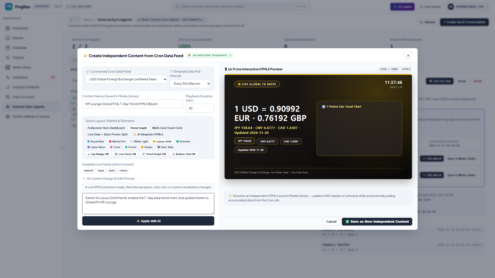
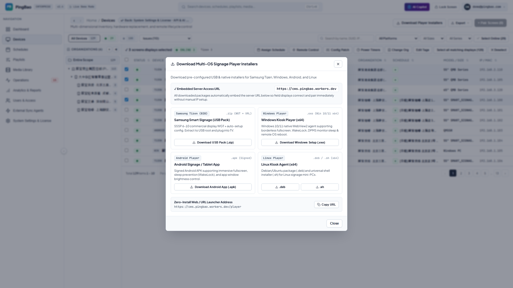
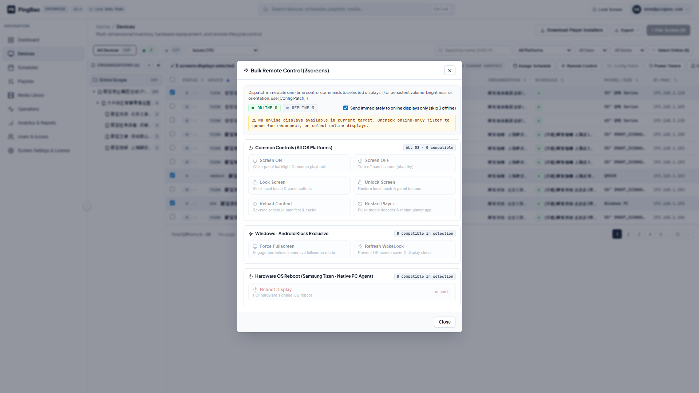
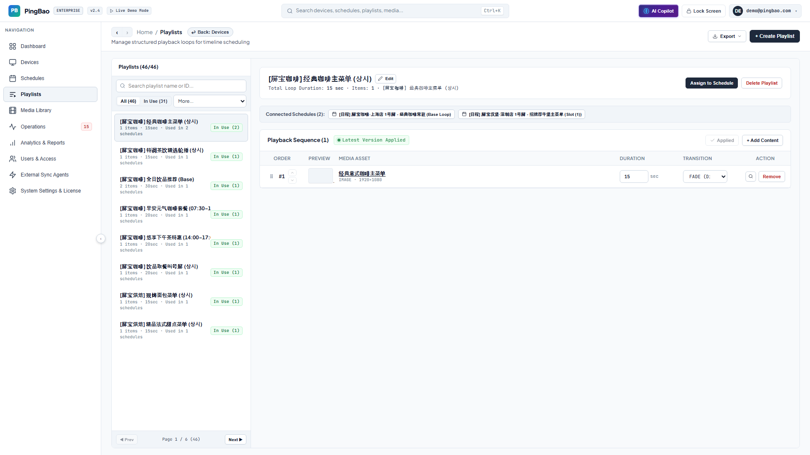

# Pingbao (屏宝 / 핑바오) Enterprise Operations Guide

**Pingbao (屏宝 / 핑바오)** is a next-generation Enterprise Digital Signage Operations Platform (CMS) supercharged with a **Built-In AI Operator Copilot (`Ctrl+J`) & AI Smart Recipes** plus a zero-code **Conversational External Sync Studio & Live HTML5 Content Studio**, centered on deep native hardware control for **Samsung Smart Signage (Tizen 6.5+ / SSSP 6–10+)** alongside **Windows, Android, Linux, and Web** players (`v2.2.0`).

---

## Table of Contents
1. [Getting Started & 10-Workspace Overview](#1-getting-started--10-workspace-overview)
2. [★ Built-In AI Operator Copilot · AI Smart Recipes & 5 Autonomous Intelligences](#2--built-in-ai-operator-copilot--ai-smart-recipes--5-autonomous-intelligences)
3. [★ Conversational External Sync Agents & 2-Column ‘AI NL Content Studio’ (NEW)](#3--conversational-external-sync-agents--2-column-ai-nl-content-studio-new)
4. [Multi-OS Fleet Management (v2.2) & Hardware IoT Control](#4-multi-os-fleet-management-v22--hardware-iot-control)
5. [Media Library · HTML5 Kiosk Bundles (.zip) · Multimodal Vision QA](#5-media-library--html5-kiosk-bundles-zip--multimodal-vision-qa)
6. [Playlist Authoring (Playlists)](#6-playlist-authoring-playlists)
7. [4-Tier Scheduling Engine & AI Conflict Audit (Schedules)](#7-4-tier-scheduling-engine--ai-conflict-audit-schedules)
8. [Operations Monitoring & Self-Healing (Operations)](#8-operations-monitoring--self-healing-operations)
9. [Analytics & Reports: Operating Times & Sub-Second PoP](#9-analytics--reports-operating-times--sub-second-pop)
10. [Multi-Tenant Organizations, RBAC & Immutable Audit Ledger](#10-multi-tenant-organizations-rbac--immutable-audit-ledger)
11. [System Settings · 11 AI/LLM Providers · 6-Month Auto-Purge · External MCP](#11-system-settings--11-aillm-providers--6-month-auto-purge--external-mcp)
12. [Full Feature Matrix](#12-full-feature-matrix)

---

## 1. Getting Started & 10-Workspace Overview

### 1.1 Sign-In & Enterprise Two-Factor Authentication (2FA / TOTP)
1. Open the Pingbao console (`https://cms.pingbao.workers.dev` or your on-premise domain) in Chrome, Edge, or Safari.
2. Sign in with operator credentials (or click **Instant Demo Admin Sign-In** on the public live demo).
3. Enter your 6-digit RFC 6238 TOTP code from Google/Microsoft Authenticator (or a 16-character emergency backup code).

 

*▲ [Workspace 1] Operations Dashboard: Live fleet health, 1-click AI Morning Briefing, 10-workspace navigation, and low-uptime anomaly alerts*

### 1.2 Overview of the 10 Workspaces
* **Dashboard**: Real-time online ratio, **`[AI Morning Briefing]`**, and 7-day/30-day low-uptime anomaly triage.
* **Devices**: Unified Multi-OS v2.2 fleet (`TIZEN`, `WINDOWS`, `ANDROID`, `LINUX`, `WEB`), **`[AI Analyze Device]`**, **live dynamic HTML5 screen capture**, and 7-command bulk control.
* **Schedules**: 4-tier priority preemption (`EMERGENCY > EVENT > REGULAR > DEFAULT`), 24h dayparting, and **`[AI Schedule & Timer Audit]`**.
* **Playlists**: Hybrid sequencing across video, image, interactive HTML5 apps, and live data-feed widgets.
* **Media Library**: 4K streaming upload, **hardened HTML5 Kiosk (`.zip`) & Live Web URL registration**, **`[✨ Edit with AI]` NL Content Studio**, and **Multimodal Vision promo-expiry guard**.
* **External Sync Agents (NEW)**: Super-Admin zero-code **Conversational Sync Concierge**, **Learned API Skill Cards**, **Decoupled Data-Feed Store**, **Quarantine Inbox**, and **Private Network Allowlist**.
* **Operations**: Multi-filter status/category triage, **`[AI Failure Pattern Summary]`**, and `BEFORE/AFTER` Desired-State Diff (`Op Diff`).
* **Analytics & Reports**: **Device Operating Times** session workbench (`[AI Power Optimization]`) and sub-second **Proof-of-Play (PoP)** billing exports.
* **Users & Access**: Hierarchical multi-tenant RBAC and **Immutable Audit Ledger** (`[AI Security Summary]`).
* **System Settings & License**: Commercial Ed25519 license, URL-stamped installers & 180-day auto-purge, **AI / LLM Automation (11 presets + free local Ollama)**, remote diagnostics, and **External Agent MCP Hub**.

---

## 2. ★ Built-In AI Operator Copilot · AI Smart Recipes & 5 Autonomous Intelligences

### 2.1 Slide-Out AI Operator Copilot (`Ctrl+J`) & Task-Memory ‘AI Smart Recipes’

 

*▲ Slide-out AI Operator Copilot: Top ‘AI Smart Recipes’ 1-click runbook strip, Multi-OS v2.2 Markdown diagnostic table, and instant jump links*

* **AI Smart Recipes (`AI Smart Recipes`)**: Located at the top of the Copilot drawer with built-in enterprise workflows (`☀️ Weekend Store Mode`, `🌙 Night Sleep Mode`, `🔄 Fleet-Wide Reboot`, `⚡ Morning Open Prep`) plus **`[+ Learn Recent Tasks]`** to save your recent multi-step actions as reusable 1-click chips or conversational triggers.
* **Active UI Focus Awareness**: Automatically detects your active tab, inspected device, and checked devices (`Focus: 3 selected`) while compacting long sessions via Rolling Memory.
* **Markdown Tables & Jump Links**: Renders server health, external data-feed status, and OS-grouped display diagnostics with 1-click navigation links.

### 2.2 Zero-Accident Human-in-the-Loop (HITL) Control & Strict Subsetting

 

| ① Pending Execution Preview (`Approval Required`) | ② Executed & Logged to Audit Ledger (`Executed`) |
| :---: | :---: |
|  |  |

* **Never Executes Without Human Approval**: Every control request or Smart Recipe generates an **Execution Preview Card** first and dispatches only after you click **`[Approve & Execute]`**.
* **Strict Device Subsetting**: Prevents accidental fleet-wide broadcasts by locking targets strictly to your selected displays.

### 2.3 All-Workspace 1-Click AI Insights

 

All 1-click workspace insights (`Morning Briefing`, `Device Diagnosis`, `3-Language Emergency Copy`, `Vision Metadata`, `Schedule Audit`, `Failure Summary`, `Security Audit`) automatically converge into your Copilot chat history.

---

## 3. ★ Conversational External Sync Agents & 2-Column ‘AI NL Content Studio’ (NEW)

Open **[External Sync Agents]** (`SUPER_ADMIN` only) to connect external public, commercial, or internal APIs into live 16:9 HTML5 signage displays without writing code.

### 3.1 Conversational Sync Concierge (`STUDIO` Tab) & Learned API Skills

 

*▲ [External Sync Agents > Conversational Studio]: Learned API Skill cards, regional API recommendations, 10 color themes, and live 16:9 HTML5 preview*

1. **Zero-Code Conversational Discovery**: Ask in plain English—*"Connect live USD foreign exchange rates for our hotel lobby"*, *"Add live New York weather"*, or paste a custom corporate API URL.
2. **Regional Curated Catalog & Keyless Fallback**: Recommends both keyless instant APIs and commercial API-key endpoints across `GLOBAL`, `CN`, and `KR`, with 1-click keyless fallback.
3. **Learned API Skill Cards**: Successfully connected APIs are remembered at the top of the Studio (endpoint, auth mode, JSONPath mapping, layout) for instant 1-click reuse.
4. **Live 16:9 Interactive HTML5 Widget Preview**: Automatically transforms raw JSON feeds into responsive 1920×1080 HTML5 signage widgets across 6 layouts and 10 color themes.

### 3.2 Decoupled Data-Feed Store (`AGENTS` Tab) & 2-Column ‘AI NL Content Studio’

 

| Cron Sync Agents & Data-Feed Store (`AGENTS`) | 2-Column ‘AI Content Modification Studio’ (`NL Studio`) |
| :---: | :---: |
|  |  |

* **Decoupled Collection vs. Presentation**: Cron Sync Agents continuously accumulate verified time-series snapshots in an isolated Data-Feed Store. Multiple independent HTML5 media assets can subscribe (`15s` / `30s` / `60s` polling) with completely different layouts and themes.
* **2-Column AI NL Content Studio**: Click **`[✨ + Build New Content from This Data]`** in the Sync Agent Inspector or **`[✨ Edit with AI]`** in Media Library to customize themes, 7-day trend charts, raw API field chips, and natural language prompts while previewing live in 16:9. Overwriting an asset automatically refreshes active schedules without interruption.

### 3.3 Zero-Shell Security Guardrails (`QUARANTINE` & `ALLOWLIST` Tabs)
* **AES-256-GCM Secret Vault**: Encrypts Bearer tokens, API Keys, Basic auth, and OAuth2 Client Credentials at rest with zero plaintext logging.
* **Quarantine Circuit Breaker (`QUARANTINE`)**: Holds batches exceeding mutation or deactivation thresholds for human diff approval.
* **Private Network Allowlist (`ALLOWLIST`)**: Blocks SSRF against internal/metadata IPs by default while permitting explicitly allowlisted internal ERP/HR hosts or CIDRs.

---

## 4. Multi-OS Fleet Management (v2.2) & Hardware IoT Control

 

| Multi-OS Fleet & v2.2 Live Remote Capture | Right Inspector (`Control` Tab) — AI Device Diagnosis |
| :---: | :---: |
|  |  |
| **Multi-OS Player Installer Modal (`Auto-Stamped URL`)** | **7-Command Bulk Remote Control Modal** |
|  |  |

* **Player v2.2 Live HTML5 Screen Capture**: Captures both Samsung SSSP hardware framebuffers and live dynamic HTML5 data-feed/kiosk DOM frames remotely in full HD.

---

## 5. Media Library · HTML5 Kiosk Bundles (.zip) · Multimodal Vision QA

 

| Media Library (`Data-Feed HTML5 & Edit with AI`) | HTML5 Kiosk (`.zip`) & Live Web URL Upload Modal |
| :---: | :---: |
|  |  |

 

* **Interactive HTML5 Kiosk Packages (`.zip`/`.html`) & Live Web URLs**: Upload touch-interactive kiosk bundles (hardened against Zip-Slip, symlinks, zip bombs, and executables), generate 1-click sample kiosk apps, or register live web URLs.
* **Multimodal Vision Promo Expiry Guard**: Automatically extracts menu items, OCR prices, recommended dayparting windows, and campaign expiry dates (`detected_valid_until`).

---

## 6. Playlist Authoring (Playlists)

 

Mix 4K video, images, interactive HTML5 packages, and live data-feed widgets in one playlist with per-item duration control.

---

## 7. 4-Tier Scheduling Engine & AI Conflict Audit (Schedules)

 

Automates `EMERGENCY > EVENT > REGULAR > DEFAULT` priority preemption, 1-click **`[AI Schedule & Timer Audit]`**, and zero-config millisecond **SSE SyncPlay** across displays sharing the same group, schedule, and LAN.

---

## 8. Operations Monitoring & Self-Healing (Operations)

 

---

## 9. Analytics & Reports: Operating Times & Sub-Second PoP

 

| Device Operating Times Workbench (`Uptime + AI Power Tip`) | Proof-of-Play Settlement Reports (`PoP`) |
| :---: | :---: |
|  |  |

---

## 10. Multi-Tenant Organizations, RBAC & Immutable Audit Ledger

 

| Users & Organization Directory (`Users & Access`) | Immutable Audit Ledger (`[AI Security Summary]`) |
| :---: | :---: |
|  |  |

---

## 11. System Settings · 11 AI/LLM Providers · 6-Month Auto-Purge · External MCP

 

| `AI / LLM Automation` — 11 Cloud, China, FreeLLMAPI & Ollama | Unconfigured `AI Capabilities Guide Modal` |
| :---: | :---: |
|  |  |
| **Commercial License (`Ed25519`)** | **Open REST API & External AI Agent MCP (`Connectivity`)** |
|  |  |

---

## 12. Full Feature Matrix

| Functional Module | Key Capabilities | Architecture & Differentiators |
| :--- | :--- | :--- |
| **1. AI Copilot & Smart Recipes** | Slide-out chat (`Ctrl+J`), **AI Smart Recipes (`+ Learn Recent Tasks`)**, Markdown tables, HITL cards | Active UI focus awareness, Strict Subsetting broadcast guard |
| **2. External Sync Agents** | Conversational API discovery, **Learned API Skills**, live 16:9 HTML5 generation, Quarantine inbox | AES-256 vault, Anti-SSRF & private Allowlist, Zero-Shell sandbox |
| **3. Data-Feed & NL Studio** | Accumulated Cron Data-Feed Store, **2-column AI NL Content Studio** | 10 color themes, 7-day trend charts, multi-content feed sharing |
| **4. HTML5 Kiosk & Vision AI** | Hardened `.zip`/`.html` bundles, live Web URLs, Vision auto-tagging & promo expiry guard | Zip-Slip protection, 11 Cloud/China/FreeLLMAPI/Ollama presets |
| **5. Multi-OS Fleet (`v2.2.0`)** | Samsung Tizen SSSP + Windows / Android / Linux / Web + 7-command bulk control | SSSP hardware + **dynamic HTML5 live capture**, URL-stamped installers |
| **6. 4-Tier Scheduling & Sync** | 4-tier priority preemption, AI conflict audit, zero-config multi-screen SyncPlay | SSE `sync-stream` + EMA clock offset calibration |
| **7. Self-Healing & Uptime/PoP** | `BEFORE/AFTER` Op Diff, daily power sessions, 1s frame-verified PoP exports | CSV/JSON/MD billing exports, 180-day auto-purge |
| **8. Security, Audit & MCP** | TOTP 2FA, RBAC, immutable audit ledger, 60+ REST APIs & built-in MCP server | Argon2id, Ed25519 air-gap license, Claude/Cursor/Antigravity ready |

---

Pingbao (屏宝 / 핑바오) © 2026. All rights reserved.

