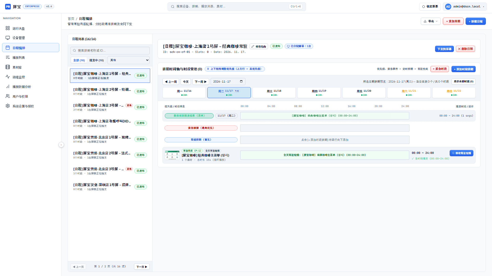

# Pingbao (屏宝 / 핑바오) Enterprise User Guide & System Manual for Samsung Smart Signage

**Pingbao (屏宝 / 핑바오)** is an enterprise-grade cloud digital signage management platform (CMS) built exclusively for the **Samsung Smart Signage** ecosystem.  
The platform natively integrates Samsung Tizen 6.5+ SSSP (Samsung Smart Signage Platform) hardware-level IoT remote control, fully automated multi-screen synchronization (SyncPlay), 24-hour visual timeline dayparting, autonomous offline playback, and standardized enterprise REST API and AI Agent MCP (Model Context Protocol) support.

---

## Table of Contents
1. [Getting Started & Workspace Architecture](#1-getting-started--workspace-architecture)
2. [Samsung Signage Fleet Management & Hardware IoT Control](#2-samsung-signage-fleet-management--hardware-iot-control)
3. [Media Asset Management & Security Standards](#3-media-asset-management--security-standards)
4. [Playlist Authoring](#4-playlist-authoring)
5. [Deep Dive: Scheduling Engine Architecture](#5-deep-dive-scheduling-engine-architecture)
6. [Real-time Operations Monitoring & Self-Healing](#6-real-time-operations-monitoring--self-healing)
7. [Proof-of-Play (PoP) & Business Settlement Reports](#7-proof-of-play-pop--business-settlement-reports)
8. [Multi-Tenant Organizations & RBAC Permissions](#8-multi-tenant-organizations--rbac-permissions)
9. [Commercial License & Automated Error Telemetry](#9-commercial-license--automated-error-telemetry)
10. [Standard REST API & AI Agent MCP Support](#10-standard-rest-api--ai-agent-mcp-support)
11. [Full Feature Matrix](#11-full-feature-matrix)

---

## 1. Getting Started & Workspace Architecture

### 1.1 Access, Login & Enterprise Two-Factor Authentication (2FA / TOTP)
1. Open a modern web browser (Google Chrome, Microsoft Edge, Safari) and navigate to the Pingbao web console URL.
2. Enter your operator email address and password.
3. In compliance with enterprise security policies, RFC 6238 TOTP two-factor authentication is enforced. Launch Google Authenticator or Microsoft Authenticator on your mobile device and submit the 6-digit dynamic code.
4. In emergency or offline circumstances, single-use 16-character backup codes issued during initialization may be used.

<br/>


*▲ [Workspace 1] Pingbao Real-Time Operations Dashboard: Samsung display fleet availability, active schedules, storage utilization, and instant health alerts (live Oracle Cloud cluster data)*

### 1.2 Overview of the 9 Core Workspaces
* **Dashboard**: Global operations hub displaying Samsung signage fleet availability, schedule deployment progress, and system health.
* **Device Management**: Lifecycle and IoT remote management for tens of thousands of Samsung screens (On/Off, volume, reboot, live screenshot).
* **Schedules**: 4-tier priority scheduling engine supporting 24-hour multi-track timeline dayparting and atomic publishing.
* **Playlists**: Media asset sequencing, exposure duration control, and GPU-accelerated transition effects.
* **Media Assets**: High-fidelity video and 4K poster storage with binary magic bytes validation and delete-protection locks.
* **Operations**: Long-polling RTT latency tracking, command queue inspection, 1-Click Batch Retry, and Markdown reports.
* **Proof-of-Play**: 1-second precision device playback audit logs, Completion Rate (%) calculations, and Excel exports.
* **Users & RBAC**: Hierarchical multi-tenant organization trees with granular CRUDX role permissions.
* **License & Telemetry**: Ed25519 digital signature licensing, sanitized error telemetry, and direct GitHub Community Issue integration.

---

## 2. Samsung Signage Fleet Management & Hardware IoT Control

<br/>


*▲ [Workspace 2] Device Management: Samsung signage fleet table, connectivity status, DUID identifiers, and remote hardware commands*

### 2.1 Device Pairing & Provisioning
1. Launch the Pingbao Player App on a **Samsung Smart Signage display (Tizen 6.5+ / SSSP 10+)**.
2. Note the unique DUID and 6-digit temporary **Pairing PIN Code** rendered on screen.
3. In the web console, navigate to **Device Management > Register Device**, enter the PIN code, and assign the device to a store location.
4. The Samsung display establishes a secure TLS-encrypted bi-directional long-polling communication channel.

### 2.2 Deep Hardware Remote Control
* **Panel Backlight On/Off**: Turn off display panel backlights remotely outside operating hours to conserve power and prevent panel burn-in.
* **Live Screen Capture (1-Second RTT)**: Capture genuine 1080P/4K rendered frames directly from the Samsung hardware framebuffer without physical store visits.
* **Volume Slider & Mute Control**: Remotely adjust audio levels in real time to match peak-hour store traffic.
* **Automated Power Schedules**: Configure daily On/Off timers driven by the hardware RTC, operating reliably even without network connectivity.

---

## 3. Media Asset Management & Security Standards

<br/>


*▲ [Workspace 3] Media Assets: High-resolution menus, 4K promotional videos, and card-based metadata previews*

### 3.1 Enterprise Media Pipeline Capabilities
* **Chunked Streaming Uploads**: High-throughput uploads for MP4 (H.264 / H.265 / AV1), WebM, PNG, JPG, SVG, and WebP files with automatic resume support.
* **Binary Magic Bytes Validation**: Inspects the first 32 bytes of uploaded streams to eliminate file-extension spoofing vulnerabilities.
* **Referential Integrity Delete Locks**: In-use assets linked to active playlists or deployed schedules are automatically locked from deletion to prevent accidental blackouts.

---

## 4. Playlist Authoring

<br/>


*▲ [Workspace 4] Playlist Authoring: Asset sequencing, hardware transitions, and precise loop cycle calculation*

### 4.1 Composition & Transition Controls
* **Seamless Media Mixing**: Blend video files and high-resolution posters within a unified playlist.
* **Granular Poster Exposure**: Configure individual display durations (e.g. 8s, 15s) per item.
* **Hardware-Accelerated Transitions**: Smooth visual transitions including instant cut and crossfade.
* **Cycle Duration Calculation**: Real-time summation of asset durations to determine exact cycle timings (e.g. `04m:15s`).

---

## 5. Deep Dive: Scheduling Engine Architecture

The scheduling engine is Pingbao's flagship capability, architected to eliminate broadcasting conflicts and ensure zero downtime across retail networks.

<br/>


*▲ [Workspace 5-1] Schedules Master-Detail View: Organization plan tree, status badges, and 24-hour visual timeline*

<br/>


*▲ [Workspace 5-2] Schedule Detail & Time Slots: Drag-and-drop priority reordering and visual Effective Broadcast Windows analysis*

### 5.1 4-Tier Hierarchical Preemption Model

| Preemption Tier | Priority Range | Operational Scope | Transition Behavior |
| :--- | :--- | :--- | :--- |
| **Tier 1: EMERGENCY** | `P: 100 ~ 200` | Fire evacuation, extreme weather alarms, VIP visit welcome messages | Instant millisecond-level interrupt pausing lower tiers; automatically resumes original position when revoked |
| **Tier 2: EVENT** | `P: 50 ~ 99` | Peak lunch discounts, evening happy hour specials, flash sales | Smooth crossfade into event content at trigger time; gracefully returns to regular broadcast on expiration |
| **Tier 3: REGULAR** | `P: 10 ~ 49` | Daily dayparted loops (Breakfast / Lunch / Tea / Dinner) | Standard daily rotational broadcasting |
| **Tier 4: DEFAULT** | `P: 0` | Core brand campaigns, signature product loops | 24/7 background fallback preventing empty screens |

### 5.2 Standard Dayparting Matrix

```
00:00                07:30      10:30     11:30       14:00      17:30       21:30           24:00
┌──────────────────────┬──────────┬─────────┬───────────┬──────────┬───────────┬───────────────┐
│ Night Low-Power Mode │Breakfast │Mid-Morn │Lunch Rush │Afternoon │Dinner/Bar │Closing Notice │
│ (DEFAULT, P:0)       │(EVENT,60)│(REG,20) │(EVENT,80) │ (REG,30) │(EVENT,85) │ (DEFAULT, P:0)│
└──────────────────────┴──────────┴─────────┴───────────┴──────────┴───────────┴───────────────┘
```

* **Effective Broadcast Windows**: When multiple promotional windows overlap, the engine calculates timeline slices and visualizes active windows in green/amber, eliminating scheduling guesswork.

### 5.3 Fully Automated SyncPlay Multi-Screen Synchronization
* **100% Automated Activation**:
  Whenever multiple Samsung smart signage displays share the **same device group, the same assigned schedule, and the same local network (LAN)**, SyncPlay automatically activates without manual pairing or hardware switchers.
* **Frame-Accurate Simultaneous Transitions**: Displays transition at the exact same millisecond, and ultra-wide (5760x1080) video is rendered seamlessly across concatenated screens.

### 5.4 Autonomous Offline Loop
1. **Background Pre-Caching**: New schedule media is silently pre-cached to Samsung display storage ahead of time.
2. **Embedded Edge Dispatcher**: An internal SQLite engine and hardware RTC clock evaluate time slots locally, guaranteeing continuous playback for months without active internet connectivity.

---

## 6. Real-time Operations Monitoring & Self-Healing

<br/>


*▲ [Workspace 6] Operations Monitoring: Device RTT latency, command queue tracking, and diagnostics*

* **Long-Polling Latency Tracking**: Real-time tracking of Ping RTT latency with visual warning indicators.
* **Desired State Gap Analysis**: Compares expected server schedule versions with active device versions to isolate slow downloads.
* **1-Click Batch Retry**: Resends timed-out commands with a single click.
* **Markdown Diagnostic Reports**: Generates technical incident reports ready for maintenance team reviews.

---

## 7. Proof-of-Play (PoP) & Business Settlement Reports

<br/>


*▲ [Workspace 7] Proof-of-Play: Completion rate analysis, playback frequency trends, and compliance audit reports*

* **1-Second Precision Frame Audit**: Edge devices log exact start and end timestamps for every played asset.
* **Completion Rate (%) Metrics**:
  $$\text{Completion Rate} = \frac{\text{Actual Full Plays}}{\text{Total Attempted Plays}} \times 100\%$$
  Distinguishes partial interruptions from full plays to provide indisputable billing data.
* **Excel / CSV Export**: Filter by store, screen, or advertising campaign and export structured financial audit reports.

---

## 8. Multi-Tenant Organizations & RBAC Permissions

<br/>


*▲ [Workspace 8] Organization Hierarchy & RBAC: Multi-tenant tree, granular roles, and audit trail logs*

* **Hierarchical Multi-Tenancy**: Organization structures (HQ ➔ Retail Center ➔ Flagship Store ➔ Counter) with strict data isolation.
* **Granular RBAC Roles**: Pre-configured enterprise roles (SuperAdmin, Operations Manager, Content Editor, Field Tech, Auditor) with module-level CRUDX permission enforcement.

---

## 9. Commercial License & Automated Error Telemetry

<br/>

| Commercial License (Ed25519) | Error Telemetry & Community Portal |
| :---: | :---: |
|  |  |

* **Ed25519 Digital Signature Licensing**: Validates fleet quotas and validity periods in air-gapped offline environments.
* **Automated Error Telemetry & Community Bug Tracking**:
  * **Opt-in Consent**: Requires explicit SuperAdmin activation.
  * **Deep PII Sanitization**: Masks passwords, tokens, Authorization headers, internal IPs, and phone numbers.
  * **SHA-256 Fingerprint Deduplication**: Aggregates identical crash traces and posts them to [pingbaosignage/pingbao-community](https://github.com/pingbaosignage/pingbao-community/issues).
  * **In-Console Manual Feedback**: Operators can submit bug reports and feature requests directly to the development team's GitHub board.

---

## 10. Standard REST API & AI Agent MCP Support

Pingbao natively integrates a standardized **Model Context Protocol (MCP)** server (`pingbao` toolset), empowering modern AI agents such as Claude Desktop, Cursor, Antigravity, and autonomous LLM workflows to interact directly with digital signage infrastructure.

### 🌟 Key Capability: LLM-Generated Content Direct Upload & Scheduling
> **💡 Can an AI agent upload newly generated visuals and schedule them directly?**  
> **Yes, 100% supported!** Through the `pingbao_upload_media` tool, an AI agent can upload LLM-generated SVG banners, HTML dynamic widgets, Base64-encoded images, or remote asset URLs straight into Pingbao's media repository. The agent can then call `pingbao_create_playlist`, `pingbao_create_schedule`, and `pingbao_assign_schedule` to execute an autonomous loop from creative generation to on-screen playback without manual steps.

### 💬 5 Real-World Autonomous Scenarios & AI Prompts

| # | Operational Scenario | MCP Tools Used | Example AI Agent Prompt |
| :---: | :--- | :--- | :--- |
| **01** | **Natural Language Device Diagnostics**<br/>(Device Status & Health) | `pingbao_list_devices`<br/>`pingbao_get_device_detail` | *"Check the operational status of all Samsung signage displays in the Shanghai Flagship and Gangnam branches. Report any screens that have been offline for over 10 minutes or experiencing playback errors."* |
| **02** | **LLM Content Generation & Scheduling**<br/>(Content Upload & Scheduling) | `pingbao_upload_media`<br/>`pingbao_create_playlist`<br/>`pingbao_create_schedule`<br/>`pingbao_assign_schedule` | *"I just generated a vertical 1080x1920 promotional SVG banner for a weekend rainy-day special. Upload this asset to the media library as 'Rainy Day Special', create a playlist, and schedule it on the Gangnam Kiosk group for Fri-Sun lunch hours (11:30~14:00) with EVENT priority (50)."* |
| **03** | **Emergency Screen Takeover & Alert**<br/>(Emergency Broadcast Takeover) | `pingbao_upload_media`<br/>`pingbao_create_schedule`<br/>`pingbao_control_device` | *"A severe typhoon warning has been issued. Immediately broadcast an urgent notification banner 'Early Store Closure at 20:00 Due to Severe Weather' across all counter displays with EMERGENCY (Priority 100) priority, overriding regular programming right now."* |
| **04** | **Eco-Mode & Remote Hardware Timers**<br/>(Eco-Mode & Power Timers) | `pingbao_control_device`<br/>`pingbao_configure_power_timers` | *"Store closing time (22:00) has passed. Set volume to 0 (mute) on all active displays, and configure weekday hardware power timers (Panel On at 08:30, Panel Off at 22:30 Monday-Friday) across all headquarters screens starting tomorrow."* |
| **05** | **Proof-of-Play (PoP) & Anomaly Triage**<br/>(Proof-of-Play Audit) | `pingbao_verify_playback`<br/>`pingbao_get_device_detail` | *"Audit playback logs for the 'New Burger Launch Campaign' video over the last 24 hours. Summarize completion rate (%) by store, and highlight any screens below 95% completion or reporting network latency frame drops."* |

---

## 11. Full Feature Matrix

| Functional Area | Key Capabilities & Features | Technical Standard & Advantages |
| :--- | :--- | :--- |
| **1. Dashboard** | Fleet overview, schedule sync rate, anomaly ribbons, storage telemetry | Multi-tenant scope isolation, MinIO/S3 metrics |
| **2. Samsung Signage Control** | Exclusively Samsung SSSP (Tizen 6.5+), remote panel On/Off, volume, reboot | Samsung Tizen b2bapis drivers, Redis command queue |
| **3. Scheduling Engine** | 4-tier preemption, Dayparting timeline tracks, Effective Windows analysis | SQLite local autonomous engine, atomic rollback |
| **4. Automatic SyncPlay** | Same group, same schedule, same network -> 100% automatic frame sync | Lightweight LAN broadcast, zero external hardware |
| **5. REST API & MCP** | 60+ API endpoints & native MCP server for AI agent autonomous operations | OpenAPI 3.0, deep Claude/Cursor/Antigravity integration |
| **6. Playlist Authoring** | Video/image mixing, per-item duration, GPU crossfade transitions, loop timing | WebGL/CSS GPU acceleration, playlist schema integrity |
| **7. Media Assets** | 4K streaming upload, binary magic bytes validation, auto metadata, delete locks | MinIO/S3 object storage, SHA-256 checksums |
| **8. Monitoring & Operations** | Long-polling latency, command queue tracking, 1-Click Batch Retry, Markdown reports | Single-device fault tracing, automated self-healing |
| **9. Proof-of-Play (PoP)** | 1-second precision play audit logs, Completion Rate (%) metrics, Excel/CSV export | Edge transaction logging, audit compliance |
| **10. Security & RBAC** | Organization hierarchy, CRUDX role matrix, RFC 6238 TOTP two-factor authentication | Argon2id password hashing, enterprise security baseline |
| **11. License & Telemetry** | Ed25519 digital signature licensing, PII-sanitized error telemetry, GitHub sync | Opt-in consent required, SHA-256 error deduplication |

---

<div align="center">
<sub>Pingbao (屏宝 / 핑바오) © 2026. All rights reserved.</sub>
</div>
