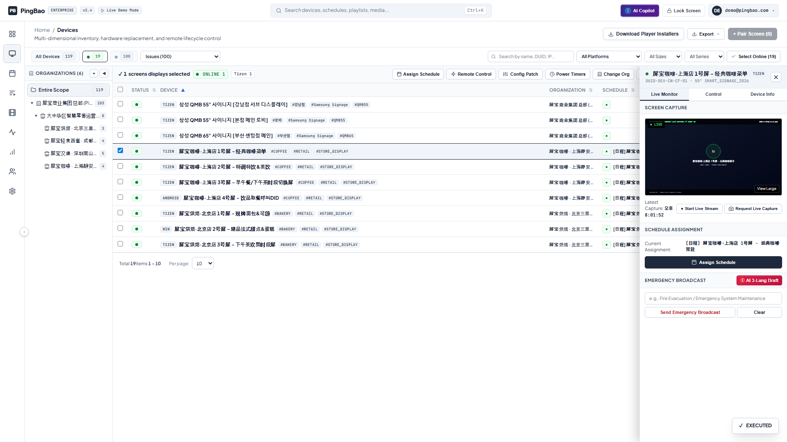
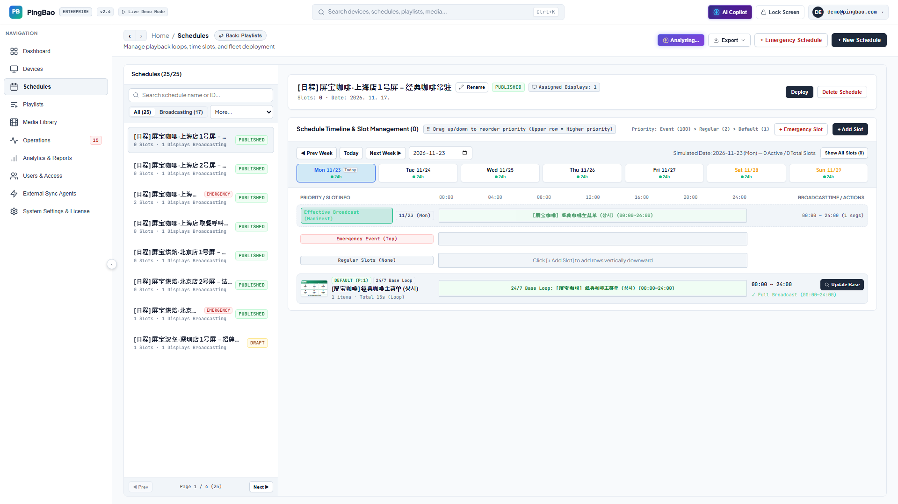

# Pingbao User Manual

**Pingbao** is an enterprise-grade cloud digital signage management platform (CMS) designed for centrally controlling large-scale smart signage displays and broadcasting media content through non-stop, autonomous scheduling.

---

## 1. Quick Start

### 1.1 Access & Login
1. Open a web browser (Google Chrome or Microsoft Edge recommended) and navigate to your Pingbao server address.
2. Sign in with your administrator or operator credentials.
3. Switch your preferred language (**English / 한국어 / 简体中文**) via the profile dropdown in the top-right corner.

### 1.2 Dashboard Overview
* **Dashboard**: Real-time overview of online/offline display statuses, total registered units, and recent activities.
* **Device Management**: Display approval, remote panel On/Off, volume control, reboot, and live screen capture.
* **Media Library**: Upload and tag media assets (MP4, WebM, PNG, JPEG, GIF, WebP).
* **Playlists**: Assemble media assets with playback sequences, transitions, and image durations.
* **Timeline Scheduling**: Drag-and-drop playlist scheduling across dates and hours with 1-click publishing.
* **Operations & Monitoring**: Real-time long-polling command queues, latency, anomaly detection, and audit logs.

 

*▲ [Screen 1] Pingbao Dashboard: Fleet Availability, Schedule Status, and System Health Summary*

---

## 2. Device Management & Control

### 2.1 Registering Displays
1. Launch the Pingbao Player application on your Samsung Smart Signage display (Tizen 6.5+ / SSSP 10+).
2. Note the 6-digit **PIN Code** or Device Unique ID (DUID) shown on screen.
3. In the Pingbao Web Console, click **Device Management > Register Device** and enter the PIN.
4. Assign an installation location (e.g., "HQ Lobby 1F") and group to approve and bind.

### 2.2 Remote Controls
* **Panel Screen On/Off**: Energy-saving display panel toggle outside business hours.
* **Remote Screen Capture**: Real-time visual verification of what is currently playing on site.
* **Reboot & Emergency Notices**: One-click remote device reboot and immediate emergency broadcast overlay.

 

*▲ [Screen 2] Pingbao Device Management: Display Fleet, DUIDs, Power Controls & Volume Sliders*

---

## 3. Real-Time Operations & Monitoring

### 3.1 Command Queue & Heartbeat Telemetry
* **Desired State Synchronization**: Real-time tracking of applied configuration vs. desired snapshot versions.
* **Latency & Anomaly Alarms**: Instant alerts for offline transitions or delayed media asset downloads.

 

*▲ [Screen 3] Pingbao Operations & Monitoring: Long-Polling Command Queues, Heartbeats & Hardware Telemetry*

---

## 4. Timeline Scheduling & Autonomous Offline Playback

### 4.1 Timeline Scheduling
* **24-Hour Base Fallback Loop**: Default continuous loop running whenever no higher-priority event is scheduled.
* **Peak & Event Schedules**: High-priority schedules targeted for specific hours (e.g., lunch specials 11:30–13:30) or specific days of the week.

### 4.2 Autonomous Playback & Instant Publishing
* When you click **Publish**, a snapshot is transmitted to all assigned displays.
* Displays download required media in the background and perform seamless, atomic playback switching.
* Even during network outages, displays continue playing autonomously using cached schedules and local storage indefinitely.

 

*▲ [Screen 4] Pingbao Timeline Scheduling: 24-Hour Base Fallback Loop and Peak Event Timeslots*

---

## 5. Full Feature Matrix

Complete functional breakdown of the Pingbao enterprise digital signage management platform.

| Category | Feature | Description | Technical Specifications & Capabilities |
| :--- | :--- | :--- | :--- |
| **Central Dashboard** | Scope-Aware Fleet Summary | Real-time counts of online, offline, and total displays under current org | Multi-tenant organization scoping |
| | Snapshot Sync Status | Percentage gauge of displays successfully synchronized with desired schedule | Live visual percentage indicator |
| | Anomaly Triage Ribbon | Immediate alerts for offline drops, download lags, disk fullness, or high heat | 1-click drill down to malfunctioning display |
| | Storage & Resources | Real-time monitoring of media asset storage volume and server capacity | MinIO/S3 object storage integration |
| **Device Management** | Multi-Dimensional Search | Search displays by org tree, screen size (32"~98"), model series, S/N, MAC/IP | Millisecond-level filtering across thousands of displays |
| | Deep Hardware Specs | Panel power-on hours, firmware/SSSP versions, RAM/disk usage, internal temp | Tizen `b2bapis` hardware sensor telemetry |
| | Remote Power On/Off Timers | Schedule automatic daily or weekly business opening/closing hours | Hardware cold power-off vs. panel backlight toggle |
| | Live Hardware Controls | Panel On/Off, volume/mute, reboot, app restart, and instant clock sync | Redis-backed persistent, zero-loss command queue |
| | Screen Capture Gallery | Real-time snapshot capture of what is physically displayed on screen | High-res pinch-zoom image inspection |
| | Mutual-Trust Pairing | 1-second pairing via 6-digit on-screen PIN code | Ed25519 public key pinning + HMAC token auth |
| | 1-Click Display Replacement | Instantly transfer all configurations, schedules, and timers to a replacement unit | Reduces site servicing downtime by over 90% |
| | WGT & Firmware OTA | Remote batch upgrades for Tizen player packages (`.wgt`) and Samsung firmware | Step-by-step progress tracking (Downloading/Installing/OK) |
| **Operations & Monitoring** | Single-Pane-of-Glass View | Monitor schedule playback states, config updates, and remote commands in one view | Unified real-time operational dashboard |
| | 1-Click Anomaly Filters | Instant triage chips: `[Failed Only]`, `[In-Progress / Delayed]`, `[Playback Mismatch]` | Immediately isolate and focus on problematic units |
| | 1-Click Batch Retry | Batch resend commands or download requests that failed due to transient outages | Automated zero-touch recovery pipeline |
| | Multi-Format Export | Export triage logs and error reasons to CSV, Excel, JSON, and LLM Markdown | Ready-to-use Markdown reports for AI analysis |
| **Media Library** | High-Capacity Streaming Upload | Upload high-resolution MP4, WebM, PNG, JPG, WebP, and GIF assets | Chunked streaming upload with progress feedback |
| | Binary Integrity Check | File validation via magic bytes binary signatures and SHA-256 hashes | Blocks corrupt or tampered media files |
| | Automatic Metadata Extraction | Duration, resolution, video codec, and FPS automatically extracted on upload | Instant runtime duration calculation |
| | Reference Integrity Protection | Deletion blocked for media currently in active playlists or schedules | Prevents broadcast interruptions |
| **Playlist Authoring** | Drag-and-Drop Sequencing | Select media library assets and reorder them via intuitive drag-and-drop | Total runtime calculation and live browser preview |
| | Image Exposure Duration | Customize display duration for static images (default 10s, 3s to unlimited) | Second-level precision timing |
| | Transition Effects | Configure smooth Cut or Fade transitions between media clips | Hardware-accelerated WebGL/CSS transitions |
| | Schedule Integrity Lock | Prevents accidental deletion of playlists actively referenced by schedules | Safe single and batch deletion pipelines |
| **Timeline Scheduling** | 24-Hour Base Fallback Loop | Default background loop running 24/7/365 when no higher-priority event is active | Eliminates black screens or broadcast gaps |
| | Peak & Event Scheduling | Schedule high-priority content blocks for specific hours (e.g. lunch rush) or days | Priority-driven multi-layer timeline overlay |
| | 🚨 Emergency Broadcast | Instantly override all displays with disaster or critical emergency messages | Highest-priority instant broadcast pipeline |
| | Autonomous Offline Loop | Displays continue playing indefinitely from local cache even during internet outages | Built-in offline autonomous loop architecture |
| | Immutable Versioned Publish | Generates immutable `ScheduleVersion` snapshots applied atomically | Seamless background pre-fetching |
| **Proof of Play (PoP)** | Second-Accurate Verification | Local real-time logging aggregated and reported on 15-minute intervals | Tamper-proof runtime playback logs |
| | Completion vs. Interruption | Differentiates full plays (`completed`) from early skips (`interrupted`) | Accurate completion rate (%) for ad billing |
| | Local Display Time Analysis | Group playback data by display local hours (`0~23h`) across global timezones | Accurate local peak audience analysis |
| | Multi-Dimensional Reports | Cross-tabulate by store, schedule, or media with CSV, Excel, and LLM MD exports | 1-click executive and advertiser reporting |
| **Security & Multi-Tenancy** | Hierarchical Organization Tree | Multi-tier corporate structure (Headquarters > Subsidiary > Store) | Recursive role and permission inheritance |
| | Fine-Grained RBAC Matrix | Per-menu permissions for Read (R), Create (C), Update (U), Delete (D), Execute (X) | Custom operator role definitions |
| | 2-Factor Authentication (TOTP) | RFC 6238 standard Google Authenticator 2FA with 10 emergency backup codes | Banking-grade credential security |
| | 5-Strike Brute Force Defense | Automatic account lockout after 5 consecutive failed login attempts | Argon2id password hashing |
| | Immutable System Audit Log | Tamper-proof append-only logging of logins, publishes, controls, and config changes | Comprehensive compliance audit trail |
| | Offline Airgap Licensing | Asymmetric Ed25519 digital signature licensing for closed/air-gapped networks | `.lic-req` export & permanent `.lic` activation |
| | Real-Time Tri-Lingual UI | Instant UI and data translation across English, 한국어, and 简体中文 | Full global deployment readiness |
