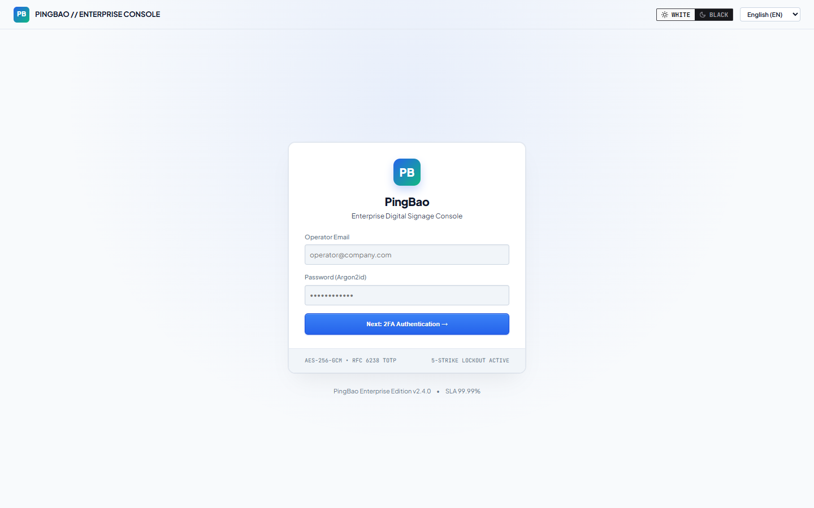
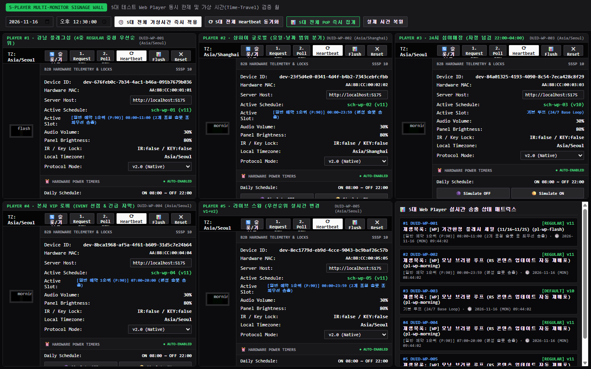

# Pingbao User Manual

**Pingbao** is an enterprise-grade cloud digital signage management platform (CMS) designed for centrally controlling large-scale smart signage displays and broadcasting media content through non-stop, autonomous scheduling.

---

## 1. Quick Start

### 1.1 Access & Login
1. Open a web browser (Google Chrome or Microsoft Edge recommended) and navigate to your Pingbao server address.
2. Sign in with your administrator or operator credentials.
3. Switch your preferred language (**English / 한국어 / 简体中文**) via the profile dropdown in the top-right corner.

### 1.2 Dashboard & Navigation
* **Dashboard**: Real-time overview of online/offline display statuses, total registered units, and recent activities.
* **Device Management**: Display approval, remote panel On/Off, volume control, reboot, and live screen capture.
* **Media Library**: Upload and tag media assets (MP4, WebM, PNG, JPEG, GIF, WebP).
* **Playlists**: Assemble media assets with playback sequences, transitions, and image durations.
* **Timeline Scheduling**: Drag-and-drop playlist scheduling across dates and hours with 1-click publishing.
* **System Settings**: Role-based access control (RBAC), audit logs, and backup settings.

 

*▲ Pingbao Enterprise Digital Signage Console Interface*

---

## 2. Device Management & Control

### 2.1 Registering Displays
1. Launch the Pingbao Player application on your Samsung Smart Signage display (Tizen 6.5+ / SSSP 10+).
2. Note the 6-digit **PIN Code** or Device Unique ID (DUID) shown on screen.
3. In the Pingbao Web Console, click **Device Management > Register Device** and enter the PIN.
4. Assign an installation location (e.g., "HQ Lobby 1F") and group to approve and bind.

### 2.2 Remote Controls & Multi-Monitor Signage Wall
* **Panel Screen On/Off**: Energy-saving display panel toggle outside business hours.
* **Remote Screen Capture**: Real-time visual verification of what is currently playing on site.
* **Reboot & Emergency Notices**: One-click remote device reboot and immediate emergency broadcast overlay.

 

*▲ Samsung Smart Signage (Tizen 6.5+) 5-Player Multi-Monitor Wall Simulator & Monitoring*

---

## 3. Media & Playlist Creation

### 3.1 Uploading Media
1. In the **Media Library**, drag and drop your media files.
2. Supported formats: MP4, 3GP, WebM, PNG, JPEG, GIF, WebP.
3. Video durations are automatically extracted from file metadata upon streaming upload.

### 3.2 Building Playlists
1. Click **Create Playlist** and enter a name and description.
2. Select the media assets to include.
3. Reorder items via drag-and-drop, and specify display duration (seconds) for still images.

---

## 4. Timeline Scheduling & Autonomous Offline Playback

### 4.1 Timeline Scheduling
* **24-Hour Base Fallback Loop**: Default continuous loop running whenever no higher-priority event is scheduled.
* **Peak & Event Schedules**: High-priority schedules targeted for specific hours (e.g., lunch specials 11:30–13:30) or specific days of the week.

### 4.2 Autonomous Playback & Instant Publishing
* When you click **Publish**, a snapshot is transmitted to all assigned displays.
* Displays download required media in the background and perform seamless, atomic playback switching.
* Even during network outages, displays continue playing autonomously using cached schedules and local storage indefinitely.
