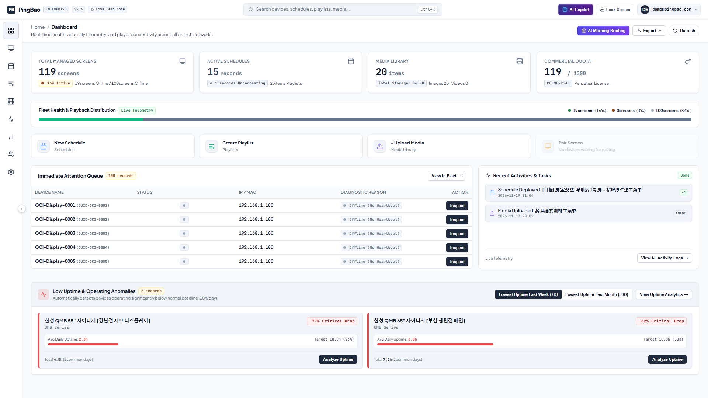
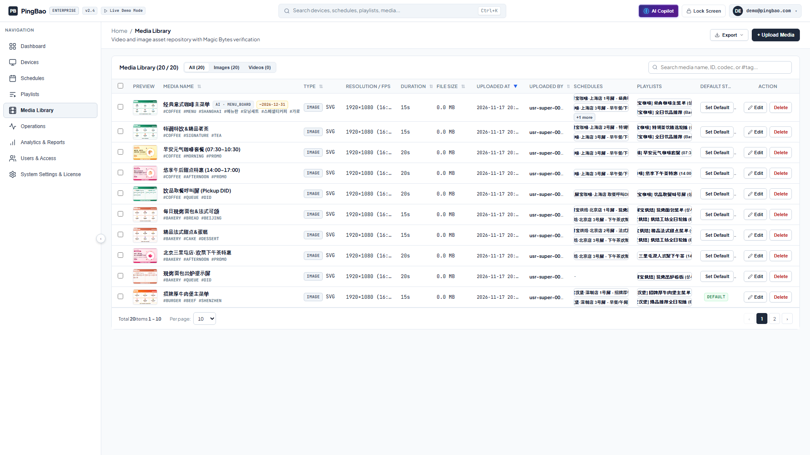
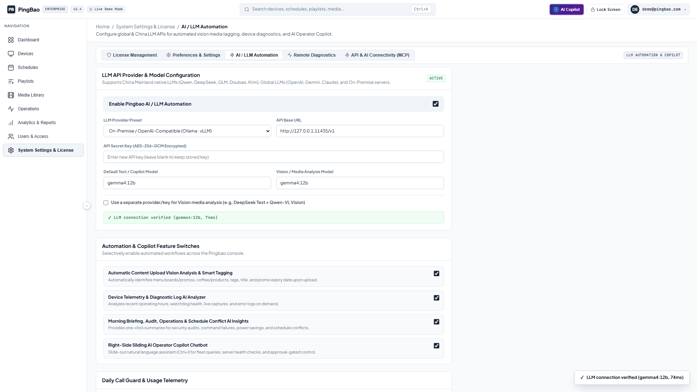
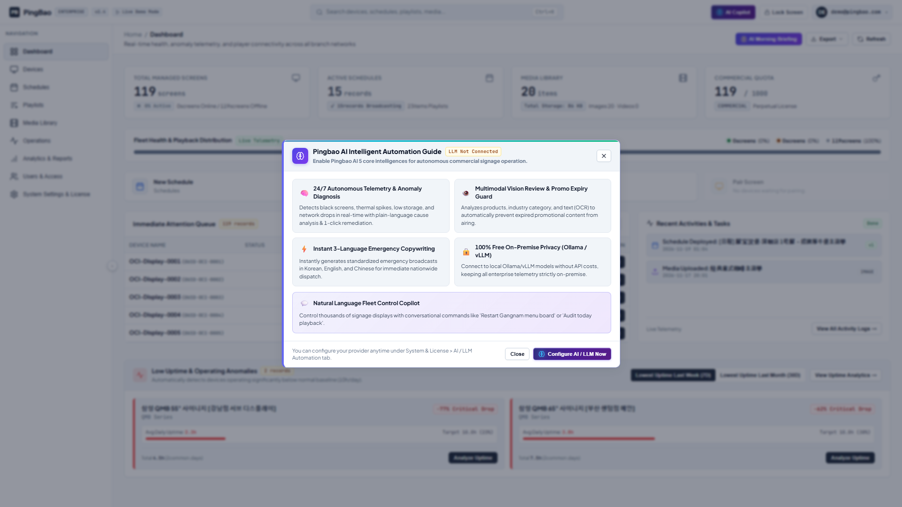
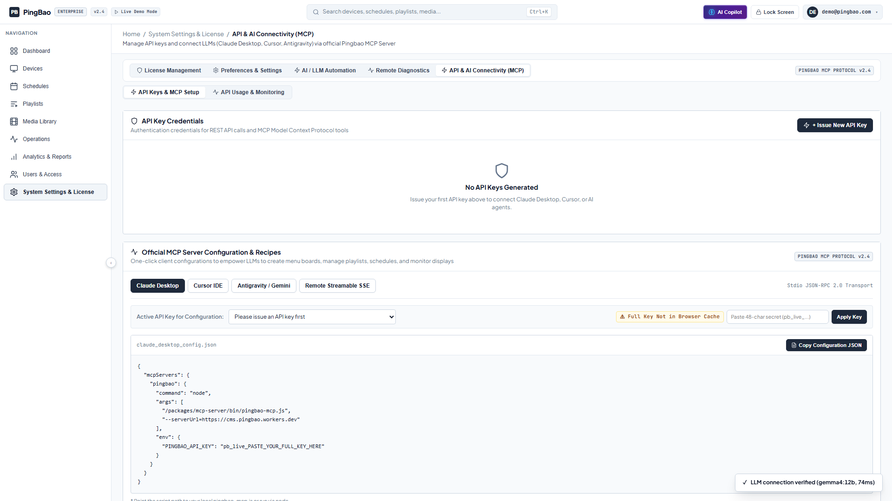

# Pingbao (屏宝 / 핑바오) Enterprise Operations Manual

**Pingbao** is a next-generation Enterprise Digital Signage CMS supercharged with a **Built-In AI Operator Copilot Chatbot (`Ctrl+J`) and 5 Core Autonomous Intelligences**, purpose-built around deep native hardware control for **Samsung Smart Signage (Tizen 6.5+ / SSSP 6–10+)** while seamlessly managing **Windows, Android, Linux, and Web** players from one unified console.  
Diagnose nationwide Multi-OS fleets in structured Markdown tables, issue **Human-in-the-Loop (HITL) approval-gated natural language controls**, block expired promotional banners via Multimodal Vision QA, orchestrate 4-tier dayparting & zero-config SyncPlay, and audit 1-second Proof-of-Play (PoP) billing reports.

---

## Table of Contents
1. [Getting Started & Workspace Architecture](#1-getting-started--workspace-architecture)
2. [★ Built-In AI Operator Copilot & 5 Autonomous Intelligences](#2--built-in-ai-operator-copilot--5-autonomous-intelligences)
3. [Multi-OS Fleet Management & Hardware IoT Control](#3-multi-os-fleet-management--hardware-iot-control)
4. [Media Assets Library & Multimodal AI Vision QA](#4-media-assets-library--multimodal-ai-vision-qa)
5. [Playlist Authoring](#5-playlist-authoring)
6. [4-Tier Scheduling Engine & AI Conflict Audit](#6-4-tier-scheduling-engine--ai-conflict-audit)
7. [Real-Time Operations Monitoring & Self-Healing](#7-real-time-operations-monitoring--self-healing)
8. [Analytics & Reports: Device Operating Times & Precision PoP](#8-analytics--reports-device-operating-times--precision-pop)
9. [Multi-Tenant Organizations, RBAC & Immutable Audit Logs](#9-multi-tenant-organizations-rbac--immutable-audit-logs)
10. [System Settings · AI/LLM Automation · 6-Month Retention · MCP](#10-system-settings--aillm-automation--6-month-retention--mcp)
11. [Full Feature Matrix](#11-full-feature-matrix)

---

## 1. Getting Started & Workspace Architecture

### 1.1 Access & Enterprise Two-Factor Authentication (2FA / TOTP)
1. Open the Pingbao console URL (`https://cms.pingbao.workers.dev` or your on-premise enterprise domain) in Chrome, Edge, or Safari.
2. Sign in with your operator credentials (or click **Instant Demo Login** on the public live demo portal).
3. Complete RFC 6238 TOTP 2-Factor Authentication via Google/Microsoft Authenticator (16-digit emergency backup codes are also supported).

 

*▲ [Workspace 1] Real-Time Enterprise Dashboard: Global fleet health, `[AI Morning Briefing]`, top-right `[AI Copilot (Ctrl+J)]`, and low-uptime anomaly triage*

---

## 2. ★ Built-In AI Operator Copilot & 5 Autonomous Intelligences

Pingbao's flagship differentiator is its deeply integrated **AI Operator Copilot (`Ctrl+J`)** and **Workspace Domain AI Insights**—delivering conversational fleet governance without external tool setup.

### 2.1 Slide-Out AI Operator Copilot (`Ctrl+J`) — Conversational Tables & Jump Links

 

*▲ Resizable Right-Side AI Operator Copilot: Quick prompt chips, live Multi-OS & server health Markdown table, and 1-click jump links*

* **Instant Slide-Out & Resizable Width (`Ctrl+J` or Header `[AI Copilot]`)**: Slides smoothly over any workspace without losing your context; drag the left border to resize freely.
* **Active UI Focus Awareness**: Automatically detects your active tab, open device inspector, or multi-selected checkboxes (`Focus: 3 selected`), accurately resolving natural prompts like *"diagnose this screen"* or *"lower volume on selected displays"*.
* **Structured HTML Markdown Tables & 1-Click Jump Links**: Summarizes server CPU/RAM/disk health, Multi-OS online counts, offline screens, and expired promos in clean tables with clickable `→ Device` / `→ Workspace` navigation buttons.
* **Rolling Context Memory Compaction**: Automatically compacts long conversations to maintain crisp multi-turn reasoning without token bloat.

### 2.2 Zero-Accident Human-in-the-Loop (HITL) Control & Strict Subsetting

 

| ① Approval-Gated Execution Preview (`APPROVAL REQUIRED`) | ② Instant Dispatch & Audit Logging (`EXECUTED`) |
| :---: | :---: |
|  |  |

* **Mandatory Human-in-the-Loop Approval**: Natural language requests for volume, brightness, screen power, reboot, power timers, or smart schedule drafts **never mutate hardware blindly**. Pingbao generates a structured **Execution Preview Card (`APPROVAL REQUIRED`)** that only executes after an authorized operator clicks **`[Approve & Execute]`**.
* **Strict Device Subsetting Guard**: Server-enforced target locking prevents accidental fleet-wide broadcasts—ensuring commands strictly target only your checked or inspected displays.

### 2.3 All-Workspace 1-Click AI Insights & Automatic Chat Convergence

 

*▲ `[AI Morning Briefing]` Knowledge Box unfolded on the Dashboard: Instant executive summary of Multi-OS fleet status, promo compliance, and energy savings*

Every core workspace features 1-click AI insight buttons whose findings also **converge automatically into your AI Copilot chat history**:
1. **Dashboard `[AI Morning Briefing]`**: 3-second executive summary of online health, schedule sync, expired promos, and energy optimization.
2. **Device Inspector `[Request AI Analysis]` & `[AI 3-Lang Emergency Copy]`**: Plain-language thermal/uptime/log root-cause diagnosis, live capture Vision QA, and instant Korean/English/Chinese emergency broadcast copywriting.
3. **Media `[AI Re-analyze Metadata]`**: Multimodal Vision extraction of purpose (`MENU_BOARD`/`PROMO`), menu items, OCR prices, dayparting windows, and **promo expiry dates (`detected_valid_until`)**.
4. **Schedules `[AI Schedule & Timer Audit]`**: Pre-publish detection of schedule vs. power-timer conflicts and expired promotional assets.
5. **Operations `[AI Failure Summary]` · Uptime `[AI Power Saving]` · Audit Logs `[AI Security Summary]`**: Automated root-cause triage across operations, energy, and security governance.

---

## 3. Multi-OS Fleet Management & Hardware IoT Control

 

| Multi-OS Fleet & Live Remote Capture | Right Inspector (`Control` Tab) — AI Device Diagnosis |
| :---: | :---: |
|  |  |

* **URL-Stamped Multi-OS Player Installer Modal**: Download pre-stamped installers (`Samsung Tizen USB .zip`, `Windows Kiosk .exe`, `Android .apk`, `Linux .deb/.sh`, or zero-install `/player` web launcher) and pair via 6-digit PIN.
* **OS-Tailored HAL & 7-Command Bulk Remote Control**: Automatically routes hardware panel power/backlight/RTC timers on Samsung SSSP and DPMS sleep/dimming/reboot on Windows, Android, and Linux.

 

| Multi-OS Player Installer Modal (`Auto-Stamped URL`) | 7-Command Dedicated Bulk Remote Control Modal |
| :---: | :---: |
|  |  |

---

## 4. Media Assets Library & Multimodal AI Vision QA

 

| Media Assets Library | AI Vision Metadata & Promo Expiry Guard |
| :---: | :---: |
|  |  |

* **Automatic Vision Tagging & Promo Expiry Guard**: Extracts asset purpose, product items, recommended dayparting slot, signage readability QA, and **campaign end date (`detected_valid_until`)**—preventing expired event banners from staying on air.
* **4K Direct-to-Disk Streaming, Magic-Byte Security & Referential Integrity Locks**: Protects active playlists and schedules from broken media links.

---

## 5. Playlist Authoring

 

*▲ [Workspace 4] Playlist Authoring: Mixed video/image sequencing, per-item duration, and GPU-accelerated transitions*

---

## 6. 4-Tier Scheduling Engine & AI Conflict Audit

 

| Schedules & `[AI Schedule & Timer Audit]` | 4-Tier 24h Dayparting Timeline & Effective Windows |
| :---: | :---: |
|  |  |

* **4-Tier Hierarchical Preemption (`EMERGENCY > EVENT > REGULAR > DEFAULT`)**: Millisecond interruption and lossless fallback with zero-config SSE **SyncPlay** across displays sharing the same Group, Schedule, and LAN.
* **1-Click `[AI Schedule & Timer Audit]`**: Verifies that promotional slots do not conflict with hardware power-off timers or contain expired media.

---

## 7. Real-Time Operations Monitoring & Self-Healing

 

*▲ [Workspace 6] Operations Monitoring: `[AI Failure Pattern Summary]`, multi-status triage filters, and `BEFORE / AFTER` Desired State Diff (`Op Diff`)*

---

## 8. Analytics & Reports: Device Operating Times & Precision PoP

 

| Device Operating Times Workbench (`Uptime + AI Power Tip`) | Precision Proof-of-Play (`PoP`) Billing Reports |
| :---: | :---: |
|  |  |

* **Operating Time Session Drill-Down & AI Power Saving**: Inspect daily `ON`/`OFF` timelines (`POWER_TIMER` vs `MANUAL`) and apply AI overnight sleep recommendations.
* **1-Second Frame-Accurate Proof-of-Play (PoP)**: Export verified completion rates (%) in CSV, JSON, or Markdown for indisputable advertiser billing.

---

## 9. Multi-Tenant Organizations, RBAC & Immutable Audit Logs

 

| Multi-Tenant Users & RBAC Matrix | Immutable Audit Logs & `[AI Security Summary]` |
| :---: | :---: |
|  |  |

* **Hierarchical Scope Isolation & Immutable Audit Ledger**: Permanently logs every operator and AI-approved command with actor, timestamp, IP address, and state diff.

---

## 10. System Settings · AI/LLM Automation · 6-Month Retention · MCP

 

| `AI / LLM Automation` — 10 Cloud, China & Free Ollama Presets | 5-Core Intelligence Onboarding Guide Modal |
| :---: | :---: |
|  |  |

* **10 Native Global · China Mainland (GFW-Direct) · Free On-Premise LLM Presets**:
  * **China Mainland Direct**: Alibaba Qwen (`DashScope`), `DeepSeek`, Zhipu `GLM`, ByteDance `Doubao`, Moonshot `Kimi`
  * **Global Cloud**: `Qwen International`, `OpenAI (GPT-4o)`, `Google Gemini (2.5 Flash/Pro)`, `Anthropic Claude (Sonnet/Haiku)`
  * **100% Free Air-Gapped On-Premise (`Ollama · vLLM · SGLang`)**: Zero API cost and zero data egress using local models (`gemma4`, `qwen2.5`, `deepseek-r1`, `qwen2.5vl`)
  * Includes **Split Text/Vision Provider routing**, **AES-256-GCM API Key Encryption**, **Live Latency Test**, and **Daily Call Quota Guard**.

 

| Commercial Ed25519 License | Open REST API & External AI Agent MCP |
| :---: | :---: |
|  |  |

---

## 11. Full Feature Matrix

| Module | Core Capabilities | Technical Differentiators |
| :--- | :--- | :--- |
| **1. Built-In AI Copilot** | Slide-out chat (`Ctrl+J`), Markdown tables, HITL approval cards, jump links | UI focus awareness, Strict Subsetting broadcast guard |
| **2. Vision & Domain AI** | Morning briefing, device log interpreter, Vision auto-tagging & promo expiry guard | 10 Cloud/China/Free Ollama presets, AES-256 key storage |
| **3. Multi-OS Fleet Control** | Samsung Tizen SSSP native + Windows / Android / Linux / Web + 7-cmd bulk modal | OS-tailored HAL routing, URL-stamped installers |
| **4. 4-Tier Scheduling & Sync** | Emergency/Event/Regular/Default preemption, AI conflict audit, auto SyncPlay | SSE `sync-stream` + EMA clock offset calibration |
| **5. Self-Healing & Uptime/PoP** | `BEFORE/AFTER` Op Diff, daily power sessions, 1s frame-verified PoP exports | CSV/JSON/MD billing exports, 180-day auto-purge |
| **6. Security, Audit & MCP** | TOTP 2FA, RBAC, immutable audit ledger, 60+ REST APIs & built-in MCP server | Argon2id, Ed25519 air-gap license, Claude/Cursor ready |

---

Pingbao (屏宝 / 핑바오) © 2026. All rights reserved.

