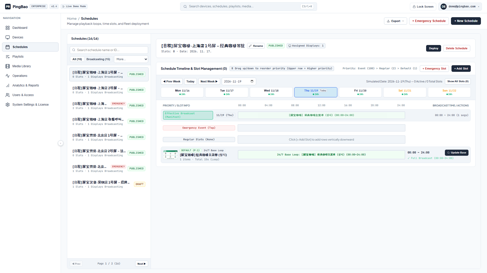
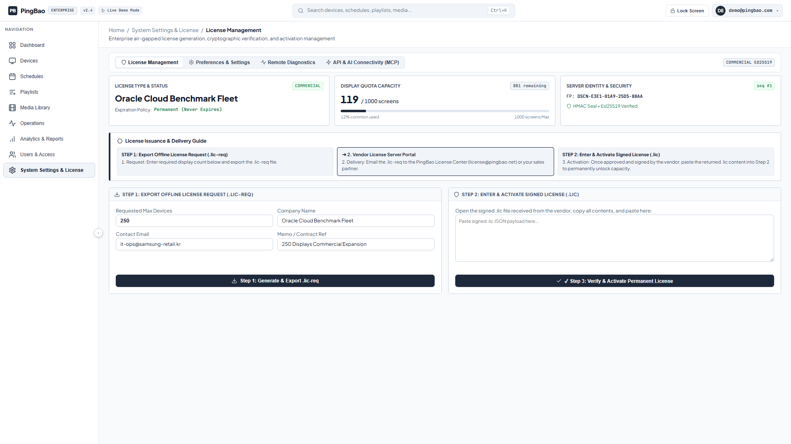
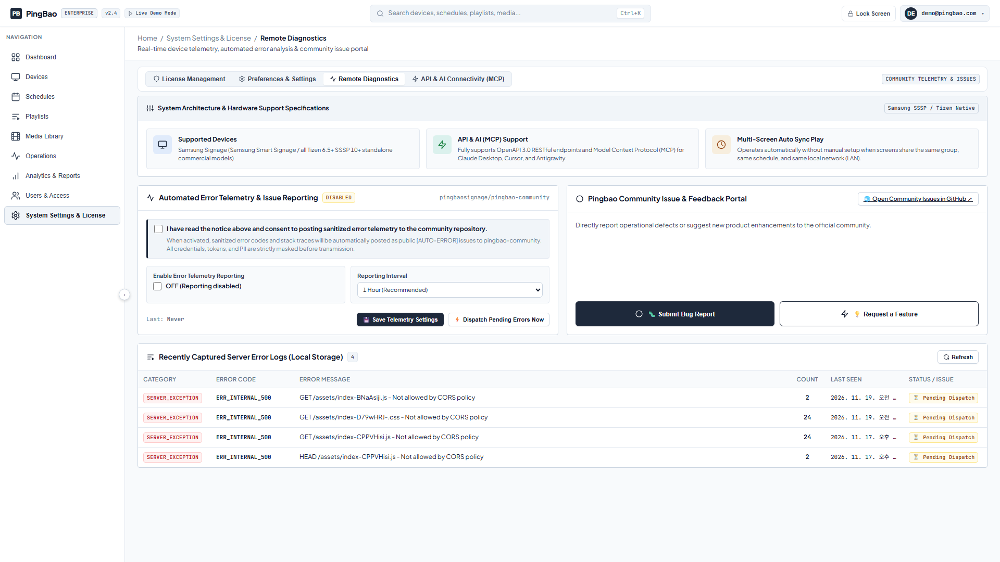

# Pingbao (屏宝 / 핑바오) Enterprise Operations & User Guide

**Pingbao (屏宝 / 핑바오)** is an enterprise-grade cloud digital signage operations platform (CMS) engineered with deep native hardware optimization for **Samsung Smart Signage (Tizen 6.5+ / SSSP 6–10+)** while seamlessly unifying **Windows, Android, Linux, and Web** players in a single console.  
It delivers OS-aware Hardware Abstraction Layer (HAL) remote control, zero-config multi-screen synchronization (SyncPlay), 24-hour multi-tier timeline dayparting, autonomous offline playback, Device Operating Time (Uptime) & sub-second Proof-of-Play (PoP) analytics, and native REST API & AI Agent MCP (Model Context Protocol) connectivity.

---

## Table of Contents
1. [Getting Started & Workspace Architecture](#1-getting-started--workspace-architecture)
2. [Multi-OS Fleet Management & Hardware IoT Control](#2-multi-os-fleet-management--hardware-iot-control)
3. [Media Asset Management & Security Standards](#3-media-asset-management--security-standards)
4. [Playlist Authoring](#4-playlist-authoring)
5. [Deep Dive: Scheduling Engine Architecture](#5-deep-dive-scheduling-engine-architecture)
6. [Real-Time Operations Monitoring & Self-Healing](#6-real-time-operations-monitoring--self-healing)
7. [Analytics & Reports: Operating Times & Precision PoP](#7-analytics--reports-operating-times--precision-pop)
8. [Multi-Tenant Organizations, RBAC & Immutable Audit Logs](#8-multi-tenant-organizations-rbac--immutable-audit-logs)
9. [System Settings, 6-Month Log Retention & Error Telemetry](#9-system-settings-6-month-log-retention--error-telemetry)
10. [Standard REST API & AI Agent MCP Support](#10-standard-rest-api--ai-agent-mcp-support)
11. [Full Feature Matrix](#11-full-feature-matrix)

---

## 1. Getting Started & Workspace Architecture

### 1.1 Access, Login & Enterprise Two-Factor Authentication (2FA / TOTP)
1. Open a modern browser (Google Chrome, Microsoft Edge, Safari) and navigate to your Pingbao console (`https://cms.pingbao.workers.dev` or your enterprise domain).
2. Enter your operator credentials (in the public live demo, click **Start Instant Demo** for one-click access without registration).
3. Complete RFC 6238 TOTP two-factor authentication via Google/Microsoft Authenticator, or use a single-use 16-character emergency backup code.

 

*▲ [Workspace 1] Pingbao Real-Time Operations Dashboard: Fleet availability, published schedules, 7d/30d low-uptime anomaly triage, and live activity feed*

### 1.2 Overview of the 9 Core Workspaces
* **Dashboard**: Global fleet connectivity, schedule deployment health, and low-uptime anomaly early warnings.
* **Devices (Fleet Management)**: Unified lifecycle management for Samsung Tizen SSSP, Windows, Android, and Linux displays, 7-command bulk remote control, and live remote screen capture.
* **Schedules**: 4-tier priority preemption engine, 24-hour multi-track timeline dayparting, effective broadcast window calculation, and atomic deployment.
* **Playlists**: Mixed video/image sequencing, per-item duration tuning, loop duration calculation, and GPU-accelerated transitions.
* **Media Library**: Direct-to-disk 4K streaming uploads, 64-byte binary magic-byte verification, and referential delete-protection locks.
* **Operations**: Multi-status (`Success` / `In Progress` / `Failed`) & category triage filters, command queue tracking, and `BEFORE / AFTER` desired-state diff inspection.
* **Analytics & Reports**: **Device Operating Times (Uptime)** session drilldown workbench and sub-second **Proof-of-Play (PoP)** settlement reports.
* **Users & Access**: Hierarchical multi-tenant organization tree, granular CRUDX role matrix, and **Immutable User Audit Logs**.
* **System Settings & License**: Ed25519 commercial licensing, auto-stamped Multi-OS packaging & **6-month log retention lifecycle**, remote diagnostics, and **API & AI Connectivity (MCP)**.

---

## 2. Multi-OS Fleet Management & Hardware IoT Control

 

*▲ [Workspace 2] Device Management: Multi-OS platform badges (TIZEN / WINDOWS / ANDROID / LINUX), online status, and live screen capture inspector*

### 2.1 Multi-OS Player Installer Modal & 6-Digit PIN Pairing
1. Click **[Download Player Installer]** at the top right of the Devices workspace.
2. Every installer bundle is **automatically stamped with your Server Access URL**, eliminating manual IP entry on site:
   * **Samsung Tizen (B2B)**: Auto-install USB bundle (`.zip`) for SSSP 6–10 commercial displays.
   * **Windows Kiosk Player (x64)**: Native `.exe` for Windows 10/11 (immersive fullscreen, sleep blocker, DPMS display power-off, remote OS reboot).
   * **Android Signage / Tablet App**: Signed `.apk` (immersive fullscreen, WakeLock keep-awake, app brightness control).
   * **Linux Kiosk Agent (x64)**: Ubuntu/Debian `.deb` package and automated `.sh` installer script.
   * **Zero-Install Web Launcher**: Direct browser URL (`/player`).
3. Launch the player, read the 6-digit **Pairing PIN** shown on screen, and submit it under **[+ Pair Screen]** in the web console.

 

*▲ Multi-OS Player Installer Download modal with pre-stamped Server Access URL*

### 2.2 Per-OS HAL Routing & 7-Command Bulk Remote Control
* **OS-Aware HAL Routing**: Automatically adapts hardware commands per OS—from Samsung Tizen hardware backlight, panel power, IR/key locks, HDMI source switching, and hardware RTC timers to Windows/Android/Linux display sleep blackout and software dimming.
* **Dedicated Bulk Remote Control Modal (7 Commands)**: Select multiple displays across mixed OS platforms to execute **Screen On/Off, Volume, Mute/Unmute, Brightness, Restart Player, Reboot Device, or Emergency Broadcast** in one action.
* **Zero-Visit Live Stream & Full-Screen Capture**: Inspect real-time rendered frames directly from the right-hand inspector or full-screen capture modal without technician site visits.

---

## 3. Media Asset Management & Security Standards

 

*▲ [Workspace 3] Media Library: 4K promotional videos, menu boards, codec metadata, and referential protection*

* **Direct-to-Disk Streaming Uploads**: Supports multi-gigabyte MP4 (H.264/H.265/AV1), WebM, PNG, JPG, SVG, and WebP files with on-the-fly SHA-256 hashing.
* **Binary Magic-Byte Validation**: Inspects binary headers to block spoofed extensions or malicious payloads.
* **Referential Integrity Delete Locks**: Assets referenced by active playlists or published schedules cannot be deleted accidentally.

---

## 4. Playlist Authoring

 

*▲ [Workspace 4] Playlists: Mixed video/image sequencing, exposure timing, and automatic loop cycle calculation*

* **Seamless Mixed Media**: Combine videos and high-resolution posters in a single loop with independent exposure durations and GPU-accelerated Cut/Crossfade transitions.

---

## 5. Deep Dive: Scheduling Engine Architecture

 

*▲ [Workspace 5-1] Schedules Master-Detail View: Broadcasting filters and 24-hour timeline overview*

 

*▲ [Workspace 5-2] Multi-Tier Timeline Editor: Drag-and-drop priority ordering & effective broadcast manifest calculation*

### 5.1 4-Tier Hierarchical Preemption Model
* **`EMERGENCY` (P: 100–200)**: Millisecond takeover for fire/weather alerts or VIP greetings; resumes prior playback seamlessly once cleared.
* **`EVENT` (P: 50–99)**: Peak-hour promotions (e.g., Lunch 11:30–14:00, Dinner specials).
* **`REGULAR` (P: 10–49)**: Standard dayparting (Breakfast, Afternoon Tea, Evening menus).
* **`DEFAULT` (P: 1)**: 24/7 base fallback loop guaranteeing zero screen blackouts.

### 5.2 Zero-Config SyncPlay & Autonomous Offline Loop
* **Automatic SyncPlay**: Displays sharing the **same group, same schedule, and same LAN** synchronize transitions to the millisecond via authenticated SSE `sync-stream` and EMA clock-offset calibration.
* **Autonomous Offline Playback**: Pre-cached media and local state machines keep dayparting transitions running 24/7/365 even during extended internet outages.

---

## 6. Real-Time Operations Monitoring & Self-Healing

 

*▲ [Workspace 6] Operations Monitoring: Multi-status & category filters, command sync tracking, and BEFORE/AFTER state diff*

* **Multi-Status & Category Triage**: Filter live operations by `Success`, `In Progress`, or `Failed` across command categories, inspect `BEFORE / AFTER` JSON state diffs, and auto-recover transient network failures without site dispatches.

---

## 7. Analytics & Reports: Operating Times & Precision PoP

### 7.1 Device Operating Times Workbench (Uptime)

 

*▲ [Workspace 7-1] Device Operating Times Workbench: Total runtime, availability %, low-uptime triage, and session timeline drilldown*

* **Proactive Store Management**: Automatically highlights displays with critical runtime drops and lets managers drill down into daily `ON` / `OFF` session records (`POWER_TIMER` vs `MANUAL`).

### 7.2 Sub-Second Proof-of-Play (PoP) & Settlement Reports

 

*▲ [Workspace 7-2] Proof-of-Play (PoP): Verified play counts, total broadcast hours, Completion Rate (%), and 15-minute ledger*

* **Indisputable Billing Audits**: Logs only hardware-rendered playback events, separates interrupted vs. completed plays into exact Completion Rates (%), and exports CSV / JSON / Markdown audit reports in one click.

---

## 8. Multi-Tenant Organizations, RBAC & Immutable Audit Logs

 

| Users & Organization Directory (`Users & Access`) | Immutable User Audit Ledger (`Audit Logs`) |
| :---: | :---: |
|  |  |

* **Hierarchical Scope Isolation & RBAC**: Isolate regional and store-level operators with fine-grained CRUDX role matrices while recording every login, schedule change, and device command in an immutable audit ledger with IP attribution.

---

## 9. System Settings, 6-Month Log Retention & Error Telemetry

 

| Commercial License (`License`) | Remote Diagnostics & Community (`Telemetry`) |
| :---: | :---: |
|  |  |

* **Air-Gapped Ed25519 Licensing & 6-Month Auto-Purge Lifecycle**: Offline cryptographic license verification paired with an automated **6-month (180-day) retention and purge lifecycle** for operational, uptime, PoP, and audit logs, plus Opt-in PII-masked community error telemetry.

---

## 10. Standard REST API & AI Agent MCP Support

 

*▲ [System Settings > API & AI Connectivity (MCP)] Scoped API keys, hourly usage analytics, and one-click Claude / Cursor / Antigravity MCP setup*

Pingbao embeds an official **MCP (Model Context Protocol)** server and **API Key Usage Analytics**, enabling Claude Desktop, Cursor, Antigravity, and custom enterprise AI agents to inspect fleet health, analyze store uptime, upload creative assets, and deploy multi-tier schedules through natural language.

---

## 11. Full Feature Matrix

| Module | Core Capabilities | Technical Differentiators |
| :--- | :--- | :--- |
| **1. Dashboard** | Global availability KPIs, live event feed, 7d/30d low-uptime anomaly triage | Multi-tenant scope isolation, 1-click drilldown |
| **2. Multi-OS Fleet** | Samsung Tizen SSSP + Windows / Android / Linux / Web & 7-command bulk control | Per-OS HAL routing, URL-stamped installers |
| **3. Scheduling Engine** | 4-tier priority preemption, 24h dayparting, effective broadcast calculation | Local autonomous state machine, zero-blackout fallback |
| **4. Auto SyncPlay** | Zero-config frame sync across same group, schedule, and LAN | Authenticated SSE `sync-stream` + EMA clock calibration |
| **5. Playlists & Media** | Mixed video/image loops, GPU transitions, 4K streaming upload, magic-byte check | 64B header verification, referential delete locks |
| **6. Operations & Healing** | Multi-status/category filters, BEFORE/AFTER state diff, automated retry | Zero-visit remote recovery |
| **7. Uptime & PoP** | Session-level ON/OFF drilldowns, hardware-verified PoP & Completion Rate (%) | `POWER_TIMER`/`MANUAL` attribution, CSV/JSON/MD export |
| **8. Security & Retention** | 2FA (TOTP), RBAC matrix, immutable audit logs, 6-month auto-purge lifecycle | RFC 6238 TOTP, Argon2id, 180-day storage hygiene |
| **9. REST API & AI MCP** | 60+ OpenAPI 3.0 endpoints, built-in MCP server, per-key traffic & error analytics | Scoped API Keys, natural language orchestration |

---

Pingbao (핑바오 / 屏宝) © 2026. All rights reserved.

