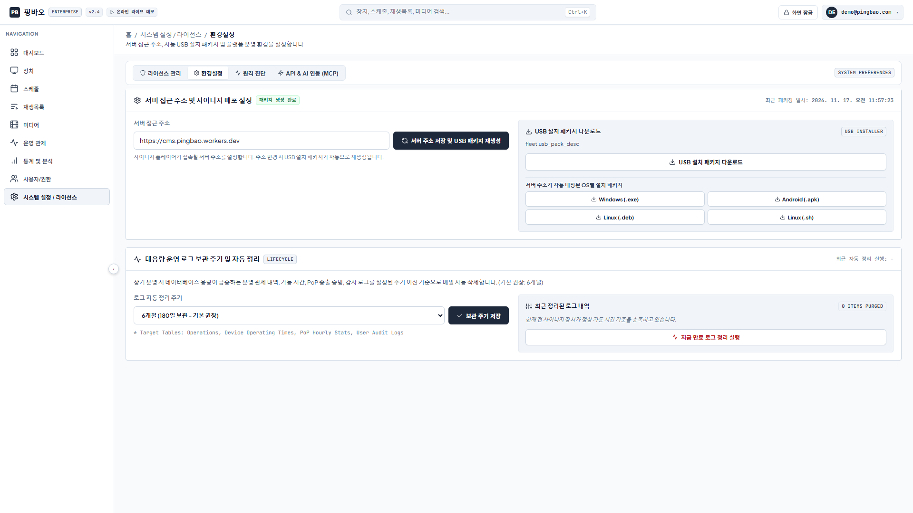

# 핑바오(Pingbao) 관리자 및 설치 가이드

본 문서는 **핑바오(Pingbao)** 서버 환경을 온프레미스(On-Premise), NAS 또는 클라우드(Cloud) 환경에 구축하고 유지 관리하는 방법을 안내합니다.

---

## 1. 시스템 요구사항 및 배포 아키텍처 선택

* **서버 운영체제**: Linux (Ubuntu 22.04 LTS+, Rocky Linux 9+), Synology DSM 7+, QNAP QTS, Oracle Linux, Windows Server 2019+
* **지원 플레이어 단말 OS**:
  * **삼성 스마트 사이니지**: Tizen 6.5+ / SSSP 6~10+ Standalone 상업용 디스플레이 (`USB 자동 설치팩 .zip`)
  * **Windows 키오스크**: Windows 10 / 11 x64 (`.exe`)
  * **Android 사이니지**: Android 셋톱박스 / 태블릿 / DID (`.apk`)
  * **Linux 미니 PC**: Ubuntu / Debian x64 (`.deb` / `.sh`)
  * **웹 런처**: 무설치 표준 브라우저 직접 접속 (`/player`)
* **컨테이너 런타임**: Docker Engine 24.0+ 및 Docker Compose v2+ (베어메탈 실행 시 **Node.js 22.5+**)
* **설치 옵션별 권장 사양 (`DB_MODE`)**:
  * **경량 / 단독형 (`DB_MODE=sqlite`, 기본값)**: CPU 2 Core 이상, **RAM 2GB~4GB**, 20GB+ SSD (`dscn-server` + `dscn-nginx` 2컨테이너 구성, NAS 및 1~300대 매장 환경 최적)
  * **엔터프라이즈 / 고가용성 (`DB_MODE=postgres`)**: CPU 4 Core 이상, **RAM 8GB 이상** (100대 이상 운영 시 16GB 권장), 100GB+ SSD (PostgreSQL 16 + Redis 7 Pub/Sub 클러스터 버스 포함 4컨테이너 구성, 다중 서버 HA 환경 최적)

---

## 2. Docker 환경 설치

### 2.1 패키지 준비
핑바오 배포 패키지(`pingbao-release.tar.gz` 또는 배포 아티팩트)를 대상 서버에 업로드합니다.

```bash
tar -zxvf pingbao-release.tar.gz
cd pingbao-release
```

### 2.2 환경변수 및 데이터베이스 모드 설정
대화형 설치 스크립트 실행 시 자동으로 `.env`와 보안 키 파일(`.env.secret`, 권한 `0600`)이 생성되며, 수동 설정 시 `.env.example`을 복사하여 구성할 수 있습니다.

```bash
cp .env.example .env
nano .env
```

주요 설정 항목:
* `DB_MODE`: 데이터베이스 엔진 선택 (`sqlite` 기본값 또는 `postgres`)
* `DATA_DIR`: 격리된 데이터베이스 보관 경로 (기본값 `./data`, 외부 정적 서빙 경로인 `./storage`와 엄격 물리 분리)
* `DATABASE_URL` / `REDIS_URL`: `DB_MODE=postgres` 선택 시 PostgreSQL 16 및 Redis 7 클러스터 접속 정보
* `JWT_SECRET`: 관리자 인증 토큰 서명 키 (미지정 시 `SERVER_MASTER_KEY`에서 HKDF-SHA256으로 안전 파생)

### 2.3 서비스 실행 (설치 시 DB 모드 선택)

```bash
# 대화형 설치 마법사 (1: SQLite 경량 모드 / 2: PostgreSQL + Redis 엔터프라이즈 모드 선택)
./install.sh

# 경량 SQLite WAL 모드 자동 설치 (docker-compose.sqlite.yml)
./install.sh --silent --db-mode=sqlite --domain=signage.mycompany.com

# 엔터프라이즈 PostgreSQL + Redis 클러스터 모드 자동 설치 (docker-compose.onprem.yml)
./install.sh --silent --db-mode=postgres --domain=signage.mycompany.com
```

---

## 3. 업데이트 및 롤백 가이드

### 3.1 신규 버전 무중단 업데이트
`DB_MODE`를 자동 감지하여 `./data` 및 DB를 사전 백업한 뒤 헬스체크 실패 시 자동 롤백합니다.

```bash
./upgrade.sh
```
* 기존 데이터베이스(`./data/pingbao.sqlite` 또는 PostgreSQL 볼륨) 및 미디어 스토리지(`./storage`)는 안전하게 보존됩니다.

### 3.2 이전 버전 즉시 롤백

```bash
./rollback.sh
```

---

## 4. 백업 및 모니터링

* **DB 백업**: `./dscn-ctl.sh backup` 실행 또는 `./data` 디렉터리(`pingbao.sqlite`) / PostgreSQL 일일 덤프 자동 수행 권장 (`.env.secret` 마스터 키 파일 필수 동반 보관)
* **스토리지 백업**: `./storage` 미디어 에셋 볼륨 복제
* **상태 및 실시간 동기화 확인**: `GET /api/v1/health` 엔드포인트(`status`, `db_mode` 반환)로 서버 상태를 모니터링하며, 다중 디스플레이 실시간 SyncPlay를 위해 리버스 프록시 앞단에서 `/api/v1/device/sync-stream` SSE 경로의 버퍼링 비활성화(`proxy_buffering off`)를 유지합니다.

---

## 5. 시스템 설정 · 로그 보존 주기 · 원격 진단 · MCP 연동

**[시스템 설정 / 라이선스]** 워크스페이스는 4개의 전문 관리 서브탭으로 구성되어 있습니다.

<br/>


*▲ [시스템 설정 > 환경설정] 서버 접근 주소 자동 패키징 및 6개월 기본 로그 보존 주기 관리*

### 5.1 4대 관리 서브탭 구조
1. **라이선스 관리 (`LICENSE`)**: 오프라인/폐쇄망 완벽 대응 Ed25519 상용 라이선스(`.lic`) 서명 검증, 단말 쿼터 현황 및 `.lic-req` 요청 파일 발급
2. **환경설정 (`ADMIN_SETTINGS`)**:
   * **서버 접근 주소 및 멀티 OS 설치 패키지 자동 생성**: 플레이어가 접속할 대표 서버 URL을 저장하면 삼성 Tizen USB(`.zip`), Windows(`.exe`), Android(`.apk`), Linux(`.deb`/`.sh`) 설치 패키지에 해당 서버 주소가 즉시 자동 내장(Stamping)되어 재패키징됩니다.
   * **6개월 기본 로그 보존 주기 및 자동 정리(Auto-Purge Lifecycle)**: 운영 관제 이력(Operations), 장치 가동 시간(Uptime), 방송 송출 증빙(PoP), 사용자 감사 로그(Audit Logs)에 대해 **기본 6개월(180일) 보존 정책**과 자동 백그라운드 정리 주기가 작동하여 장기 운영 시 디스크 용량 포화를 방지합니다.
3. **원격 진단 (`DIAGNOSTICS`)**: 단말 텔레메트리 사양 확인, Opt-in 기반 개인정보 자동 마스킹 에러 리포팅 및 커뮤니티 이슈 포털 연동
4. **API & AI 연동 (`CONNECTIVITY`)**: 조직·역할·작업 범위(Scope) 제한 API 키 발급, 시간대별 API/MCP 호출량 및 인증 실패 모니터링, Claude Desktop / Cursor / Antigravity 원클릭 MCP 설정 JSON 제공

### 5.2 자동 에러 텔레메트리 및 커뮤니티 포털 (`DIAGNOSTICS`)
* **보안 및 개인정보 보호**: 모든 패스워드, JWT 토큰, API Secret, IP, 로컬 경로 등 민감 정보는 전송 전 메모리에서 즉시 `***MASKED***` 처리되며, SHA-256 지문으로 중복 제거됩니다.
* **관리자 명시적 동의제 (Opt-in)**: 기본 비활성화(`DISABLED`) 상태이며, 최고 관리자가 주의사항 확인 후 동의 체크박스를 활성화해야만 동작합니다.
* **콘솔 내 이슈 등록**: 브라우저를 벗어나지 않고 `[수동 버그 리포트 등록]` 및 `[기능 개선 제안 등록]`을 통해 `pingbaosignage/pingbao-community` 이슈를 즉시 생성할 수 있습니다.
