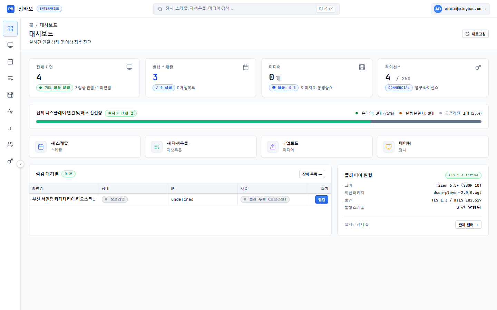

# 핑바오(Pingbao) 사용자 매뉴얼

**핑바오(Pingbao)**는 대규모 스마트 사이니지 디스플레이를 중앙에서 손쉽게 제어하고, 미디어 콘텐츠를 무중단 자율 스케줄링으로 송출할 수 있는 엔터프라이즈 디지털 사이니지 관리 플랫폼(CMS)입니다.

---

## 1. 시작하기 (Quick Start)

### 1.1 접속 및 로그인
1. 브라우저(Chrome, Edge 권장)를 열고 핑바오 서버 주소로 접속합니다.
2. 관리자 또는 운영자 계정으로 로그인합니다.
3. 최초 로그인 후 우측 상단 프로필에서 언어(한국어, English, 中文) 설정을 변경할 수 있습니다.

### 1.2 화면 구성 및 대시보드
* **대시보드 (Dashboard)**: 전체 디스플레이 상태(온라인/오프라인), 등록 단말 수, 최근 활동 현황 요약
* **디바이스 관리 (Devices)**: 현장 사이니지 등록 승인, 화면 On/Off 원격 제어, 볼륨 조절, 재부팅 및 실시간 스크린 캡처
* **미디어 라이브러리 (Media)**: 이미지, 동영상(MP4, WebM 등) 에셋 업로드 및 태그 기반 분류
* **플레이리스트 (Playlists)**: 미디어 에셋을 조합하여 재생 순서와 시간을 구성
* **스케줄 관리 (Schedules)**: 타임라인 드래그 앤 드롭으로 날짜/시간대별 플레이리스트 편성 및 원클릭 배포
* **운영 모니터링 (Operations)**: 실시간 롱폴링 명령 큐, 통신 지연시간, 이상 징후 감지 및 실시간 감사 로그

 

*▲ [화면 1] 핑바오 대시보드: 디스플레이 가동률, 스케줄 배포 현황 및 시스템 헬스 요약*

---

## 2. 디바이스 등록 및 관리

### 2.1 사이니지 단말 신규 등록
1. 현장의 삼성 스마트 사이니지(Tizen 6.5+)에서 핑바오 플레이어 앱을 실행합니다.
2. 화면에 표시되는 6자리 **등록 코드(PIN Code)** 또는 단말 고유 식별자(DUID)를 확인합니다.
3. 핑바오 웹 콘솔의 **디바이스 관리 > 단말 등록** 버튼을 누르고 등록 코드를 입력합니다.
4. 설치 위치(예: "강남점 1층 로비")와 그룹을 지정한 뒤 승인하면 즉시 연결됩니다.

### 2.2 디바이스 원격 제어
* **패널 화면 On/Off**: 영업시간 외 디스플레이 전원 절약
* **원격 스크린 캡처**: 현장에 가지 않고도 현재 송출 중인 화면 실시간 확인
* **원격 재부팅 & 볼륨 제어**: 단말 이상 시 원격 재기동 및 매장 음향 원격 통제

 

*▲ [화면 2] 핑바오 장치 관리: 등록된 디스플레이 목록, 상태, DUID 및 원격 전원/볼륨 제어*

---

## 3. 실시간 운영 모니터링 (Operations)

### 3.1 명령 큐 및 하트비트 관제
* **Desired State 동기화**: 단말기 버전과 서버 설정 버전 간의 일치 여부를 실시간으로 추적합니다.
* **통신 지연시간 및 이상 감지**: 오프라인 전환 단말기, 미디어 다운로드 지연 단말기를 즉시 감지하여 알림을 제공합니다.

 

*▲ [화면 3] 핑바오 운영 모니터링: 실시간 단말 상태, 롱폴링 명령 큐 및 하드웨어 텔레메트리 관제*

---

## 4. 타임라인 스케줄링 및 무중단 배포

### 4.1 타임라인 기반 스케줄 편성
* **24시간 기본 루프 (Fallback Loop)**: 별도 이벤트가 없을 때 무한 반복되는 기본 플레이리스트
* **피크 타임/특정 시간대 이벤트 스케줄**: 점심시간(11:30~13:30) 특가 안내 등 특정 시간대에만 우선 노출되는 스케줄 지정

### 4.2 자율 재생 및 원클릭 배포
* 스케줄을 저장하고 **게시(Publish)** 버튼을 누르면 할당된 모든 디바이스에 새로운 스케줄 스냅샷이 즉시 전달됩니다.
* 디바이스는 필요한 미디어를 백그라운드로 안전하게 다운로드한 뒤, 원자적(Atomic)으로 화면을 전환합니다.
* 일시적인 네트워크 장애가 발생해도 디바이스 로컬 저장소의 스케줄 규칙에 따라 영구 자율 재생됩니다.

 

*▲ [화면 4] 핑바오 스케줄 편성: 24시간 Base Fallback 루프 및 피크 이벤트 타임라인 스케줄링*
