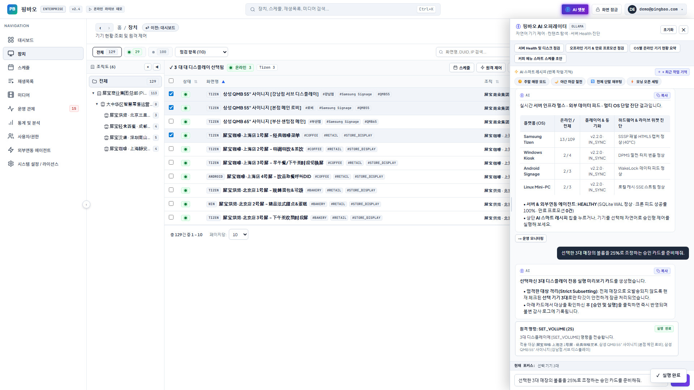
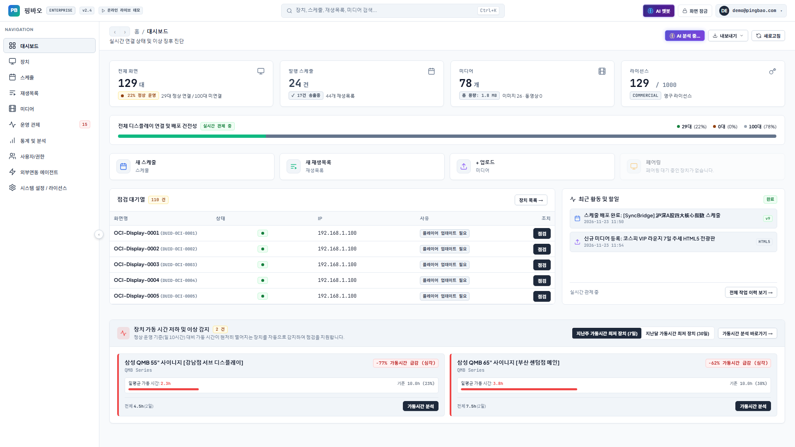
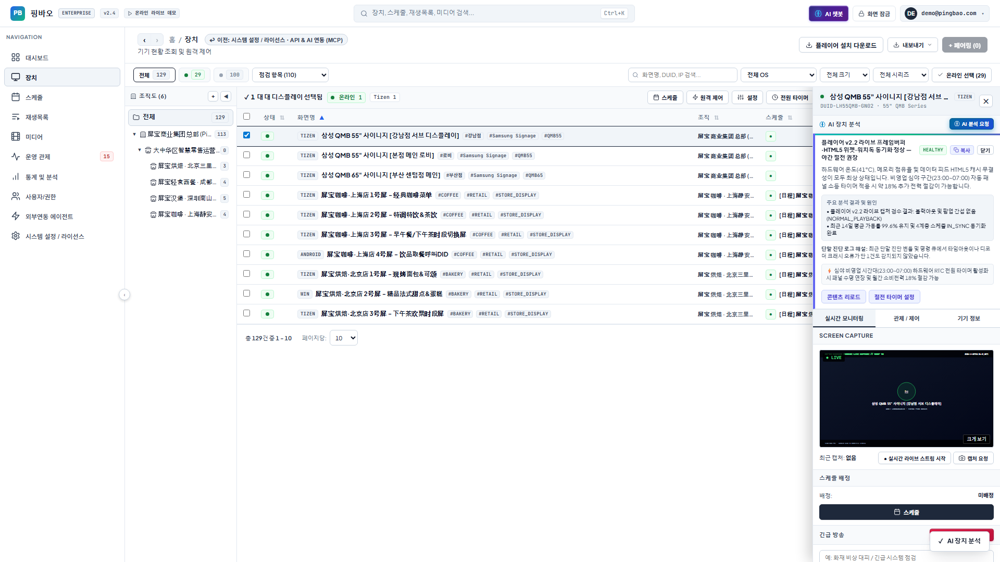
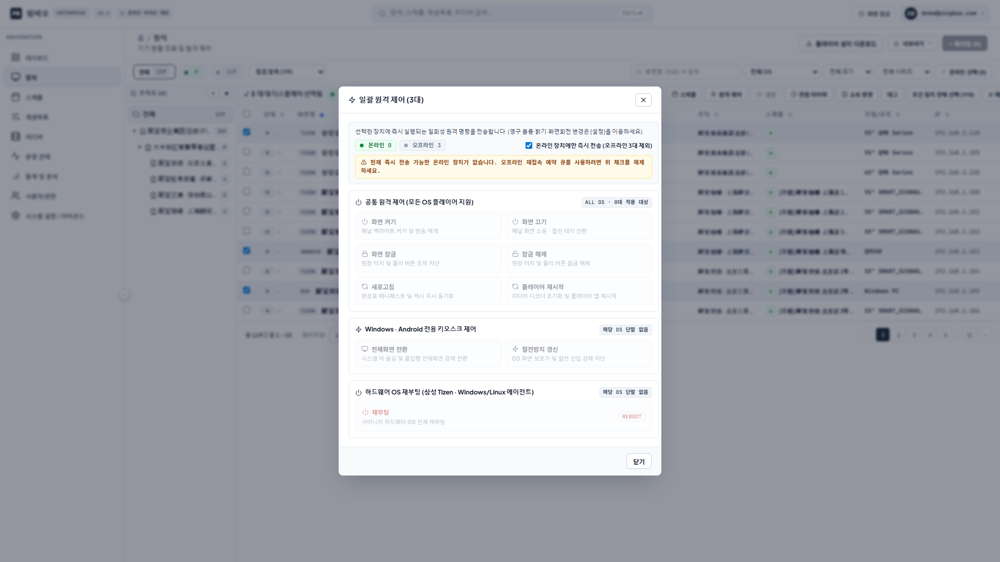
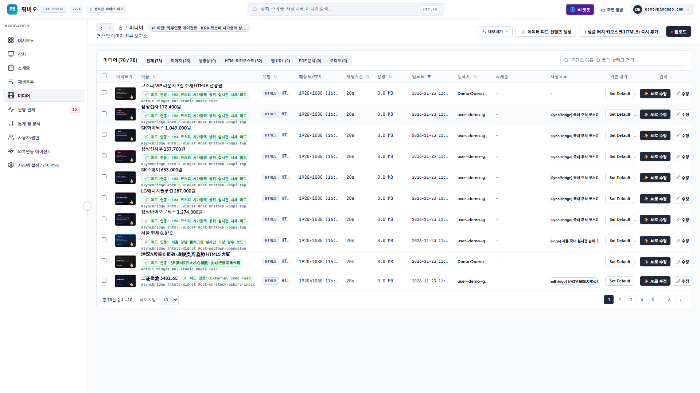
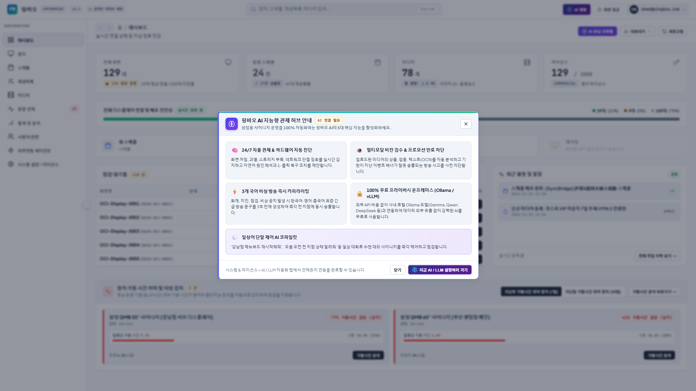

# 핑바오 (Pingbao / 屏宝) 엔터프라이즈 통합 운영 매뉴얼

**핑바오(Pingbao)**는 **빌트인 AI 오퍼레이터 챗봇(AI Copilot) & 스마트 레시피**와 코딩 없이 실시간 외부 데이터를 16:9 인터랙티브 HTML5 전광판으로 연결하는 **대화형 외부연동 에이전트 스튜디오**를 기본 탑재하고, **삼성 스마트 사이니지 (Samsung Smart Signage · Tizen 6.5+ / SSSP 6~10+)** 심층 하드웨어 제어를 중심으로 **Windows, Android, Linux, Web** 플레이어(`v2.2.0`)까지 아우르는 차세대 엔터프라이즈 디지털 사이니지 통합 관제 플랫폼(CMS)입니다.

---

## 목차 (Table of Contents)
1. [시스템 시작 및 10대 워크스페이스 구조](#1-시스템-시작-및-10대-워크스페이스-구조)
2. [★ 빌트인 AI 오퍼레이터 챗봇 · AI 스마트 레시피 & 5대 자율 관제 지능](#2--빌트인-ai-오퍼레이터-챗봇--ai-스마트-레시피--5대-자율-관제-지능)
3. [★ 대화형 외부연동 에이전트 & 2단 분할 ‘AI 컨텐츠 수정 스튜디오’ (NEW)](#3--대화형-외부연동-에이전트--2단-분할-ai-컨텐츠-수정-스튜디오-new)
4. [멀티 OS 장치 관리(v2.2) 및 하드웨어 IoT 제어 (Fleet Management)](#4-멀티-os-장치-관리v22-및-하드웨어-iot-제어-fleet-management)
5. [미디어 라이브러리 · HTML5 키오스크(.zip) · AI 비전 검수](#5-미디어-라이브러리--html5-키오스크zip--ai-비전-검수)
6. [플레이리스트 저작 (Playlists)](#6-플레이리스트-저작-playlists)
7. [스케줄링 핵심 엔진 및 AI 편성 점검 (Scheduling Engine)](#7-스케줄링-핵심-엔진-및-ai-편성-점검-scheduling-engine)
8. [실시간 운영 관제 및 자율 치유 (Operations Monitoring)](#8-실시간-운영-관제-및-자율-치유-operations-monitoring)
9. [통계 및 분석: 장치 가동 시간 & 초정밀 재생 증빙 (Uptime & PoP)](#9-통계-및-분석-장치-가동-시간--초정밀-재생-증빙-uptime--pop)
10. [다중 테넌트 조직, RBAC 권한 및 불변 감사 로그 (Users & Audit)](#10-다중-테넌트-조직-rbac-권한-및-불변-감사-로그-users--audit)
11. [시스템 설정 · 11대 AI/LLM 자동화 · 6개월 로그 보존 · 외부 MCP 연동](#11-시스템-설정--11대-aillm-자동화--6개월-로그-보존--외부-mcp-연동)
12. [전체 풀기능 상세 명세표 (Full Feature Matrix)](#12-전체-풀기능-상세-명세표-full-feature-matrix)

---

## 1. 시스템 시작 및 10대 워크스페이스 구조

### 1.1 접속 및 기업 2단계 인증 (2FA / TOTP)
1. 권장 브라우저(Google Chrome, Microsoft Edge, Safari)에서 핑바오 콘솔 주소(`https://cms.pingbao.workers.dev` 또는 사내 구축 도메인)로 접속합니다.
2. 운영자 이메일과 비밀번호를 입력합니다 (공개 라이브 데모 환경에서는 **데모 관리자로 즉시 시작** 원클릭 진입을 지원합니다).
3. 시스템 보안 정책에 따라 RFC 6238 TOTP 2단계 인증 화면이 표시되며, Google/Microsoft Authenticator 앱의 6자리 인증 코드 또는 사전 발급된 16자리 백업 코드로 인증합니다.

 

*▲ [워크스페이스 1] 핑바오 실시간 운영 대시보드: 전역 디스플레이 가동률, AI 모닝 브리핑, 10대 좌측 내비게이션 및 저가동 이상 징후 관제*

### 1.2 10대 핵심 워크스페이스 개요
* **대시보드 (Dashboard)**: 전역 가동률, **원클릭 AI 모닝 브리핑**, 7일/30일 가동시간 최저 이상 징후 장치 조기 경보 관제.
* **장치 (Device Management)**: 삼성 Tizen SSSP 및 Windows·Android·Linux(`v2.2.0`) 통합 관제, **AI 장치 정밀 원인 분석**, **동적 HTML5 라이브 화면 캡처**, 7대 일괄 제어.
* **스케줄 (Schedules)**: 4계층 우선순위 선점 엔진, 24시간 타임파팅, **AI 편성·타이머 충돌 점검** 및 원클릭 배포.
* **재생목록 (Playlists)**: 비디오, 이미지, **실시간 데이터 피드 HTML5 위젯** 혼합 편성 및 초 단위 노출 시간 제어.
* **미디어 (Media Assets)**: 4K 스트리밍 업로드, **인터랙티브 HTML5 키오스크(`.zip`) & 실시간 웹 URL 등록**, **`[✨ AI로 수정]` 컨텐츠 스튜디오**, **AI 비전 행사 종료일 만료 차단**.
* **외부연동 에이전트 (External Sync Agents · NEW)**: 최고 관리자 전용 **대화형 AI 외부연동 컨시어지**, **학습된 API 스킬 카드**, **분리형 데이터 피드 스토어**, **서킷브레이커 격리 승인함** 및 **사내망 Allowlist**.
* **운영 관제 (Operations)**: 상태별·분류별 트리아지 필터, **AI 장애 패턴 요약**, 명령 전후 상태 비교(`Op Diff`).
* **통계 및 분석 (Analytics & Reports)**: **장치 가동 시간(AI 절전 추천)** 세션 워크벤치 및 1초 단위 **방송 송출 증빙(PoP)** 정산 리포트.
* **사용자/권한 (Users & RBAC)**: 본사-본부-매장 계층형 조직 트리, 역할별 권한 매트릭스 및 **불변 감사 로그(AI 감사 분석)**.
* **시스템 설정 / 라이선스 (System Settings)**: 상용 라이선스, 서버 주소 패키징 & 6개월 로그 보존, **AI / LLM 자동화(11종 프리셋 & 무료 로컬 Ollama)**, 원격 진단, **외부 AI 에이전트 연동(MCP)**.

---

## 2. ★ 빌트인 AI 오퍼레이터 챗봇 · AI 스마트 레시피 & 5대 자율 관제 지능

### 2.1 우측 슬라이드 AI 오퍼레이터 챗봇 (`Ctrl+J`) & 반복 작업 기억 ‘AI 스마트 레시피’

 

*▲ 우측 슬라이드 AI 오퍼레이터 챗봇: 상단 ‘AI 스마트 레시피’ 원클릭 런북 바, 멀티 OS v2.2 가동 현황 마크다운 표 렌더링 및 바로가기 링크*

* **AI 스마트 레시피 (`AI Smart Recipes`)**: 챗봇 상단에 `☀️ 주말 매장 모드`, `🌙 야간 마감 절전`, `🔄 전체 단말 재부팅`, `⚡ 모닝 오픈 세팅` 등 기본 런북 칩이 제공되며, **`[+ 최근 작업 기억]`** 클릭 시 방금 수행한 작업 흐름을 나만의 원클릭 레시피로 저장합니다. 채팅창에 *"주말 모드 실행해줘"*처럼 자연어로 지시해도 즉시 매칭됩니다.
* **현재 화면 포커스 자동 인식 (`Active UI Focus`)**: 열려 있는 탭, 인스펙터 단말, 체크박스로 선택한 기기 대수(`현재 포커스: 선택 기기 3대`)를 실시간 인식하여 지시대명사 명령을 정확히 수행합니다.
* **실시간 마크다운 표(Table) & 원클릭 점프 링크**: 서버 헬스, 외부 데이터 피드 상태, OS별 온라인 단말 현황을 가독성 높은 HTML 표로 즉시 출력합니다.

### 2.2 사고 제로 Human-in-the-Loop (HITL) 승인형 원격 제어 & 엄격한 대상 격리

 

| ① 실행 미리보기 승인 대기 (`승인 대기` · Strict Subsetting) | ② 운영자 승인 클릭 직후 즉시 반영 (`실행 완료`) |
| :---: | :---: |
|  |  |

* **승인 전 절대 자동 실행 금지**: 원격 제어나 스마트 레시피 실행 시 반드시 **실행 미리보기 카드(`승인 대기`)**를 먼저 제시하며, 운영자가 **`[승인 및 실행]`**을 클릭할 때만 실제 전송되고 불변 감사 로그에 기록됩니다.
* **엄격한 대상 격리 (`Strict Device Subsetting`)**: 선택한 기기 외 전국 전체 매장으로 오발송되는 사고를 서버단에서 원천 차단합니다.

### 2.3 전 워크스페이스 원클릭 AI 도메인 인사이트

 

*▲ 대시보드 `[AI 모닝 브리핑]` 클릭 시 펼쳐지는 AI Knowledge Box*

대시보드 `[AI 모닝 브리핑]`, 장치 `[AI 분석 요청]` & `[AI 다국어 문안 생성]`, 미디어 `[AI 메타데이터 재분석]`, 스케줄 `[AI 편성·타이머 점검]`, 운영 관제 `[AI 장애 패턴 요약]`, 감사 로그 `[AI 감사 분석]` 결과가 모두 챗봇 히스토리에 자동 수렴됩니다.

---

## 3. ★ 대화형 외부연동 에이전트 & 2단 분할 ‘AI 컨텐츠 수정 스튜디오’ (NEW)

좌측 사이드바의 **[외부연동 에이전트]** 워크스페이스(`SUPER_ADMIN` 전용)에서는 개발 코드 한 줄 없이 외부 공공/상용/사내 API 데이터를 실시간 사이니지 화면으로 자동 연결합니다.

### 3.1 대화형 AI 컨시어지 스튜디오 (`STUDIO` 탭) & 학습된 API 스킬 카드

 

*▲ [외부연동 에이전트 > 대화형 스튜디오]: 학습된 API 원클릭 재사용 카드, 한·중·글로벌 엄선 API 카탈로그 및 16:9 라이브 HTML5 위젯 미리보기*

1. **자연어 API 탐색 및 연결**: *"코스피 실시간 상위 종목 시세 연결해줘"*, *"강남 매장 실시간 날씨 보드 만들어줘"*, *"사내 ERP 재고 API 연결할래"*처럼 원하는 데이터를 대화창에 입력합니다.
2. **지역별 엄선 카탈로그 & 무인증 즉시 폴백**: 한국(`KR`), 중국 본토(`CN`), 글로벌(`GLOBAL`)의 무인증(Keyless) 즉시 연결 API와 공식 인증키 입력형 API를 동시 제안하며, 인증키가 아직 없어도 원클릭으로 무료 무인증 API로 즉시 전환할 수 있습니다.
3. **학습된 API 스킬 카드 (`Learned API Skills`)**: 한 번 성공적으로 연결한 API는 상단 학습 스트립에 자동 저장되어, 다음 매장이나 다른 레이아웃 제작 시 **1클릭 재사용**이 가능합니다.
4. **16:9 인터랙티브 HTML5 위젯 실시간 완성**: 순수 데이터 API도 6종 레이아웃(`풀스크린 대시보드`, `추세 차트 보드`, `프로모션 분할형`, `멀티 카드 그리드`, `미니멀 포스터`, `AI 맞춤 템플릿`)과 **10종 프리미엄 컬러 테마**로 즉시 시각화됩니다.

### 3.2 분리형 데이터 피드 스토어 (`AGENTS` 탭) & 2단 분할 ‘AI 컨텐츠 수정 스튜디오’

 

| 크론 에이전트 & 축적 데이터 피드 스토어 (`AGENTS`) | 2단 분할 ‘AI 컨텐츠 수정 스튜디오’ (`NL Content Studio`) |
| :---: | :---: |
|  |  |

* **수집과 표현의 완벽한 분리 (`Decoupled Data-Feed Store`)**: 크론 에이전트는 주기적으로 외부 데이터를 수집·검증하여 시계열 스냅샷 스토어에 축적합니다. 하나의 데이터 피드 위에서 **로비용 풀스크린 보드, 엘리베이터용 미니멀 카드, VIP 라운지용 7일 추세 차트 보드** 등 여러 개의 독립된 HTML5 미디어 에셋을 자유롭게 파생 생성할 수 있습니다.
* **2단 분할 AI 컨텐츠 수정 스튜디오**:
  * 에이전트 우측 인스펙터의 **`[✨ + 이 데이터로 새 컨텐츠 만들기]`** 또는 미디어 목록의 **`[✨ AI로 수정]`**을 클릭해 호출합니다.
  * 좌측에서 데이터 갱신 주기(`15초`/`30초`/`60초`), 10종 컬러 테마, 배지·시계·추세 차트·하단바 표시 여부를 조작하거나 원본 API 필드 칩을 클릭 삽입해 자연어로 디자인 수정을 지시하면 우측 **1920×1080 라이브 미리보기**에 즉시 반영됩니다.
  * 저장 시 덮어쓰기 또는 새 미디어 복제를 선택할 수 있으며, 덮어쓰기 시 현재 송출 중인 활성 스케줄도 무중단 자동 갱신됩니다.

### 3.3 엔터프라이즈 보안 가드레일 (`QUARANTINE` & `ALLOWLIST` 탭)
* **AES-256-GCM 시크릿 볼트**: API 키·토큰·OAuth2 자격증명을 암호화 보관하며 평문 로그 노출을 원천 차단합니다.
* **서킷브레이커 격리 승인함 (`QUARANTINE`)**: 외부 API 이상으로 1회 최대 변경 건수나 대량 비활성화 비율을 초과하면 자동 반영을 멈추고 관리자 Diff 승인 대기 상태로 격리합니다.
* **사내망 호스트 허용 목록 (`ALLOWLIST`)**: 기본 차단된 사설망/내부 도메인 중 관리자가 명시 등록한 사내 ERP/HR 호스트(`erp-api.corp.internal` 등) 또는 CIDR 대역만 제한적으로 통신을 허용합니다.

---

## 4. 멀티 OS 장치 관리(v2.2) 및 하드웨어 IoT 제어 (Fleet Management)

 

| 멀티 OS 장치 관리 & v2.2 실시간 라이브 캡처 | 우측 인스펙터 `관제/제어` 탭 — AI 장치 정밀 진단 |
| :---: | :---: |
|  |  |
| **멀티 OS 플레이어 설치 패키지 모달 (`URL 자동 내장`)** | **7대 명령 전용 일괄 원격 제어 모달 (`Bulk Control`)** |
|  |  |

* **5대 멀티 OS v2.2 런타임 & 서버 URL 자동 스탬핑**: 삼성 Tizen(`.zip`), Windows(`.exe`), Android(`.apk`), Linux(`.deb`/`.sh`), Web(`/player`) 설치팩에 서버 주소가 자동 내장되며 6자리 PIN으로 즉시 페어링됩니다.
* **플레이어 v2.2 동적 HTML5 라이브 화면 캡처**: 삼성 SSSP 하드웨어 프레임버퍼 캡처뿐만 아니라 **실시간 데이터 피드 HTML5 위젯 및 키오스크 화면까지 고해상도 원격 캡처**하여 무방문 현장 검증을 완성합니다.

---

## 5. 미디어 라이브러리 · HTML5 키오스크(.zip) · AI 비전 검수

 

| 미디어 에셋 라이브러리 (`데이터 피드 HTML5 & AI 수정`) | 인터랙티브 HTML5 키오스크(`.zip`) & 실시간 웹 URL 모달 |
| :---: | :---: |
|  |  |

 

*▲ 멀티모달 AI 비전 검수: 품목·가격표 OCR·권장 시간대 및 행사 종료일(`detected_valid_until`) 자동 추출로 만료 배너 송출 원천 차단*

* **인터랙티브 HTML5 키오스크 패키지(`.zip`/`.html`) & 실시간 웹 URL**: 터치 메뉴판·웨이팅 보드·로비 안내용 HTML5 압축 패키지 업로드(Zip-Slip·심볼릭 링크·악성 실행파일 원천 차단), `+ 샘플 키오스크 앱 원클릭 생성`, 외부 실시간 대시보드 웹 URL 등록을 지원합니다.
* **멀티모달 AI 비전 자동 태깅 & 만료 배너 가드**: 이미지/영상 업로드 시 행사 종료일을 자동 감지하여 기한 지난 프로모션 오송출을 막습니다.

---

## 6. 플레이리스트 저작 (Playlists)

 

동영상, 고화질 이미지, 인터랙티브 HTML5 위젯 및 실시간 데이터 피드 컨텐츠를 단일 재생목록에 자유롭게 교차 배치하고 항목별 노출 시간을 초 단위로 제어합니다.

---

## 7. 스케줄링 핵심 엔진 및 AI 편성 점검 (Scheduling Engine)

 

* **4계층 우선순위 선점 (`EMERGENCY > EVENT > REGULAR > DEFAULT`)** 및 **`[AI 편성·타이머 점검]`**으로 단말 전원 타이머 충돌과 만료 프로모션 포함 여부를 배포 전 감사하며, 동일 그룹·스케줄·LAN 단말 간 **100% 무설정 SSE SyncPlay**를 지원합니다.

---

## 8. 실시간 운영 관제 및 자율 치유 (Operations Monitoring)

 

상태별·분류별 트리아지 필터, `[AI 장애 패턴 요약]`, 명령 전후 `BEFORE / AFTER` JSON 비교(`Op Diff`) 및 일시 장애 자동 재시도 복구를 지원합니다.

---

## 9. 통계 및 분석: 장치 가동 시간 & 초정밀 재생 증빙 (Uptime & PoP)

 

| 장치 가동 시간 워크벤치 (`[AI 가동시간·절전 추천]`) | 방송 송출 증빙 리포트 (`1초 단위 완주율 PoP`) |
| :---: | :---: |
|  |  |

---

## 10. 다중 테넌트 조직, RBAC 권한 및 불변 감사 로그 (Users & Audit)

 

| 사용자 및 조직 디렉터리 (`Users & RBAC`) | 전수 불변 감사 로그 & `[AI 감사 분석]` (`Audit Logs`) |
| :---: | :---: |
|  |  |

일반 운영자 명령, AI 챗봇 HITL 승인 실행, 외부연동 에이전트 동기화 및 외부 MCP 에이전트 작업까지 수행자와 접속 IP가 전수 불변 감사 로그에 기록됩니다.

---

## 11. 시스템 설정 · 11대 AI/LLM 자동화 · 6개월 로그 보존 · 외부 MCP 연동

 

| `AI / LLM 자동화` — 11대 글로벌·중국·FreeLLMAPI·로컬 Ollama | AI 미연결 시 안내되는 `핵심 지능 가이드 모달` |
| :---: | :---: |
|  |  |
| **상용 라이선스 (`License`)** | **개방형 REST API & 외부 AI 에이전트 MCP (`Connectivity`)** |
|  |  |

* **11대 LLM 프로바이더 프리셋**: 중국 본토 직결 5종(`Qwen`, `DeepSeek`, `GLM`, `Doubao`, `Kimi`), 글로벌 클라우드 4종(`Qwen Intl`, `OpenAI`, `Gemini`, `Claude`), 무료 게이트웨이 `FreeLLMAPI`, 그리고 **100% 무료 사내 폐쇄망 로컬 `Ollama / vLLM / SGLang`**을 완벽 지원합니다.
* **내장 MCP 서버**: Claude Desktop, Cursor, Antigravity, Dify 등 외부 AI 에이전트가 스코프 API 키로 사이니지를 자율 편성·제어할 수 있습니다.

---

## 12. 전체 풀기능 상세 명세표 (Full Feature Matrix)

| 모듈 영역 | 핵심 기능 및 상세 명세 | 기술 규격 및 차별점 |
| :--- | :--- | :--- |
| **1. 빌트인 AI 코파일럿 & 레시피** | 우측 슬라이드 대화창(`Ctrl+J`), **AI 스마트 레시피(`+ 최근 작업 기억`)**, 마크다운 표, HITL 제어 | UI 포커스 자동 인식, Strict Subsetting 오발송 원천 차단 |
| **2. 대화형 외부연동 에이전트** | 자연어 API 탐색·연결, **학습된 API 스킬 카드**, 16:9 HTML5 자동 생성, 격리 승인함 | AES-256 볼트, Anti-SSRF & 사내망 Allowlist, 제로-쉘 샌드박스 |
| **3. 데이터 스토어 & 컨텐츠 스튜디오** | 크론 시계열 스냅샷 스토어, **2단 분할 AI 컨텐츠 수정 스튜디오** | 10종 컬러 테마, 7일 추세 차트, 단일 피드 다중 컨텐츠 독립 구독 |
| **4. 인터랙티브 HTML5 & 비전 AI** | 키오스크 `.zip`/`.html` 업로드, 실시간 웹 URL, 비전 자동 태깅·만료 배너 차단 | Zip-Slip 차단, 11대 클라우드/중국/FreeLLMAPI/무료 로컬 Ollama |
| **5. 멀티 OS 플릿 관제 (`v2.2.0`)** | 삼성 Tizen SSSP 특화 + Windows / Android / Linux / Web 통합 관제 및 7대 일괄 제어 | SSSP 하드웨어 + **동적 HTML5 실시간 화면 캡처**, URL 스탬핑 설치팩 |
| **6. 4계층 스케줄 & 자동 SyncPlay** | 4계층 우선순위 선점, 24시간 Dayparting, AI 편성·타이머 충돌 감사, 자동 SyncPlay | 인증 SSE `sync-stream` + EMA 시계 오프셋 보정 |
| **7. 운영 관제 & 가동/PoP** | `BEFORE/AFTER` 비교(`Op Diff`), 가동 세션 분석, 1초 단위 렌더링 PoP 완주율(%) | CSV/JSON/MD 정산 감사 내보내기, 180일 로그 자동 보존 |
| **8. 보안 · 감사 · 외부 MCP** | 2FA(TOTP), RBAC, 불변 감사 로그, 60+ REST API & 내장 MCP 서버 | RFC 6238 TOTP, Argon2id, Claude/Cursor/Antigravity 직결 |

---

Pingbao (핑바오 / 屏宝) © 2026. All rights reserved.

