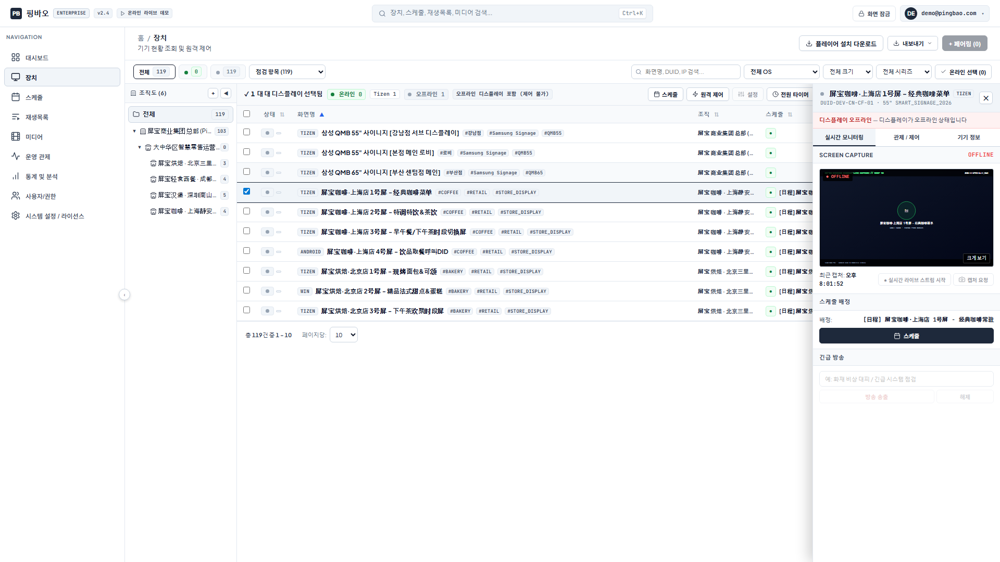
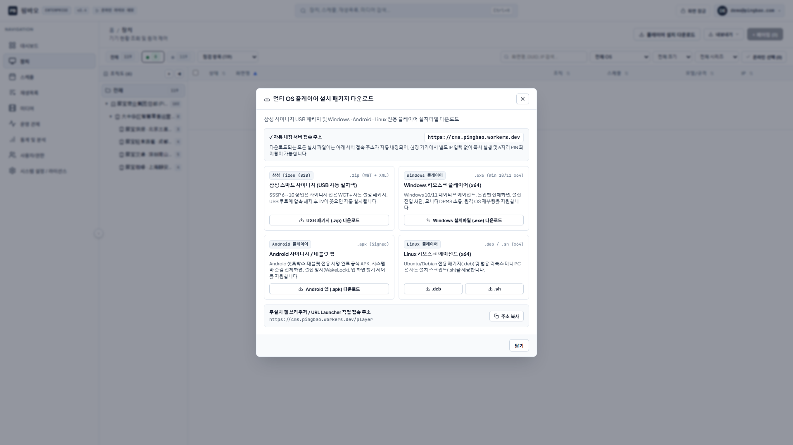
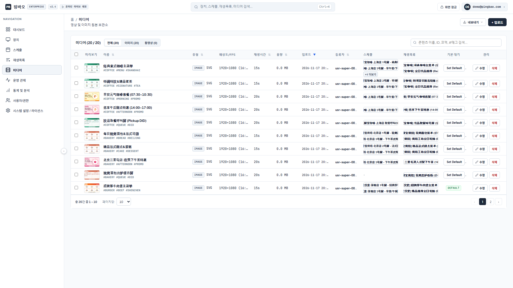
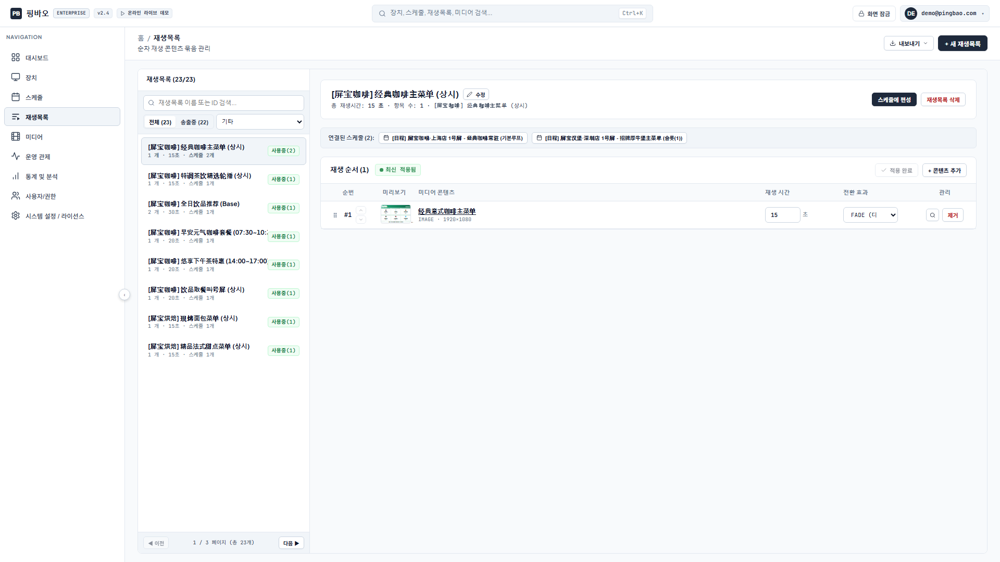
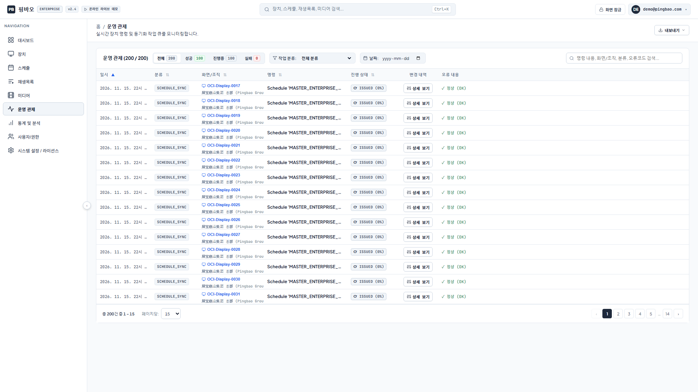
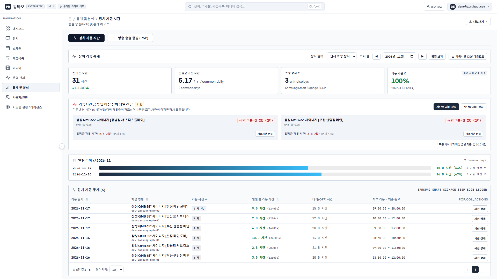
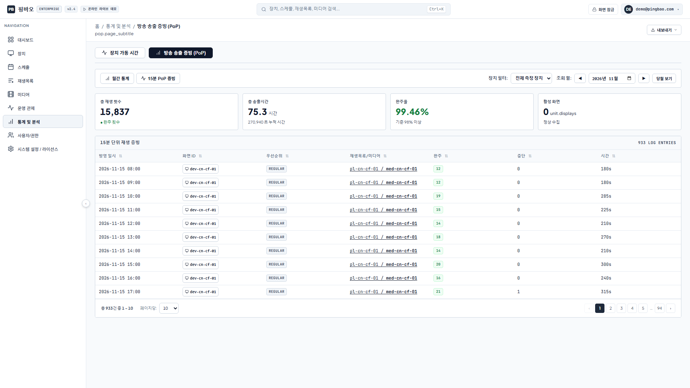
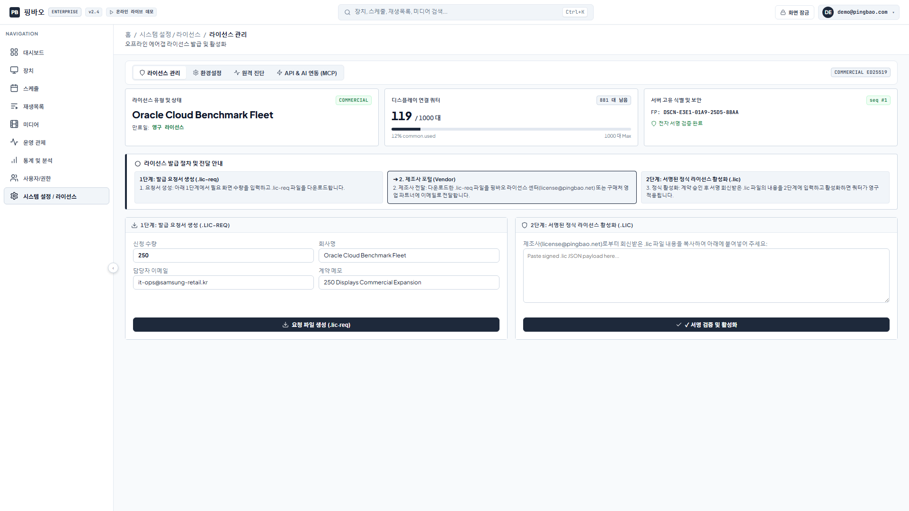
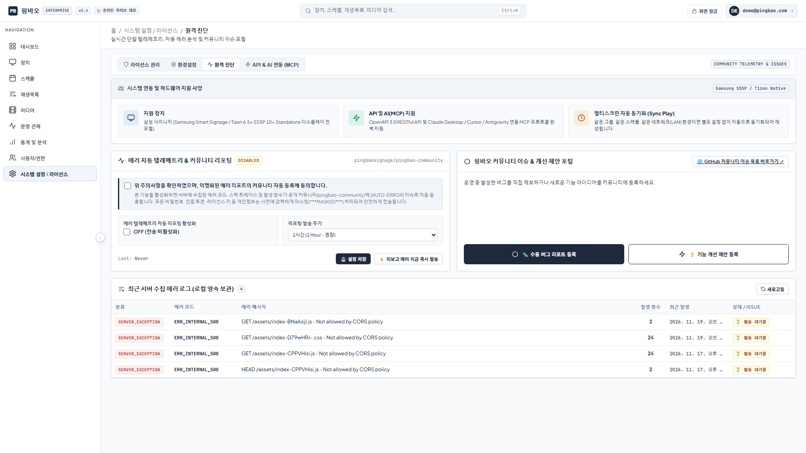

# 핑바오 (Pingbao / 屏宝) 엔터프라이즈 통합 운영 매뉴얼

**핑바오(Pingbao)**는 **삼성 스마트 사이니지 (Samsung Smart Signage · Tizen 6.5+ / SSSP 6~10+)** 심층 하드웨어 제어를 중심으로 **Windows, Android, Linux, Web**까지 아우르는 엔터프라이즈 디지털 사이니지 전역 스마트 통합 관제 플랫폼(CMS)입니다.  
OS별 맞춤형 하드웨어 추상화 계층(HAL) 원격 제어, 전 자동 다중 화면 싱크(SyncPlay), 24시간 타임라인 타임파팅(Dayparting), 단절 무관 영구 자율 오프라인 재생, 장치 가동 시간(Uptime) 및 초정밀 재생 증빙(PoP) 워크벤치, 그리고 개방형 REST API 및 AI 에이전트용 MCP(Model Context Protocol) 지원을 전면 제공합니다.

---

## 목차 (Table of Contents)
1. [시스템 시작 및 워크스페이스 구조](#1-시스템-시작-및-워크스페이스-구조)
2. [멀티 OS 장치 관리 및 하드웨어 IoT 제어 (Fleet Management)](#2-멀티-os-장치-관리-및-하드웨어-iot-제어-fleet-management)
3. [미디어 에셋 라이브러리 및 보안 규격 (Media Assets)](#3-미디어-에셋-라이브러리-및-보안-규격-media-assets)
4. [플레이리스트 저작 (Playlists)](#4-플레이리스트-저작-playlists)
5. [스케줄링 핵심 엔진 아키텍처 상세 (Scheduling Engine)](#5-스케줄링-핵심-엔진-아키텍처-상세-scheduling-engine)
6. [실시간 운영 관제 및 자율 치유 (Operations Monitoring)](#6-실시간-운영-관제-및-자율-치유-operations-monitoring)
7. [통계 및 분석: 장치 가동 시간 & 초정밀 재생 증빙 (Uptime & PoP)](#7-통계-및-분석-장치-가동-시간--초정밀-재생-증빙-uptime--pop)
8. [다중 테넌트 조직, RBAC 권한 및 불변 감사 로그 (Users & Audit)](#8-다중-테넌트-조직-rbac-권한-및-불변-감사-로그-users--audit)
9. [시스템 설정, 6개월 로그 보존 및 오류 텔레메트리 (Settings & Telemetry)](#9-시스템-설정-6개월-로그-보존-및-오류-텔레메트리-settings--telemetry)
10. [개방형 REST API 및 AI 에이전트 MCP 지원](#10-개방형-rest-api-및-ai-에이전트-mcp-지원)
11. [전체 풀기능 상세 명세표 (Full Feature Matrix)](#11-전체-풀기능-상세-명세표-full-feature-matrix)

---

## 1. 시스템 시작 및 워크스페이스 구조

### 1.1 접속 및 기업 2단계 인증 (2FA / TOTP)
1. 권장 브라우저(Google Chrome, Microsoft Edge, Safari)에서 핑바오 콘솔 주소(`https://cms.pingbao.workers.dev` 또는 사내 구축 도메인)로 접속합니다.
2. 운영자 이메일과 비밀번호를 입력합니다 (공개 라이브 데모 환경에서는 **데모 관리자로 즉시 시작** 원클릭 진입을 지원합니다).
3. 시스템 보안 정책에 따라 RFC 6238 TOTP 2단계 인증 화면이 표시되며, Google/Microsoft Authenticator 앱의 6자리 인증 코드를 입력하여 로그인합니다.
4. 단말 분실 등 비상 상황 시 사전 발급된 16자리 백업 코드(Backup Code)로 즉시 인증할 수 있습니다.

 

*▲ [워크스페이스 1] 핑바오 실시간 운영 대시보드: 전역 디스플레이 가동률, 발행 스케줄, 가동시간 급감 이상 징후 트리아지 및 실시간 이벤트 피드*

### 1.2 9대 핵심 워크스페이스 개요
* **대시보드 (Dashboard)**: 전역 디스플레이 연결 상태, 스케줄 배포 현황, 7일/30일 가동시간 최저 이상 징후 장치 조기 경보 관제.
* **장치 (Device Management)**: 삼성 Tizen SSSP 및 Windows·Android·Linux 멀티 OS 디스플레이 통합 등록, 원격 제어, 일괄 제어(7대 명령) 및 실시간 라이브 화면 캡처.
* **스케줄 (Schedules)**: 4계층 우선순위 선점 엔진, 24시간 타임라인 타임파팅(Dayparting), 유효 송출 명세 자동 계산 및 원클릭 배포.
* **재생목록 (Playlists)**: 비디오와 이미지 혼합 편성, 초 단위 노출 시간 제어 및 GPU 가속 트랜지션.
* **미디어 (Media Assets)**: 4K 고화질 영상 스트리밍 업로드, 바이너리 매직 바이트 보안 검증 및 참조 무결성 삭제 방지 락.
* **운영 관제 (Operations)**: 상태별(`성공`/`진행중`/`실패`)·분류별 다중 트리아지 필터, 명령 동기화 큐 추적 및 BEFORE/AFTER 변경 비교(`Op Diff`).
* **통계 및 분석 (Analytics & Reports)**: **장치 가동 시간(Operating Times)** 세션 분석 워크벤치 및 1초 단위 **방송 송출 증빙(PoP)** 정산 리포트.
* **사용자/권한 (Users & RBAC)**: 본사-본부-매장 계층형 조직 트리, 역할별 CRUDX 권한 매트릭스 및 **사용자별 전수 불변 감사 로그**.
* **시스템 설정 / 라이선스 (System Settings)**: Ed25519 상용 라이선스, 서버 주소 자동 패키징 & **6개월 로그 보존 주기**, 원격 진단 텔레메트리, **API & AI 연동(MCP)**.

---

## 2. 멀티 OS 장치 관리 및 하드웨어 IoT 제어 (Fleet Management)

 

*▲ [워크스페이스 2] 장치 관리: 멀티 OS 배지(TIZEN / WINDOWS / ANDROID / LINUX), 온라인 상태 및 우측 실시간 라이브 캡처 인스펙터*

### 2.1 멀티 OS 플레이어 설치 패키지 다운로드 및 6자리 PIN 등록
1. 장치 관리 우측 상단의 **[플레이어 설치 다운로드]** 버튼을 클릭하여 **멀티 OS 플레이어 설치 패키지 모달**을 엽니다.
2. 다운로드되는 모든 패키지에는 현재 **서버 접속 주소가 자동으로 내장(Stamping)** 되어 있어 현장에서 별도 IP 입력이 필요 없습니다:
   * **삼성 Tizen (B2B)**: SSSP 6~10 상업용 사이니지 전용 USB 자동 설치팩(`.zip` — USB 루트에 압축 해제 후 TV에 꽂으면 자동 설치)
   * **Windows 키오스크 플레이어 (x64)**: Windows 10/11 전용 `.exe` (몰입형 전체화면, 절전 차단, DPMS 모니터 소등, 원격 OS 재부팅)
   * **Android 사이니지 / 태블릿 앱**: 서명 완료 공식 `.apk` (시스템 바 숨김 전체화면, WakeLock 절전 방지, 앱 화면 밝기 제어)
   * **Linux 키오스크 에이전트 (x64)**: Ubuntu/Debian `.deb` 및 자동 설치 스크립트 `.sh`
   * **무설치 웹 브라우저 런처**: `/player` URL 직접 접속
3. 플레이어 실행 시 화면에 표시되는 6자리 **페어링 PIN 코드**를 웹 콘솔의 **[+ 페어링]** 창에 입력하고 소속 매장을 지정하면 즉시 TLS 암호화 채널이 개설됩니다.

 

*▲ 서버 접속 주소가 자동 내장된 멀티 OS 플레이어 설치 패키지 다운로드 모달*

### 2.2 심층 원격 제어 및 7대 명령 일괄 원격 제어 모달
* **OS별 맞춤형 HAL 자동 라우팅**: 삼성 Tizen의 하드웨어 백라이트·패널 전원·리모컨/패널 잠금·외부 입력 전환·RTC 전원 타이머부터 Windows/Android/Linux의 디스플레이 절전 소등·소프트웨어 밝기 디밍·OS 재부팅까지 기기 역량(`Capabilities`)을 자동 감지하여 최적 제어합니다.
* **전용 일괄 원격 제어 모달 (7대 명령)**: 복수의 디스플레이(혼합 OS 포함)를 선택하면 전용 일괄 제어 모달을 통해 **① 화면 켜기/끄기, ② 볼륨 조절, ③ 음소거/해제, ④ 밝기 조절, ⑤ 플레이어 재시작, ⑥ 기기 재부팅, ⑦ 긴급 방송 송출**을 한 번에 실행합니다.
* **현장 무방문 실시간 라이브 스트림 & 4K 화면 캡처**: 우측 인스펙터에서 `실시간 라이브 스트림` 및 `크게 보기`를 통해 실제 렌더링 중인 화면을 출장 없이 즉시 검증합니다.

---

## 3. 미디어 에셋 라이브러리 및 보안 규격 (Media Assets)

 

*▲ [워크스페이스 3] 미디어 에셋 라이브러리: 고화질 메뉴판, 프로모션 영상 및 메타데이터 관리*

* **대용량 파일 디스크 직결 스트리밍 업로드**: MP4(H.264/H.265/AV1), WebM, PNG, JPG, SVG, WebP 파일의 청크 스트리밍 전송 및 실시간 SHA-256 무결성 검증을 지원합니다.
* **바이너리 매직 바이트 검증 (Magic Bytes Verification)**: 파일 헤더 바이너리 서명을 직접 검증하여 확장자 위변조 악성 파일을 원천 차단합니다.
* **참조 무결성 삭제 방지 락 (Referential Integrity Protection)**: 활성 재생목록이나 배포된 스케줄에서 참조 중인 미디어는 자동 삭제 잠금 처리되어 현장 블랙아웃 사고를 방지합니다.

---

## 4. 플레이리스트 저작 (Playlists)

 

*▲ [워크스페이스 4] 재생목록 저작 워크스페이스: 다중 미디어 순서 편성, 개별 재생시간 및 총 순환 시간 자동 산출*

* **비디오 및 이미지 자유 혼합**: 단일 재생목록 내에서 동영상과 고화질 정적 이미지를 자유롭게 교차 배치합니다.
* **개별 노출 시간 및 GPU 가속 전환 효과**: 항목별 노출 시간(초) 독립 설정과 컷(Cut)/크로스페이드(Crossfade) 하드웨어 가속 전환을 지원하며, 1회 순환 총 재생시간을 실시간 자동 합산합니다.

---

## 5. 스케줄링 핵심 엔진 아키텍처 상세 (Scheduling Engine)

 

*▲ [워크스페이스 5-1] 스케줄 관리 마스터-디테일 뷰: 전체/송출중 필터 및 24시간 타임라인*

 

*▲ [워크스페이스 5-2] 멀티 티어 타임라인 상세 편성: 위·아래 드래그 우선순위 변경 및 최종 송출 명세 자동 계산*

### 5.1 4계층 우선순위 선점 모델 (4-Tier Hierarchical Preemption)

| 계층 (Tier) | 우선순위 | 적용 시나리오 및 동작 정의 | 선점 및 복귀 방식 |
| :--- | :--- | :--- | :--- |
| **Tier 1: EMERGENCY (긴급)** | `P: 100 ~ 200` | 화재/지진 대피 안내, 기상 특보, VIP 방문 환영사 | 밀리초 단위 즉시 인터럽트 및 전 화면 독점 송출; 해제 시 원래 위치로 무손실 복귀 |
| **Tier 2: EVENT (피크 이벤트)** | `P: 50 ~ 99` | 런치 피크 특가, 디너 타임세일, 주말 한정 행사 | 지정 시각 도달 시 우선 전환되고 종료 시각에 하위 슬롯으로 자연스럽게 복귀 |
| **Tier 3: REGULAR (일반 타임파팅)** | `P: 10 ~ 49` | 조식 메뉴, 오후 디저트, 석식 패밀리 세트 | 영업 시간대별 규칙적 롤링 편성 |
| **Tier 4: DEFAULT (기본 루프)** | `P: 1` | 24시간 상시 브랜드 홍보 영상 및 기본 메뉴판 | 상위 슬롯 공백 시 항상 송출되어 화면 블랙아웃을 원천 방지 |

### 5.2 전 자동 SyncPlay 멀티스크린 동기화 & 오프라인 자율 루프
* **무설정 자동 SyncPlay**: 여러 대의 디스플레이가 **【같은 그룹】 + 【같은 스케줄】 + 【같은 네트워크(LAN)】** 조건을 충족하면 실시간 SSE 스트림(`sync-stream`)과 시계 오프셋 자동 보정을 통해 별도 분배기 없이 밀리초 단위로 동시 화면 전환됩니다.
* **단절 무관 오프라인 영구 자율 루프**: 모든 미디어와 타임라인 규칙이 로컬 스토리지에 사전 캐싱되어 외부 인터넷이 장기간 단절되어도 정해진 시각에 조식/중식/석식 메뉴판이 오차 없이 자동 전환됩니다.

---

## 6. 실시간 운영 관제 및 자율 치유 (Operations Monitoring)

 

*▲ [워크스페이스 6] 운영 관제: 상태별(전체/성공/진행중/실패)·분류별 필터 및 동기화 작업 상세 비교(Op Diff)*

* **다중 상태 트리아지 및 작업 분류 필터**: 전체 명령 큐를 성공·진행중·실패 상태와 작업 분류(`SCHEDULE_SYNC`, `POWER_CONTROL` 등)로 즉시 필터링하고 키워드로 검색합니다.
* **설정 변경 전후 상세 비교 (`Op Diff`)**: 각 작업의 `[상세 보기]`를 클릭하면 이전 설정값(`BEFORE`)과 적용 대상 설정값(`AFTER`) JSON 차이를 투명하게 대조할 수 있습니다.
* **자가 복구 및 일괄 재시도**: 일시적 회선 장애로 지연되거나 실패한 명령을 자동 감지하고 재동기화하여 현장 출장 없이 복구합니다.

---

## 7. 통계 및 분석: 장치 가동 시간 & 초정밀 재생 증빙 (Uptime & PoP)

### 7.1 장치 가동 시간 워크벤치 (Device Operating Times)

 

*▲ [워크스페이스 7-1] 장치 가동 시간 워크벤치: 총 가동시간, 가동 가용률, 저가동 급감 이상 장치 정밀 진단 및 회차별 세션 상세*

* **저가동 및 이상 장치 조기 포착**: 기준 영업시간 대비 가동률이 급감하거나 조기 전원 차단된 매장 디스플레이를 자동으로 선별합니다.
* **가동 세션 상세 드릴다운 모달**: `[세션 상세]` 클릭 시 해당 일자의 회차별 켜짐(`ON`)~꺼짐(`OFF`) 시각과 동작 유형(`POWER_TIMER` 자동 타이머 vs `MANUAL` 수동 조작)을 초 단위로 검증합니다.

### 7.2 초정밀 방송 송출 증빙 및 정산 리포트 (Proof-of-Play)

 

*▲ [워크스페이스 7-2] 방송 송출 증빙(PoP): 총 재생 횟수, 총 송출시간, 완주율(%) 및 15분 단위 정밀 재생 증빙 원장*

* **실제 렌더링 기반 무결점 PoP**: 단말 하드웨어에서 실제 프레임이 렌더링된 시작·종료 시각과 계층(`EMERGENCY`/`EVENT`/`REGULAR`)을 정밀 집계합니다.
* **완주율(Completion Rate %) 및 다포맷 내보내기**: 정상 완주 횟수와 긴급 인터럽트로 인한 중단 횟수를 분리 산출하여 광고주/가맹점 정산 분쟁을 차단하며, CSV / JSON / Markdown 감사 보고서로 즉시 내보낼 수 있습니다.

---

## 8. 다중 테넌트 조직, RBAC 권한 및 불변 감사 로그 (Users & Audit)

 

| 사용자 및 조직 디렉터리 (`Users & RBAC`) | 사용자별 전수 불변 감사 로그 (`Audit Logs`) |
| :---: | :---: |
|  |  |

* **계층형 다중 테넌트 스코프 격리**: `그룹 본사` ➔ `권역 본부` ➔ `개별 매장`으로 이어지는 트리 구조로 하위 매장 관리자의 타 매장 접근을 엄격히 차단합니다.
* **세분화 역할 권한 매트릭스 (RBAC)**: 최고 관리자, 운영 관리자, 콘텐츠 편집자, 현장 엔지니어, 감사관 등 역할별 CRUDX 권한을 정밀 통제합니다.
* **전수 불변 감사 로그 (`Audit Logs`)**: 모든 로그인, 스케줄 배포, 전원 제어, 설정 변경의 수행자, 일시, 대상, 변경 상세 및 접속 IP를 불변 원장으로 기록합니다.

---

## 9. 시스템 설정, 6개월 로그 보존 및 오류 텔레메트리 (Settings & Telemetry)

 

| 상용 라이선스 (`License`) | 원격 진단 & 커뮤니티 (`Diagnostics & Telemetry`) |
| :---: | :---: |
|  |  |

* **Ed25519 전자서명 상용 라이선스**: 폐쇄망(Air-gap) 환경에서도 변조 불가능한 비대칭 전자서명 검증으로 디바이스 쿼터를 관리합니다.
* **6개월 기본 로그 보존 주기 (`환경설정`)**: 운영 관제, 장치 가동 시간, PoP 증빙, 감사 로그에 기본 **6개월(180일) 보존 및 자동 정리 라이프사이클**이 적용되며, 서버 접근 URL 변경 시 전 OS 플레이어 설치 패키지를 자동 재패키징합니다.
* **Opt-in 자동 에러 텔레메트리**: 관리자 명시적 동의 시에만 활성화되며, 모든 민감정보(`***MASKED***`) 마스킹 및 SHA-256 중복 제거 후 공식 커뮤니티 이슈와 연동됩니다.

---

## 10. 개방형 REST API 및 AI 에이전트 MCP 지원

 

*▲ [시스템 설정 > API & AI 연동 (MCP)] 스코프 기반 API 키 관리, 호출량 분석 및 Claude / Cursor / Antigravity 원클릭 MCP 설정*

핑바오는 표준 **MCP (Model Context Protocol)** 서버(`pingbao` 툴킷)와 **API 키 사용량 실시간 모니터링**을 기본 내장하여, Claude Desktop, Cursor, Antigravity 및 기업 자체 LLM 에이전트가 자연어로 장치 상태 조회, 가동시간 점검, 미디어 업로드, 재생목록 생성 및 타임라인 스케줄 배포를 원스톱 자율 수행할 수 있습니다.

---

## 11. 전체 풀기능 상세 명세표 (Full Feature Matrix)

| 모듈 영역 | 핵심 기능 및 상세 명세 | 기술 규격 및 차별점 |
| :--- | :--- | :--- |
| **1. 통합 대시보드** | 전역 가동률 요약, 실시간 활동 피드, 7일/30일 저가동 이상 장치 트리아지 | 멀티 테넌트 스코프 자동 분리, 원클릭 드릴다운 |
| **2. 멀티 OS 플릿 관제** | 삼성 Tizen SSSP 특화 + Windows / Android / Linux / Web 통합 관제 및 7대 일괄 제어 | OS별 HAL 자동 라우팅, 서버 URL 스탬핑 설치팩 |
| **3. 타임라인 스케줄링** | 4계층 우선순위 선점, 24시간 Dayparting, 유효 송출 구간 자동 계산, 긴급 방송 | 로컬 자율 상태 머신, 1ms 즉시 선점 및 무손실 복귀 |
| **4. 전 자동 SyncPlay** | 같은 그룹·같은 스케줄·같은 LAN 충족 시 100% 무설정 자동 프레임 동기화 | 인증 SSE `sync-stream` + EMA 시계 오프셋 보정 |
| **5. 플레이리스트 & 미디어** | 영상/이미지 교차 편성, GPU 가속 전환, 4K 스트리밍 업로드, 매직 바이트 검증 | 64B 바이너리 헤더 검증, 참조 무결성 삭제 방지 락 |
| **6. 운영 관제 & 자가 치유** | 상태/분류 다중 트리아지 필터, BEFORE/AFTER 상태 비교(`Op Diff`), 자동 복구 | 실시간 명령 큐 추적, 무방문 원격 정상화 |
| **7. 가동 시간 & 정밀 PoP** | 일별/회차별 가동 세션 드릴다운 분석, 1초 단위 렌더링 PoP 및 완주율(%) 산출 | `POWER_TIMER`/`MANUAL` 구분, CSV/JSON/MD 정산 감사 |
| **8. 보안 · 감사 · 보존정책** | 2FA(TOTP), RBAC 권한 매트릭스, 불변 감사 로그, 6개월 로그 자동 정리 주기 | RFC 6238 TOTP, Argon2id, 180일 Auto-Purge |
| **9. REST API & AI MCP** | 60+ OpenAPI 3.0 엔드포인트, 내장 MCP 서버, API 키별 호출량·오류율 모니터링 | 스코프 제한 API Key, 자연어 AI 자율 편성 |

---

Pingbao (핑바오 / 屏宝) © 2026. All rights reserved.

