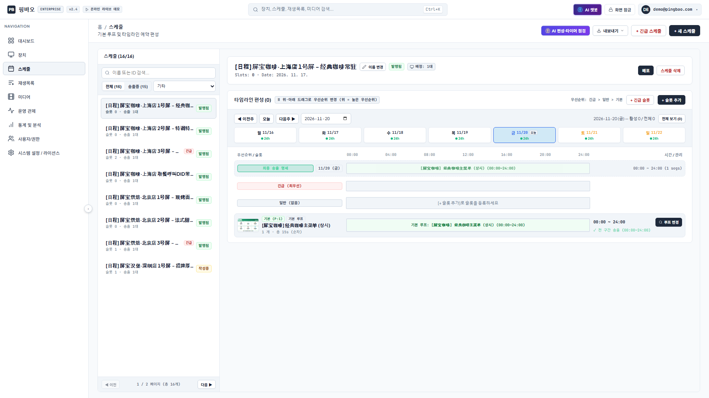
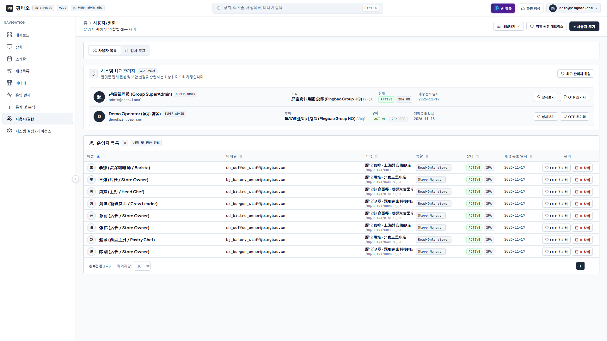
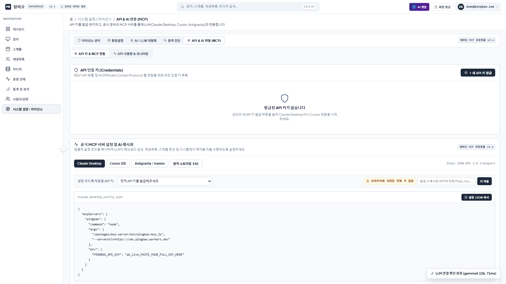

# 핑바오 (Pingbao / 屏宝) 엔터프라이즈 통합 운영 매뉴얼

**핑바오(Pingbao)**는 **빌트인 AI 오퍼레이터 챗봇(AI Copilot)과 5대 자율 관제 지능**을 기본 탑재하고, **삼성 스마트 사이니지 (Samsung Smart Signage · Tizen 6.5+ / SSSP 6~10+)** 심층 하드웨어 제어를 중심으로 **Windows, Android, Linux, Web**까지 아우르는 차세대 엔터프라이즈 디지털 사이니지 통합 관제 플랫폼(CMS)입니다.  
자연어 대화 한마디로 수백 개 매장의 실시간 상태를 표(Table)로 진단하고 **Human-in-the-Loop 승인형 원격 제어**를 안전하게 수행할 수 있으며, 멀티모달 비전(Vision) 만료 배너 차단, 전 자동 다중 화면 싱크(SyncPlay), 4계층 타임파팅 스케줄링, 장치 가동 시간(Uptime) 및 초정밀 재생 증빙(PoP), 표준 REST API 및 MCP 연동을 전면 제공합니다.

---

## 목차 (Table of Contents)
1. [시스템 시작 및 워크스페이스 구조](#1-시스템-시작-및-워크스페이스-구조)
2. [★ 빌트인 AI 오퍼레이터 챗봇 & 5대 자율 관제 지능 (AI Copilot Spotlight)](#2--빌트인-ai-오퍼레이터-챗봇--5대-자율-관제-지능-ai-copilot-spotlight)
3. [멀티 OS 장치 관리 및 하드웨어 IoT 제어 (Fleet Management)](#3-멀티-os-장치-관리-및-하드웨어-iot-제어-fleet-management)
4. [미디어 에셋 라이브러리 및 AI 비전 검수 (Media Assets & Vision QA)](#4-미디어-에셋-라이브러리-및-ai-비전-검수-media-assets--vision-qa)
5. [플레이리스트 저작 (Playlists)](#5-플레이리스트-저작-playlists)
6. [스케줄링 핵심 엔진 및 AI 편성 점검 (Scheduling Engine)](#6-스케줄링-핵심-엔진-및-ai-편성-점검-scheduling-engine)
7. [실시간 운영 관제 및 자율 치유 (Operations Monitoring)](#7-실시간-운영-관제-및-자율-치유-operations-monitoring)
8. [통계 및 분석: 장치 가동 시간 & 초정밀 재생 증빙 (Uptime & PoP)](#8-통계-및-분석-장치-가동-시간--초정밀-재생-증빙-uptime--pop)
9. [다중 테넌트 조직, RBAC 권한 및 불변 감사 로그 (Users & Audit)](#9-다중-테넌트-조직-rbac-권한-및-불변-감사-로그-users--audit)
10. [시스템 설정 · AI/LLM 자동화 · 6개월 로그 보존 · MCP 연동](#10-시스템-설정--aillm-자동화--6개월-로그-보존--mcp-연동)
11. [전체 풀기능 상세 명세표 (Full Feature Matrix)](#11-전체-풀기능-상세-명세표-full-feature-matrix)

---

## 1. 시스템 시작 및 워크스페이스 구조

### 1.1 접속 및 기업 2단계 인증 (2FA / TOTP)
1. 권장 브라우저(Google Chrome, Microsoft Edge, Safari)에서 핑바오 콘솔 주소(`https://cms.pingbao.workers.dev` 또는 사내 구축 도메인)로 접속합니다.
2. 운영자 이메일과 비밀번호를 입력합니다 (공개 라이브 데모 환경에서는 **데모 관리자로 즉시 시작** 원클릭 진입을 지원합니다).
3. 시스템 보안 정책에 따라 RFC 6238 TOTP 2단계 인증 화면이 표시되며, Google/Microsoft Authenticator 앱의 6자리 인증 코드를 입력하여 로그인합니다.
4. 단말 분실 등 비상 상황 시 사전 발급된 16자리 백업 코드(Backup Code)로 즉시 인증할 수 있습니다.

 

*▲ [워크스페이스 1] 핑바오 실시간 운영 대시보드: 전역 디스플레이 가동률, AI 모닝 브리핑 버튼, 상단 AI 챗봇(Ctrl+J) 및 저가동 이상 징후 관제*

### 1.2 9대 핵심 워크스페이스 개요
* **대시보드 (Dashboard)**: 전역 가동률, **원클릭 AI 모닝 브리핑**, 7일/30일 가동시간 최저 이상 징후 장치 조기 경보 관제.
* **장치 (Device Management)**: 삼성 Tizen SSSP 및 Windows·Android·Linux 멀티 OS 통합 관제, **AI 장치 정밀 원인 분석**, **AI 3개 국어 비상 방송 문안 생성**, 7대 일괄 제어 및 실시간 화면 캡처.
* **스케줄 (Schedules)**: 4계층 우선순위 선점 엔진, 24시간 타임파팅, **AI 편성·타이머 충돌 점검** 및 원클릭 배포.
* **재생목록 (Playlists)**: 비디오와 이미지 혼합 편성, 초 단위 노출 시간 제어 및 GPU 가속 트랜지션.
* **미디어 (Media Assets)**: 4K 스트리밍 업로드, **AI 비전 자동 메타데이터·태그 할당 및 행사 종료일 만료 차단**, 참조 무결성 삭제 방지 락.
* **운영 관제 (Operations)**: 상태별·분류별 트리아지 필터, **AI 장애 패턴 요약**, 명령 전후 상태 비교(`Op Diff`).
* **통계 및 분석 (Analytics & Reports)**: **장치 가동 시간(AI 절전 추천)** 세션 워크벤치 및 1초 단위 **방송 송출 증빙(PoP)** 정산 리포트.
* **사용자/권한 (Users & RBAC)**: 본사-본부-매장 계층형 조직 트리, 역할별 권한 매트릭스 및 **불변 감사 로그(AI 감사 분석)**.
* **시스템 설정 / 라이선스 (System Settings)**: 상용 라이선스, 서버 주소 패키징 & 6개월 로그 보존, **AI / LLM 자동화(10종 프리셋 & 무료 로컬 Ollama)**, 원격 진단, **API & AI 연동(MCP)**.

---

## 2. ★ 빌트인 AI 오퍼레이터 챗봇 & 5대 자율 관제 지능 (AI Copilot Spotlight)

핑바오의 가장 강력한 차별화 기능은 외부 도구 설치 없이 웹 콘솔 자체에 깊숙이 통합된 **핑바오 AI 오퍼레이터 챗봇 (`Ctrl+J`)**과 **전 워크스페이스 AI 도메인 인사이트**입니다.

### 2.1 우측 슬라이드 AI 오퍼레이터 챗봇 (`Ctrl+J`) — 자연어 진단 & 마크다운 표 리포팅

 

*▲ 우측 슬라이드 AI 오퍼레이터 챗봇: 좌측 경계 드래그 폭 조절, 원클릭 퀵 프롬프트, 멀티 OS 가동 현황 마크다운 표 렌더링 및 바로가기 링크*

* **언제 어디서나 즉시 호출 (`Ctrl+J` 또는 우측 상단 `[AI 챗봇]`)**: 현재 작업 화면을 가리지 않고 우측에서 부드럽게 슬라이드되며, 좌측 가장자리 핸들을 드래그하여 대화창 너비를 자유롭게 조절할 수 있습니다.
* **현재 화면 포커스 자동 인식 (`Active UI Focus`)**: 현재 열려 있는 탭, 우측 인스펙터에서 점검 중인 기기, 체크박스로 선택한 기기 대수(`현재 포커스: 선택 기기 3대`)를 실시간 인식하여 “이 기기 분석해줘”, “선택한 기기들 볼륨 줄여줘” 같은 지시대명사 명령을 정확히 이해합니다.
* **실시간 마크다운 표(Table) & 원클릭 점프 링크**: 서버 CPU/RAM/디스크 헬스, OS별 온라인 단말 현황, 오프라인 및 만료 프로모션 점검 결과를 가독성 높은 HTML 표로 즉시 브리핑하며, 응답 하단의 `→ 장치명` / `→ 운영 모니터링` 버튼 클릭 시 해당 화면으로 즉시 이동합니다.
* **장기 대화 자동 요약 메모리 (`Rolling Memory Compaction`)**: 대화가 길어져도 이전 맥락을 자동 요약·압축하여 토큰 낭비 없이 연속적인 운영 지시를 이어갑니다.

### 2.2 사고 제로 Human-in-the-Loop (HITL) 승인형 원격 제어 & 엄격한 대상 격리

 

| ① 실행 미리보기 승인 대기 (`승인 대기` · Strict Subsetting) | ② 운영자 승인 클릭 직후 즉시 반영 (`실행 완료`) |
| :---: | :---: |
|  |  |

* **승인 전 절대 자동 실행 금지 (Human-in-the-Loop Guard)**: 운영자가 자연어로 화면 켜기/끄기, 볼륨/밝기 조절, 재부팅, 전원 타이머 변경, 스마트 스케줄 초안 생성을 지시하면 AI가 임의로 기기를 조작하지 않고 반드시 **실행 미리보기 카드(`승인 대기`)**를 먼저 제시합니다. 운영자가 대상과 경고를 확인한 뒤 **`[승인 및 실행]`**을 클릭할 때만 실제 명령이 전송되고 불변 감사 로그에 기록됩니다.
* **엄격한 대상 격리 (`Strict Device Subsetting`)**: 특정 기기를 선택하거나 지목했을 때 의도치 않게 전국 전체 매장으로 명령이 브로드캐스트(오발송)되는 대형 방송 사고를 서버단에서 원천 차단합니다.

### 2.3 전 워크스페이스 원클릭 AI 도메인 인사이트 & 챗봇 자동 수렴

 

*▲ 대시보드 `[AI 모닝 브리핑]` 클릭 시 펼쳐지는 AI Knowledge Box: 전 매장 가동 상태, 만료 배너 유무 및 권장 절전 조치를 한눈에 요약*

모든 주요 워크스페이스 상단에는 원클릭 AI 분석 버튼이 배치되어 있으며, 분석된 모든 인사이트는 **AI 챗봇 대화창 히스토리에도 자동 수렴(Convergence)**되어 언제든 다시 열람하거나 복사할 수 있습니다:
1. **대시보드 `[AI 모닝 브리핑]`**: 출근 직후 전체 매장 온라인 상태, 스케줄 동기화, 만료 배너 위험, 라이선스 상태를 3초 만에 종합 브리핑
2. **장치 인스펙터 `[AI 분석 요청]` & `[AI 다국어 문안 생성]`**: 단말 온도·가동시간·에러 로그 자연어 원인 해설 + 실시간 화면 캡처 비전 검수 + 3개 국어(한·영·중) 표준 긴급 방송 문안 즉시 생성
3. **미디어 `[AI 메타데이터 재분석]`**: 업로드 이미지/영상의 용도(`MENU_BOARD`/`PROMO`), 품목, 가격표 OCR, 권장 시간대 및 **행사 종료일 자동 추출**
4. **스케줄 `[AI 편성·타이머 점검]`**: 스케줄 편성 시간대와 단말 전원 타이머 간 충돌 및 만료 프로모션 포함 여부 사전 감사
5. **운영 관제 `[AI 장애 패턴 요약]` · 가동 시간 `[AI 가동시간·절전 추천]` · 감사 로그 `[AI 감사 분석]`**: 반복 오류 원인, 심야 전력 절감 팁, 보안 이상 징후 원클릭 요약

---

## 3. 멀티 OS 장치 관리 및 하드웨어 IoT 제어 (Fleet Management)

 

| 멀티 OS 장치 관리 & 실시간 라이브 캡처 | 우측 인스펙터 `관제/제어` 탭 — AI 장치 정밀 진단 |
| :---: | :---: |
|  |  |

### 3.1 멀티 OS 플레이어 설치 패키지 다운로드 및 6자리 PIN 등록
1. 장치 관리 우측 상단의 **[플레이어 설치 다운로드]** 버튼을 클릭하여 **멀티 OS 플레이어 설치 패키지 모달**을 엽니다.
2. 다운로드되는 모든 패키지에는 현재 **서버 접속 주소가 자동으로 내장(Stamping)** 되어 있어 현장에서 별도 IP 입력이 필요 없습니다:
   * **삼성 Tizen (B2B)**: SSSP 6~10 상업용 사이니지 전용 USB 자동 설치팩(`.zip`)
   * **Windows 키오스크 플레이어 (x64)**: Windows 10/11 전용 `.exe`
   * **Android 사이니지 / 태블릿 앱**: 서명 완료 공식 `.apk`
   * **Linux 키오스크 에이전트 (x64)**: Ubuntu/Debian `.deb` 및 자동 설치 스크립트 `.sh`
   * **무설치 웹 브라우저 런처**: `/player` URL 직접 접속
3. 플레이어 화면에 표시되는 6자리 **페어링 PIN 코드**를 웹 콘솔의 **[+ 페어링]** 창에 입력하면 즉시 등록됩니다.

 

| 멀티 OS 플레이어 설치 패키지 모달 (`URL 자동 내장`) | 7대 명령 전용 일괄 원격 제어 모달 (`Bulk Control`) |
| :---: | :---: |
|  |  |

### 3.2 심층 원격 제어, AI 장치 분석 및 7대 명령 일괄 제어
* **OS별 맞춤형 HAL 자동 라우팅**: 삼성 Tizen 하드웨어 백라이트·패널 전원·리모컨 잠금·RTC 타이머부터 Windows/Android/Linux 디스플레이 절전·밝기 디밍·OS 재부팅까지 기기 역량(`Capabilities`)을 자동 감지하여 제어합니다.
* **AI 장치 정밀 분석 (`관제 / 제어` 탭)**: `[AI 분석 요청]` 클릭 시 최근 14일 가동률, 하드웨어 텔레메트리, 단말 에러 로그 번들, 실시간 캡처 비전 검수를 종합하여 비개발자도 즉시 이해할 수 있는 원인 해설과 원클릭 복구/절전 버튼을 제공합니다.
* **전용 일괄 원격 제어 모달 (7대 명령)**: 다중 선택 시 **화면 켜기/끄기, 볼륨, 음소거, 밝기, 플레이어 재시작, 기기 재부팅, 긴급 방송**을 일괄 실행합니다.

---

## 4. 미디어 에셋 라이브러리 및 AI 비전 검수 (Media Assets & Vision QA)

 

| 미디어 에셋 라이브러리 (`Media Assets`) | AI 비전 분석 메타데이터 & 만료 배너 차단 (`Vision QA`) |
| :---: | :---: |
|  |  |

* **멀티모달 AI 비전 자동 태깅 & 행사 종료일 감지**: 콘텐츠 업로드 즉시(또는 `[AI 메타데이터 재분석]` 클릭 시) 비전 AI가 이미지를 판독하여 **용도(`MENU_BOARD`/`PROMO`), 업종/분류, 인식 상품·메뉴명, 추천 제목·태그, 권장 편성 시간대(`07:00-11:30`), 감지된 행사 종료일(`detected_valid_until`), 사이니지 화질 검수 코멘트**를 자동 기록합니다. 기한이 지난 프로모션이 스케줄에 남아 있으면 AI 브리핑과 챗봇이 즉시 경고하여 방송 사고를 예방합니다.
* **4K 디스크 직결 스트리밍 & 바이너리 매직 바이트 검증**: 대용량 4K 영상 무결성 업로드 및 위변조 악성 파일 원천 차단을 지원합니다.
* **참조 무결성 삭제 방지 락**: 활성 재생목록·스케줄에서 사용 중인 미디어는 자동 삭제 잠금 처리됩니다.

---

## 5. 플레이리스트 저작 (Playlists)

 

*▲ [워크스페이스 4] 재생목록 저작 워크스페이스: 다중 미디어 순서 편성, 개별 재생시간 및 총 순환 시간 자동 산출*

* **비디오 및 이미지 자유 혼합**: 단일 재생목록 내에서 동영상과 고화질 정적 이미지를 자유롭게 교차 배치합니다.
* **개별 노출 시간 및 GPU 가속 전환 효과**: 항목별 노출 시간(초) 설정과 컷/크로스페이드 하드웨어 가속 전환 및 총 순환 시간 자동 합산을 지원합니다.

---

## 6. 스케줄링 핵심 엔진 및 AI 편성 점검 (Scheduling Engine)

 

*▲ [워크스페이스 5-1] 스케줄 관리: 우측 상단 `[AI 편성·타이머 점검]` 버튼 및 24시간 타임라인 마스터-디테일 뷰*

 

*▲ [워크스페이스 5-2] 멀티 티어 타임라인 상세 편성: 우선순위 선점 및 최종 송출 명세 자동 계산*

### 6.1 4계층 우선순위 선점 모델 & AI 편성·타이머 충돌 점검
* **`EMERGENCY` (긴급) > `EVENT` (피크 이벤트) > `REGULAR` (일반 타임파팅) > `DEFAULT` (24시간 기본 루프)** 4계층 자동 선점 및 종료 시각 무결점 자동 복귀를 지원합니다.
* **`[AI 편성·타이머 점검]`**: 배포 전 클릭 한 번으로 배정 단말들의 하드웨어 전원 꺼짐 시간대와 이벤트 편성 시간대 간 충돌 여부, 가로/세로 해상도 불일치, 만료 프로모션 포함 여부를 AI가 즉시 감사해 줍니다.
* **무설정 전 자동 SyncPlay & 오프라인 자율 루프**: **【같은 그룹】 + 【같은 스케줄】 + 【같은 LAN】** 조건 충족 시 실시간 SSE 스트림과 클럭 오프셋 보정으로 밀리초 단위 동시 화면 전환이 작동하며, 인터넷 단절 시에도 영구 자율 재생됩니다.

---

## 7. 실시간 운영 관제 및 자율 치유 (Operations Monitoring)

 

*▲ [워크스페이스 6] 운영 관제: `[AI 장애 패턴 요약]`, 다중 상태/분류 트리아지 필터 및 동기화 작업 상세 비교(Op Diff)*

* **다중 트리아지 필터 & `[AI 장애 패턴 요약]`**: 최근 원격 명령 큐의 성공·진행중·실패 이력을 필터링하고, AI가 특정 매장이나 네트워크 구간의 반복 실패 원인을 자동 요약합니다.
* **설정 변경 전후 비교 (`Op Diff`) 및 자율 복구**: `[상세 보기]`로 `BEFORE / AFTER` JSON 상태 차이를 투명하게 대조하며, 일시적 회선 장애 시 자동 재시도로 무방문 복구합니다.

---

## 8. 통계 및 분석: 장치 가동 시간 & 초정밀 재생 증빙 (Uptime & PoP)

### 8.1 장치 가동 시간 워크벤치 & AI 절전 추천 (Device Operating Times)

 

*▲ [워크스페이스 7-1] 장치 가동 시간 워크벤치: `[AI 가동시간·절전 추천]`, 저가동 이상 장치 진단 및 회차별 세션 상세*

* **저가동 이상 포착 & `[AI 가동시간·절전 추천]`**: 영업시간 대비 조기 종료된 매장과 폐점 후에도 불필요하게 켜져 있는 매장을 AI가 분석하여 맞춤형 RTC 절전 타이머 정책을 제안합니다.
* **가동 세션 상세 드릴다운**: 일자별 켜짐(`ON`)~꺼짐(`OFF`) 시각과 동작 원인(`POWER_TIMER` vs `MANUAL`)을 초 단위로 검증합니다.

### 8.2 초정밀 방송 송출 증빙 및 정산 리포트 (Proof-of-Play)

 

*▲ [워크스페이스 7-2] 방송 송출 증빙(PoP): 총 재생 횟수, 총 송출시간, 완주율(%) 및 상업 정산 리포트 내보내기*

* **실제 렌더링 프레임 기반 PoP 및 완주율(%) 산출**: 실제 하드웨어 렌더링 시간과 완주율을 정밀 집계하고 CSV / JSON / Markdown 정산 감사 리포트로 원클릭 내보냅니다.

---

## 9. 다중 테넌트 조직, RBAC 권한 및 불변 감사 로그 (Users & Audit)

 

| 사용자 및 조직 디렉터리 (`Users & RBAC`) | 전수 불변 감사 로그 & `[AI 감사 분석]` (`Audit Logs`) |
| :---: | :---: |
|  |  |

* **계층형 다중 테넌트 격리 및 세분화 RBAC**: 본사-본부-매장 조직 스코프 격리 및 역할별 정밀 권한 통제를 제공합니다.
* **전수 불변 감사 로그 & `[AI 감사 분석]`**: 일반 운영자 명령은 물론 **AI 챗봇을 통해 승인 실행된 모든 작업**까지 수행자, 일시, 대상, 변경 상세, 접속 IP를 불변 원장으로 기록하며, `[AI 감사 분석]`으로 비정상 접근 및 주요 변경 사항을 즉시 요약합니다.

---

## 10. 시스템 설정 · AI/LLM 자동화 · 6개월 로그 보존 · MCP 연동

 

| `AI / LLM 자동화` — 10대 글로벌·중국·무료 로컬 Ollama 연동 | AI 미연결 시 안내되는 `5대 핵심 지능 가이드 모달` |
| :---: | :---: |
|  |  |

* **10대 글로벌 · 중국 본토 직결 · 100% 무료 사내 로컬 LLM 프리셋 (`시스템 설정 > AI / LLM 자동화`)**:
  * **중국 본토 직결 (GFW 무관)**: Alibaba 통의천문(`Qwen`), `DeepSeek`, 지푸 `GLM`, 바이트댄스 `Doubao`, Moonshot `Kimi`
  * **글로벌 클라우드**: `Qwen International`, `OpenAI (GPT-4o)`, `Google Gemini (2.5 Flash/Pro)`, `Anthropic Claude (Sonnet/Haiku)`
  * **100% 무료 폐쇄망 온프레미스 (`Ollama · vLLM · SGLang`)**: 외부 API 비용 0원, 사내 데이터 외부 유출 0건으로 로컬 GPU/미니서버의 무료 오픈모델(`gemma4`, `qwen2.5`, `deepseek-r1` 등)과 즉시 연동
  * **텍스트/비전 프로바이더 분리 조합**, **AES-256-GCM API 키 암호화 보관**, **실시간 연결 지연시간 테스트**, **일일 호출 상한 가드** 제공

 

| 상용 라이선스 (`License`) | 개방형 REST API & 외부 AI 에이전트 MCP (`Connectivity`) |
| :---: | :---: |
|  |  |

* **6개월 기본 로그 보존 주기 (`환경설정`)**: 모든 운영·가동·PoP·감사 로그를 기본 180일간 안전 보관 후 자동 정리하여 디스크 포화를 방지합니다.
* **개방형 REST API & 표준 MCP 서버 내장**: 빌트인 AI 챗봇뿐만 아니라 Claude Desktop, Cursor, Antigravity 등 외부 AI 에이전트도 내장 `pingbao` MCP 서버에 직결하여 자율 관제를 수행할 수 있습니다.

---

## 11. 전체 풀기능 상세 명세표 (Full Feature Matrix)

| 모듈 영역 | 핵심 기능 및 상세 명세 | 기술 규격 및 차별점 |
| :--- | :--- | :--- |
| **1. 빌트인 AI 오퍼레이터 챗봇** | 우측 슬라이드 자연어 대화창(`Ctrl+J`), 마크다운 표 진단, HITL 승인형 제어 | UI 포커스 자동 인식, Strict Subsetting 오발송 원천 차단 |
| **2. 5대 AI 도메인 & 비전 검수** | 모닝 브리핑, 장치 로그 해설, 비전 자동 태깅·만료 배너 차단, 3개국어 비상문안 | 10대 클라우드/중국/무료 로컬 Ollama 지원, AES-256 키 암호화 |
| **3. 통합 대시보드** | 전역 가동률 요약, 실시간 활동 피드, 7일/30일 저가동 이상 장치 트리아지 | 멀티 테넌트 스코프 자동 분리, 원클릭 드릴다운 |
| **4. 멀티 OS 플릿 관제** | 삼성 Tizen SSSP 특화 + Windows / Android / Linux / Web 통합 관제 및 7대 일괄 제어 | OS별 HAL 자동 라우팅, 서버 URL 스탬핑 설치팩 |
| **5. 타임라인 스케줄링** | 4계층 우선순위 선점, 24시간 Dayparting, AI 편성·타이머 충돌 감사 | 로컬 자율 상태 머신, 1ms 즉시 선점 및 무손실 복귀 |
| **6. 전 자동 SyncPlay** | 같은 그룹·같은 스케줄·같은 LAN 충족 시 100% 무설정 자동 프레임 동기화 | 인증 SSE `sync-stream` + EMA 시계 오프셋 보정 |
| **7. 운영 관제 & 가동/PoP** | BEFORE/AFTER 비교(`Op Diff`), 가동 세션 분석, 1초 단위 렌더링 PoP 완주율(%) | `POWER_TIMER`/`MANUAL` 구분, CSV/JSON/MD 정산 감사 |
| **8. 보안 · 감사 · 외부 MCP** | 2FA(TOTP), RBAC, 불변 감사 로그, 180일 자동 보존, 60+ REST API & 내장 MCP | RFC 6238 TOTP, Argon2id, Claude/Cursor/Antigravity 직결 |

---

Pingbao (핑바오 / 屏宝) © 2026. All rights reserved.

