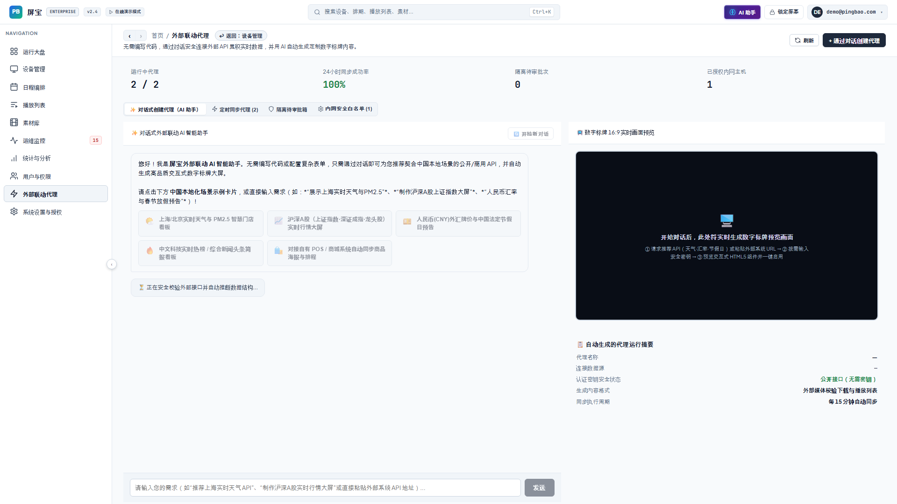
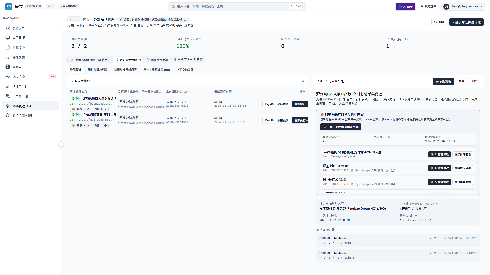
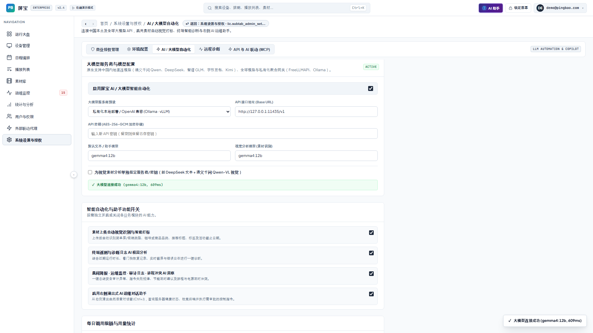

# 屏宝 (Pingbao) 管理员部署、安全与大模型配置指南

本文档指导管理员在企业内网、NAS 或云服务器部署 **屏宝 (Pingbao)**，并配置 **11 大中外/本地 Ollama 大模型引擎**与 **外部联动代理零 Shell 安全防线**。

---

## 1. 系统环境要求与部署架构选择

* **服务器系统**：Linux (Ubuntu 22.04 LTS+, Rocky Linux 9+)、群晖 Synology DSM 7+、威联通 QNAP、Oracle Linux、Windows Server 2019+
* **支持终端系统 (`v2.2.0`)**：
  * **三星智能商用标牌**：Tizen 6.5+ / SSSP 6~10+（`U 盘自动安装包 .zip`，支持硬件帧与动态 HTML5 实时截屏）
  * **Windows 自助终端**：Windows 10 / 11 x64 (`.exe`)
  * **Android 商显主板/平板**：签名正式版 (`.apk`)
  * **Linux 迷你主机**：Ubuntu / Debian x64 (`.deb` / `.sh`)
  * **免安装网页端**：标准浏览器直接访问 (`/player`)
* **容器环境**：Docker Engine 24.0+ 与 Docker Compose v2+（裸机运行需 **Node.js 22.5+**）
* **双数据库引擎模式 (`DB_MODE`)**：
  * **轻量单机版 (`DB_MODE=sqlite`，默认)**：2 核 CPU、**2~4 GB 内存**、20 GB+ SSD（双容器架构，极适合群晖 NAS 与中小型连锁）
  * **企业高可用集群版 (`DB_MODE=postgres`)**：4 核+ CPU、**8~16 GB 内存**、100 GB+ SSD（含 PostgreSQL 16 + Redis 7 集群总线）
  * **（可选）企业内网私有化大模型 (`Ollama / vLLM`)**：8~16 GB+ 显存 GPU 或高性能主机，零 API 费用、数据 100% 不出内网

---

## 2. Docker 一键安装、升级与回滚

```bash
tar -zxvf pingbao-release.tar.gz
cd pingbao-release

# 交互式安装向导（1: SQLite 轻量模式 / 2: PostgreSQL + Redis 集群模式）
./install.sh

# 无缝热升级（自动备份并在健康检查失败时自动回滚）
./upgrade.sh

# 一键回滚至上一稳定版本
./rollback.sh
```

核心安全隔离规范：
* `DATA_DIR`：独立数据库目录（默认 `./data`），与公开静态媒体目录 `./storage` 严格物理隔离。
* `SERVER_MASTER_KEY`：保存在 `.env.secret`（权限 `0600`），统一用于派生 JWT 密钥、加密大模型 API Key 及外部联动密钥保险库（`AES-256-GCM`）。

---

## 3. 外部联动代理 (External Sync Agents) 零 Shell 安全架构

**【外部联动代理】** 仅对超级管理员 (`SUPER_ADMIN`) 开放，内置五重纵深安全防线：

<br/>

| 对话式外部联动工作室 (`STUDIO`) | 定时同步代理与数据采集池 (`AGENTS`) |
| :---: | :---: |
|  |  |

1. **零 Shell 沙箱 (`Zero-Shell Sandbox`)**：仅执行受控 HTTP(S) JSON 拉取与字段映射，绝不允许执行任何系统命令或读写宿主文件。
2. **AES-256-GCM 密钥保险库**：Bearer、API Key (`Header`/`Query`)、Basic 与 OAuth2 密钥落盘加密，接口与日志全程脱敏 (`••••`)。
3. **防 SSRF 拦截与企业内网白名单 (`ALLOWLIST` 标签页)**：
   * 默认在 DNS 解析层拦截回环地址 (`127.0.0.1`)、云元数据 (`169.254.169.254`)、私有网段及内部数据库端口。
   * 如需对接企业内网 ERP/POS/HR 接口，可在 **`内网安全白名单 (ALLOWLIST)`** 中显式添加受信任域名（如 `erp-api.corp.internal`）或 CIDR 网段。
4. **批量变更熔断与隔离审批箱 (`QUARANTINE` 标签页)**：
   * 当单次新增/修改数或停用比例超出安全阈值时自动熔断挂起，待人工核对差异审批后方才入库。
   * 组织人事同步 (`USER_ORG`) 硬性禁止授予 `SUPER_ADMIN` 权限，且人事隐私数据绝不进入公开数据池接口 (`/api/v1/public/data-feeds/*`)。
5. **HTML5 触控压缩包 (`.zip`) 安全校验**：严格拦截路径穿越 (`../`)、符号链接、超 100MB 压缩炸弹及可执行服务端脚本。

---

## 4. 系统设置五大管理页签与 11 大模型配置

<br/>

| 管理员环境设置 (`ADMIN_SETTINGS`) | 内置 AI / 大模型自动化 (`AI_SETTINGS`) |
| :---: | :---: |
|  |  |

1. **授权管理 (`LICENSE`)**：支持纯离线内网校验的 Ed25519 商业许可证 (`.lic`) 与屏幕配额管理。
2. **环境设置 (`ADMIN_SETTINGS`)**：修改主服务器地址后自动重新打包全平台安装包，并提供**默认 6 个月（180 天）日志自动清理周期**。
3. **★ AI / 大模型自动化 (`AI_SETTINGS` · 11 大官方预设)**：
   * **中国大陆免代理直连 (5 款)**：阿里通义千问 (`qwen`)、`deepseek`、智谱 `zhipu` (GLM)、字节豆包 (`doubao`)、月之暗面 `kimi`
   * **国际主流云与免费网关 (5 款)**：`qwen_intl`、`openai`、`gemini`、`claude`、**`freellmapi` (`FreeLLMAPI`)**
   * **100% 免费企业内网私有化**：**`ollama`**（兼容 `Ollama · vLLM · SGLang`，零 API 费用、数据零出境）
   * 支持文本与视觉模型独立混搭、AES-256-GCM 密钥存储、实时延迟测试及每日调用上限保护 (`daily_call_limit`)。
4. **远程诊断 (`DIAGNOSTICS`)**：终端诊断日志包采集与敏感信息自动脱敏 (`***MASKED***`) 上报。
5. **API 与智能体互联 (`CONNECTIVITY`)**：细粒度 API Key (`pb_live_...`) 签发及外部智能体（Claude Desktop、Cursor、Antigravity、Dify）标准 MCP 配置一键复制。
