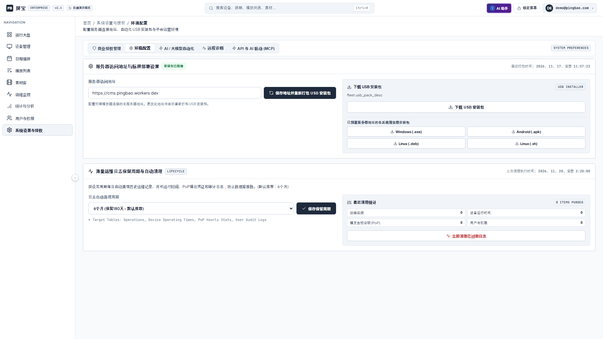

# 屏宝 (Pingbao) 系统管理员部署与大模型配置指南

本文档面向企业 IT 运维与系统架构师，介绍如何在私有化机房 (On-Premise)、NAS 或云端部署 **屏宝 (Pingbao)**，并配置**内置 AI / 大模型自动化引擎（支持国内直连大模型、国际云模型及 100% 免费内网 Ollama/vLLM）**。

---

## 1. 系统环境要求与部署架构选择

* **服务器操作系统**：Linux (Ubuntu 22.04 LTS+、Rocky Linux 9+)、群晖 DSM 7+、威联通 QTS、Oracle Linux、Windows Server 2019+
* **支持终端系统 (Multi-OS)**：三星商用标牌 Tizen 6.5+ / SSSP 6~10+ (`.zip`)、Windows 10/11 (`.exe`)、Android 商显/平板 (`.apk`)、Linux 迷你主机 (`.deb`/`.sh`)、免安装 Web 端 (`/player`)
* **运行环境**：Docker Engine 24.0+ & Docker Compose v2+（裸机运行需 **Node.js 22.5+**）
* **双数据库引擎规格 (`DB_MODE`)**：
  * **轻量单机模式 (`DB_MODE=sqlite`，默认)**：2 核 CPU、**2~4GB 内存**、20GB+ SSD（适用于 NAS 及 1~300 台门店规模）
  * **企业高可用集群 (`DB_MODE=postgres`)**：4 核+ CPU、**8~16GB+ 内存**、100GB+ SSD（PostgreSQL 16 + Redis 7 Pub/Sub 集群总线）
  * **（可选）内网本地大模型 (`Ollama` / `vLLM`)**：如需零成本离线运行本地大模型（如 `gemma4:12b`、`qwen2.5:14b`、`qwen2.5vl:7b`），建议配备 8~16GB+ 显存 GPU 或高性能主机；若直连阿里云通义千问、DeepSeek 等云端 API 则无需任何额外硬件。

---

## 2. Docker 快速安装

```bash
tar -zxvf pingbao-release.tar.gz
cd pingbao-release

# 交互式安装向导（可选 SQLite 轻量模式或 PostgreSQL + Redis 集群模式）
./install.sh

# 轻量级 SQLite WAL 模式静默安装
./install.sh --silent --db-mode=sqlite --domain=signage.mycompany.com

# 企业级 PostgreSQL + Redis 高可用模式静默安装
./install.sh --silent --db-mode=postgres --domain=signage.mycompany.com
```

安全隔离准则：
* 数据库目录 `./data` (`pingbao.sqlite`) 与静态资源目录 `./storage` 严格物理隔离。
* `.env.secret` (`0600`) 保存 64 位 `SERVER_MASTER_KEY`，用于派生 JWT 密钥及 **AES-256-GCM 加密存储大模型 API 密钥**。

---

## 3. 平滑升级、回滚与备份

```bash
./upgrade.sh           # 自动识别数据库模式、备份数据并在健康检查失败时自动回滚
./rollback.sh          # 一键回滚至上一稳定版本
./dscn-ctl.sh backup   # 备份数据库与配置（请务必同步妥善保管 .env.secret）
```

---

## 4. 系统设置五大管理子页签与 AI / 大模型配置详解

<br/>

| 环境参数与 6 个月日志自动清理 (`ADMIN_SETTINGS`) | AI / 大模型智能自动化配置 (`AI_SETTINGS`) |
| :---: | :---: |
|  |  |

1. **授权许可管理 (`LICENSE`)**：支持内网离线环境的 Ed25519 非对称数字签名 `.lic` 校验与屏幕配额管理。
2. **环境参数设置 (`ADMIN_SETTINGS`)**：
   * **服务器访问地址自动写入安装包**：修改保存服务器地址后，系统自动重新打包各系统安装程序并内嵌最新服务器 URL。
   * **6 个月默认日志保留与自动清理 (`Auto-Purge Lifecycle`)**：运维记录、运行时长、PoP 凭据及审计日志默认保留 180 天并自动清理过期数据。
3. **★ AI / 大模型自动化 (`AI_SETTINGS` · 仅限超级管理员)**：
   * **内置 10 大国内外与私有化预设**：
     * **中国内地直连（免代理高速访问）**：阿里云通义千问 (`qwen`)、深度求索 (`deepseek`)、智谱清言 (`zhipu`)、字节豆包 (`doubao`)、月之暗面 (`kimi`)
     * **国际云服务**：通义千问国际版 (`qwen_intl`)、`openai`、`gemini`、`claude`
     * **内网私有化部署 (`ollama`)**：无缝对接本地 `Ollama`、`vLLM`、`SGLang` 服务（默认 `http://127.0.0.1:11434/v1`），零费用、零数据出境。
   * **支持文本与视觉服务商分离混搭**：例如使用 `DeepSeek` 驱动右侧 AI 助手对话，同时指定 `通义千问 Qwen-VL` 负责上传素材多模态视觉识别。
   * **密钥加密、连接延迟实测与每日限额保护**：API 密钥采用 AES-256-GCM 加密落盘，支持保存前一键 `【连接测试】` 验证毫秒级延迟，并可通过每日调用上限防止账单超支。
4. **远程诊断 (`DIAGNOSTICS`)**：终端诊断日志包拉取、敏感信息自动脱敏 (`***MASKED***`) 遥测与社区工单直提。
5. **API 与智能体连接 (`CONNECTIVITY`)**：细粒度 API 密钥签发、调用监控及 Claude / Cursor / Antigravity 标准 MCP 配置导出。
