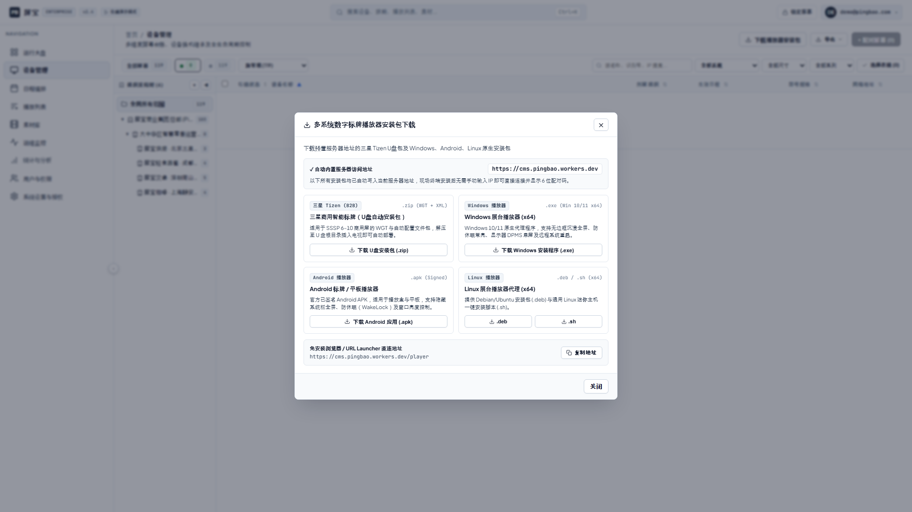
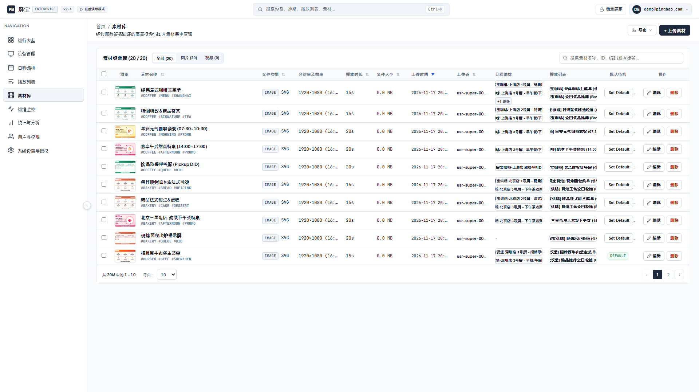
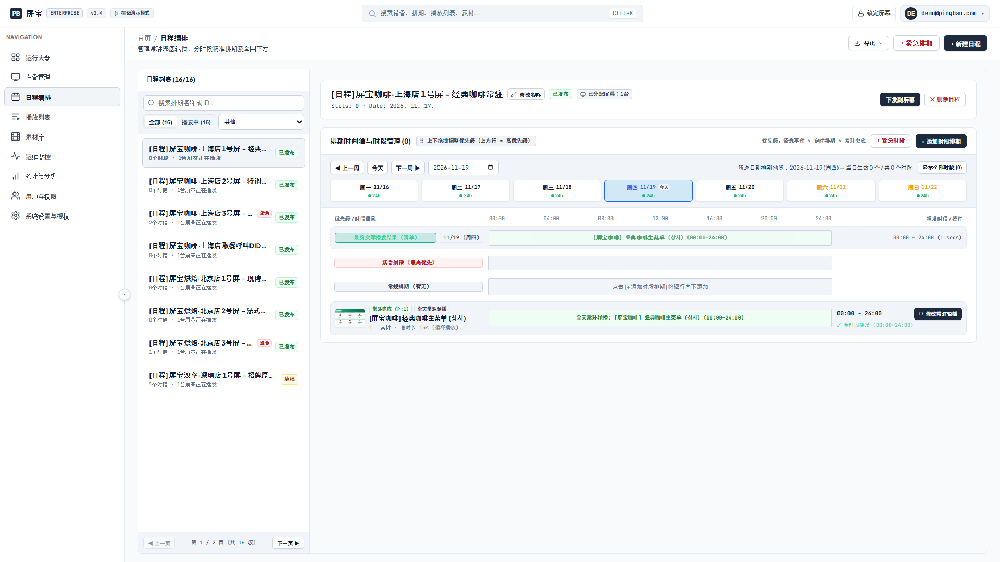

# 屏宝 (Pingbao / 핑바오) 企业级智能标牌全景操作手册

**屏宝 (Pingbao)** 是一款以**三星智能商用标牌 (Samsung Smart Signage · Tizen 6.5+ / SSSP 6~10+)** 底层原生硬件智控为核心，同时全面统一纳管 **Windows、Android、Linux 与 Web** 播放终端的企业级数字标牌全域云端播控平台（CMS）。  
平台内置多系统硬件抽象层（HAL）自适应远控、零配置全自动多屏同步（SyncPlay）、24 小时可视化四级分时排期（Dayparting）、断网永续离线轮播、设备开机时长（Uptime）与秒级播放凭据（PoP）双分析工作台，并原生开放企业级 REST API 与 AI 智能体 MCP（Model Context Protocol）协议支持。

---

## 目录 (Table of Contents)
1. [系统入门与工作台架构](#1-系统入门与工作台架构)
2. [多系统终端集中管控与物联网深控 (Multi-OS Fleet Management)](#2-多系统终端集中管控与物联网深控-multi-os-fleet-management)
3. [媒体素材库与安全合规 (Media Assets)](#3-媒体素材库与安全合规-media-assets)
4. [播放列表编排 (Playlists)](#4-播放列表编排-playlists)
5. [节目排期核心引擎深度解析 (Scheduling Engine)](#5-节目排期核心引擎深度解析-scheduling-engine)
6. [实时运维监控与故障自愈 (Operations Monitoring)](#6-实时运维监控与故障自愈-operations-monitoring)
7. [统计与分析：设备开机时长与秒级播放凭据 (Uptime & PoP)](#7-统计与分析设备开机时长与秒级播放凭据-uptime--pop)
8. [多租户组织、RBAC 权限与不可篡改审计日志 (Users & Audit)](#8-多租户组织rbac-权限与不可篡改审计日志-users--audit)
9. [系统设置、6 个月日志留存与错误遥测 (Settings & Telemetry)](#9-系统设置6-个月日志留存与错误遥测-settings--telemetry)
10. [开放 REST API 与 AI 智能体 MCP 支持](#10-开放-rest-api-与-ai-智能体-mcp-支持)
11. [全功能特性规格清单 (Full Feature Matrix)](#11-全功能特性规格清单-full-feature-matrix)

---

## 1. 系统入门与工作台架构

### 1.1 访问登录与企业双因子认证 (2FA / TOTP)
1. 使用现代浏览器（Chrome、Edge、Safari）访问屏宝控制台（官方演示环境 `https://cms.pingbao.workers.dev` 或企业私有域名）。
2. 输入操作员邮箱与密码（公开在线演示环境支持点击 **[以演示管理员身份立即体验]** 免登录一键进入）。
3. 通过 Google / Microsoft Authenticator 输入 RFC 6238 6 位动态验证码完成双因子鉴权，紧急情况下亦可使用 16 位一次性应急备份码。

 

*▲ [工作台 1] 屏宝实时运行仪表盘：全网终端在线率、已发布排期、7天/30天低开机率异常预警面板与实时动态流*

### 1.2 9 大核心工作台全景导航
* **仪表盘 (Dashboard)**：全网大屏连接健康度、排期同步率及近 7 天 / 30 天低开机率异常屏幕主动预警。
* **设备管理 (Devices)**：三星 Tizen SSSP 及 Windows·Android·Linux 多系统终端接入、7 大指令批量远控面板与零跑店实时高清截屏监看。
* **节目排期 (Schedules)**：四级优先级抢占引擎、24 小时时间轴分时排期（Dayparting）、最终播发明细自动计算与原子发布。
* **播放列表 (Playlists)**：音视频与高清海报混合编排、独立停留时长控制与 GPU 硬件加速转场。
* **媒体素材 (Media Assets)**：4K 超高清视频流式直传、64 字节二进制魔数安全校验与强一致性防误删引用锁。
* **运维监控 (Operations)**：多状态（成功/进行中/失败）与任务类别筛选、实时指令队列追踪及变更前后差异对比（`Op Diff`）。
* **统计与分析 (Analytics & Reports)**：**设备运行时间 (Operating Times)** 会话下钻工作台与秒级 **播发合规证明 (PoP)** 商业对账报表。
* **用户与权限 (Users & RBAC)**：集团-区域-门店多级树形隔离、角色 CRUDX 权限矩阵与**全员操作不可篡改审计日志**。
* **系统设置 / 商业授权 (Settings & License)**：Ed25519 离线签名授权、多系统安装包自动重打包与 **6 个月日志自动清理周期**、远程诊断遥测及 **API 与 AI 联动 (MCP)**。

---

## 2. 多系统终端集中管控与物联网深控 (Multi-OS Fleet Management)

 

*▲ [工作台 2] 设备集中管理：多系统平台徽标 (TIZEN / WINDOWS / ANDROID / LINUX)、在线状态与右侧实时画面监看面板*

### 2.1 多系统播放器一键安装包弹窗与 6 位 PIN 极速配对
1. 点击设备管理右上角 **[下载播放器安装包]** 打开多平台安装弹窗。
2. 所有下载包均已**自动内嵌当前服务器访问地址 (URL Stamping)**，现场通电安装后无需手动配置 IP：
   * **三星 Tizen (B2B)**：适配 SSSP 6~10 商用屏的 U 盘自动安装压缩包（`.zip`，解压至 U 盘根目录插上电视即自动安装）。
   * **Windows 自助终端播放器 (x64)**：Windows 10/11 原生 `.exe`（沉浸式全屏、防休眠锁定、DPMS 显示器息屏、远程系统重启）。
   * **Android 标牌 / 平板客户端**：官方签名 `.apk`（隐藏系统栏全屏、WakeLock 常亮防休眠、应用级亮度调节）。
   * **Linux 工控代理 (x64)**：Ubuntu/Debian `.deb` 安装包及一键自动化 `.sh` 脚本。
   * **免安装网页端 / URL Launcher**：浏览器直接访问 `/player`。
3. 终端启动后屏幕显示 6 位临时 **配对 PIN 码**，在控制台点击 **[+ 配对新屏幕]** 输入即可建立 TLS 双向加密通道。

 

*▲ 自动内嵌服务器访问地址的多系统播放器安装包下载弹窗*

### 2.2 多系统 HAL 智能适配与 7 大指令批量远控弹窗
* **按系统自适应硬件控制 (Per-OS HAL)**：自动识别三星 Tizen 硬件背光、面板电源、遥控/按键锁、HDMI 信号源切换与硬件 RTC 定时器，以及 Windows/Android/Linux 的显示器休眠黑屏与亮度调节能力。
* **专属批量远程控制弹窗 (7 大指令)**：勾选多台跨系统终端即可一键批量下发 **① 屏幕开/关、② 音量调节、③ 静音控制、④ 亮度调节、⑤ 重启播放器、⑥ 重启设备系统、⑦ 紧急插播通知**。
* **零跑店实时直播流与全屏高清抓屏**：在右侧详情栏一键启动实时画面流或全屏高清大图核验，足不出户 100% 掌控门店实际播放画面。

---

## 3. 媒体素材库与安全合规 (Media Assets)

 

*▲ [工作台 3] 媒体资产中心：4K 视频、高清餐牌海报、编码元数据与防误删保护*

* **大文件磁盘直连流式上传**：支持数 GB 级 MP4 (H.264/H.265/AV1)、WebM、PNG、JPG、SVG、WebP 流式传输与实时 SHA-256 完整性校验。
* **二进制魔数校验与引用防删锁**：拦截伪装扩展名的非法文件；凡被活跃播单或排期引用的素材均自动锁定禁止删除，杜绝门店 404 黑屏事故。

---

## 4. 播放列表编排 (Playlists)

 

*▲ [工作台 4] 播放列表工作台：音视频图文混排、独立停留秒数设置与总循环时长实时核算*

* **音视频与海报自由混排**：支持每个素材独立设定展示秒数与 GPU 硬件加速平滑切换（硬切 / 淡入淡出），自动汇总单轮总时长。

---

## 5. 节目排期核心引擎深度解析 (Scheduling Engine)

 

*▲ [工作台 5-1] 节目排期主从视图：播发状态筛选与 24 小时时间轴总览*

 

*▲ [工作台 5-2] 多优先级时间轴精细编排：上下拖拽调整优先级与最终播发明细自动演算*

### 5.1 四级优先级抢占模型 (4-Tier Preemption)
* **`EMERGENCY`（紧急插播，P: 100~200）**：火警疏散、极端天气通知，毫秒级中断当前画面全屏独占，解除后无缝恢复原进度。
* **`EVENT`（高峰活动，P: 50~99）**：午市半价、晚间特惠等限时营销时段优先播发。
* **`REGULAR`（日常分时，P: 10~49）**：早市、下午茶、晚市常规分时菜单轮播。
* **`DEFAULT`（常驻兜底，P: 1）**：24 小时全天候底图循环，彻底杜绝任何排期空窗导致的黑屏。

### 5.2 零配置全自动 SyncPlay 多屏同步与断网永续轮播
* **全自动 SyncPlay**：同一分组、相同排期、同一局域网下的多台屏幕通过认证 SSE `sync-stream` 与 EMA 时钟偏移自动校准，无需额外拼接器即可实现毫秒级同步翻页。
* **断网永续自主循环**：所有素材与时间轴规则预先缓存至本地存储，即便外网长期中断，早中晚菜单依然按点精准切换。

---

## 6. 实时运维监控与故障自愈 (Operations Monitoring)

 

*▲ [工作台 6] 运维监控：多状态/任务分类筛选、实时指令同步队列与变更前后差异对比 (Op Diff)*

* **多状态与分类精准筛查**：按全部、成功、进行中、失败状态及指令类别快速过滤，点击 `[查看详情]` 即可直观比对变更前后配置差异（`BEFORE / AFTER`），配合自动重试机制实现零跑店故障自愈。

---

## 7. 统计与分析：设备开机时长与秒级播放凭据 (Uptime & PoP)

### 7.1 设备运行时间工作台 (Device Operating Times)

 

*▲ [工作台 7-1] 设备运行时间工作台：累计运行时长、在线可用率、低开机率异常筛查与开关机会话下钻分析*

* **低开机率异常屏幕快速定位**：自动筛查日均运行时长骤降或提前关机的异常门店屏幕，点击 `[会话详情]` 即可精确核查每日每次开机（`ON`）至关机（`OFF`）时段及触发原因（`POWER_TIMER` 定时策略 vs `MANUAL` 人工操作）。

### 7.2 秒级播发合规证明与商业对账报表 (Proof-of-Play)

 

*▲ [工作台 7-2] 播发合规证明 (PoP)：累计播放次数、累计播出时长、平均完播率 (%) 与 15 分钟微批次存证流水*

* **真实硬件渲染存证**：仅记录终端实际渲染上屏的播放事实，严格区分紧急中断与完整完播，精准计算完播率 (%) 并支持一键导出 CSV / JSON / Markdown 商业审计对账单。

---

## 8. 多租户组织、RBAC 权限与不可篡改审计日志 (Users & Audit)

 

| 用户与多租户组织目录 (`Users & RBAC`) | 全员操作不可篡改审计账本 (`Audit Logs`) |
| :---: | :---: |
|  |  |

* **多租户数据隔离与全量审计追溯**：支持集团-大区-门店无限层级组织树与角色 CRUDX 细粒度权限矩阵；所有登录鉴权、排期下发、设备控制操作均连同操作人 IP 永久写入不可篡改审计日志。

---

## 9. 系统设置、6 个月日志留存与错误遥测 (Settings & Telemetry)

 

| 商业授权管理 (`License`) | 远程诊断与社区门户 (`Diagnostics & Telemetry`) |
| :---: | :---: |
|  |  |

* **Ed25519 离线商业授权与 6 个月自动清理周期**：支持纯内网环境电子签名验签激活；内置**默认 6 个月（180 天）日志留存与自动清理生命周期**（涵盖运维、开机时长、PoP 与审计日志），并提供 Opt-in 严格脱敏（`***MASKED***`）的社区错误遥测门户。

---

## 10. 开放 REST API 与 AI 智能体 MCP 支持

 

*▲ [系统设置 > API 与 AI 联动 (MCP)] 细粒度 API 密钥签发、小时级调用量监控与 Claude / Cursor / Antigravity 一键配置*

屏宝原生内置标准 **MCP (Model Context Protocol)** 服务与 **API 密钥用量监控看板**，支持 Claude Desktop、Cursor、Antigravity 及企业自研大模型智能体通过一句自然语言完成全网屏幕巡检、开机率核查、素材上传、播单创建与分时排期自动下发。

---

## 11. 全功能特性规格清单 (Full Feature Matrix)

| 模块领域 | 核心功能与技术规格 | 核心差异化优势 |
| :--- | :--- | :--- |
| **1. 运行仪表盘** | 全网在线率总览、实时动态流、7天/30天低开机率异常屏幕预警 | 多租户作用域自动隔离，一键下钻排查 |
| **2. 多系统终端智控** | 三星 Tizen SSSP 深度优化 + Windows / Android / Linux / Web 纳管与 7 项批量远控 | 多系统 HAL 自动路由，安装包自动内嵌服务器地址 |
| **3. 时间轴排期引擎** | 四级优先级抢占、24h 分时轮播、有效播发时段自动演算、紧急插播 | 本地状态机脱网运行，毫秒级抢占与无损回落 |
| **4. 全自动 SyncPlay** | 同分组、同排期、同局域网 100% 零配置自动帧同步联屏切换 | 认证 SSE `sync-stream` + EMA 时钟偏移校准 |
| **5. 播单与媒体库** | 音视频图文混排、GPU 转场、4K 流式直传、64B 魔数校验与引用防删锁 | 大文件零内存溢出，杜绝误删导致门店黑屏 |
| **6. 运维监控与自愈** | 多状态/分类筛选、BEFORE/AFTER 状态对比 (`Op Diff`)、异常自动重试 | 零跑店远程自愈，全链路指令可观测 |
| **7. 开机时长与 PoP** | 每日开关机会话明细下钻、真实硬件渲染秒级存证与完播率 (%) 核算 | 区分定时与人工开关机，一键导出商业审计报表 |
| **8. 安全 · 审计 · 留存** | 双因子认证 (TOTP)、RBAC 权限矩阵、不可篡改审计日志、6 个月自动清理 | RFC 6238 TOTP，Argon2id，180 天长效存储治理 |
| **9. REST API 与 MCP** | 60+ OpenAPI 3.0 接口、内置标准 MCP 服务端、按密钥流量与错误率分析 | 细粒度权限密钥，一句话自然语言智能运维 |

---

Pingbao (핑바오 / 屏宝) © 2026. All rights reserved.

