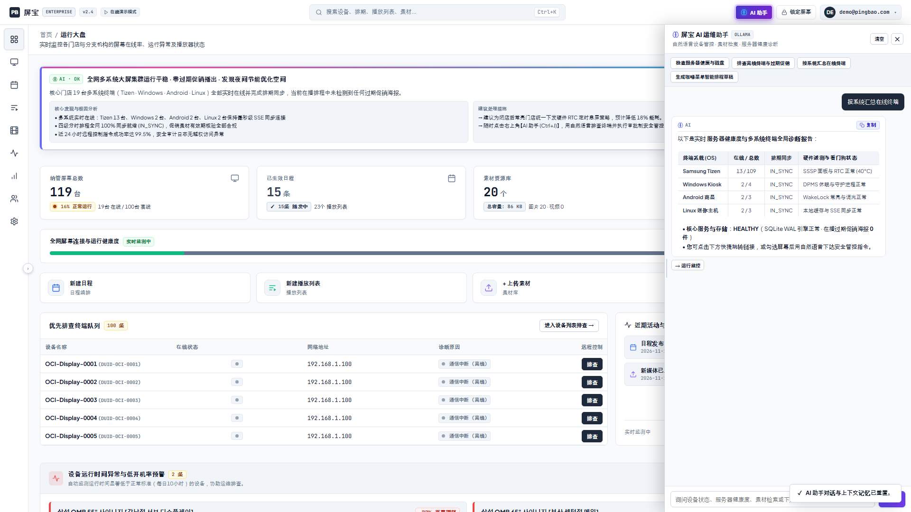
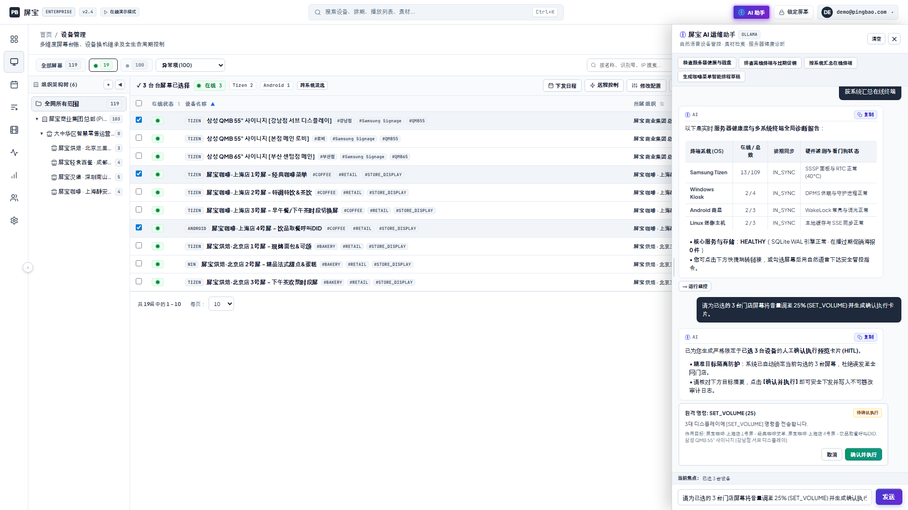
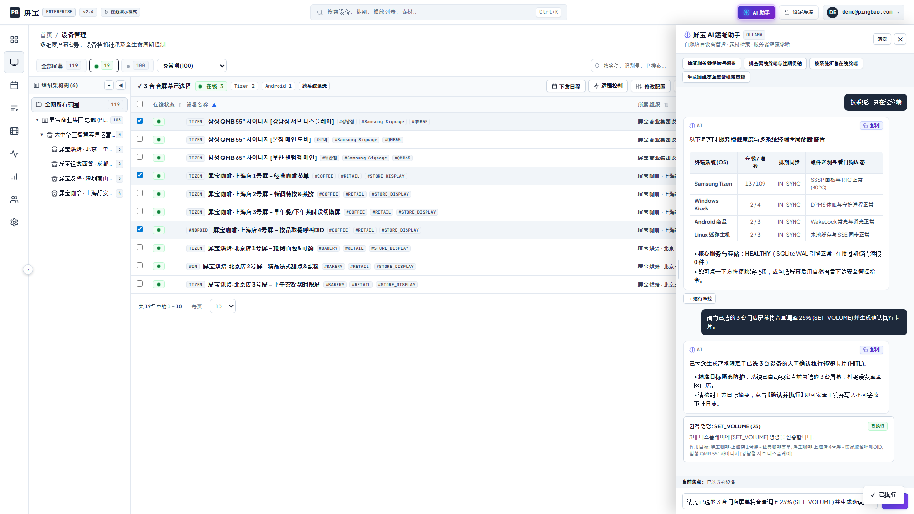
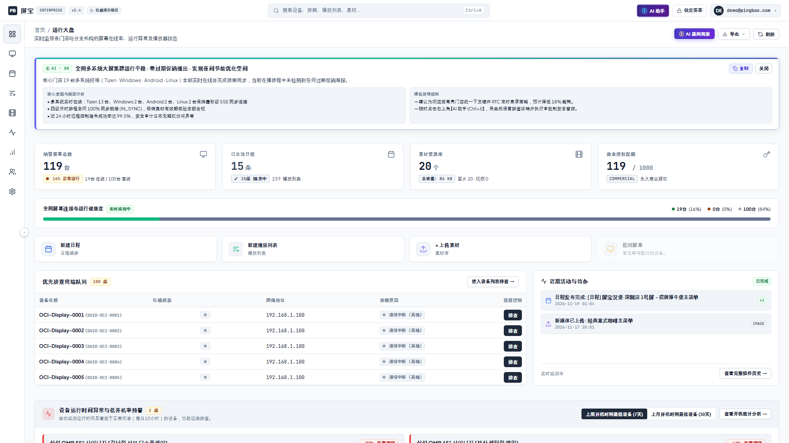
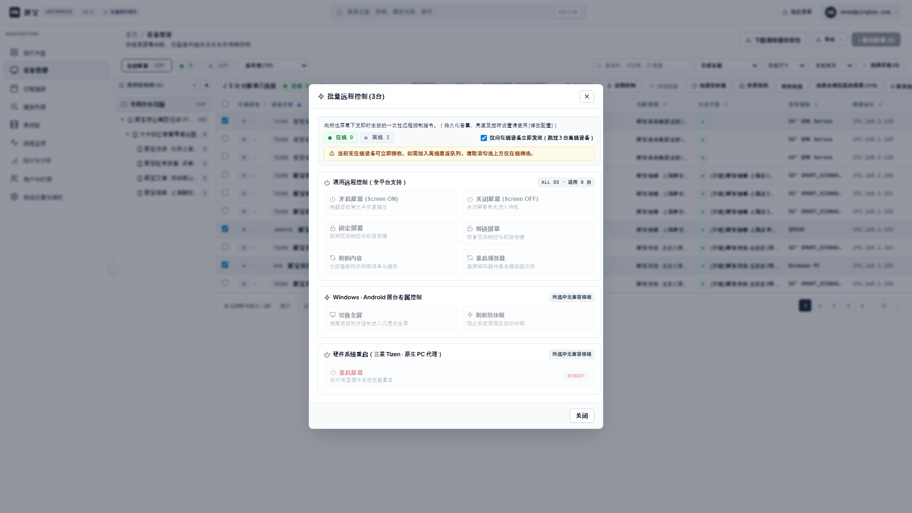
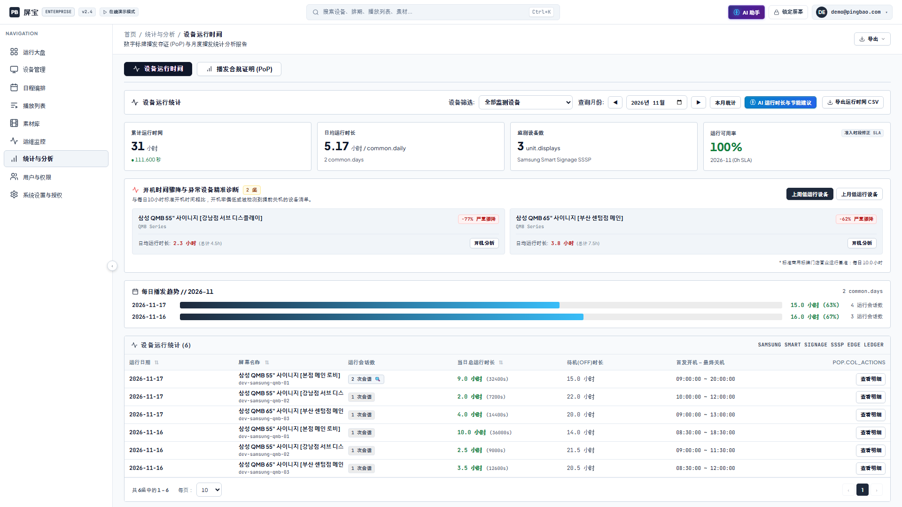
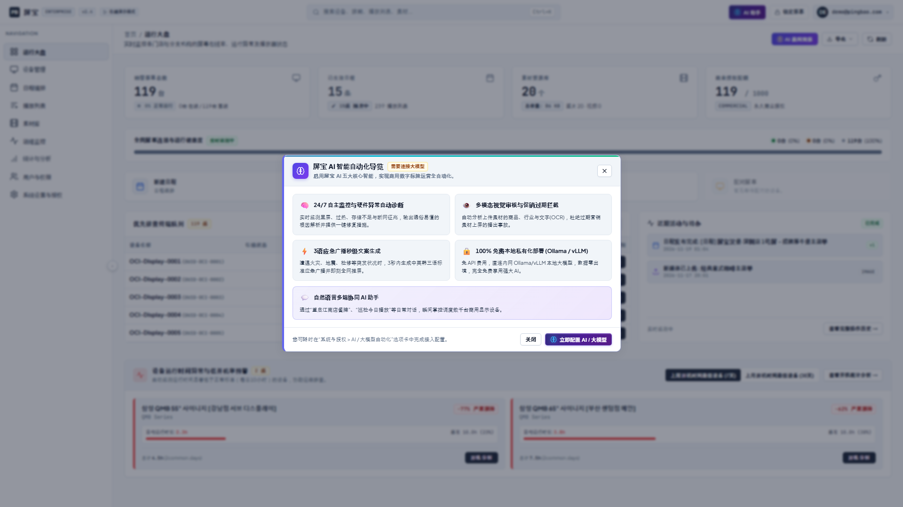
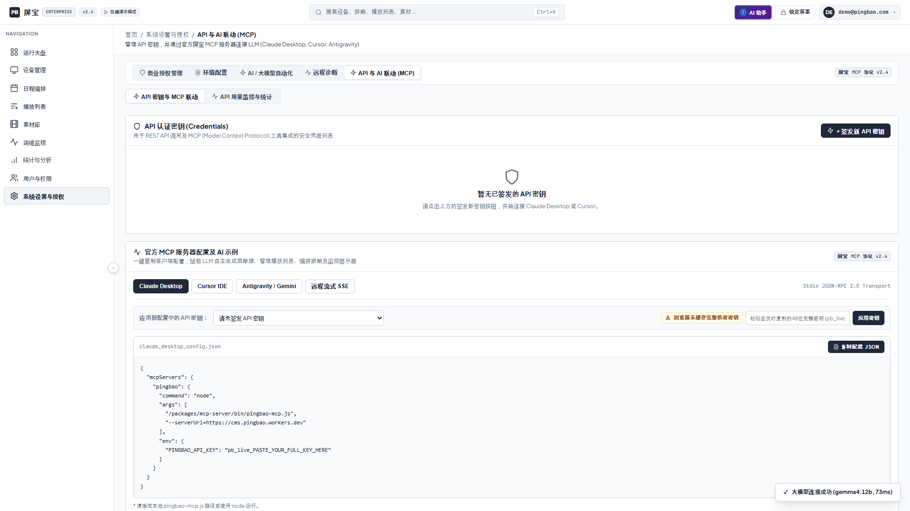

# 屏宝 (Pingbao / 핑바오) 企业级智能商显运营手册

**屏宝 (Pingbao)** 是原生内置 **AI 运维对话助手 (AI Copilot) 与五大核心智能自动化引擎**的新一代企业级数字标牌集中播控平台 (CMS)。系统以 **三星智能商用标牌 (Samsung Smart Signage · Tizen 6.5+ / SSSP 6~10+)** 底层硬件深度控制为核心，同时在单一控制台统一纳管 **Windows、Android、Linux 与 Web** 播放终端。  
只需一句自然语言对话，即可输出多系统大屏诊断表格并执行**零事故人工审批制 (HITL) 远程管控**；配合多模态视觉防过期质检、四级分时排程、零配置多屏同帧同步 (SyncPlay)、开机时长与秒级精准播放凭据 (PoP) 报表以及标准 MCP 接口，全面实现百城千店智能化无人值守运维。

---

## 目录 (Table of Contents)
1. [系统登录与工作台总览](#1-系统登录与工作台总览)
2. [★ 内置 AI 运维助手与五大核心智能自动化 (AI Copilot 核心亮点)](#2--内置-ai-运维助手与五大核心智能自动化-ai-copilot-核心亮点)
3. [多系统终端管理与硬件级远程控制 (Fleet Management)](#3-多系统终端管理与硬件级远程控制-fleet-management)
4. [素材库管理与多模态 AI 视觉质检 (Media & Vision QA)](#4-素材库管理与多模态-ai-视觉质检-media--vision-qa)
5. [播放列表编排 (Playlists)](#5-播放列表编排-playlists)
6. [四级分时排程引擎与 AI 冲突校验 (Scheduling Engine)](#6-四级分时排程引擎与-ai-冲突校验-scheduling-engine)
7. [实时运维监控与自动自愈 (Operations Monitoring)](#7-实时运维监控与自动自愈-operations-monitoring)
8. [统计分析：终端运行时长与秒级播放凭据 (Uptime & PoP)](#8-统计分析终端运行时长与秒级播放凭据-uptime--pop)
9. [多租户组织架构、RBAC 权限与不可篡改审计 (Users & Audit)](#9-多租户组织架构rbac-权限与不可篡改审计-users--audit)
10. [系统设置 · 大模型自动化 · 6个月日志留存 · MCP 生态](#10-系统设置--大模型自动化--6个月日志留存--mcp-生态)
11. [全功能规格总表 (Full Feature Matrix)](#11-全功能规格总表-full-feature-matrix)

---

## 1. 系统登录与工作台总览

1. 使用 Chrome、Edge 或 Safari 访问屏宝控制台地址（官方在线演示站 `https://cms.pingbao.workers.dev` 或企业内网域名）。
2. 输入管理员账号密码（在线演示站支持 **一键免密体验登录**），并通过 RFC 6238 TOTP 动态口令（或 16 位应急备用码）完成企业双因素认证。

 

*▲ [工作台 1] 屏宝全局实时仪表盘：全网在线率、右上角 `【AI 晨间简报】` 与 `【AI 助手 (Ctrl+J)】`、低开机率异常预警及实时动态*

---

## 2. ★ 内置 AI 运维助手与五大核心智能自动化 (AI Copilot 核心亮点)

屏宝最核心的革命性升级，是将 **屏宝 AI 运维助手 (`Ctrl+J`)** 与 **全业务模块 AI 洞察卡片**原生内置于管理后台，无需额外部署外部工具即可用自然语言掌控全网大屏。

### 2.1 右侧滑出式 AI 运维助手 (`Ctrl+J`) —— 自然语言全局诊断与表格直出

 

*▲ 右侧滑出式屏宝 AI 运维助手：支持左边缘拖拽调宽、快捷指令芯片、多系统终端在线汇总表格及一键页面跳转*

* **全界面随时呼出与自由调宽 (`Ctrl+J` 或右上角 `【AI 助手】`)**：不打断当前操作，支持拖拽左侧边框自由调节抽屉宽度。
* **智能感知当前界面焦点 (`当前焦点`)**：自动识别当前所在菜单、右侧详情面板打开的设备、或列表中勾选的多台屏幕（如 `当前焦点: 已选 3 台设备`），精准理解“诊断这台屏幕”、“把所选屏幕音量调到 25%”等指代指令。
* **结构化 Markdown 数据表格与一键跳转**：秒级排查服务器 CPU/内存/磁盘健康度、各操作系统在线率及过期促销隐患，以精美 HTML 表格呈现，并提供 `→ 终端名称` / `→ 运行监控` 快捷跳转按钮。
* **长对话摘要记忆压缩 (`Rolling Memory`)**：多轮长对话自动提炼上下文摘要，兼顾连续追问体验与低 Token 消耗。

### 2.2 零事故人工确认制 (HITL) AI 远程管控与精准目标隔离

 

| ① 待确认执行预览卡片 (`待确认执行` · 精准子集隔离) | ② 管理员点击确认后秒级下发 (`已执行`) |
| :---: | :---: |
|  |  |

* **强制人工审批防线 (Human-in-the-Loop Guard)**：凡涉及开关屏、音量/亮度调节、重启、电源定时策略或智能排程草稿创建的自然语言请求，AI 绝不会擅自盲目执行，而是先生成清晰的**执行预览卡片 (`待确认执行`)**，唯有管理员核对无误并点击 **【确认并执行】** 后才会真正下发并记入审计日志。
* **严格的设备子集隔离 (`Strict Device Subsetting`)**：底层强制锁定已勾选或指定目标设备，从根源杜绝误操作演变为全网门店群发事故。

### 2.3 全工作台一键 AI 业务洞察与对话历史自动汇聚

 

*▲ 仪表盘点击 `【AI 晨间简报】` 展开智能知识卡片：3 秒掌握全网在线态势、促销合规性与节能优化建议*

各大核心工作台均配备一键 AI 洞察按钮，且所有分析结论均**自动汇聚保存至右侧 AI 助手对话记录**中：
1. **仪表盘 `【AI 晨间简报】`**：每日早间一键汇总全网在线率、排期同步、过期海报风险与节能建议。
2. **终端详情 `【请求 AI 诊断】` & `【AI 三语字幕生成】`**：通俗解读芯片温度、开机率与底层报错日志，结合实时截屏视觉质检给出修复按钮；突发事件 3 秒生成中英韩三语标准应急广播文案。
3. **素材库 `【AI 重新分析元数据】`**：多模态视觉自动识别电子菜单/促销用途、商品餐品、价目表 OCR、推荐时段及**活动截止日期 (`detected_valid_until`)**。
4. **排程管理 `【AI 排程与定时校验】`**：发布前自动核查排程时段与硬件定时息屏冲突及过期素材隐患。
5. **运维监控 `【AI 故障规律总结】` · 运行时长 `【AI 节能建议】` · 审计日志 `【AI 安全审计总结】`**：全方位智能护航。

---

## 3. 多系统终端管理与硬件级远程控制 (Fleet Management)

 

| 多系统终端列表与实时画面监看 | 右侧详情 `管控/控制` 页签 —— AI 终端深度诊断 |
| :---: | :---: |
|  |  |

* **内嵌服务器地址的多系统安装包弹窗**：一键下载三星 Tizen USB 安装包 (`.zip`)、Windows 播放器 (`.exe`)、Android 商显包 (`.apk`)、Linux 安装包 (`.deb`/`.sh`) 或免安装 Web 端 (`/player`)，开机即连并通过 6 位 PIN 码极速配对。
* **OS 自适应硬件抽象层 (HAL) 与 7 项批量远程控制弹窗**：精准匹配三星 SSSP 硬件背光/面板电源/按键锁/RTC 定时与 Windows/Android/Linux 息屏调光控制。

 

| 多系统播放器安装包下载弹窗 (`自动写入服务器地址`) | 7 项指令专用批量远程控制弹窗 |
| :---: | :---: |
|  |  |

---

## 4. 素材库管理与多模态 AI 视觉质检 (Media & Vision QA)

 

| 高清素材资源库 | AI 视觉元数据与促销过期拦截 |
| :---: | :---: |
|  |  |

* **多模态视觉自动打标与过期拦截**：上传即自动提取用途 (`MENU_BOARD`/`PROMO`)、餐品/商品名称、推荐时段、画质质检评价及**活动截止日期**，杜绝过期营销海报继续上屏的播出事故。
* **4K 流式直写、64 字节文件头防伪校验与在播防删保护锁**。

---

## 5. 播放列表编排 (Playlists)

 

*▲ [工作台 4] 播放列表编排：音视频与高清图片混排、独立时长设置与硬件加速转场*

---

## 6. 四级分时排程引擎与 AI 冲突校验 (Scheduling Engine)

 

| 排程列表与 `【AI 排程与定时校验】` | 四级 24 小时分时时间轴与最终播出明细 |
| :---: | :---: |
|  |  |

* **四级优先级自动抢占 (`EMERGENCY > EVENT > REGULAR > DEFAULT`)** 与断网永久自治循环播放。
* **全自动多屏同步播放 (SyncPlay)**：满足 **【同一分组 + 同一排程 + 同一局域网】** 即可零配置实现联屏菜单毫秒级同帧切换。

---

## 7. 实时运维监控与自动自愈 (Operations Monitoring)

 

*▲ [工作台 6] 运维监控：`【AI 故障规律总结】`、多状态分类筛选与指令变更前后差异对比 (`BEFORE / AFTER Op Diff`)*

---

## 8. 统计分析：终端运行时长与秒级播放凭据 (Uptime & PoP)

 

| 终端运行时长分析台 (`Uptime + AI 节能建议`) | 秒级精准播放凭据 (`PoP`) 结算报表 |
| :---: | :---: |
|  |  |

---

## 9. 多租户组织架构、RBAC 权限与不可篡改审计 (Users & Audit)

 

| 多租户用户与角色权限矩阵 | 全量不可篡改审计日志与 `【AI 安全审计总结】` |
| :---: | :---: |
|  |  |

---

## 10. 系统设置 · 大模型自动化 · 6个月日志留存 · MCP 生态

 

| `AI / 大模型自动化` —— 十大中外云与免费本地 Ollama | 未连接大模型时的 `五大核心智能导览弹窗` |
| :---: | :---: |
|  |  |

* **原生内置 10 大中国本土直连 · 国际云 · 100% 免费内网私有化大模型预设**：
  * **中国内地直连（无需任何代理）**：阿里云通义千问 (`Qwen`)、深度求索 (`DeepSeek`)、智谱清言 (`GLM-4/4V`)、字节跳动豆包 (`Doubao`)、月之暗面 (`Kimi`)
  * **全球云服务**：通义千问国际站、`OpenAI (GPT-4o)`、`Google Gemini (2.5 Flash/Pro)`、`Anthropic Claude`
  * **100% 免费内网私有化部署 (`Ollama · vLLM · SGLang`)**：零 API 费用、企业数据零出境，直接连接内网本地模型（如 `gemma4`、`qwen2.5`、`deepseek-r1`、`qwen2.5vl`）
  * 支持**文本与视觉模型独立混搭**（如 DeepSeek 文本 + 通义千问 Qwen-VL 视觉）、**AES-256-GCM 密钥加密存储**、**实时连接延迟测试**与**每日调用限额保护**。

 

| 商业离线数字签名授权 (`License`) | 开放 REST API 与外部智能体 MCP 接口 (`Connectivity`) |
| :---: | :---: |
|  |  |

---

## 11. 全功能规格总表 (Full Feature Matrix)

| 模块领域 | 核心功能规格 | 技术架构与核心优势 |
| :--- | :--- | :--- |
| **1. 内置 AI 运维对话助手** | 右侧滑出对话窗 (`Ctrl+J`)、表格诊断、HITL 审批执行卡片、一键跳转 | 自动感知界面焦点、严格子集隔离杜绝全网误发 |
| **2. 多模态视觉与全域 AI 洞察** | 晨间简报、终端日志解读、视觉自动打标防过期、三语应急文案秒级生成 | 原生支持国内五大模型与免费内网 Ollama、AES-256 加密 |
| **3. 多系统终端集中管控** | 三星 Tizen SSSP 深度控制 + Windows / Android / Linux / Web + 7 项批量管控 | OS 自适应 HAL 路由、安装包自动写入服务器地址 |
| **4. 四级分时排程与多屏同步** | 紧急/活动/常规/垫片四级抢占、AI 排程冲突校验、零配置自动 SyncPlay | SSE `sync-stream` + EMA 时钟偏移毫秒级校准 |
| **5. 自动自愈与开机率/PoP** | `BEFORE/AFTER` 差异比对、开关机会话钻取、秒级真实渲染帧完播率统计 | CSV/JSON/MD 商业对账导出、180 天日志自动清理 |
| **6. 企业安全、审计与 MCP** | TOTP 双因素认证、RBAC、不可篡改审计、60+ REST API 与内置 MCP 服务 | Argon2id、Ed25519 离线授权、无缝直连外部智能体 |

---

Pingbao (屏宝 / 핑바오) © 2026. All rights reserved.

