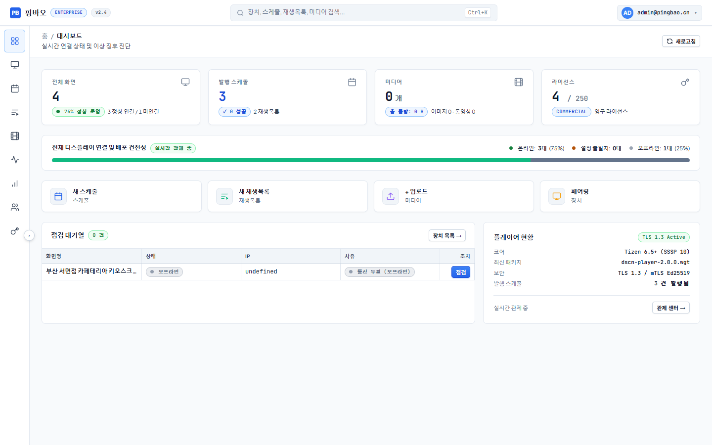

# 屏宝 (Pingbao) 用户使用手册

**屏宝 (Pingbao)** 是一款企业级云端数字标牌管理平台 (CMS)，专为大规模智能商用显示屏的集中管控、音视频媒体编排以及永续自主轮播调度而设计。

---

## 1. 快速入门 (Quick Start)

### 1.1 访问与登录
1. 打开网页浏览器（推荐使用 Chrome 或 Edge），输入屏宝服务器访问地址。
2. 输入管理员或操作员账号与密码进行登录。
3. 登录后，可点击右上角个人中心切换系统语言（**简体中文 / 한국어 / English**）。

### 1.2 界面功能导航与仪表盘
* **运行仪表盘 (Dashboard)**：在线/离线显示屏状态总览、已登记设备总数、近期活动概览。
* **设备集中管控 (Devices)**：现场标牌设备接入审批、屏幕面板远程开/关、音量调节、设备重启及实时屏幕截屏回传。
* **媒体内容资产库 (Media)**：批量上传图片、视频（MP4, WebM 等）并进行标签分类。
* **播放列表编排 (Playlists)**：组合音视频素材，调整播放次序及图片停留时长。
* **时间轴排期调度 (Schedules)**：通过时间轴拖拽编排全天或特定时段轮播计划，支持一键极速发布。
* **实时运维监看 (Operations)**：长轮询指令队列跟踪、通讯延迟、硬件异常告警及实时操作审计日志。

 

*▲ [界面 1] 屏宝系统仪表盘：标牌在线率、排期发布进展及系统健康度总览*

---

## 2. 标牌设备接入与远程运维

### 2.1 新设备配对与注册
1. 在三星智能商用标牌（Tizen 6.5+ / SSSP 10+）上启动屏宝播放器应用。
2. 获取屏幕上显示的 6 位**注册配对码 (PIN Code)** 或设备唯一序列号 (DUID)。
3. 打开屏宝管理控制台，进入 **设备管理 > 注册设备**，输入配对码。
4. 设定安装点位名称（例如：“总部大堂 1 楼大屏”）及设备分组后确认，即可秒级建立长连接。

### 2.2 深度硬件级远程控制
* **屏幕面板远程开/关**：营业时间外一键关闭屏幕背光以节能延长硬件寿命。
* **实时画面截屏监看**：无需亲临现场，随时通过网络远程截取屏幕当前真实播放画面。
* **远程重启与音量控制**：设备异常时远程软硬件重启，发生突发事件时秒级推送全屏紧急广播通知。

 

*▲ [界面 2] 屏宝设备集中管控：已注册屏幕列表、运行状态、DUID 与面板远程开关/音量滑块*

---

## 3. 实时运维监看中心 (Operations)

### 3.1 期望状态 (Desired State) 同步与遥测
* **版本状态追踪**：毫秒级追踪终端当前运行的排期/素材版本与服务端期望版本的同步状态。
* **通讯延迟与异常告警**：对离线断连、心跳超时或大文件下载迟缓的终端实现秒级感知与精准告警。

 

*▲ [界面 3] 屏宝运维监看中心：长轮询指令队列、单机网络心跳与硬件遥测明细*

---

## 4. 时间轴排期与无网络断网自主播放

### 4.1 时间轴排期设计
* **24 小时兜底基础循环 (Base Fallback Loop)**：无特殊临时活动时，常态化全天无缝循环轮播。
* **高峰期与时段插播 (Event Schedules)**：针对特定日期或午高峰（11:30~13:30）等黄金时段自动切入优先播放。

### 4.2 本地自主离线播放与一键下发
* 点击 **发布排期 (Publish)** 后，最新排期快照与配置将瞬间同步至所有关联设备。
* 终端设备会在后台预先下载所需素材，并在关键时间点原子化切换渲染画面。
* **离线自主循环原则**：即使现场网络发生长期故障或断网，终端仍会基于本地缓存按时间规则永久自主播放。

 

*▲ [界面 4] 屏宝时间轴排期：24小时常态兜底轮播与高峰活动排期可视化编排*
