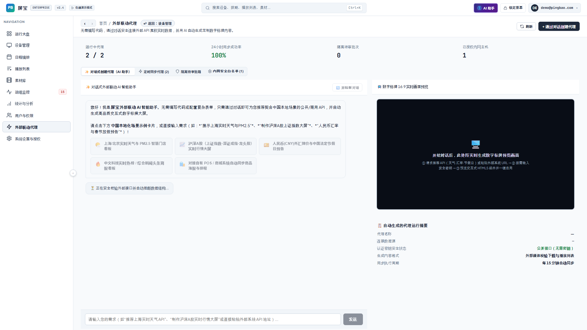
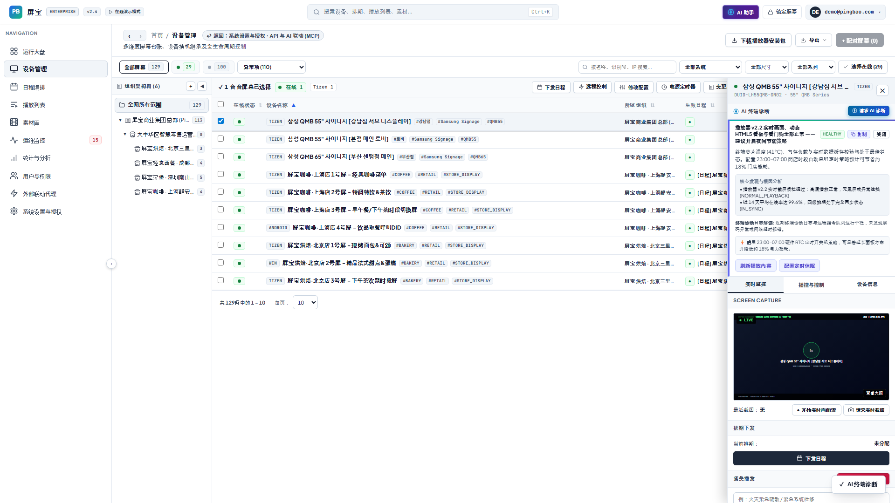
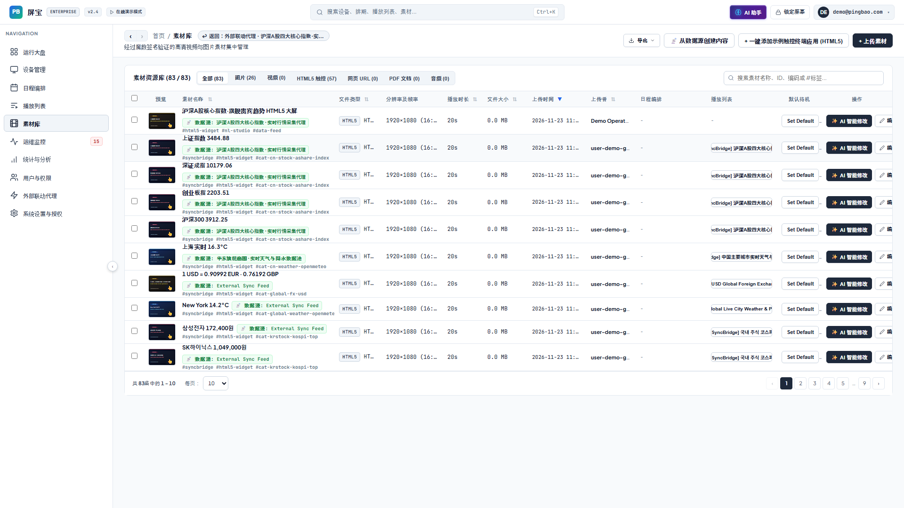
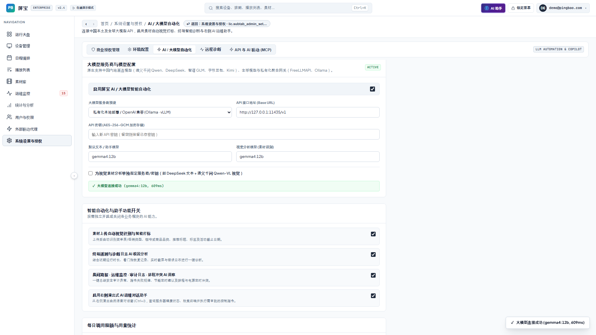

# 屏宝 (Pingbao / 핑바오) 企业级云端播控平台运营手册

**屏宝 (Pingbao)** 是原生内置 **AI 运维对话助手 (`Ctrl+J`) & AI 智能配方**与零代码 **对话式外部联动代理及实时 HTML5 内容工作室**的新一代企业级数字标牌全域播控平台 (CMS)。系统以**三星智能商用标牌 (Samsung Smart Signage · Tizen 6.5+ / SSSP 6~10+)** 深度硬件控制为核心，统一纳管 **Windows、Android、Linux 与 Web** 播放终端（`v2.2.0`）。

---

## 目录 (Table of Contents)
1. [系统登录与十大核心工作台概览](#1-系统登录与十大核心工作台概览)
2. [★ 内置 AI 运维对话助手 · AI 智能配方与五大自主洞察](#2--内置-ai-运维对话助手--ai-智能配方与五大自主洞察)
3. [★ 对话式外部联动代理与双栏「AI 内容修改工作室」 (NEW)](#3--对话式外部联动代理与双栏ai-内容修改工作室-new)
4. [多系统设备管理 (v2.2) 与底层硬件智控](#4-多系统设备管理-v22-与底层硬件智控)
5. [媒体素材库 · HTML5 触控包 (.zip) · 多模态视觉质检](#5-媒体素材库--html5-触控包-zip--多模态视觉质检)
6. [播放列表编排 (Playlists)](#6-播放列表编排-playlists)
7. [四级节目排期引擎与 AI 冲突校验 (Schedules)](#7-四级节目排期引擎与-ai-冲突校验-schedules)
8. [运维监控与状态差异对比自愈 (Operations)](#8-运维监控与状态差异对比自愈-operations)
9. [统计与分析：设备运行时长与秒级精准播放凭据 (Uptime & PoP)](#9-统计与分析设备运行时长与秒级精准播放凭据-uptime--pop)
10. [多租户组织权限与不可篡改审计日志 (Users & Audit)](#10-多租户组织权限与不可篡改审计日志-users--audit)
11. [系统设置 · 11 大模型自动化 · 6 个月日志清理 · 外部 MCP 联动](#11-系统设置--11-大模型自动化--6-个月日志清理--外部-mcp-联动)
12. [全功能特性矩阵表 (Full Feature Matrix)](#12-全功能特性矩阵表-full-feature-matrix)

---

## 1. 系统登录与十大核心工作台概览

### 1.1 安全登录与双因素认证 (2FA / TOTP)
1. 使用主流浏览器访问屏宝控制台（`https://cms.pingbao.workers.dev` 或企业私有部署域名）。
2. 输入管理员账号密码（在线演示站支持一键 **免登录演示管理员进入**）。
3. 输入身份验证器生成的 6 位 RFC 6238 动态口令（或 16 位应急备用恢复码）完成认证。

 

*▲ [工作台 1] 实时运行仪表盘：全网在线率、一键 AI 晨间简报、左侧十大业务工作台与低开机率异常预警*

### 1.2 十大核心工作台概览
* **运行大盘 (Dashboard)**：全网在线态势、**一键 `【AI 晨间简报】`** 及近 7/30 天低开机率异常预警。
* **设备管理 (Devices)**：三星 Tizen SSSP 与 Windows/Android/Linux (`v2.2.0`) 统一纳管、**`【AI 终端诊断】`**、**动态 HTML5 实时截屏**与 7 项批量远控。
* **日程编排 (Schedules)**：四级优先级抢占（`紧急 > 活动 > 常规 > 垫片`）、24 小时分时时间轴与 **`【AI 排程与定时校验】`**。
* **播放列表 (Playlists)**：视频、图片、交互式 HTML5 应用与实时数据看板混合编排。
* **素材库 (Media Assets)**：4K 流式上传、**HTML5 触控压缩包 (`.zip`) 与实时网页 URL 注册**、**`【✨ AI 修改】` 内容工作室**及**视觉过期海报拦截**。
* **外部联动代理 (External Sync Agents · NEW)**：超管专属**对话式外部联动工作室**、**已学习 API 记忆卡片**、**独立数据采集池**、**熔断隔离审批箱**与**企业内网白名单**。
* **运维监控 (Operations)**：多维状态筛选、**`【AI 故障规律总结】`** 与 `BEFORE/AFTER` 状态差异对比 (`Op Diff`)。
* **统计与分析 (Analytics & Reports)**：**设备运行时长分析台（AI 节能建议）** 与秒级 **播放凭据 (PoP)** 结算导出。
* **用户与权限 (Users & RBAC)**：集团-区域-门店多级树形权限隔离与**不可篡改审计账本（AI 安全总结）**。
* **系统设置与授权 (System Settings)**：商业离线授权、自动写入服务器地址安装包、180 天日志自动清理、**11 大中外/本地 Ollama 大模型配置**与**外部智能体 MCP 服务**。

---

## 2. ★ 内置 AI 运维对话助手 · AI 智能配方与五大自主洞察

### 2.1 右侧滑出式 AI 运维助手 (`Ctrl+J`) 与任务记忆「AI 智能配方」

 

*▲ 右侧滑出式 AI 运维助手：顶部「AI 智能配方」一键运行栏、多系统 v2.2 在线诊断表格与一键直达跳转*

* **AI 智能配方 (`AI 智能配方`)**：抽屉顶部预置 `☀️ 周末门店模式`、`🌙 夜间打烊休眠`、`🔄 全网终端重启`、`⚡ 晨间开店准备` 等标准运维配方，点击 **`【+ 记忆近期任务】`** 即可将刚执行的一连串操作保存为专属一键配方，亦支持自然语言口令直接触发。
* **界面焦点自动感知与长对话摘要记忆**：实时识别当前所在页面、右侧选中设备与列表勾选设备数（`当前焦点：已选 3 台设备`）。

### 2.2 零事故人工确认制 (HITL) 管控与精准目标隔离

 

| ① 待确认执行预览卡片 (`待审批` · 严格目标隔离) | ② 点击确认后安全下发 (`已执行`) |
| :---: | :---: |
|  |  |

* **未经人工确认绝不自动下发**：所有远程控制与智能配方均先生成**执行预览卡片**，唯有管理员点击 **【确认并执行】** 后方才真正下发并写入不可篡改审计账本。
* **严格子集隔离 (`Strict Subsetting`)**：自动将执行范围锁定在已勾选屏幕，100% 杜绝误发全网门店事故。

### 2.3 全工作台一键 AI 业务洞察

 

各工作台顶部的 `AI 晨间简报`、`AI 终端诊断`、`AI 三语应急广播生成`、`AI 视觉重分析`、`AI 排程冲突校验`、`AI 安全审计总结` 结果均会自动同步留存于右侧 AI 助手对话历史中。

---

## 3. ★ 对话式外部联动代理与双栏「AI 内容修改工作室」 (NEW)

进入左侧 **【外部联动代理】** 工作台（仅超级管理员可见），无需编写代码即可将外部公共、商业或企业内网 API 实时转化为大屏内容。

### 3.1 对话式创建工作室 (`STUDIO` 标签页) 与已学习 API 记忆卡片

 

*▲ 【外部联动代理 > 对话式创建工作室】：顶部已学习 API 一键复用卡片、中国本地化接口目录、10 款主题与 16:9 实时 HTML5 预览*

1. **零代码自然语言接入**：直接输入*“帮我接入沪深A股四大核心指数实时行情”*、*“接入上海门店实时天气”*或粘贴企业自有 API 地址。
2. **中国本地化与全球精选目录**：内置沪深A股、中国主要城市天气/空气质量、和风天气、高德开放平台、天行数据、人民币汇率、中国法定节假日等接口，支持免密钥秒级连接或一键回退免密钥方案。
3. **已学习 API 记忆卡片 (`Learned API Skills`)**：成功接入过的接口会自动记忆端点、认证方式与字段映射，下次一键即可复用。
4. **16:9 交互式 HTML5 看板实时渲染**：支持 6 大版式与 10 款高端商业配色主题，右侧窗口即刻交互预览。

### 3.2 独立数据采集池 (`AGENTS` 标签页) 与双栏「AI 内容修改工作室」

 

| 定时同步代理与累积数据存储池 (`AGENTS`) | 双栏「AI 内容修改工作室」 (`NL Content Studio`) |
| :---: | :---: |
|  |  |

* **数据采集与画面展示彻底解耦**：定时代理持续拉取并累积时序快照至独立数据存储池，多套不同风格的 HTML5 商显素材可按 `15秒 / 30秒 / 60秒` 周期独立订阅同一数据源。
* **双栏 AI 内容修改工作室**：点击代理详情中的 **`【✨ + 基于此数据新建内容】`** 或素材库中的 **`【✨ AI 修改】`**，即可点击插入原始字段芯片、切换黑金等 10 款主题、开启 7 日趋势图，或通过自然语言多轮微调版式，覆盖保存后在播排期自动热更新。

### 3.3 企业级零 Shell 安全护栏 (`QUARANTINE` 与 `ALLOWLIST` 标签页)
* **AES-256-GCM 密钥保险库**：API Key、Bearer 令牌与 OAuth2 密钥全程加密存储，日志与接口零明文暴露。
* **批量变更熔断审批箱 (`QUARANTINE`)**：外部接口异常触发超量修改或停用时自动挂起隔离，待管理员核对差异审批后生效。
* **企业内网白名单 (`ALLOWLIST`)**：默认阻断内网/元数据 SSRF 请求，仅放行显式登记的企业内网 ERP/HR 主机或网段。

---

## 4. 多系统设备管理 (v2.2) 与底层硬件智控

 

| 多系统终端列表与 v2.2 实时画面监看 | 右侧详情 `管控/控制` —— AI 终端深度诊断 |
| :---: | :---: |
|  |  |
| **多系统安装包下载弹窗 (`自动内嵌服务器地址`)** | **7 项指令专属批量远控弹窗 (`Bulk Control`)** |
|  |  |

* **播放器 v2.2 动态 HTML5 实时截屏**：不仅支持三星 SSSP 硬件帧截屏，还能高清回传动态 HTML5 数据看板与触控应用的真实渲染画面。

---

## 5. 媒体素材库 · HTML5 触控包 (.zip) · 多模态视觉质检

 

| 媒体资源库 (`实时数据看板与 AI 修改`) | HTML5 触控包 (`.zip`) 与实时网页 URL 上传弹窗 |
| :---: | :---: |
|  |  |

 

* **交互式 HTML5 触控压缩包 (`.zip`/`.html`) 与实时网页 URL**：内置防 Zip-Slip 路径穿越、符号链接与可执行脚本拦截，支持一键生成示例触控应用。
* **多模态视觉自动打标与防过期拦截**：自动识别餐品、价目表 OCR、推荐时段与**活动截止日期 (`detected_valid_until`)**，杜绝过期促销上屏。

---

## 6. 播放列表编排 (Playlists)

 

---

## 7. 四级节目排期引擎与 AI 冲突校验 (Schedules)

 

支持四级优先级抢占、一键 **`【AI 排程与定时校验】`** 以及同一分组、同一排程、同一局域网下的 **100% 零配置毫秒级 SSE SyncPlay 多屏同步**。

---

## 8. 运维监控与状态差异对比自愈 (Operations)

 

---

## 9. 统计与分析：设备运行时长与秒级精准播放凭据 (Uptime & PoP)

 

| 设备运行时长分析台 (`【AI 运行时长与节能建议】`) | 秒级精准播放凭据报表 (`完播率 % 与结算导出`) |
| :---: | :---: |
|  |  |

---

## 10. 多租户组织权限与不可篡改审计日志 (Users & Audit)

 

| 多租户组织与 RBAC 权限 (`Users & RBAC`) | 不可篡改审计账本 (`【AI 安全审计总结】`) |
| :---: | :---: |
|  |  |

---

## 11. 系统设置 · 11 大模型自动化 · 6 个月日志清理 · 外部 MCP 联动

 

| `AI / 大模型自动化` — 11 大中外/FreeLLMAPI/本地 Ollama | 未配置时展示的 `核心 AI 能力导览弹窗` |
| :---: | :---: |
|  |  |
| **商业离线数字签名授权 (`License`)** | **开放 REST API 与外部智能体 MCP (`Connectivity`)** |
|  |  |

---

## 12. 全功能特性矩阵表 (Full Feature Matrix)

| 核心模块 | 功能特性明细 | 技术规范与核心优势 |
| :--- | :--- | :--- |
| **1. 内置 AI 助手与智能配方** | 右侧滑出对话窗 (`Ctrl+J`)、**AI 智能配方 (`+ 记忆近期任务`)**、表格诊断、HITL 审批管控 | 自动感知界面焦点、严格子集隔离杜绝全网误发 |
| **2. 对话式外部联动代理** | 自然语言接入天气/沪深A股/汇率/内网 ERP、**已学习 API 记忆卡片**、16:9 HTML5 自动生成 | AES-256 保险库、防 SSRF 与内网白名单、熔断隔离审批箱 |
| **3. 数据采集池与内容工作室** | 定时累积快照存储池、**双栏自然语言 HTML5 内容修改工作室** | 10 款主题配色、7 日走势图、单数据源多看板独立订阅 |
| **4. HTML5 触控包与视觉质检** | 安全上传 `.zip`/`.html` 触控包、实时网页 URL、视觉自动打标与过期拦截 | 严防 Zip-Slip、支持 11 大中外模型与免费内网 Ollama |
| **5. 多系统集群管控 (`v2.2.0`)** | 三星 Tizen SSSP 深度控制 + Windows / Android / Linux / Web + 7 项批量管控 | SSSP 硬件 + **动态 HTML5 实时截屏**、安装包自动写入地址 |
| **6. 四级排期与全自动 SyncPlay** | 紧急/活动/常规/垫片四级抢占、AI 排程冲突校验、零配置毫秒级多屏同步 | SSE `sync-stream` + EMA 时钟偏移自动对齐 |
| **7. 自动自愈与开机率/PoP** | `BEFORE/AFTER` 差异比对、开关机会话钻取、秒级真实渲染帧完播率统计 | CSV/JSON/MD 商业对账导出、180 天日志自动清理 |
| **8. 企业安全、审计与 MCP** | TOTP 双因素认证、RBAC、不可篡改审计、60+ REST API 与内置 MCP 服务 | Argon2id、Ed25519 离线授权、直连外部智能体 |

---

Pingbao (屏宝 / 핑바오) © 2026. All rights reserved.

